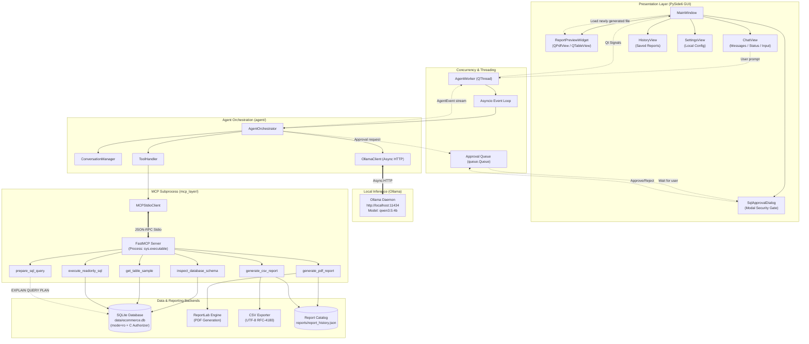
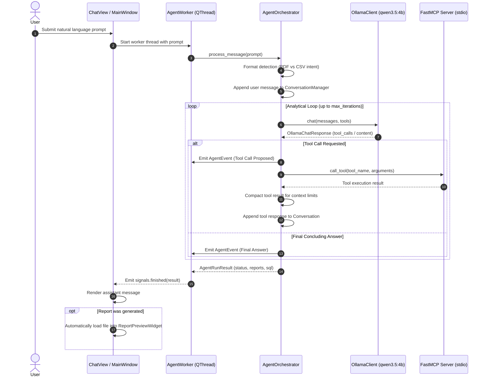
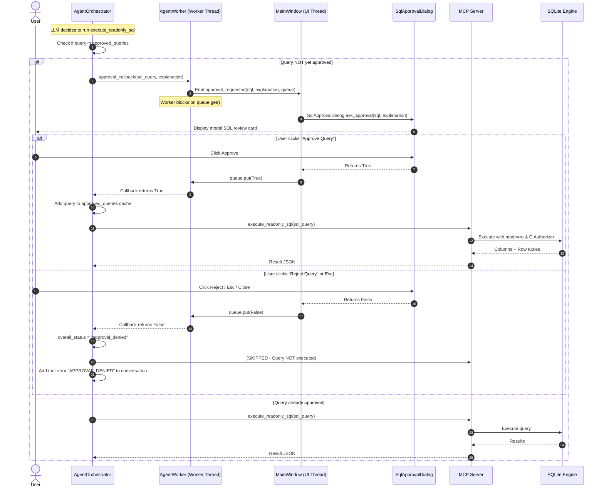
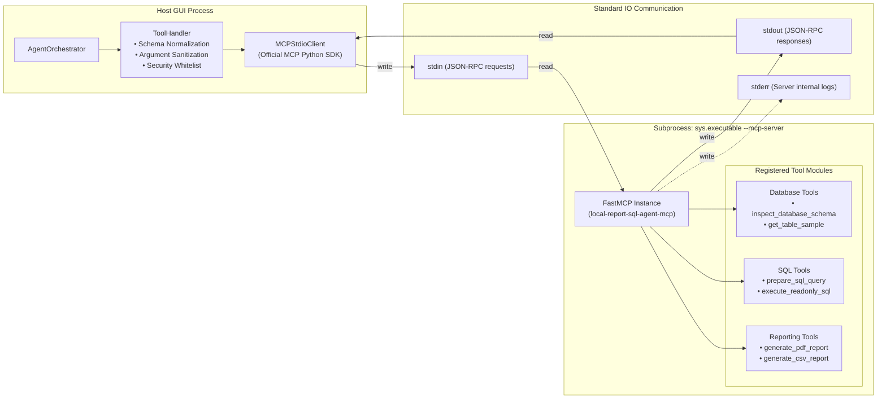

# System Architecture

This document describes the software architecture, component relationships, concurrency model, and data communication protocols of the **Local Report SQL Agent**.

---

## 1. High-Level Architecture Overview

The application is structured into five decoupled architectural layers operating strictly on the local machine:

```
┌────────────────────────────────────────────────────────────────────────┐
│                        1. Presentation Layer (PySide6)                 │
│    MainWindow • ReportPreviewWidget (PDF/CSV) • ChatView • Dialogs     │
└───────────────────────────────────┬────────────────────────────────────┘
                                    │ Cross-thread Signals & Queues
                                    ▼
┌────────────────────────────────────────────────────────────────────────┐
│                        2. Orchestration Layer (agent/)                 │
│      AgentOrchestrator • ConversationManager • ToolHandler • Client    │
└───────────────────┬────────────────────────────────┬───────────────────┘
                    │                                │
      HTTP / JSON   │                                │ JSON-RPC Stdio
                    ▼                                ▼
┌───────────────────────────────┐  ┌─────────────────────────────────────┐
│    Local LLM Service (Ollama) │  │    3. Protocol Layer (mcp_layer/)   │
│   Host: http://localhost:11434│  │      FastMCP Server (Subprocess)    │
│       Model: qwen3.5:4b       │  │  inspect • sample • prepare • exec  │
└───────────────────────────────┘  └───────────────┬─────────────────────┘
                                                   │
                           ┌───────────────────────┴─────────────────────┐
                           │                                             │
                           ▼                                             ▼
             ┌───────────────────────────┐                 ┌───────────────────────────┐
             │   4. Relational Storage   │                 │   5. Reporting Engines    │
             │     (database/)           │                 │      (reporting/)         │
             │ SQLite (data/ecommerce.db)│                 │  ReportLab PDF Generator  │
             │ Read-Only + C Authorizer  │                 │  RFC-4180 CSV Exporter    │
             └───────────────────────────┘                 └───────────────────────────┘
```

---

## 2. Architecture Diagrams

### A. Overall System Architecture



---

### B. Agent Request Lifecycle



---

### C. SQL Approval and Execution Lifecycle



---

### D. MCP Tool Communication Architecture



---

## 3. Component Responsibilities

### 1. Presentation Layer (`app/`)
* **`app/main_window.py` (`MainWindow`)**: Central window orchestrating layout, split pane resizing, menu actions, report opening, and background thread lifecycle management. Implements a safe `closeEvent` hook to cancel active workers and cleanly shut down subprocesses without crashing Qt.
* **`app/widgets/report_preview_widget.py` (`ReportPreviewWidget`)**: Workspace displaying rendered reports using `QStackedWidget`:
  - **PDF View**: Uses official Qt 6 `QPdfView` and `QPdfDocument`. Implements page navigation, zoom factor controls, fit-to-width, fit-to-page, and system file launcher.
  - **CSV View**: Uses `QTableView` backed by custom `CsvTableModel` (`app/models/csv_table_model.py`) with memory-bounded row previewing.
* **`app/views/chat_view.py` (`ChatView`)**: Lateral conversational feed. Renders `MessageWidget` cards, inline SQL code previews (`SqlPreviewWidget`), progress activity bars, and multi-line user text input.
* **`app/dialogs/sql_approval_dialog.py` (`SqlApprovalDialog`)**: Modal security dialog presenting SQL statements, explanations, database target, and warnings. The default action is strictly **Reject** to prevent accidental confirmation.
* **`app/views/history_view.py` (`HistoryView`)**: Dialog displaying historical report records from `report_history.json`. Supports instant loading into the workspace preview or opening in native system applications.
* **`app/views/settings_view.py` (`SettingsView`)**: Dialog for configuring Ollama connection parameters, model selection, execution timeouts, and row caps. Includes an interactive live connectivity test.

### 2. Concurrency & Threading Layer (`app/workers/`)
* **`app/workers/agent_worker.py` (`AgentWorker`)**: Subclasses `QThread`. Runs a private `asyncio` event loop so that asynchronous HTTP requests to Ollama and stdio IPC calls to the FastMCP server never block the GUI thread.
* **`queue.Queue` Cross-Thread Approval Bridge**: When the agent requires SQL execution confirmation, `AgentWorker` emits a Qt signal to the main thread with a thread-safe `queue.Queue[bool]`. The worker thread pauses on `queue.get()`, the UI thread displays `SqlApprovalDialog`, and the user's choice is returned via `queue.put()`.

### 3. Agent Orchestration Layer (`agent/`)
* **`agent/orchestrator.py` (`AgentOrchestrator`)**: Drives the multi-turn conversational loop, intent steering (PDF default vs explicit CSV), event broadcasting, and SQL approval verification.
* **`agent/ollama_client.py` (`OllamaClient`)**: High-performance HTTP client using `httpx.AsyncClient`. Connects exclusively to local hosts, validates endpoints, parses native function calling schemas, extracts CoT `<think>` tags, and supports structured JSON fallback.
* **`agent/tool_handler.py` (`ToolHandler`)**: Security whitelist gateway for MCP tools. Validates tool arguments against strict schemas, sanitizes parameters, enforces tool timeouts, and prevents schema corruption from nullable types.
* **`agent/conversation.py` (`ConversationManager`)**: Manages conversation history within context window bounds (`num_ctx = 8192`). Guarantees that assistant tool calls and their corresponding tool execution results are never split across context compaction boundaries.

### 4. Protocol Layer (`mcp_layer/`)
* **`mcp_layer/server.py`**: FastMCP stdio server registering the 6 tools and configuring process isolation and file-only logging (suppressing console output to prevent JSON-RPC pipe pollution).
* **`mcp_layer/client.py` (`MCPStdioClient`)**: Manages the child subprocess lifecycle and executes JSON-RPC 2.0 tool calls over stdio. Automatically detects development mode (`python -m mcp_layer.server`) versus packaged executable mode (`sys.executable --mcp-server`).
* **Tool Modules (`mcp_layer/tools/`)**: Modular packages for `database_tools.py`, `sql_tools.py` (housing `validate_and_prepare_sql`, the custom Python lexical tokenizer `_tokenize_sql`, and SQLite `EXPLAIN QUERY PLAN` validation using a read-only authorizer connection), and `reporting_tools.py`.

### 5. Storage & Database Layer (`database/`)
* **`database/importer.py`**: Batch-streaming importer converting raw CSV/ZIP datasets into `data/ecommerce.db` with foreign key constraints, indexes, and transactional rollbacks.
* **`database/schema_inspector.py`**: Reusable introspection utility extracting table names, SQLite column affinities, primary keys, foreign keys, and row counts without hardcoded assumptions.
* **`database/query_executor.py`**: Read-only query execution engine enforcing `mode=ro`, `PRAGMA query_only = ON`, hard row limits, query timeouts, and a low-level SQLite C-authorizer.
* **`database/connection.py`**: SQLite connection helpers providing URI percent-encoding, `mode=ro`, and read-write connection factories.

### 6. Reporting Layer (`reporting/`)
* **`reporting/pdf_generator.py`**: ReportLab engine generating paginated, publication-quality PDF documents with executive summary cards, KPI blocks, formatted tabular grids, auto-wrapping, and running headers/footers (`Page X of Y`).
* **`reporting/csv_generator.py`**: RFC-4180 compliant CSV generator handling UTF-8 encoding, null value representations (`""`), and quoting.
* **`reporting/report_manager.py`**: Manages report file naming, atomic filesystem writes, directory traversal prevention, and catalog updates in `reports/report_history.json`.

---

## 4. Concurrency & Communication Model

1. **GUI Main Thread**: Runs the Qt 6 event loop (`QApplication.exec()`). Manages visual component rendering, animations, user input events, and modal dialog presentation.
2. **Agent Worker Thread (`QThread`)**: Executes background inference and MCP communication. Runs a dedicated `asyncio` event loop.
3. **MCP Subprocess**: Spawns an isolated Python child process communicating strictly over anonymous standard input/output pipes (`sys.stdin` / `sys.stdout`).
4. **Ollama Daemon**: External local service running at `http://localhost:11434`. Handled asynchronously via non-blocking HTTP requests.

---

## 5. Execution Modes

* **Development Mode (from source)**:
  - Invoked with `.venv/bin/python run_app.py`.
  - Child MCP server is spawned via `[sys.executable, "-m", "mcp_layer.server"]`.
  - Storage paths resolve relative to the repository root.
* **Packaged Mode (`sys.frozen`)**:
  - Invoked via standalone executable or macOS bundle (`ReportSQLAgent.app`).
  - Read-only bundled assets (reference database, fonts) resolve from `sys._MEIPASS` (`resource_root()`).
  - Mutable application state (custom settings, generated PDF/CSV reports, log files, report history) resolves from standard operating system user application directories (`user_data_root()`):
    - macOS: `~/Library/Application Support/ReportSQLAgent`
    - Windows: `%APPDATA%\ReportSQLAgent`
    - Linux: `~/.local/share/ReportSQLAgent`
  - Child MCP server is spawned directly via `[sys.executable, "--mcp-server"]`, removing any dependency on external or system Python installations.

