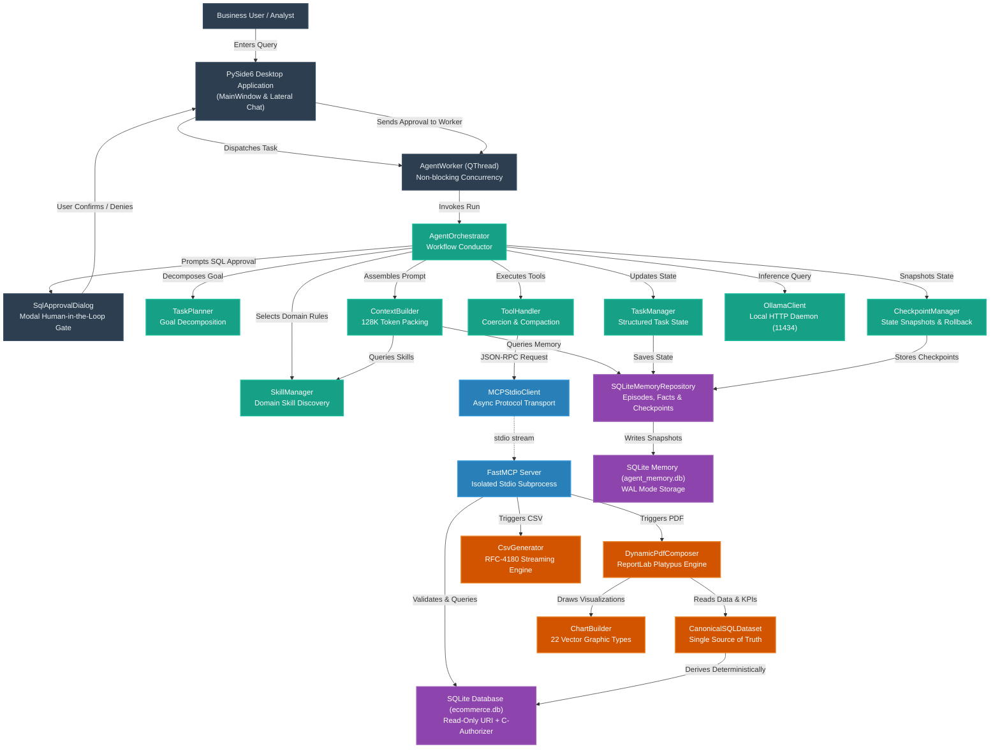

# Local Report SQL Agent — Complete System Reference & Architecture Guide

**Project Title**: Local Report SQL Agent  
**Language**: Python 3.11+ / PySide6 / SQLite / FastMCP / ReportLab  
**Target Environment**: 100% Offline Local Desktop (macOS / Windows / Linux)  
**Hardware & Inference**: Local Ollama Daemon (`qwen3.5:4b`)  
**Database**: SQLite (`data/ecommerce.db`, 499,385 records across 7 tables)  
**Deliverable**: Comprehensive Master Reference Document (`docs/COMPLETE_SYSTEM_REFERENCE.md`)  

---

## Table of Contents
1. [Executive Summary & System Overview](#1-executive-summary--system-overview)
2. [Global System Knowledge Graph](#2-global-system-knowledge-graph)
3. [Project Directory & File Structure](#3-project-directory--file-structure)
4. [Subsystem Components & Class Reference](#4-subsystem-components--class-reference)
5. [Model Context Protocol (FastMCP) Tools Specification](#5-model-context-protocol-fastmcp-tools-specification)
6. [Terminology, Definitions & Enums](#6-terminology-definitions--enums)
7. [Comprehensive Exception Taxonomy](#7-comprehensive-exception-taxonomy)
8. [End-to-End System Execution Lifecycle ("How Does It Work?")](#8-end-to-end-system-execution-lifecycle-how-does-it-work)
9. [Configurable Agent Context Window & Ollama Validation](#9-configurable-agent-context-window--ollama-validation)
10. [Multi-Layer Defensive Security Invariants](#10-multi-layer-defensive-security-invariants)
11. [Detailed Documentation Cross-Reference](#11-detailed-documentation-cross-reference)

---

## 1. Executive Summary & System Overview

The **Local Report SQL Agent** is a production-grade, privacy-preserving desktop application that enables business analysts and non-technical stakeholders to query complex enterprise databases using natural language, safely executes read-only SQL queries under mandatory human supervision, and compiles publication-quality PDF and CSV business reports.

### Key Capabilities
- **100% Offline & Private**: Zero external cloud API calls. All inference is processed locally via Ollama (`qwen3.5:4b`), and all data resides in local SQLite storage.
- **Genuine Model Context Protocol (FastMCP)**: Tools execute inside an isolated child subprocess communicating over JSON-RPC 2.0 stdio, decoupling tool execution from LLM reasoning.
- **Defensive Multi-Layer Security**: Combines SQLite URI read-only connections (`mode=ro`), internal query-only pragmas, native C-authorizer callbacks (`sqlite3_set_authorizer`), opcode watchdog timers, and modal human-in-the-loop review gates.
- **Deterministic Reporting**: Enforces that all displayed numbers, KPI cards, and vector charts derive directly from the SQL result set (the Single Source of Truth). The LLM never invents data.
- **Configurable Context Window (128K Default)**: Centrally managed and validated context budget supporting 32K, 64K, 128K, and 256K tiers with dynamic priority-based token allocation and zero silent truncation.
- **Integrated Desktop GUI**: Built with PySide6, featuring split-pane workspace viewing with embedded native multi-page PDF viewing (`QPdfView`), tabular CSV grid viewing (`QTableView`), formatted SQL preview, activity inspection, and interactive lateral chat.

---

## 2. Global System Knowledge Graph

The following directed diagram illustrates the primary systems, components, protocols, and data stores, mapping how information flows through the application.



---

## 3. Project Directory & File Structure

```text
FinalProject_SQLAgent/
├── run_app.py                          # Application entry point and crash logger
├── ReportSQLAgent.spec                 # PyInstaller standalone & bundle packaging spec
├── requirements.txt                    # Pinned Python package dependencies
├── pytest.ini                         # Pytest configuration and test filters
├── README.md                          # Repository overview and quickstart
├── BUILD.md                           # Packaging and multi-platform compilation guide
├── PHASE_6_INTEGRATION_REPORT.md      # Phase 6 verification & audit deliverable
├── Manual_Prompts_Sample.md           # Sample test prompts for natural language queries
│
├── agent/                             # Core Agent Intelligence & Orchestration Layer
│   ├── orchestrator.py                # Central workflow coordinator & event dispatcher
│   ├── task_models.py                 # Task, TaskStep, TaskPlan, and status enums
│   ├── task_manager.py                # Structured task execution state & SQLite sync
│   ├── task_planner.py                # Goal decomposition & reusable step generation
│   ├── context_models.py              # ContextSection, priorities, and token reports
│   ├── context_builder.py             # Context window allocation (32K-256K) & packing
│   ├── checkpoint_models.py           # Checkpoint metadata, types, and recovery policies
│   ├── checkpoint_manager.py          # State persistence, rollback, and recovery
│   ├── skill_models.py                # Skill metadata schema, YAML parser, token estimator
│   ├── skill_manager.py               # Deterministic skill discovery & Kahn cycle resolution
│   ├── ollama_client.py               # Local Ollama HTTP client & context validator
│   ├── tool_handler.py                # MCP tool execution, parameter coercion & retry
│   ├── conversation.py                # Chat history management & tool output compactor
│   ├── events.py                      # Activity events, categories, and PII masking
│   └── system_prompt.py               # Dynamic system prompt & operating guidelines
│
├── app/                               # PySide6 Desktop GUI Presentation Layer
│   ├── main.py                        # GUI startup, 5-stage initialization & fatal dialog
│   ├── main_window.py                 # Primary split-view window & workspace controller
│   ├── style.py                       # Modern dark-theme stylesheet definitions
│   ├── dialogs/sql_approval_dialog.py # Human-in-the-loop SQL security confirmation dialog
│   ├── models/csv_table_model.py      # QAbstractTableModel for tabular CSV preview
│   ├── views/chat_view.py             # Lateral conversation feed & prompt input bar
│   ├── views/history_view.py          # Generated reports history browser & open action
│   ├── views/settings_view.py         # Centralized configuration dialog (context/Ollama)
│   ├── widgets/activity_inspector_widget.py # Live token context bar & activity inspector
│   ├── widgets/message_widget.py      # Chat message bubbles with Markdown & tool cards
│   ├── widgets/report_preview_widget.py # Multi-tab native PDF (QPdfView) & CSV viewer
│   ├── widgets/sql_highlighter.py     # PySide6 syntax highlighter for SQL queries
│   ├── widgets/sql_preview_widget.py  # Formatted SQL preview box with copy actions
│   ├── workers/agent_worker.py        # QThread runner for non-blocking agent tasks
│   └── workers/worker_signals.py      # Qt signals bridging async asyncio and GUI threads
│
├── config/                            # Global Configuration & Environment Settings
│   ├── settings.py                    # Pydantic v2 settings (Agent, DB, UI, Ollama)
│   ├── paths.py                       # Cross-platform path resolution & frozen bundle detection
│   ├── logging_setup.py               # Rotating file logging & stderr formatter
│   └── prompts.py                     # Static prompt templates & instruction blocks
│
├── database/                          # Relational Storage & SQLite Engine
│   ├── connection.py                  # Read-only URI connection & C-authorizer hooks
│   ├── query_executor.py              # AST inspection, timeout watchdog & row caps
│   ├── schema_inspector.py            # SQLite table, column, and foreign key introspector
│   └── importer.py                    # CSV to SQLite relational schema import engine
│
├── data/                              # Local Datastores & Raw Datasets
│   ├── ecommerce.db                   # Authoritative business database (499,385 records)
│   ├── agent_memory.db                # Agent memory store (episodes, facts, checkpoints)
│   └── raw/                           # Source CSV data files for database creation
│
├── mcp_layer/                         # Model Context Protocol (FastMCP) Layer
│   ├── server.py                      # FastMCP stdio server exposing 6 local tools
│   ├── client.py                      # Async stdio MCP client communicating with server
│   └── tools/                         # MCP Tool Implementations (database, sql, reporting)
│
├── memory/                            # Persistent Agent Memory & Schema Migrations
│   ├── repository.py                  # SQLite memory repository for episodic/semantic items
│   ├── models.py                      # Memory records, facts, and tool execution traces
│   └── migrations/                    # Atomic database migration scripts (001, 002, 003)
│
├── reporting/                         # Deterministic Report Generation Engines
│   ├── canonical_data.py              # Single source of truth dataset & KPI calculator
│   ├── report_spec.py                 # Structured report specification dataclasses
│   ├── dynamic_pdf_composer.py        # ReportLab Platypus multi-component document composer
│   ├── pdf_generator.py               # PDF page templates, canvas numbering & styles
│   ├── csv_generator.py               # RFC-4180 compliant CSV export engine
│   ├── chart_builder.py               # 22 vector chart renderers (ReportLab graphics)
│   ├── chart_registry.py              # Chart type registry and capability validator
│   ├── report_manager.py              # Report metadata tracking & directory manager
│   └── date_utils.py                  # Financial calendar calculations & date helpers
│
├── skills/                            # Markdown & YAML Domain Skill Definitions
│   ├── sql/                           # SQL query generation best practices
│   ├── reporting/                     # Business report design standards
│   ├── data_analysis/                 # Exploratory data analysis guidelines
│   └── data_validation/               # Data verification & sanity checks
│
├── scripts/                           # Build, Deployment & Acceptance Scripts
│   ├── build_macos.sh                 # macOS PyInstaller build script & bundle verifier
│   ├── build_windows.ps1              # Windows PowerShell packaging script
│   ├── verify_environment.py          # Pre-build & runtime environment verifier
│   └── import_dataset.py              # Command-line CSV to SQLite data importer
│
├── tests/                             # Comprehensive Automated Test Suite (457 tests across 36 modules)
└── docs/                              # Project Documentation Corpus
```

---

## 4. Subsystem Components & Class Reference

### 4.1 Orchestration & Planning (`agent/`)

#### [`AgentOrchestrator`](file:///Users/stefanapopa/Documents/8)%20DOCUMENTE%20BOGDAN/7_Projects/Applied-Computational-Intelligence-UBB/Year2_Semester1_DeclarativeProgrammingMachineLearning/FinalProject_SQLAgent/agent/orchestrator.py)
* **Role**: Primary workflow conductor coordinating Ollama inference, tool calls, security gates, and reporting pipelines.
* **Key Attributes**:
  - `effective_context_window: int`: Resolved active token context limit (default `131072`).
  - `ollama_client: OllamaClient`: Async HTTP client for Ollama daemon communication.
  - `mcp_client: MCPStdioClient`: Async stdio bridge to the FastMCP subprocess.
  - `task_manager: TaskManager`: Authoritative structured task state tracker.
  - `context_builder: ContextBuilder`: Dynamic priority-based token packing engine.
* **Key Methods**:
  - `async run(user_prompt: str, approval_cb: ApprovalCallbackType, progress_cb: ProgressCallbackType) -> AgentRunResult`: Orchestrates end-to-end execution.
  - `_execute_task(task: AgentTask, ...) -> AgentRunResult`: Iterates over planned steps with failure recovery.
  - `_handle_tool_call(tool_call: OllamaToolCall, ...) -> Any`: Validates, executes, and compacts MCP tool results.

#### [`TaskPlanner`](file:///Users/stefanapopa/Documents/8)%20DOCUMENTE%20BOGDAN/7_Projects/Applied-Computational-Intelligence-UBB/Year2_Semester1_DeclarativeProgrammingMachineLearning/FinalProject_SQLAgent/agent/task_planner.py)
* **Role**: Analyzes intent and constructs ordered execution plans.
* **Key Methods**:
  - `plan_task(goal: str, context: dict[str, Any] | None = None) -> TaskPlan`: Emits structured steps with goal types (`DATABASE_DISCOVERY`, `SQL_ANALYTICS`, `REPORT_GENERATION`, `DATA_EXPORT`).
  - `replan_failed_step(task: AgentTask, failed_step: TaskStep, error_msg: str) -> list[TaskStep]`: Generates corrective recovery steps upon failure.

#### [`TaskManager`](file:///Users/stefanapopa/Documents/8)%20DOCUMENTE%20BOGDAN/7_Projects/Applied-Computational-Intelligence-UBB/Year2_Semester1_DeclarativeProgrammingMachineLearning/FinalProject_SQLAgent/agent/task_manager.py)
* **Role**: Manages task and step state transitions and synchronizes state to SQLite storage (`data/agent_memory.db`).
* **Key Methods**:
  - `create_task(goal: str, plan: TaskPlan) -> AgentTask`
  - `start_step(task_id: str, step_id: str) -> TaskStep`
  - `complete_step(task_id: str, step_id: str, output: Any) -> TaskStep`
  - `fail_step(task_id: str, step_id: str, error: str) -> TaskStep`

#### [`ContextBuilder`](file:///Users/stefanapopa/Documents/8)%20DOCUMENTE%20BOGDAN/7_Projects/Applied-Computational-Intelligence-UBB/Year2_Semester1_DeclarativeProgrammingMachineLearning/FinalProject_SQLAgent/agent/context_builder.py)
* **Role**: Dynamically allocates token budget within the effective context window (32K to 256K).
* **Key Invariant**:
  $$\text{Input Tokens} \le \text{Effective Context} - \text{Reserved Output} - \text{Safety Margin}$$
* **Key Methods**:
  - `build_context(stage: ExecutionStage, user_prompt: str, ...) -> AssembledContext`: Sorts sections by priority (`MANDATORY`, `HIGH`, `MEDIUM`, `LOW`) and packs within budget without silent truncation.

#### [`CheckpointManager`](file:///Users/stefanapopa/Documents/8)%20DOCUMENTE%20BOGDAN/7_Projects/Applied-Computational-Intelligence-UBB/Year2_Semester1_DeclarativeProgrammingMachineLearning/FinalProject_SQLAgent/agent/checkpoint_manager.py)
* **Role**: Captures immutable execution snapshots for recovery and rollback.
* **Key Methods**:
  - `create_checkpoint(task_id: str, checkpoint_type: CheckpointType, state: dict[str, Any]) -> TaskCheckpoint`
  - `restore_checkpoint(checkpoint_id: str) -> TaskCheckpoint`

#### [`SkillManager`](file:///Users/stefanapopa/Documents/8)%20DOCUMENTE%20BOGDAN/7_Projects/Applied-Computational-Intelligence-UBB/Year2_Semester1_DeclarativeProgrammingMachineLearning/FinalProject_SQLAgent/agent/skill_manager.py)
* **Role**: Discovers, parses, and loads Markdown domain skills.
* **Key Methods**:
  - `discover_skills() -> list[SkillMetadata]`: Validates YAML metadata and uses Kahn's algorithm for dependency cycle detection.
  - `get_skills_for_stage(stage: ExecutionStage) -> list[LoadedSkill]`: Loads only stage-relevant skills.

#### [`OllamaClient`](file:///Users/stefanapopa/Documents/8)%20DOCUMENTE%20BOGDAN/7_Projects/Applied-Computational-Intelligence-UBB/Year2_Semester1_DeclarativeProgrammingMachineLearning/FinalProject_SQLAgent/agent/ollama_client.py)
* **Role**: Communicates with the local Ollama daemon over HTTP loopback.
* **Key Features**:
  - Inspects `/api/show` to validate model context capabilities.
  - Applies `options: {"num_ctx": effective_context_window}` to every request.
  - Implements automatic dual-mode fallback: native tool calling $\rightarrow$ structured JSON extraction upon XML syntax errors.

---

### 4.2 Storage & Security Layer (`database/` & `memory/`)

#### [`DatabaseConnectionManager` Helpers](file:///Users/stefanapopa/Documents/8)%20DOCUMENTE%20BOGDAN/7_Projects/Applied-Computational-Intelligence-UBB/Year2_Semester1_DeclarativeProgrammingMachineLearning/FinalProject_SQLAgent/database/connection.py)
* `connect_readonly(path: str | Path, immutable: bool = False) -> sqlite3.Connection`:
  - Opens connections with `file:...mode=ro` URI.
  - Executes `PRAGMA query_only = ON`.

#### [`QueryExecutor`](file:///Users/stefanapopa/Documents/8)%20DOCUMENTE%20BOGDAN/7_Projects/Applied-Computational-Intelligence-UBB/Year2_Semester1_DeclarativeProgrammingMachineLearning/FinalProject_SQLAgent/database/query_executor.py)
* **Five Security Layers**:
  1. URI connection mode: `mode=ro`.
  2. Pragma enforcement: `PRAGMA query_only = ON`.
  3. C-Authorizer callback: permits only `SQLITE_SELECT`, `SQLITE_READ`, safe functions, and recursive CTEs; blocks `load_extension` and `fts3_tokenizer`.
  4. VM Opcode watchdog (`sqlite3_progress_handler`): cancels queries exceeding 30.0s timeout.
  5. Bounded fetch (`fetchmany(max_rows + 1)`): enforces row count limits (default 5,000).

#### [`SQLiteMemoryRepository`](file:///Users/stefanapopa/Documents/8)%20DOCUMENTE%20BOGDAN/7_Projects/Applied-Computational-Intelligence-UBB/Year2_Semester1_DeclarativeProgrammingMachineLearning/FinalProject_SQLAgent/memory/repository.py)
* Manages persistence in `data/agent_memory.db` in SQLite WAL mode.
* Stores working memory items, episodic query executions, semantic domain facts, and task checkpoints.

---

### 4.3 Reporting Engines (`reporting/`)

#### [`CanonicalSQLDataset`](file:///Users/stefanapopa/Documents/8)%20DOCUMENTE%20BOGDAN/7_Projects/Applied-Computational-Intelligence-UBB/Year2_Semester1_DeclarativeProgrammingMachineLearning/FinalProject_SQLAgent/reporting/canonical_data.py)
* Serves as the authoritative Single Source of Truth for all report components.
* Computes deterministic KPIs (Gross Sales, Net Revenue, Orders, Transactions, AOV) and validates numeric column types.
* Strict metric separation: Gross Sales (order item totals) vs Net Revenue (actual payments); vertical AOV strictly computed as Net Revenue / Orders without cross-unit horizontal summing.

#### [`ReportDatasetRegistry`](file:///Users/stefanapopa/Documents/8)%20DOCUMENTE%20BOGDAN/7_Projects/Applied-Computational-Intelligence-UBB/Year2_Semester1_DeclarativeProgrammingMachineLearning/FinalProject_SQLAgent/reporting/dataset_registry.py)
* Curates, registers, and categorizes query results into semantic roles (`canonical_kpis`, `status_distribution`, `historical_trend`, `crosstab_matrix`).
* Manages `CuratedDataset` instances, enforcing valid column naming, tabular row normalization, and deduplication.

#### [`ReportDataValidator`](file:///Users/stefanapopa/Documents/8)%20DOCUMENTE%20BOGDAN/7_Projects/Applied-Computational-Intelligence-UBB/Year2_Semester1_DeclarativeProgrammingMachineLearning/FinalProject_SQLAgent/reporting/report_validator.py)
* Four-stage verification gate executed before PDF/CSV generation:
  1. *Schema Validation*: Verifies column types, dictionary row structures, and non-empty metadata.
  2. *Strict Chart Eligibility*: Rejects single-slice/100% distribution charts, requires $\ge 2$ time points for trends, and validates 2D pivot crosstabs.
  3. *Cross-Dataset Numerical Consistency*: Ensures matching totals between KPI cards and summary tables.
  4. *Empty Suppression*: Automatically strips unpopulated sections, preventing blank pages and orphan headers.

#### [`PeriodAvailabilityContext` & Date Utilities](file:///Users/stefanapopa/Documents/8)%20DOCUMENTE%20BOGDAN/7_Projects/Applied-Computational-Intelligence-UBB/Year2_Semester1_DeclarativeProgrammingMachineLearning/FinalProject_SQLAgent/reporting/date_utils.py)
* Computes calendar month boundaries (`calculate_calendar_month`) and evaluates database date coverage (`resolve_requested_period`).
* When requested period has no records (e.g. October 2026 when database coverage ends September 2026), flags `has_requested_data=False` and designates the latest available month as comparison.

#### [`DynamicPdfComposer`](file:///Users/stefanapopa/Documents/8)%20DOCUMENTE%20BOGDAN/7_Projects/Applied-Computational-Intelligence-UBB/Year2_Semester1_DeclarativeProgrammingMachineLearning/FinalProject_SQLAgent/reporting/dynamic_pdf_composer.py)
* Assembles ReportLab Platypus documents: header banner, Data Availability Notice (Red/Pink callout banner when requested period has no data), dual KPI grid (Requested Period vs Comparison Period), 25 vector chart types, paginated tables with alternating row shading, narrative findings, and monospace SQL appendix.
* Implements two-pass `NumberedCanvas` emitting `"Page X of Y"` and `LongTable` pagination wrapping across page boundaries.

#### [`ChartRegistry` & `ChartBuilder`](file:///Users/stefanapopa/Documents/8)%20DOCUMENTE%20BOGDAN/7_Projects/Applied-Computational-Intelligence-UBB/Year2_Semester1_DeclarativeProgrammingMachineLearning/FinalProject_SQLAgent/reporting/chart_registry.py)
* Renders 25 supported vector chart types across Comparison, Trend, Distribution, Relationship, Hierarchical, and Matrix categories using native ReportLab graphics.

#### [`CsvGenerator`](file:///Users/stefanapopa/Documents/8)%20DOCUMENTE%20BOGDAN/7_Projects/Applied-Computational-Intelligence-UBB/Year2_Semester1_DeclarativeProgrammingMachineLearning/FinalProject_SQLAgent/reporting/csv_generator.py)
* Streaming RFC-4180 compliant CSV export engine encoded with UTF-8-SIG (BOM) for Excel compatibility.

---

### 4.4 Desktop GUI Layer (`app/`)

#### [`MainWindow`](file:///Users/stefanapopa/Documents/8)%20DOCUMENTE%20BOGDAN/7_Projects/Applied-Computational-Intelligence-UBB/Year2_Semester1_DeclarativeProgrammingMachineLearning/FinalProject_SQLAgent/app/main_window.py)
* Split-pane desktop window hosting Report Workspace tabs (PDF preview, CSV preview, SQL preview) and lateral ChatView.

#### [`SqlApprovalDialog`](file:///Users/stefanapopa/Documents/8)%20DOCUMENTE%20BOGDAN/7_Projects/Applied-Computational-Intelligence-UBB/Year2_Semester1_DeclarativeProgrammingMachineLearning/FinalProject_SQLAgent/app/dialogs/sql_approval_dialog.py)
* Modal security gate presenting formatted SQL, syntax highlighting, affected tables, and row scan impact for explicit human confirmation.

#### [`ActivityInspectorWidget`](file:///Users/stefanapopa/Documents/8)%20DOCUMENTE%20BOGDAN/7_Projects/Applied-Computational-Intelligence-UBB/Year2_Semester1_DeclarativeProgrammingMachineLearning/FinalProject_SQLAgent/app/widgets/activity_inspector_widget.py)
* Real-time observability widget displaying live token context usage, breakdown of input/output/safety buffers, and audit event feed.

#### [`AgentWorker`](file:///Users/stefanapopa/Documents/8)%20DOCUMENTE%20BOGDAN/7_Projects/Applied-Computational-Intelligence-UBB/Year2_Semester1_DeclarativeProgrammingMachineLearning/FinalProject_SQLAgent/app/workers/agent_worker.py)
* `QThread` executing the asyncio event loop and orchestrator off the main GUI thread, bridging events via Qt signals.

---

## 5. Model Context Protocol (FastMCP) Tools Specification

The FastMCP server ([`mcp_layer/server.py`](file:///Users/stefanapopa/Documents/8)%20DOCUMENTE%20BOGDAN/7_Projects/Applied-Computational-Intelligence-UBB/Year2_Semester1_DeclarativeProgrammingMachineLearning/FinalProject_SQLAgent/mcp_layer/server.py)) runs as an isolated subprocess communicating over JSON-RPC 2.0 stdio, exposing six authorized tools:

```text
1. inspect_database_schema(table_name: str | None = None)
   └─ Discovers tables, columns, data types, primary keys, and foreign keys.

2. get_table_sample(table_name: str, limit: int = 5)
   └─ Retrieves bounded sample rows (limit capped at 50) for value inspection.

3. prepare_sql_query(query: str)
   └─ Validates syntax, verifies read-only AST, extracts query execution plan.

4. execute_readonly_sql(query: str, max_rows: int = 5000)
   └─ Executes query with C-authorizer, opcode timeout watchdog, and row cap.

5. generate_pdf_report(title, subtitle, sql_query, columns, rows, findings, kpis, charts, ...)
   └─ Assembles dynamic multi-page ReportLab Platypus PDF with vector charts.

6. generate_csv_report(title, columns, rows, filename = None)
   └─ Streams RFC-4180 compliant CSV file with UTF-8-SIG encoding.
```

For complete schemas and argument constraints, see [TOOLS_AND_MCP_SPECIFICATION.md](file:///Users/stefanapopa/Documents/8)%20DOCUMENTE%20BOGDAN/7_Projects/Applied-Computational-Intelligence-UBB/Year2_Semester1_DeclarativeProgrammingMachineLearning/FinalProject_SQLAgent/docs/TOOLS_AND_MCP_SPECIFICATION.md).

---

## 6. Terminology, Definitions & Enums

### Key Definitions
* **Model Context Protocol (MCP)**: JSON-RPC over stdio protocol isolating tool execution inside a subprocess.
* **Effective Context Window**: The validated token capacity used for requests after verifying Ollama model metadata (`/api/show`).
* **Context Budget Invariant**: Guarantee that $\text{Input Tokens} \le \text{Effective Context} - \text{Reserved Output} - \text{Safety Margin}$.
* **Single Source of Truth**: Principle requiring all report metrics to derive directly from executed SQL query results.
* **C-Authorizer**: Low-level SQLite engine callback intercepting and denying any non-read SQL bytecode operations.
* **Kahn's Algorithm**: Topological sorting algorithm with cycle detection used for domain skill resolution.

### Primary Enums
* `TaskStatus`: `PENDING`, `IN_PROGRESS`, `COMPLETED`, `FAILED`, `CANCELLED`
* `StepStatus`: `PENDING`, `RUNNING`, `COMPLETED`, `FAILED`, `SKIPPED`
* `CheckpointType`: `TASK_CREATED`, `PLAN_READY`, `STEP_STARTED`, `TOOL_EXECUTION`, `STEP_COMPLETED`, `TASK_COMPLETED`, `ERROR_RECOVERY`
* `RecoveryPolicy`: `SAFE_RESUME`, `RETRY_STEP`, `REPLAN_REMAINDER`, `FAIL_FAST`
* `SectionPriority`: `MANDATORY (100)`, `HIGH (75)`, `MEDIUM (50)`, `LOW (25)`
* `ModelCapabilityStatus`: `COMPATIBLE`, `INCOMPATIBLE`, `UNKNOWN`, `REJECTED`

For the complete dictionary of terms and enums, see [TERMINOLOGY_AND_DEFINITIONS.md](file:///Users/stefanapopa/Documents/8)%20DOCUMENTE%20BOGDAN/7_Projects/Applied-Computational-Intelligence-UBB/Year2_Semester1_DeclarativeProgrammingMachineLearning/FinalProject_SQLAgent/docs/TERMINOLOGY_AND_DEFINITIONS.md).

---

## 7. Comprehensive Exception Taxonomy

```mermaid
classDiagram
    class Exception
    class SkillError
    class MigrationError
    class QueryExecutionError
    class OllamaClientError
    class ContextError

    Exception <|-- SkillError
    Exception <|-- MigrationError
    Exception <|-- QueryExecutionError
    Exception <|-- OllamaClientError
    Exception <|-- ContextError

    SkillError <|-- SkillNotFoundError
    SkillError <|-- SkillValidationError
    SkillError <|-- MissingSkillDependencyError
    SkillError <|-- CircularSkillDependencyError
    SkillError <|-- ExcessiveSkillSizeError
    SkillError <|-- SkillSecurityError

    MigrationError <|-- UnsupportedSchemaVersionError

    QueryExecutionError <|-- QueryTimeoutError
    QueryExecutionError <|-- QueryCancelledError
    QueryExecutionError <|-- SQLValidationError

    OllamaClientError <|-- OllamaConnectionError
    OllamaClientError <|-- OllamaTimeoutError
    OllamaClientError <|-- OllamaModelNotFoundError
    OllamaClientError <|-- ModelContextIncompatibleError
    OllamaClientError <|-- OllamaContextSizeRejectedError

    ContextError <|-- ContextBudgetExceededError
```



---

## 8. End-to-End System Execution Lifecycle ("How Does It Work?")

The execution flow follows 13 discrete, sequential phases:

```
[1. User Input in GUI] ──► [2. Worker Thread Dispatch] ──► [3. Intent Analysis & Planning]
                                                                     │
[6. Ollama Local Inference] ◄── [5. Context Allocation (128K)] ◄── [4. Skill & Memory Retrieval]
         │
         ▼
[7. FastMCP Query Validation] ──► [8. Human-in-the-Loop Review Gate]
                                              │ (Approved)
                                              ▼
[11. PDF/CSV Report Generation] ◄── [10. Canonical Dataset] ◄── [9. Read-Only SQL Execution]
         │                                                            (With Self-Healing)
         ▼
[12. Checkpoint Persistence] ──► [13. Native PDF GUI Rendering]
```

1. **Input Submission**: User enters prompt in `ChatView`; `MainWindow` dispatches an `AgentWorker` background thread.
2. **Intent Analysis & Planning**: `AgentOrchestrator` determines output format and triggers `TaskPlanner` to decompose the goal into structured steps.
3. **State Checkpointing**: `CheckpointManager` records snapshot `TASK_CREATED` and `PLAN_READY`.
4. **Skill & Memory Retrieval**: `SkillManager` loads stage-relevant skills (`skills/sql/SKILL.md`); `SQLiteMemoryRepository` retrieves semantic facts.
5. **Context Window Assembly**: `ContextBuilder` calculates available input tokens (129,792 for 128K window) and prioritizes sections from `MANDATORY` down to `LOW`.
6. **Ollama Local Inference**: `OllamaClient` invokes `/api/chat` passing `num_ctx=131072`; LLM emits tool call (e.g., `prepare_sql_query`).
7. **FastMCP Validation**: MCP subprocess validates AST, verifies read-only syntax, and extracts query plan.
8. **Human Review Gate**: `SqlApprovalDialog` opens as a modal window on the GUI thread; user clicks **Approve Query**.
9. **Bounded Execution**: `QueryExecutor` executes SQL with C-authorizer, 30s opcode timeout watchdog, and 5,000 row cap.
10. **Self-Healing Loop**: If a query fails, the agent captures the exact SQLite error and schema metadata, self-correcting the query automatically (up to 3 retries).
11. **Canonical Report Synthesis**: `CanonicalSQLDataset` computes deterministic KPIs; `DynamicPdfComposer` compiles multi-page PDF with ReportLab vector charts.
12. **Persistence**: Final task checkpoint `TASK_COMPLETED` is written to SQLite memory.
13. **Workspace Preview**: Qt signals deliver report path to GUI; `ReportPreviewWidget` renders the PDF natively in `QPdfView`.

For the detailed phase-by-phase breakdown, see [HOW_IT_WORKS_LIFECYCLE.md](file:///Users/stefanapopa/Documents/8)%20DOCUMENTE%20BOGDAN/7_Projects/Applied-Computational-Intelligence-UBB/Year2_Semester1_DeclarativeProgrammingMachineLearning/FinalProject_SQLAgent/docs/HOW_IT_WORKS_LIFECYCLE.md).

---

## 9. Configurable Agent Context Window & Ollama Validation

The application supports four authoritative context window tiers:

| Configuration Tier | Token Limit | Operating Role |
|---|---:|---|
| **32K** | 32,768 | Resource-constrained hardware fallback |
| **64K** | 65,536 | Mid-range local GPU / CPU execution |
| **128K** | 131,072 | **Default Production Baseline** |
| **256K** | 262,144 | Extended multi-table and multi-turn analytical sessions |

### Runtime Model Capability Validation
Before issuing requests, [`OllamaClient`](file:///Users/stefanapopa/Documents/8)%20DOCUMENTE%20BOGDAN/7_Projects/Applied-Computational-Intelligence-UBB/Year2_Semester1_DeclarativeProgrammingMachineLearning/FinalProject_SQLAgent/agent/ollama_client.py) queries `/api/show` to inspect model metadata:
- **Compatible**: Model context $\ge$ configured window $\rightarrow$ configured limit used.
- **Incompatible**: Model context $<$ configured window $\rightarrow$ execution halts with `ModelContextIncompatibleError`; never silently fakes context size.
- **Unknown**: Safe fallback policy applied (32K).
- **Rejected**: Out-of-memory or size rejections surface as `OllamaContextSizeRejectedError`.

---

## 10. Multi-Layer Defensive Security Invariants

The architecture enforces strict security controls across all layers:

1. **OS / VFS Read-Only Connection**: SQLite connections are opened via URI: `file:ecommerce.db?mode=ro`.
2. **Internal SQLite Read-Only Pragma**: Every connection executes `PRAGMA query_only = ON`.
3. **C-Authorizer Engine Hook**: Low-level callback (`_readonly_authorizer`) restricts execution to `SQLITE_SELECT`, `SQLITE_READ`, safe functions, and recursive CTEs. Blocks `load_extension` and `fts3_tokenizer`.
4. **Opcode Watchdog Timeout**: `sqlite3_progress_handler` cancels runaway queries exceeding 30.0 seconds.
5. **Memory-Bounded Fetch**: Queries execute with `cursor.fetchmany(max_rows + 1)` (capped at 5,000 rows).
6. **Mandatory Human-in-the-Loop Review**: No database query is executed without explicit approval in `SqlApprovalDialog`.
7. **Database Integrity Invariant**: `data/ecommerce.db` SHA-256 hash must remain bit-for-bit identical:
   `c5a5965e000becdb75d0802897cb047dc2f827d1fdc7bacdf9d53ef7a46b6934`

---

## 11. Detailed Documentation Cross-Reference

To inspect specific subsystems in granular detail, consult the modular documentation suite:

* **[PROJECT_STRUCTURE_AND_DIRECTORIES.md](file:///Users/stefanapopa/Documents/8)%20DOCUMENTE%20BOGDAN/7_Projects/Applied-Computational-Intelligence-UBB/Year2_Semester1_DeclarativeProgrammingMachineLearning/FinalProject_SQLAgent/docs/PROJECT_STRUCTURE_AND_DIRECTORIES.md)**: File-by-file inventory, package roles, and cross-platform packaging structure.
* **[COMPONENTS_AND_CLASSES.md](file:///Users/stefanapopa/Documents/8)%20DOCUMENTE%20BOGDAN/7_Projects/Applied-Computational-Intelligence-UBB/Year2_Semester1_DeclarativeProgrammingMachineLearning/FinalProject_SQLAgent/docs/COMPONENTS_AND_CLASSES.md)**: In-depth architectural breakdown of every Python class, attributes, methods, and contracts.
* **[TOOLS_AND_MCP_SPECIFICATION.md](file:///Users/stefanapopa/Documents/8)%20DOCUMENTE%20BOGDAN/7_Projects/Applied-Computational-Intelligence-UBB/Year2_Semester1_DeclarativeProgrammingMachineLearning/FinalProject_SQLAgent/docs/TOOLS_AND_MCP_SPECIFICATION.md)**: Exhaustive JSON-RPC schema definitions and guardrails for all 6 FastMCP tools.
* **[KNOWLEDGE_GRAPH_AND_FLOWS.md](file:///Users/stefanapopa/Documents/8)%20DOCUMENTE%20BOGDAN/7_Projects/Applied-Computational-Intelligence-UBB/Year2_Semester1_DeclarativeProgrammingMachineLearning/FinalProject_SQLAgent/docs/KNOWLEDGE_GRAPH_AND_FLOWS.md)**: Visual Mermaid knowledge graphs, sequence diagrams, state machines, and flowcharts.
* **[TERMINOLOGY_AND_DEFINITIONS.md](file:///Users/stefanapopa/Documents/8)%20DOCUMENTE%20BOGDAN/7_Projects/Applied-Computational-Intelligence-UBB/Year2_Semester1_DeclarativeProgrammingMachineLearning/FinalProject_SQLAgent/docs/TERMINOLOGY_AND_DEFINITIONS.md)**: Conceptual glossary, enum specifications, and exception inheritance hierarchies.
* **[HOW_IT_WORKS_LIFECYCLE.md](file:///Users/stefanapopa/Documents/8)%20DOCUMENTE%20BOGDAN/7_Projects/Applied-Computational-Intelligence-UBB/Year2_Semester1_DeclarativeProgrammingMachineLearning/FinalProject_SQLAgent/docs/HOW_IT_WORKS_LIFECYCLE.md)**: Step-by-step walkthrough of the 13-stage request-to-report lifecycle.

