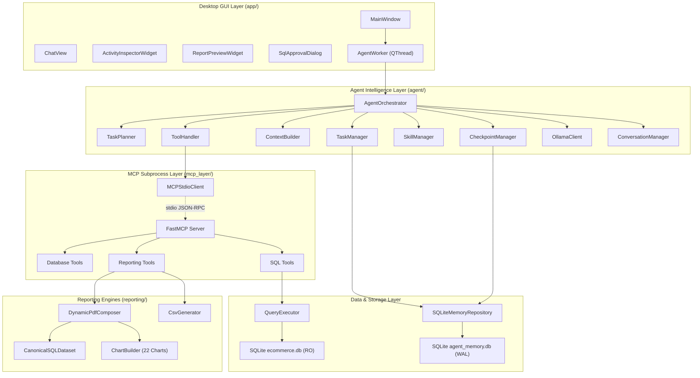

# Detailed Components & Classes Specification

**Project**: Local Report SQL Agent  
**Language**: Python 3.11+ / PySide6 / SQLite / FastMCP  
**Parent Document**: [COMPLETE_SYSTEM_REFERENCE.md](file:///Users/stefanapopa/Documents/8)%20DOCUMENTE%20BOGDAN/7_Projects/Applied-Computational-Intelligence-UBB/Year2_Semester1_DeclarativeProgrammingMachineLearning/FinalProject_SQLAgent/docs/COMPLETE_SYSTEM_REFERENCE.md)

---

## 1. Architectural Component Map

---

## 2. Agent Intelligence Layer (`agent/`)

### 2.1 [`AgentOrchestrator`](file:///Users/stefanapopa/Documents/8)%20DOCUMENTE%20BOGDAN/7_Projects/Applied-Computational-Intelligence-UBB/Year2_Semester1_DeclarativeProgrammingMachineLearning/FinalProject_SQLAgent/agent/orchestrator.py)
The central director coordinating user interaction, task state machines, LLM inference, security approval gates, and reporting pipelines.

* **Primary Responsibilities**:
  - Initializes and binds all intelligence subsystems (`TaskManager`, `TaskPlanner`, `ContextBuilder`, `CheckpointManager`, `SkillManager`, `ToolHandler`, `OllamaClient`).
  - Performs startup validation of Ollama model capabilities and checks context window compatibility.
  - Manages the execution loop: intent classification $\rightarrow$ task planning $\rightarrow$ context construction $\rightarrow$ LLM generation $\rightarrow$ tool execution $\rightarrow$ self-healing $\rightarrow$ report synthesis.
  - Invokes modal human-in-the-loop review before executing database queries.
* **Key Attributes**:
  - `settings: AppSettings`: Authoritative configuration container.
  - `effective_context_window: int`: Resolved active token context limit (default `131072`).
  - `ollama_client: OllamaClient`: Local inference client communicating with Ollama daemon.
  - `mcp_client: MCPStdioClient`: Subprocess stdio transport bridge.
  - `tool_handler: ToolHandler`: Parameter validator and executor for MCP tools.
  - `task_manager: TaskManager`: Active execution state and step tracker.
  - `context_builder: ContextBuilder`: Priority-based token packing engine.
* **Key Methods**:
  - `async run(user_prompt: str, approval_cb: ApprovalCallbackType, progress_cb: ProgressCallbackType) -> AgentRunResult`: Primary workflow entry point.
  - `_execute_task(task: AgentTask, ...) -> AgentRunResult`: Iterates through planned steps, invoking tools and recovering from failures.
  - `_handle_tool_call(tool_call: OllamaToolCall, ...) -> Any`: Dispatches calls to MCP tools with timing, event recording, and result compaction.

### 2.2 [`TaskPlanner`](file:///Users/stefanapopa/Documents/8)%20DOCUMENTE%20BOGDAN/7_Projects/Applied-Computational-Intelligence-UBB/Year2_Semester1_DeclarativeProgrammingMachineLearning/FinalProject_SQLAgent/agent/task_planner.py)
Decomposes user queries into ordered, machine-decidable execution steps before invoking tools.

* **Primary Responsibilities**:
  - Analyzes user prompt intent (schema discovery, metric calculation, PDF reporting, CSV export, validation).
  - Generates a structured [`TaskPlan`](file:///Users/stefanapopa/Documents/8)%20DOCUMENTE%20BOGDAN/7_Projects/Applied-Computational-Intelligence-UBB/Year2_Semester1_DeclarativeProgrammingMachineLearning/FinalProject_SQLAgent/agent/task_models.py) consisting of typed [`TaskStep`](file:///Users/stefanapopa/Documents/8)%20DOCUMENTE%20BOGDAN/7_Projects/Applied-Computational-Intelligence-UBB/Year2_Semester1_DeclarativeProgrammingMachineLearning/FinalProject_SQLAgent/agent/task_models.py) instances.
  - Assigns explicit success criteria and expected tools to each step.
* **Key Methods**:
  - `plan_task(goal: str, context: dict[str, Any] | None = None) -> TaskPlan`: Generates deterministic, reusable execution plan.
  - `replan_failed_step(task: AgentTask, failed_step: TaskStep, error_msg: str) -> list[TaskStep]`: Emits corrective recovery steps (e.g., schema re-inspection or SQL query correction).

### 2.3 [`TaskManager`](file:///Users/stefanapopa/Documents/8)%20DOCUMENTE%20BOGDAN/7_Projects/Applied-Computational-Intelligence-UBB/Year2_Semester1_DeclarativeProgrammingMachineLearning/FinalProject_SQLAgent/agent/task_manager.py)
Maintains authoritative, structured task execution state, eliminating the need to pass unbounded chat history to the LLM.

* **Primary Responsibilities**:
  - Enforces the task state lifecycle: `PENDING` $\rightarrow$ `IN_PROGRESS` $\rightarrow$ `COMPLETED` / `FAILED` / `CANCELLED`.
  - Enforces step state transitions: `PENDING` $\rightarrow$ `RUNNING` $\rightarrow$ `COMPLETED` / `FAILED` / `SKIPPED`.
  - Automatically triggers checkpoints in [`CheckpointManager`](file:///Users/stefanapopa/Documents/8)%20DOCUMENTE%20BOGDAN/7_Projects/Applied-Computational-Intelligence-UBB/Year2_Semester1_DeclarativeProgrammingMachineLearning/FinalProject_SQLAgent/agent/checkpoint_manager.py) on state transitions.
  - Synchronizes task state to persistent SQLite storage (`data/agent_memory.db`).
* **Key Methods**:
  - `create_task(goal: str, plan: TaskPlan) -> AgentTask`: Creates and registers a new task.
  - `start_step(task_id: str, step_id: str) -> TaskStep`: Transitions a step to `RUNNING`.
  - `complete_step(task_id: str, step_id: str, output: Any) -> TaskStep`: Records step output and marks as `COMPLETED`.
  - `fail_step(task_id: str, step_id: str, error: str) -> TaskStep`: Records error details and marks as `FAILED`.

### 2.4 [`ContextBuilder`](file:///Users/stefanapopa/Documents/8)%20DOCUMENTE%20BOGDAN/7_Projects/Applied-Computational-Intelligence-UBB/Year2_Semester1_DeclarativeProgrammingMachineLearning/FinalProject_SQLAgent/agent/context_builder.py)
Dynamic token packing and prioritization engine operating within the effective context window.

* **Primary Responsibilities**:
  - Enforces the Context Budget Invariant:
    $$\text{System} + \text{User} + \text{State} + \text{Memory} + \text{Skills} + \text{Schema} + \text{Tools} + \text{History} \le \text{Effective Context} - \text{Output} - \text{Safety}$$
  - Dynamically packages context according to 4 discrete priority tiers:
    - **`MANDATORY` (Score 100)**: System instructions, stage operational rules, sanitized user request.
    - **`HIGH` (Score 75)**: Relevant stage domain skills, targeted table schemas.
    - **`MEDIUM` (Score 50)**: Structured task state, recent tool results, active conversation window.
    - **`LOW` (Score 25)**: Semantic domain facts, completed step history, older dialogue.
  - Prevents silent truncation: optional sections that exceed remaining capacity are completely excluded and recorded in [`ContextBuildReport`](file:///Users/stefanapopa/Documents/8)%20DOCUMENTE%20BOGDAN/7_Projects/Applied-Computational-Intelligence-UBB/Year2_Semester1_DeclarativeProgrammingMachineLearning/FinalProject_SQLAgent/agent/context_models.py).
* **Key Methods**:
  - `build_context(stage: ExecutionStage, user_prompt: str, ...) -> AssembledContext`: Packages and returns formatted messages for Ollama.

### 2.5 [`CheckpointManager`](file:///Users/stefanapopa/Documents/8)%20DOCUMENTE%20BOGDAN/7_Projects/Applied-Computational-Intelligence-UBB/Year2_Semester1_DeclarativeProgrammingMachineLearning/FinalProject_SQLAgent/agent/checkpoint_manager.py)
Maintains immutable state snapshots at critical points during execution.

* **Primary Responsibilities**:
  - Captures execution state at discrete checkpoints (`TASK_CREATED`, `PLAN_READY`, `STEP_STARTED`, `TOOL_EXECUTION`, `STEP_COMPLETED`, `TASK_COMPLETED`).
  - Implements rollback and recovery policies (`SAFE_RESUME`, `RETRY_STEP`, `REPLAN_REMAINDER`).
  - Eliminates the need to reconstruct conversation history when resuming or recovering tasks.
* **Key Methods**:
  - `create_checkpoint(task_id: str, checkpoint_type: CheckpointType, state: dict[str, Any]) -> TaskCheckpoint`: Persists snapshot.
  - `restore_checkpoint(checkpoint_id: str) -> TaskCheckpoint`: Restores state for rollback or recovery.

### 2.6 [`SkillManager`](file:///Users/stefanapopa/Documents/8)%20DOCUMENTE%20BOGDAN/7_Projects/Applied-Computational-Intelligence-UBB/Year2_Semester1_DeclarativeProgrammingMachineLearning/FinalProject_SQLAgent/agent/skill_manager.py)
Discovers, validates, and loads Markdown-based domain skills.

* **Primary Responsibilities**:
  - Scans `skills/` subdirectories for `metadata.yaml` and `SKILL.md`.
  - Validates semantic versions, descriptions, and file size limits (500 KB cap).
  - Resolves inter-skill dependencies with cycle detection using Kahn's topological sort algorithm.
  - Provides selective stage loading so only relevant skills are placed into context.
  - Enforces path traversal and symlink escape security checks.
* **Key Methods**:
  - `discover_skills() -> list[SkillMetadata]`: Deterministic scan and registry update.
  - `load_skill(skill_id: str) -> LoadedSkill`: Reads markdown documentation and validates constraints.
  - `get_skills_for_stage(stage: ExecutionStage) -> list[LoadedSkill]`: Retrieves skills mapped to the current execution phase.

### 2.7 [`OllamaClient`](file:///Users/stefanapopa/Documents/8)%20DOCUMENTE%20BOGDAN/7_Projects/Applied-Computational-Intelligence-UBB/Year2_Semester1_DeclarativeProgrammingMachineLearning/FinalProject_SQLAgent/agent/ollama_client.py)
Asynchronous HTTP client interfacing with the local Ollama daemon.

* **Primary Responsibilities**:
  - Issues non-streaming and streaming requests to `/api/chat` and `/api/show`.
  - Validates model context capability against the application-configured context window.
  - Sets the authoritative `num_ctx` option on every inference request.
  - Provides seamless automatic fallback: attempts native tool calling first; on HTTP 500 XML syntax or parser errors, automatically retries in structured JSON mode.
* **Key Methods**:
  - `check_model_context_capability(model: str, configured_window: int) -> ModelContextCapability`: Validates supported context size.
  - `chat(messages: list[dict], tools: list[dict] | None, num_ctx: int, ...) -> OllamaChatResponse`: Dispatches chat inference request.

---

## 3. FastMCP Subprocess Layer (`mcp_layer/`)

### 3.1 [`FastMCP Server`](file:///Users/stefanapopa/Documents/8)%20DOCUMENTE%20BOGDAN/7_Projects/Applied-Computational-Intelligence-UBB/Year2_Semester1_DeclarativeProgrammingMachineLearning/FinalProject_SQLAgent/mcp_layer/server.py)
Hosts the standardized Model Context Protocol tools inside an isolated process.

* **Architecture**: Standalone process spawned with `sys.executable -m mcp_layer.server` or `ReportSQLAgent --mcp-server`.
* **Transport**: Communicates strictly over standard input / standard output (`stdio`) using JSON-RPC 2.0.
* **Registered Tools**:
  1. `inspect_database_schema`: Introspects table structures, column datatypes, and foreign keys.
  2. `get_table_sample`: Retrieves bounded rows from a table for exploratory inspection.
  3. `prepare_sql_query`: Formats, parses, and validates read-only SQL queries before execution.
  4. `execute_readonly_sql`: Executes read-only queries with low-level C-authorizer protection.
  5. `generate_pdf_report`: Generates multi-component PDF reports via ReportLab.
  6. `generate_csv_report`: Generates RFC-4180 compliant CSV exports.

### 3.2 [`MCPStdioClient`](file:///Users/stefanapopa/Documents/8)%20DOCUMENTE%20BOGDAN/7_Projects/Applied-Computational-Intelligence-UBB/Year2_Semester1_DeclarativeProgrammingMachineLearning/FinalProject_SQLAgent/mcp_layer/client.py)
Async client running in the main application that manages the child MCP process lifecycle.

* **Primary Responsibilities**:
  - Spawns and monitors the child process.
  - Implements the MCP protocol initialization handshake (`initialize` and `notifications/initialized`).
  - Issues `tools/call` JSON-RPC messages and unpacks structured tool results.
  - Manages process restarts and connection timeouts.

---

## 4. Database & Storage Layer (`database/` & `memory/`)

### 4.1 [`DatabaseConnectionManager` & Helpers](file:///Users/stefanapopa/Documents/8)%20DOCUMENTE%20BOGDAN/7_Projects/Applied-Computational-Intelligence-UBB/Year2_Semester1_DeclarativeProgrammingMachineLearning/FinalProject_SQLAgent/database/connection.py)
* `connect_readonly(path: str | Path, immutable: bool = False) -> sqlite3.Connection`:
  - Builds percent-encoded URI: `file:<path>?mode=ro`.
  - Executes `PRAGMA query_only = ON`.
  - Ensures SQLite VFS layer refuses any write or file modification.
* `connect_readwrite(path: str | Path) -> sqlite3.Connection`:
  - Used exclusively during database dataset initialization.

### 4.2 [`QueryExecutor`](file:///Users/stefanapopa/Documents/8)%20DOCUMENTE%20BOGDAN/7_Projects/Applied-Computational-Intelligence-UBB/Year2_Semester1_DeclarativeProgrammingMachineLearning/FinalProject_SQLAgent/database/query_executor.py)
* **Five Defense Security Layers**:
  1. Read-only URI connection mode (`mode=ro`).
  2. `PRAGMA query_only = ON`.
  3. C-authorizer callback (`_readonly_authorizer`): allows only `SQLITE_SELECT`, `SQLITE_READ`, safe `SQLITE_FUNCTION`, and `SQLITE_RECURSIVE`. Blocks `load_extension` and `fts3_tokenizer`.
  4. VM Opcode watchdog (`sqlite3_progress_handler`): aborts runaway queries exceeding timeout limits (default 30.0s).
  5. Memory-bounded row capping: fetches `max_rows + 1` (default 5,000 rows) to prevent memory exhaustion.

### 4.3 [`SQLiteMemoryRepository`](file:///Users/stefanapopa/Documents/8)%20DOCUMENTE%20BOGDAN/7_Projects/Applied-Computational-Intelligence-UBB/Year2_Semester1_DeclarativeProgrammingMachineLearning/FinalProject_SQLAgent/memory/repository.py)
* Manages persistence in `data/agent_memory.db` with SQLite WAL mode.
* Stores:
  - Working memory items and execution state.
  - Episodic memory of completed queries and user sessions.
  - Semantic domain facts and business knowledge.
  - Checkpoints and task step transitions.
  - Domain skill registry synchronization records.

---

## 5. Reporting Engines (`reporting/`)

### 5.1 [`CanonicalSQLDataset`](file:///Users/stefanapopa/Documents/8)%20DOCUMENTE%20BOGDAN/7_Projects/Applied-Computational-Intelligence-UBB/Year2_Semester1_DeclarativeProgrammingMachineLearning/FinalProject_SQLAgent/reporting/canonical_data.py)
* Serves as the Single Source of Truth for reporting.
* Enforces that all displayed numbers, KPI cards, and charts derive directly and deterministically from the executed SQL result set.
* Calculates automated KPIs: record count, totals, averages, min/max, and percentage changes.

### 5.2 [`DynamicPdfComposer`](file:///Users/stefanapopa/Documents/8)%20DOCUMENTE%20BOGDAN/7_Projects/Applied-Computational-Intelligence-UBB/Year2_Semester1_DeclarativeProgrammingMachineLearning/FinalProject_SQLAgent/reporting/dynamic_pdf_composer.py)
* Implements ReportLab Platypus document composition:
  - Title & metadata header banner.
  - Metric summary cards (KPI grid).
  - High-resolution vector charts with auto-wrapping labels.
  - Long tables with column width calculation, alternate row shading, and repeating headers.
  - Executive narrative findings and takeaways.
  - Optional SQL Query Appendix with monospace query rendering.
  - Dynamic page numbering canvas: `"Page X of Y"`.

### 5.3 [`ChartBuilder`](file:///Users/stefanapopa/Documents/8)%20DOCUMENTE%20BOGDAN/7_Projects/Applied-Computational-Intelligence-UBB/Year2_Semester1_DeclarativeProgrammingMachineLearning/FinalProject_SQLAgent/reporting/chart_builder.py)
* Renders 22 supported vector chart types:
  - **Bar**: Vertical, Horizontal, Grouped, Stacked.
  - **Line & Area**: Historical Line, Multi-Series Line, Area, Stacked Area.
  - **Proportional**: Pie, Donut, Treemap.
  - **Distribution**: Histogram, Density, Box Plot, Violin Plot.
  - **Relational**: Scatter Plot, Bubble Chart.
  - **Matrix**: Correlation Matrix, Heatmap.

---

## 6. Desktop Presentation Layer (`app/`)

### 6.1 [`MainWindow`](file:///Users/stefanapopa/Documents/8)%20DOCUMENTE%20BOGDAN/7_Projects/Applied-Computational-Intelligence-UBB/Year2_Semester1_DeclarativeProgrammingMachineLearning/FinalProject_SQLAgent/app/main_window.py)
* Primary PySide6 desktop interface with horizontal splitter:
  - **Left / Main Pane**: Report Workspace with native PDF preview (`QPdfView`), CSV tabular preview (`QTableView`), and SQL preview.
  - **Right Pane**: Interactive lateral chat interface, status pill, and activity inspector.
* Coordinates asynchronous `AgentWorker` background execution and handles security approval dialogs on the main GUI thread.

### 6.2 [`ActivityInspectorWidget`](file:///Users/stefanapopa/Documents/8)%20DOCUMENTE%20BOGDAN/7_Projects/Applied-Computational-Intelligence-UBB/Year2_Semester1_DeclarativeProgrammingMachineLearning/FinalProject_SQLAgent/app/widgets/activity_inspector_widget.py)
* Provides real-time execution visibility:
  - Live token context bar showing usage vs effective limit (32K / 64K / 128K / 256K).
  - Breakdown of input tokens, output reservation, and safety margin.
  - Detailed audit feed of included and excluded context sections.
  - Step-by-step agent activity events (planning, tool proposals, validation, execution).

### 6.3 [`SqlApprovalDialog`](file:///Users/stefanapopa/Documents/8)%20DOCUMENTE%20BOGDAN/7_Projects/Applied-Computational-Intelligence-UBB/Year2_Semester1_DeclarativeProgrammingMachineLearning/FinalProject_SQLAgent/app/dialogs/sql_approval_dialog.py)
* Modal security gate that halts execution before running queries:
  - Formatted SQL with syntax highlighting ([`SqlHighlighter`](file:///Users/stefanapopa/Documents/8)%20DOCUMENTE%20BOGDAN/7_Projects/Applied-Computational-Intelligence-UBB/Year2_Semester1_DeclarativeProgrammingMachineLearning/FinalProject_SQLAgent/app/widgets/sql_highlighter.py)).
  - Analysis of target tables and projected row scan impact.
  - User options: **Approve Query** or **Deny Query** (with optional guidance sent back to the agent for self-correction).

