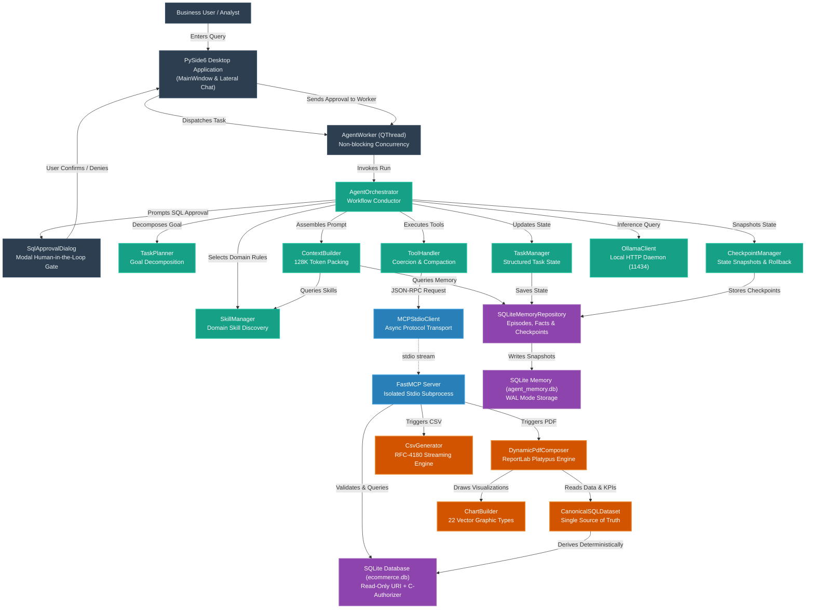
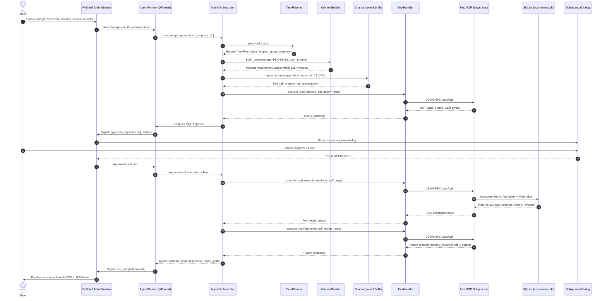
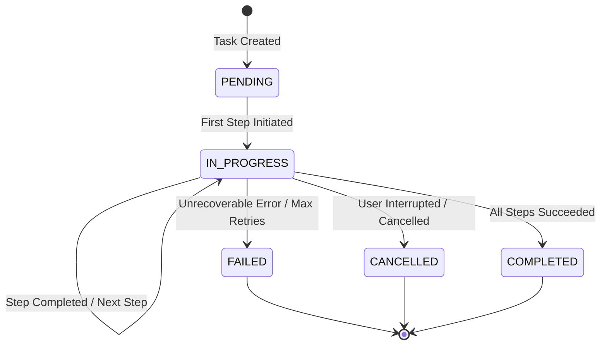
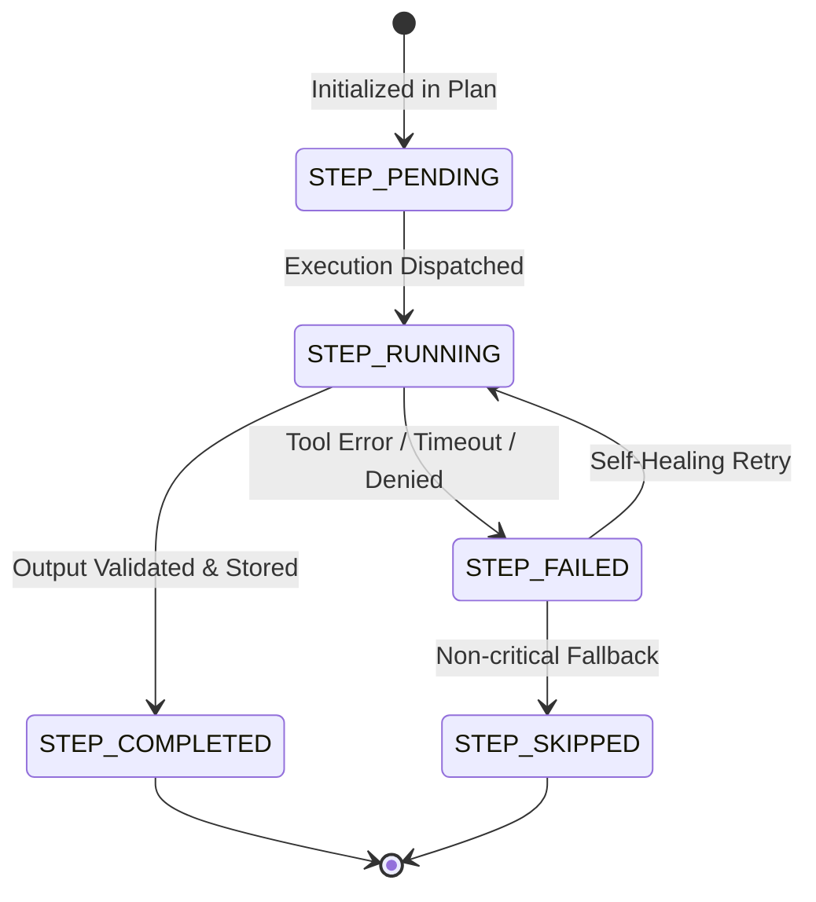
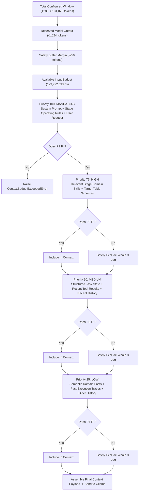
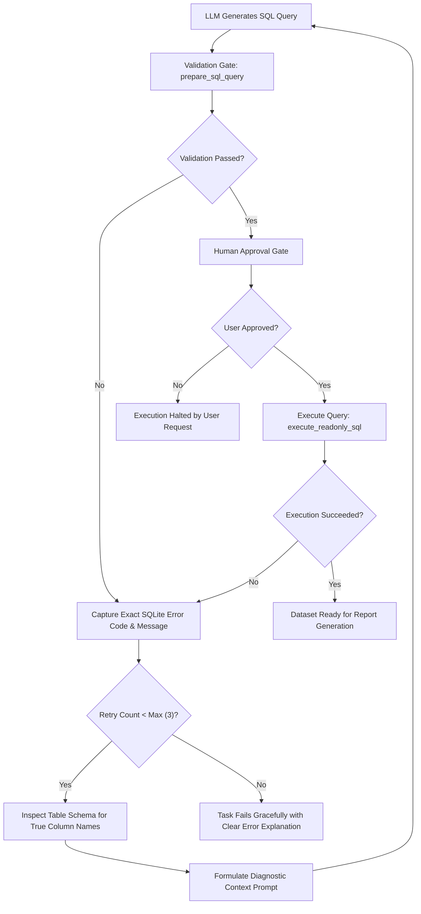

# Knowledge Graphs, State Machines & Execution Flows

**Project**: Local Report SQL Agent  
**Format**: GitHub Flavored Markdown / Mermaid Diagrams  
**Parent Document**: [COMPLETE_SYSTEM_REFERENCE.md](file:///Users/stefanapopa/Documents/8)%20DOCUMENTE%20BOGDAN/7_Projects/Applied-Computational-Intelligence-UBB/Year2_Semester1_DeclarativeProgrammingMachineLearning/FinalProject_SQLAgent/docs/COMPLETE_SYSTEM_REFERENCE.md)

---

## 1. Global System Knowledge Graph

The following directed graph maps all primary systems, components, protocols, and data stores in the application, visualizing their interconnections and operational relationships.

---

## 2. End-to-End Execution Sequence

This sequence diagram depicts the chronological message exchange for a natural language reporting request from user input to rendered report.

---

## 3. Task & Step Lifecycle State Machines

Structured task state machines govern agent execution, guaranteeing that the agent cannot proceed blindly without explicit state validation.

### 3.1 Task State Machine

### 3.2 Task Step State Machine

---

## 4. Context Budget Allocation Flowchart

The ContextBuilder divides the configured context window (default `131,072` tokens) into distinct segments. Optional content is included strictly by priority order until the available budget is exhausted.

---

## 5. Self-Healing SQL Recovery Loop

When a proposed SQL query fails syntax validation, table resolution, or C-authorizer security checks, the agent automatically executes a self-healing loop:

