# Local Report SQL Agent — Complete Technical Reference

**Document Version:** 1.0.0  
**Target System:** Local Report SQL Agent (`FinalProject_SQLAgent`)  
**Execution Model:** 100% Local, Privacy-Preserving Desktop Analytical & Executive Reporting System  
**Primary Stack:** Python 3.10+, PySide6 (Qt6), Local Ollama (`qwen3.5:4b`), Model Context Protocol (MCP over JSON-RPC stdio), SQLite 3, ReportLab, Matplotlib, Pandas  

> **Self-Contained Reference Note:** This document is a standalone, comprehensive architectural and engineering reference for the **Local Report SQL Agent** repository. It is designed to be read independently by university evaluators, software architects, security reviewers, engineers, or AI assistants without requiring access to the source code repository or modular documentation files. Optional relative links to `./solution/...` are provided at the end of sections for readers browsing inside the repository.

---

## Table of Contents

1. [Project Title, Purpose, Scope, Objectives, and Key Features](#1-project-title-purpose-scope-objectives-and-key-features)
2. [Executive Summary and Problem Statement](#2-executive-summary-and-problem-statement)
3. [Functional and Non-Functional Requirements](#3-functional-and-non-functional-requirements)
4. [Technology Stack and Development Environment](#4-technology-stack-and-development-environment)
5. [Complete System Architecture](#5-complete-system-architecture)
6. [Component-by-Component Responsibilities](#6-component-by-component-responsibilities)
7. [Application Startup and Initialization Lifecycle](#7-application-startup-and-initialization-lifecycle)
8. [GUI Architecture and Threading/Concurrency Model](#8-gui-architecture-and-threadingconcurrency-model)
9. [Local Ollama LLM Integration and Communication Model](#9-local-ollama-llm-integration-and-communication-model)
10. [MCP Architecture, Tool Registration, Discovery, Schema Adaptation, and Execution Flow](#10-mcp-architecture-tool-registration-discovery-schema-adaptation-and-execution-flow)
11. [Agent Orchestration, Task Planning, Step Dependencies, and State Transitions](#11-agent-orchestration-task-planning-step-dependencies-and-state-transitions)
12. [System Prompt, Dynamic Context Construction, Token Budgeting, and Context-Window Management](#12-system-prompt-dynamic-context-construction-token-budgeting-and-context-window-management)
13. [SQL Validation, Preparation, Approval, and Read-Only Execution Pipeline](#13-sql-validation-preparation-approval-and-read-only-execution-pipeline)
14. [SQLite Database Architecture and Actual Schema Reference](#14-sqlite-database-architecture-and-actual-schema-reference)
15. [Security Model and Safety Mechanisms](#15-security-model-and-safety-mechanisms)
16. [Skills and Domain Knowledge Loading](#16-skills-and-domain-knowledge-loading)
17. [Working, Episodic, and Semantic Memory Architecture, Checkpoints, and Recovery Mechanisms](#17-working-episodic-and-semantic-memory-architecture-checkpoints-and-recovery-mechanisms)
18. [Canonical Dataset Architecture and Single-Source-of-Truth Reporting Rules](#18-canonical-dataset-architecture-and-single-source-of-truth-reporting-rules)
19. [Reporting Pipeline and Deterministic KPI Calculation](#19-reporting-pipeline-and-deterministic-kpi-calculation)
20. [PDF Generation and CSV Export Architecture](#20-pdf-generation-and-csv-export-architecture)
21. [Supported Charts, Visualizations, Tables, and Layout Mechanisms](#21-supported-charts-visualizations-tables-and-layout-mechanisms)
22. [Error Handling, Retries, Fallbacks, and Degraded Execution Paths](#22-error-handling-retries-fallbacks-and-degraded-execution-paths)
23. [Cross-Platform Packaging and Execution on macOS and Windows](#23-cross-platform-packaging-and-execution-on-macos-and-windows)
24. [Testing Strategy, Test Suites, and Validation Results](#24-testing-strategy-test-suites-and-validation-results)
25. [Configuration Reference and Installation/Setup Guide](#25-configuration-reference-and-installationsetup-guide)
26. [Known Limitations, Operational Assumptions, and Design Trade-Offs](#26-known-limitations-operational-assumptions-and-design-trade-offs)
27. [End-to-End Walkthrough of a Complete User Request from Prompt to Generated Report](#27-end-to-end-walkthrough-of-a-complete-user-request-from-prompt-to-generated-report)
28. [Conclusion and Architectural Rationale](#28-conclusion-and-architectural-rationale)

---

## 1. Project Title, Purpose, Scope, Objectives, and Key Features

### 1.1 Project Title and Purpose

**Local Report SQL Agent** (`ReportSQLAgent`) is a privacy-preserving, offline-capable desktop business intelligence and executive reporting application. It translates natural-language analytical questions into validated, read-only SQLite queries, enforces human-in-the-loop (HITL) query approval, computes deterministic business metrics from an immutable query result snapshot, and synthesizes multi-page executive PDF and CSV reports complete with high-resolution statistical visualizations.

### 1.2 Scope

The system operates entirely on the user's workstation without external cloud LLM dependencies or external network egress:

- **Natural-Language Interface:** Native PySide6 (Qt6) desktop GUI with multi-turn conversational chat, live SQL preview, execution timeline, and report library.
- **Local LLM Reasoning:** Connects exclusively to a local Ollama HTTP server (`http://localhost:11434`) running the `qwen3.5:4b` model with native tool-calling enabled.
- **Process-Isolated Tool Execution:** All database inspection, SQL preparation, read-only SQL execution, and PDF/CSV report generation occur inside a dedicated child subprocess speaking the **Model Context Protocol (MCP)** over standard input/output (`stdio`).
- **Analytical Data Warehouse:** Ships with a deterministic 7-table, 499,385-row retail e-commerce SQLite database (`data/ecommerce.db`) spanning orders from `2024-01-01` through `2026-09-29`.
- **Durable Agent Memory:** Persists task plans, tool traces, checkpoints, recovery attempts, and domain skills in a separate WAL-mode SQLite database (`data/agent_memory.db`).

### 1.3 Core Engineering Objectives

1. **Zero Data Exfiltration:** Ensure no database schema, customer PII, financial figures, or user prompts leave `localhost`.
2. **Deterministic Numerical Integrity:** Prevent LLM numerical hallucinations by computing all KPIs, chart series, and PDF data tables in deterministic Python from a frozen `CanonicalSQLDataset` (`reporting/canonical_data.py`).
3. **Defense-in-Depth SQL Safety:** Guarantee that LLM-generated SQL can never mutate, drop, or corrupt the analytical database through a 5-gate security pipeline combining AST/regex validation (`database/query_validator.py`), mandatory human approval, and SQLite URI `mode=ro` + `PRAGMA query_only = ON` enforcement (`database/connection.py`).
4. **Deterministic MCP Capability Awareness:** Discover and validate all 6 MCP tools before accepting the first user prompt (`agent/orchestrator.py` → `AgentOrchestrator.initialize()`), passing both native Ollama `tools` schemas and a human-readable capability section into the LLM context.
5. **Crash-Safe Resumability:** Persist step-level execution checkpoints (`memory/checkpoint_manager.py`) and detect interrupted runs on application restart (`memory/recovery_service.py`).

### 1.4 Key Features Summary

| Feature Area | Implementation Highlights | Primary Source Modules |
| :--- | :--- | :--- |
| **Desktop GUI** | PySide6 dark-themed interface with Chat, SQL Approval Card, Activity Inspector (5 tabs), Report History, and Settings dialog | `app/main.py`, `app/main_window.py`, `app/widgets/*` |
| **MCP Tool Layer** | FastMCP stdio server exposing 6 structured tools (`inspect_database_schema`, `get_table_sample`, `prepare_sql_query`, `execute_readonly_sql`, `generate_pdf_report`, `generate_csv_report`) | `mcp_layer/server.py`, `mcp_layer/client.py`, `mcp_layer/tools/*` |
| **Agent Orchestrator** | Up to 10-iteration tool-calling loop, task planning (`TaskPlanner`), loop prevention, heuristic fallbacks, and live progress signals | `agent/orchestrator.py`, `agent/task_planner.py`, `agent/tool_handler.py` |
| **Context & Prompt Engine** | Token-budgeted context assembly (`ContextBuilder`, default `6,000` tokens) with priority-based eviction (`CRITICAL` > `HIGH` > `MEDIUM` > `LOW`) | `agent/system_prompt.py`, `agent/context_builder.py`, `agent/conversation.py` |
| **Three-Tier Memory** | Working memory (`WorkingMemoryState`), Episodic SQLite repository (`SQLiteMemoryRepository`, 11 tables), Semantic facts & Markdown skills (`SkillManager`) | `memory/working_memory.py`, `memory/repository.py`, `agent/skill_manager.py` |
| **Canonical Reporting** | Single-source-of-truth `CanonicalSQLDataset`, `ReportConsistencyValidator`, dual-mode PDF engines (`pdf_generator.py` & `dynamic_pdf_composer.py`), and 25 chart keys (`ChartRegistry`) | `reporting/canonical_data.py`, `reporting/pdf_generator.py`, `reporting/chart_registry.py` |

> *Optional modular reference:* [`docs/solution/01-executive-overview.md`](./solution/01-executive-overview.md)

---

## 2. Executive Summary and Problem Statement

### 2.1 The Problem Statement

Modern business analysts and executives need rapid, multi-dimensional answers from relational databases—complete with executive summaries, KPI scorecards, visual charts, and downloadable PDF/CSV artifacts. However, deploying LLM-based SQL agents in enterprise or academic environments introduces four critical failure modes:

1. **Privacy and Compliance Risk:** Sending proprietary database rows and schemas to cloud-hosted LLM APIs violates data residency and confidentiality policies.
2. **Destructive SQL Execution:** Unconstrained LLM agents with read/write database credentials can accidentally execute `DROP`, `DELETE`, `UPDATE`, or `ATTACH DATABASE` statements.
3. **Analytical Hallucination & Split-Brain Reporting:** Small local models (4B–8B parameters) frequently miscalculate sums, averages, or percentages when asked to summarize raw rows in text, or invent numbers in narrative summaries that contradict the charts and tables in the generated PDF.
4. **Capability Blindness in Small Local Models:** Compact local models (such as `qwen3.5:4b`) often default to generic pre-trained safety refusals (e.g., *"I cannot generate PDF files or create visualizations directly"*) unless tool schemas are deterministically discovered via MCP, adapted to Ollama's `/api/chat` tool specification, and reinforced in the system prompt prior to the first turn.

### 2.2 Architectural Solution

The **Local Report SQL Agent** resolves each failure mode through explicit architectural boundaries:

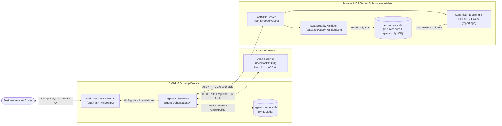

1. **Strict Separation of Reasoning and Computation:** The LLM (`qwen3.5:4b`) is responsible *only* for intent interpretation, schema exploration, SQL formulation, and narrative commentary. It never computes KPI totals or renders charts.
2. **Process-Isolated MCP Tooling:** Database access and file generation are isolated inside `mcp_layer/server.py`, invoked over JSON-RPC stdio via `MCPClientManager` (`mcp_layer/client.py`).
3. **Human-in-the-Loop (HITL) Approval Gate:** When `require_sql_approval=True` (default), `AgentOrchestrator` pauses before `execute_readonly_sql`, displays the formatted SQL and safety warnings in `SQLPreviewWidget` (`app/widgets/sql_preview_widget.py`), and waits on a thread-safe `threading.Event` until the user clicks **Approve & Run**, **Edit SQL**, or **Reject**.
4. **Canonical Dataset Single Source of Truth:** Once `execute_readonly_sql` succeeds, `ToolHandler` constructs an immutable `CanonicalSQLDataset` (`reporting/canonical_data.py`). Every KPI card, Matplotlib chart, PDF table, and CSV file is derived deterministically from this dataset and verified by `ReportConsistencyValidator` before rendering.

---

## 3. Functional and Non-Functional Requirements

### 3.1 Functional Requirements (FR)

| ID | Requirement Category | Detailed Specification | Verification / Implementation Anchor |
| :--- | :--- | :--- | :--- |
| **FR-01** | **Deterministic MCP Tool Discovery** | On startup, spawn the MCP server subprocess, complete JSON-RPC handshake, discover all 6 tools via `list_tools()`, validate against `EXPECTED_MCP_TOOLS`, and populate `ToolRegistry` before accepting user input. | `mcp_layer/client.py` → `MCPClientManager.discover_and_register_tools()` |
| **FR-02** | **Schema & Sample Inspection** | Allow the agent to inspect table names, column types, PKs, FKs, row counts (`inspect_database_schema`) and fetch bounded sample rows (`get_table_sample`, 1–25 rows). | `mcp_layer/tools/database_tools.py` |
| **FR-03** | **Multi-Gate SQL Validation** | Validate every SQL query (`prepare_sql_query`) against multi-statement injection, dangerous keywords (`DROP`, `DELETE`, `UPDATE`, `INSERT`, `ALTER`, `ATTACH`, `PRAGMA`, etc.), and `SELECT`/`WITH` structural rules, automatically applying `LIMIT` caps (`1,000` default, `10,000` max). | `database/query_validator.py` → `validate_and_prepare_sql()` |
| **FR-04** | **Interactive SQL Approval Workflow** | Present prepared SQL queries in the GUI with syntax highlighting and validation warnings; support **Approve & Run**, **Edit SQL** (with re-validation), and **Reject** actions. | `app/widgets/sql_preview_widget.py`, `app/worker.py` → `AgentWorker.request_sql_approval()` |
| **FR-05** | **Read-Only SQL Execution** | Execute approved SQL against `data/ecommerce.db` over a read-only URI connection (`?mode=ro`) with `PRAGMA query_only = ON` and a wall-clock timeout (`30s` default) enforced via `sqlite3.Connection.set_progress_handler`. | `database/executor.py` → `execute_readonly_query()` |
| **FR-06** | **Canonical Dataset Construction** | Wrap query results into an immutable `CanonicalSQLDataset` that classifies numeric, categorical, temporal, and identifier columns and pre-computes `ColumnStats` (`sum`, `mean`, `median`, `min`, `max`, `std`). | `reporting/canonical_data.py` → `CanonicalSQLDataset.from_query_result()` |
| **FR-07** | **Executive PDF Report Generation** | Generate multi-page A4 PDF reports (`generate_pdf_report`) with cover header, KPI summary cards, narrative findings, embedded 200-DPI Matplotlib PNG charts, zebra-striped data tables, and page footers. | `reporting/pdf_generator.py`, `reporting/dynamic_pdf_composer.py` |
| **FR-08** | **CSV Export** | Export full query results to UTF-8 CSV (`generate_csv_report`) with optional `#` metadata header comments. | `reporting/csv_generator.py` → `generate_csv_file()` |
| **FR-09** | **Multi-Tier Agent Memory & Recovery** | Persist task runs, plans, tool calls, decisions, artifacts, and step checkpoints in `data/agent_memory.db`; detect interrupted runs on startup and offer Resume or Discard in the GUI. | `memory/repository.py`, `memory/checkpoint_manager.py`, `memory/recovery_service.py` |
| **FR-10** | **Domain Skill Injection** | Load Markdown skills from `skills/*.md`, score relevance against the active user query, and inject the top matching domain guidelines into the token-budgeted prompt. | `agent/skill_manager.py` → `SkillManager.get_relevant_skills_text()` |

### 3.2 Non-Functional Requirements (NFR)

| ID | Attribute | Target / Constraint | Architectural Mechanism |
| :--- | :--- | :--- | :--- |
| **NFR-01** | **Data Privacy** | 100% local execution; zero external network requests. | Local Ollama (`localhost:11434`), local SQLite databases, local stdio MCP transport. |
| **NFR-02** | **Database Immutability** | Zero writes or schema changes to `data/ecommerce.db` under any prompt or fault condition. | 5-layer defense: AST/regex validator, MCP parameter validation, HITL approval, SQLite URI `?mode=ro`, and `PRAGMA query_only = ON`. |
| **NFR-03** | **GUI Responsiveness** | Main Qt UI thread must never block during LLM inference, SQL execution, or PDF rendering. | Background `QThread` (`AgentWorker`) with dedicated `asyncio` event loop communicating via queued Qt `Signal`s. |
| **NFR-04** | **Context Window Safety** | Never exceed local model context window limits during multi-turn conversations or wide query results. | `ContextBuilder` enforces a configurable budget (`6,000` tokens default) with priority-ordered section shedding and history truncation (`max_history_messages=20`). |
| **NFR-05** | **Cross-Platform Portability** | Run identically from source or PyInstaller bundle on macOS (`arm64`/`x86_64`) and Windows (`win64`). | `config/paths.py` (`RuntimePaths`) resolves `_MEIPASS` vs. user-writable OS data directories (`~/Library/Application Support/ReportSQLAgent` or `%LOCALAPPDATA%\ReportSQLAgent`) and spawns the MCP server via `--mcp-server` dispatcher mode in `run_app.py`. |
| **NFR-06** | **Testability & Verification** | Comprehensive automated verification across unit, integration, security, GUI, and live LLM suites. | 35 pytest modules (`388` test functions / `439` collected test items) in `tests/`. |

---

## 4. Technology Stack and Development Environment

### 4.1 Runtime Technology Stack

| Layer | Package / Technology | Version Constraint (`requirements.txt`) | Architectural Role |
| :--- | :--- | :--- | :--- |
| **Language & Runtime** | Python | `>= 3.10` (3.11+ recommended) | Core application runtime (`asyncio`, `dataclasses`, `sqlite3`, type annotations) |
| **Desktop GUI** | `PySide6` | `>= 6.6.0` | Qt6 native desktop windowing, QSS styling, background `QThread` worker, signals/slots |
| **Configuration & Schemas** | `pydantic`, `pydantic-settings`, `python-dotenv` | `>= 2.5.0`, `>= 2.1.0`, `>= 1.0.0` | Type-safe `AppSettings` (`config/settings.py`) and MCP/agent data contracts (`agent/models.py`, `mcp_layer/schemas.py`) |
| **LLM Inference Client** | `httpx`, `ollama` | `>= 0.26.0`, `>= 0.1.6` | Async HTTP client (`OllamaClient`) communicating with local Ollama `/api/chat` and `/api/tags` |
| **MCP Framework** | `mcp` (`FastMCP`, `ClientSession`, `stdio_client`) | `>= 1.0.0` | Model Context Protocol server (`mcp_layer/server.py`) and async stdio client (`mcp_layer/client.py`) |
| **Database Engine** | `sqlite3` (stdlib) | Built-in SQLite 3 | Read-only analytical warehouse (`data/ecommerce.db`) and WAL-mode episodic memory (`data/agent_memory.db`) |
| **Data Processing** | `pandas`, `numpy` | `>= 2.1.0`, `>= 1.26.0` | DataFrame transformations, aggregations, time-series indexing, and statistical calculations |
| **Visualization Engine** | `matplotlib`, `Pillow` | `>= 3.8.0`, `>= 10.1.0` | Headless `Agg` backend chart rendering (`reporting/chart_generator.py`, `reporting/chart_registry.py`) at 200 DPI |
| **PDF Composition** | `reportlab` | `>= 4.0.8` | Platypus flowable document layout (`BaseDocTemplate`, `Table`, `Paragraph`, `Image`, `KeepTogether`) |
| **Packaging** | `pyinstaller` | `>= 6.3.0` | Cross-platform standalone executable bundler (`ReportSQLAgent.spec`, `scripts/package_app.py`) |
| **Testing** | `pytest`, `pytest-asyncio`, `pytest-qt` | `>= 7.4.0`, `>= 0.23.0`, `>= 4.3.0` | Unit, async MCP/orchestrator integration, and headless Qt widget testing |

### 4.2 External Runtime Dependency: Local Ollama Server

The application requires a local **Ollama** instance (`http://localhost:11434` by default) serving a tool-capable model:

- **Default Model (`OLLAMA_MODEL`):** `qwen3.5:4b`
- **Fallback Models (`OLLAMA_FALLBACK_MODELS`):** `qwen2.5-coder:7b`, `qwen2.5:7b`, `llama3.1:8b`, `mistral:7b`
- **Health Check & Auto-Fallback:** `OllamaClient.check_health()` queries `GET /api/tags`. If the configured primary model is not pulled locally, it automatically matches against `ollama_fallback_models` before reporting a model-missing error.

> *Optional modular reference:* [`docs/solution/18-configuration-and-runtime-requirements.md`](./solution/18-configuration-and-runtime-requirements.md)

---

## 5. Complete System Architecture

### 5.1 Six-Layer Architectural Topology

The codebase is organized into six strictly decoupled architectural layers:

1. **Bootstrap & Configuration Layer (`run_app.py`, `config/`):** Entry-point mode dispatch (`--mcp-server` vs. GUI), frozen/source path resolution (`RuntimePaths`), typed environment configuration (`AppSettings`), and structured logging (`setup_logging`).
2. **Presentation & Concurrency Layer (`app/`):** PySide6 `MainWindow`, custom widgets (`MessageWidget`, `SQLPreviewWidget`, `ActivityInspectorWidget`, `ReportViewerWidget`), and the background `AgentWorker` (`QThread`) hosting a persistent `asyncio` loop.
3. **Cognitive Agent Layer (`agent/`):** `AgentOrchestrator`, `TaskPlanner`, `ToolHandler`, `OllamaClient`, `ContextBuilder`, `ConversationManager`, `SkillManager`, and `system_prompt.py`.
4. **Memory & Recovery Layer (`memory/`):** Working memory (`WorkingMemoryState`), episodic SQLite storage (`SQLiteMemoryRepository`), `CheckpointManager`, `RecoveryService`, and `MemoryCompressor`.
5. **MCP Protocol Boundary Layer (`mcp_layer/`):** Parent-side `MCPClientManager` + `ToolRegistry` (`mcp_layer/client.py`) and child-side `FastMCP("ReportSQLServer")` (`mcp_layer/server.py`) with 6 registered tool handlers (`mcp_layer/tools/*`).
6. **Data & Deterministic Reporting Layer (`database/`, `reporting/`):** Multi-gate SQL validator (`query_validator.py`), read-only executor (`executor.py`), schema inspector (`schema_inspector.py`), `CanonicalSQLDataset` (`canonical_data.py`), `ChartRegistry` (`chart_registry.py`), `pdf_generator.py`, `dynamic_pdf_composer.py`, and `csv_generator.py`.

### 5.2 Complete System Component Graph

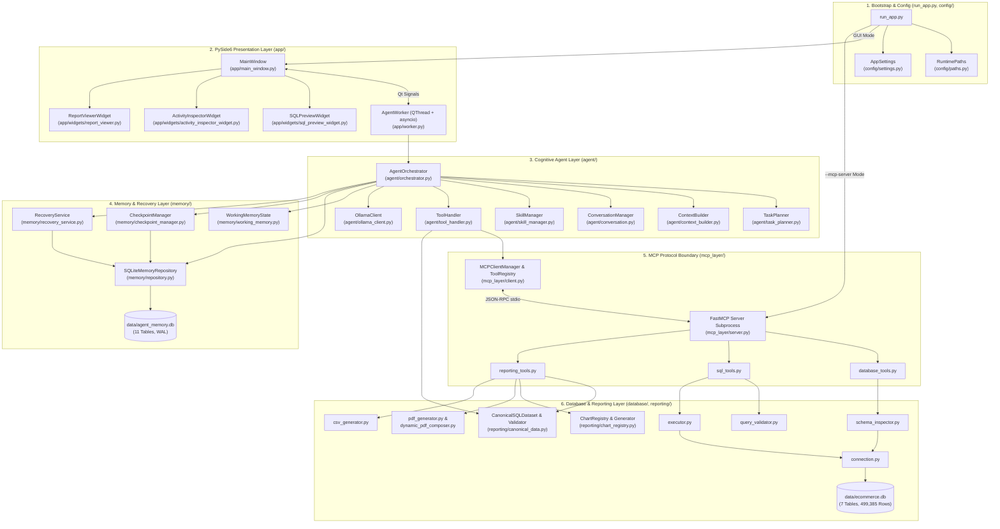

This diagram illustrates the strict separation between the **parent desktop process** (hosting the PySide6 GUI, `AgentWorker`, `AgentOrchestrator`, and `SQLiteMemoryRepository`) and the **child MCP server subprocess** (`mcp_layer/server.py`). All analytical database queries and PDF/CSV renders pass across the JSON-RPC stdio pipe managed by `MCPClientManager`.

> *Optional modular references:* [`docs/solution/02-system-architecture.md`](./solution/02-system-architecture.md), [`docs/solution/knowledge-graphs/01-system-component-graph.md`](./solution/knowledge-graphs/01-system-component-graph.md)

---

## 6. Component-by-Component Responsibilities

Every Python module in the repository has a single, well-defined responsibility:

### 6.1 Root & Configuration (`run_app.py`, `config/`)

| File Path | Key Classes / Functions | Exact Responsibility |
| :--- | :--- | :--- |
| `run_app.py` | `main()`, `_run_mcp_server_mode()` | Top-level entry point. Checks `sys.argv` for `--mcp-server` (or `REPORT_SQL_MCP_SERVER_MODE=1`); either launches the FastMCP stdio server or initializes `RuntimePaths`, `AppSettings`, logging, database seeding check, and the PySide6 GUI. |
| `config/__init__.py` | `get_settings()`, `reload_settings()`, `get_runtime_paths()` | Singleton accessors for `AppSettings` and `RuntimePaths`. |
| `config/paths.py` | `RuntimePaths`, `resolve_runtime_paths()`, `get_mcp_server_Spawn_command()` | Resolves read-only bundled assets vs. writable user directories across source and PyInstaller (`sys.frozen`) execution modes; seeds `ecommerce.db` into user data dir if bundled; computes the subprocess command to spawn the MCP server. |
| `config/settings.py` | `AppSettings`, `load_settings()` | Pydantic `BaseSettings` loading `.env` and environment variables (`OLLAMA_*`, `MAX_QUERY_ROWS`, `HARD_MAX_QUERY_ROWS`, `QUERY_TIMEOUT_SECONDS`, `REQUIRE_SQL_APPROVAL`, `MAX_AGENT_ITERATIONS`, `CONTEXT_TOKEN_BUDGET`, etc.) and creating `reports/`, `charts/`, and `logs/` directories. |
| `config/logging_config.py` | `setup_logging()`, `get_logger()` | Configures rotating file handler (`logs/app.log`, 5 MB max, 3 backups) and console logging (`stderr` in MCP mode so `stdout` remains pure JSON-RPC). |

### 6.2 Database Layer (`database/`)

| File Path | Key Classes / Functions | Exact Responsibility |
| :--- | :--- | :--- |
| `database/connection.py` | `get_readonly_connection()`, `get_writable_connection()`, `verify_database_exists()` | Opens SQLite connections. `get_readonly_connection()` uses `file:<path>?mode=ro` URI mode, sets `PRAGMA query_only = ON`, `PRAGMA foreign_keys = ON`, `PRAGMA temp_store = MEMORY`, and `sqlite3.Row` factory. |
| `database/schema_inspector.py` | `inspect_Full_schema()`, `get_table_schema()`, `get_table_sample_rows()`, `generate_schema_prompt_summary()` | Introspects `sqlite_master` and `PRAGMA table_info` / `foreign_key_list` / `index_list` to produce structured metadata and compact Markdown schema summaries for the LLM prompt. |
| `database/query_validator.py` | `SQLValidationResult`, `validate_and_prepare_sql()` | 5-step security and structural validator: strips comments/literals, blocks multi-statement `;`, checks word-boundary forbidden keywords (`DROP`, `DELETE`, `UPDATE`, `INSERT`, `ALTER`, `ATTACH`, `PRAGMA`, etc.), enforces `SELECT`/`WITH` start, and injects or caps `LIMIT` (`default_limit=1000`, `hard_max_limit=10000`). |
| `database/executor.py` | `QueryExecutionResult`, `execute_readonly_query()` | Calls `validate_and_prepare_sql()`, opens `get_readonly_connection()`, attaches a wall-clock timeout via `conn.set_progress_handler` (checked every 1,000 VM opcodes), fetches up to `max_rows + 1` to detect truncation, and returns structured JSON-serializable rows and timing. |
| `database/seed_data.py` | `initialize_and_seed_database()`, `generate_all_seed_data()` | Deterministic (`random.Random(42)`) generator that builds the 7-table, 499,385-row retail e-commerce dataset from `database/schema.sql`. |

### 6.3 MCP Layer (`mcp_layer/`)

| File Path | Key Classes / Functions | Exact Responsibility |
| :--- | :--- | :--- |
| `mcp_layer/schemas.py` | `InspectSchemaInput/Output`, `TableSampleInput/Output`, `PrepareSQLInput/Output`, `ExecuteSQLInput/Output`, `GeneratePDFInput/Output`, `GenerateCSVInput/Output`, `ChartSpec` | Pydantic v2 input/output contracts shared between MCP server tools and agent tool handlers. |
| `mcp_layer/server.py` | `mcp` (`FastMCP("ReportSQLServer")`), `run_server()` | FastMCP stdio server registering the 6 tools and routing calls to `database_tools.py`, `sql_tools.py`, and `reporting_tools.py`. |
| `mcp_layer/client.py` | `DiscoveredTool`, `ToolRegistry`, `MCPClientManager`, `EXPECTED_MCP_TOOLS` | Spawns the MCP server subprocess via `stdio_client`, manages `ClientSession`, performs `discover_and_register_tools()`, adapts MCP `inputSchema` into Ollama native `tools` definitions (`DiscoveredTool.to_ollama_tool()`), and executes `call_tool()` with JSON parsing and error wrapping. |
| `mcp_layer/tools/database_tools.py` | `inspect_database_schema_tool()`, `get_table_sample_tool()` | Implements schema introspection and bounded table row sampling (`1..25` rows). |
| `mcp_layer/tools/sql_tools.py` | `prepare_sql_query_tool()`, `execute_readonly_sql_tool()` | Implements SQL validation/preparation and read-only SQL execution. |
| `mcp_layer/tools/reporting_tools.py` | `generate_pdf_report_tool()`, `generate_csv_report_tool()` | Orchestrates chart generation, dynamic or standard PDF assembly, CSV export, and `ReportHistoryManager` registration. |

### 6.4 Cognitive Agent Layer (`agent/`)

| File Path | Key Classes / Functions | Exact Responsibility |
| :--- | :--- | :--- |
| `agent/models.py` | `MessageRole`, `ToolCallRequest`, `ChatMessage`, `TaskPlan`, `TaskStep`, `AgentEvent`, `SQLApprovalDecision`, `AgentTurnResult` | Core Pydantic data structures for conversation state, tool calls, execution plans, and UI streaming events. |
| `agent/ollama_client.py` | `OllamaClient`, `OllamaClientError`, `OllamaConnectionError`, `OllamaModelNotFoundError` | Async HTTP client (`httpx.AsyncClient`) for Ollama `/api/tags` and `/api/chat`. Normalizes tool calls (`arguments` dict vs. JSON string) and extracts fallback JSON tool calls from plain text when needed. |
| `agent/system_prompt.py` | `DEFAULT_SYSTEM_PROMPT`, `build_system_prompt()`, `build_discovered_tools_capability_section()`, `build_compact_tool_reminder()` | Builds the system prompt, dynamically injecting discovered MCP tool schemas, database schema summaries, active domain skills, and strict anti-hallucination / canonical reporting rules. |
| `agent/context_builder.py` | `ContextBuilder`, `ContextSection`, `SectionPriority`, `estimate_tokens()` | Token-budgeted prompt assembler (`len(text) // 4` heuristic) that prioritizes `CRITICAL` (`system_instructions`, `user_request`) and `HIGH` (`discovered_mcp_tools`, `database_schema`, `canonical_dataset`, `active_plan`) over `MEDIUM`/`LOW` sections. |
| `agent/conversation.py` | `ConversationManager` | Maintains multi-turn `ChatMessage` history, injects tool results, and prunes old turns while preserving `tool_calls` ↔ `tool` message pairs. |
| `agent/task_planner.py` | `TaskPlanner` | Detects reporting/export/visualization intent via regex patterns and creates deterministic 3-step or 5-step `TaskPlan` workflows (`inspect_schema` → `prepare_sql` → `execute_sql` → `analyze_results` → `generate_report`). |
| `agent/tool_handler.py` | `ToolHandler`, `ToolExecutionRecord` | Validates requested tool calls against `ToolRegistry`, normalizes LLM parameter aliases (e.g., `sql` → `query`), manages the HITL SQL approval gate, builds `CanonicalSQLDataset` after `execute_readonly_sql`, auto-hydrates `columns`/`rows` into `generate_pdf_report` / `generate_csv_report`, and strips raw rows from LLM tool output to prevent context overflow. |
| `agent/skill_manager.py` | `SkillManager`, `SkillDocument` | Parses YAML frontmatter and Markdown bodies from `skills/*.md`, syncs metadata to `skill_registry` in `agent_memory.db`, and ranks skills by keyword/trigger match against the user prompt. |
| `agent/orchestrator.py` | `AgentOrchestrator` | Central coordinator managing startup initialization (`initialize()`), the 10-iteration tool-calling loop (`process_message()`), loop-detection guards, fallback tool synthesis when small models stop early, memory checkpointing, and recovery (`resume_recoverable_task()`). |

### 6.5 Memory & Persistence Layer (`memory/`)

| File Path | Key Classes / Functions | Exact Responsibility |
| :--- | :--- | :--- |
| `memory/models.py` | `TaskStatus`, `StepStatus`, `TaskRunRecord`, `TaskPlanRecord`, `TaskStepRecord`, `CheckpointRecord`, `RecoverableTaskSummary` | Typed dataclasses and enums for episodic and checkpoint persistence. |
| `memory/working_memory.py` | `WorkingMemoryState`, `SQLExecutionSnapshot`, `GeneratedArtifactRecord` | In-RAM turn state tracking executed tool signatures (`name::canonical_json`) to prevent duplicate tool loops, latest SQL snapshot, and generated artifacts. |
| `memory/repository.py` | `SQLiteMemoryRepository` | WAL-mode SQLite data access layer over `data/agent_memory.db`, applying SQL migrations (`001`–`003`) and providing CRUD methods across 11 tables. |
| `memory/checkpoint_manager.py` | `CheckpointManager` | Captures serialized state snapshots (`WorkingMemoryState` + `CanonicalSQLDataset` + plan status) at key pipeline milestones (`plan_created`, `sql_prepared`, `sql_executed`, `report_generated`, `task_completed`). |
| `memory/recovery_service.py` | `RecoveryService`, `ReconstructedTaskContext` | Scans `agent_memory.db` on startup for unfinished tasks (`RUNNING`, `AWAITING_APPROVAL`, `INTERRUPTED`), reconstructs context from the latest valid checkpoint, and handles Resume or Discard actions. |
| `memory/compressor.py` | `MemoryCompressor` | Compresses large SQL result sets into compact statistical digests (`row_count`, top 5 preview rows, numeric min/max/avg/sum) for LLM context efficiency. |

### 6.6 Reporting & Visualization Layer (`reporting/`)

| File Path | Key Classes / Functions | Exact Responsibility |
| :--- | :--- | :--- |
| `reporting/canonical_data.py` | `CanonicalSQLDataset`, `ColumnStats`, `ReportConsistencyValidator`, `ConsistencyValidationResult` | Immutable single-source-of-truth wrapper around SQL results. Automatically classifies column semantics, computes descriptive statistics, derives KPI cards, recommends charts, sanitizes LLM hallucinated numbers (`sanitize_narrative_numbers()`), and validates cross-section consistency. |
| `reporting/chart_registry.py` | `ChartRegistry`, `ChartMetadata`, `ChartRenderRequest` | Central registry of 25 chart type keys across 6 categories (`executive`, `Advanced`, `Geographic`, `Tables`, `Specialized`, `General`), providing smart column resolution and auto-recommendations. |
| `reporting/chart_generator.py` | `generate_chart()`, `generate_charts_batch()` | Headless Matplotlib (`Agg`) chart renderer supporting legacy chart types (`bar`, `horizontal_bar`, `line`, `pie`, `scatter`, `stacked_bar`) and delegating extended types to `ChartRegistry`. |
| `reporting/charts/*` | `executive_charts.py`, `advanced_charts.py`, `geo_charts.py`, `table_charts.py`, `specialized_charts.py`, `theme.py` | 19 specialized Matplotlib chart renderers plus unified corporate color palette and typography (`theme.py`). |
| `reporting/pdf_generator.py` | `generate_pdf_file()`, `_NumberedCanvas` | Deterministic ReportLab Platypus PDF generator creating executive cover headers, KPI scorecards, narrative sections, embedded chart PNGs, and formatted data tables with two-pass `"Page X of Y"` numbering. |
| `reporting/dynamic_pdf_composer.py` | `compose_dynamic_pdf()`, `analyze_query_complexity()` | Adaptive multi-section PDF composer for complex analytical queries, adding Automated Key Insights, Visual Analysis, Statistical Deep-Dive, and Methodology sections. |
| `reporting/csv_generator.py` | `generate_csv_file()` | UTF-8 CSV writer with optional `#` metadata header block. |
| `reporting/report_manager.py` | `ReportHistoryManager`, `ReportRecord` | Maintains `reports/report_index.json` catalog of generated PDF/CSV artifacts for the GUI Report History panel. |

### 6.7 GUI Layer (`app/`)

| File Path | Key Classes / Functions | Exact Responsibility |
| :--- | :--- | :--- |
| `app/main.py` | `launch_gui()` | Instantiates `QApplication`, applies QSS dark theme (`app/styles.qss`), creates `MainWindow`, and triggers startup initialization after `200ms`. |
| `app/main_window.py` | `MainWindow`, `SettingsDialog` | Primary desktop window coordinating the left sidebar (status badges, quick prompts, report history), center splitter (chat scroll area, `SQLPreviewWidget`, prompt input), and right collapsible `ActivityInspectorWidget`. |
| `app/worker.py` | `AgentWorker`, `InitWorker` | `QThread` background workers bridging async `AgentOrchestrator` execution with thread-safe Qt signals and blocking `threading.Event` synchronization for HITL SQL approval. |
| `app/widgets/message_widget.py` | `MessageWidget` | Renders user, assistant, system, and error chat bubbles with Markdown-to-HTML formatting, collapsible tool-call trace badges, and clickable PDF/CSV artifact cards. |
| `app/widgets/sql_preview_widget.py` | `SQLPreviewWidget`, `SQLSyntaxHighlighter` | Interactive SQL approval card with regex syntax highlighting, validation warning banners, inline SQL editing, and **Approve & Run** / **Edit SQL** / **Reject** buttons. |
| `app/widgets/activity_inspector_widget.py` | `ActivityInspectorWidget` | 5-tab real-time telemetry drawer (**Plan**, **Tools**, **SQL**, **Assumptions**, **Memory**). |
| `app/widgets/report_viewer.py` | `ReportViewerWidget` | Sidebar report history browser with search/type filtering and native OS file opening (`open` on macOS, `os.startfile` on Windows). |

> *Optional modular reference:* [`docs/solution/appendices/source-code-map.md`](./solution/appendices/source-code-map.md)

---

## 7. Application Startup and Initialization Lifecycle

### 7.1 Dual-Mode Entry Point (`run_app.py`)

`run_app.py` serves as both the GUI launcher and, when packaged into a single PyInstaller executable, the MCP server entry point:

1. **Mode Dispatch (`run_app.py:L55-L60`):** If `--mcp-server` is present in `sys.argv` or `REPORT_SQL_MCP_SERVER_MODE == "1"`, `run_app.py` immediately invokes `_run_mcp_server_mode()`, which configures logging to `stderr` and starts `mcp_layer.server.run_server()`.
2. **GUI Bootstrap (`run_app.py:L62-L108`):** Otherwise, it resolves `RuntimePaths`, loads `AppSettings`, configures rotating file logging, ensures `data/ecommerce.db` exists (seeding 499,385 rows via `initialize_and_seed_database()` if absent), and calls `app.main.launch_gui(settings)`.

### 7.2 Startup Sequence Diagram

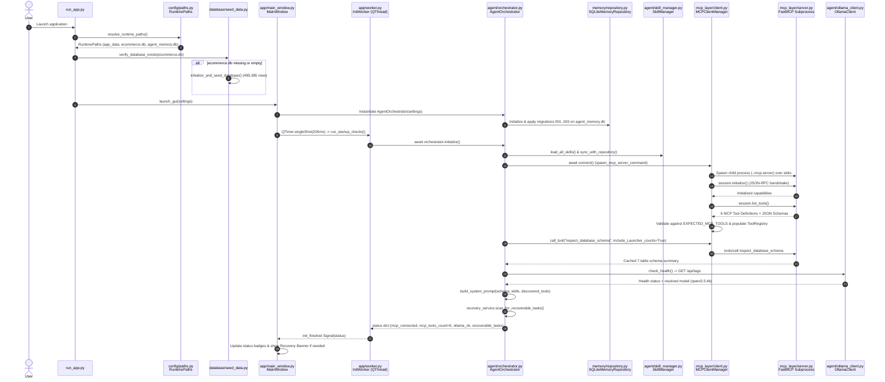

This startup sequence guarantees that before the user can submit their first prompt, the MCP subprocess is alive, all 6 expected tools are registered in `ToolRegistry`, the 7-table database schema is cached in memory, domain skills are indexed, and the system prompt has been populated with the authoritative MCP tool schemas.

> *Optional modular references:* [`docs/solution/03-application-lifecycle.md`](./solution/03-application-lifecycle.md), [`docs/solution/knowledge-graphs/02-application-startup-sequence.md`](./solution/knowledge-graphs/02-application-startup-sequence.md)

---

## 8. GUI Architecture and Threading/Concurrency Model

### 8.1 Three-Panel Desktop Layout (`app/main_window.py`)

`MainWindow` (`app/main_window.py`) organizes the user workspace into a responsive `QSplitter` layout styled via `app/styles.qss` (Catppuccin Mocha-inspired dark palette: `#1e1e2e` base, `#89b4fa` primary accent):

- **Left Sidebar (`280px` fixed width):**
  - **System Status Badges:** Live indicators for **Ollama LLM** (`Connected (qwen3.5:4b)`) and **MCP Tools** (`6 Tools Ready`).
  - **Quick Prompts Panel:** Curated one-click analytical templates (e.g., Executive Revenue Report, Category Performance, Return Rate Analysis, Customer Loyalty Tiers).
  - **Embedded `ReportViewerWidget`:** Searchable list of generated PDF and CSV reports with instant open/reveal buttons.
- **Center Conversation & Control Column:**
  - **Recovery Banner (Conditional):** Appears at the top if `RecoveryService` detects an unfinished task run from a prior crash, offering **Resume Task** or **Discard**.
  - **Chat Scroll Area:** Vertically stacked `MessageWidget` cards displaying user queries, streaming/completed assistant narratives, collapsible tool execution badges, and downloadable report cards.
  - **Interactive `SQLPreviewWidget` (Hidden until triggered):** Slides into view when `AgentOrchestrator` pauses at the HITL approval gate, allowing the user to inspect, edit, approve, or reject the prepared SQL.
  - **Composer Bar:** Multi-line `QTextEdit` (`Enter` to send, `Shift+Enter` for newline), **Send** button, **Cancel** button, and **Require SQL Approval** checkbox toggle.
- **Right Telemetry Drawer (`ActivityInspectorWidget`, `360px` collapsible):**
  - 5 real-time inspection tabs: **Plan** (step status badges), **Tools** (chronological tool invocations, arguments, durations), **SQL** (latest validated SQL + row count/duration), **Assumptions** (schema/skill context), and **Memory** (working memory state, checkpoints, and episodic summary).

### 8.2 Threading, Asyncio Event Loop, and HITL Synchronization (`app/worker.py`)

Because PySide6's UI event loop runs on the main OS thread while `AgentOrchestrator`, `MCPClientManager`, and `OllamaClient` are asynchronous (`async`/`await`), `app/worker.py` bridges the two concurrency models via `AgentWorker(QThread)`:

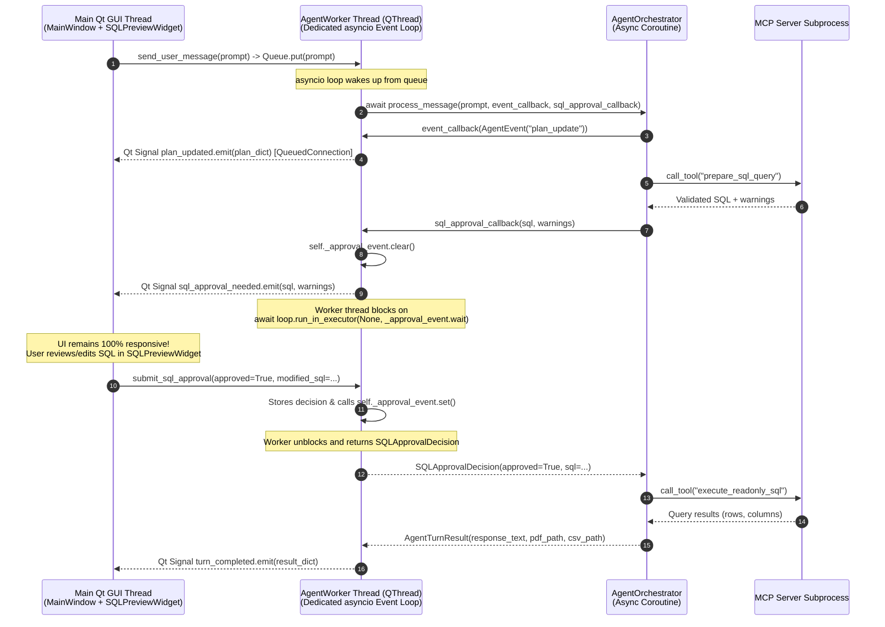

Key concurrency guarantees in `app/worker.py`:
1. **Single Persistent Asyncio Loop for MCP Affinity:** `MCPClientManager`'s `anyio`/`stdio_client` pipes are bound to the event loop that created them. `AgentWorker.run()` creates one persistent `asyncio` event loop for the lifetime of the background thread and processes both initialization and all subsequent user turns on that same loop.
2. **Non-Blocking HITL Wait:** When `request_sql_approval()` is invoked, the worker emits `sql_approval_needed` to the GUI thread and awaits `self._approval_event.wait()` via `run_in_executor` (with a `300s` timeout), keeping the Qt main thread completely responsive while pausing the agent coroutine at the exact pre-execution boundary.
3. **Cooperative Cancellation:** Clicking **Cancel** in the UI calls `AgentWorker.cancel_current_task()`, which sets `self._cancel_event` (`threading.Event`) and unblocks any pending `_approval_event`. `AgentOrchestrator` checks `cancel_event.is_set()` before and immediately after every `ollama_client.chat()` and `tool_handler.execute_tool_call()` invocation.

> *Optional modular reference:* [`docs/solution/14-gui-and-concurrency.md`](./solution/14-gui-and-concurrency.md)

---

## 9. Local Ollama LLM Integration and Communication Model

### 9.1 `OllamaClient` Architecture (`agent/ollama_client.py`)

`OllamaClient` manages all communication with the local Ollama server (`http://localhost:11434` by default) using `httpx.AsyncClient`:

- **Health & Fallback Resolution (`check_health()`):**
  - Sends `GET /api/tags` (`10.0s` timeout).
  - Parses available local model tags (`models[*].name`).
  - Matches `settings.ollama_model` (`qwen3.5:4b`) either by exact tag or prefix match.
  - If the primary model is missing, iterates through `settings.ollama_fallback_models` (`qwen2.5-coder:7b`, `qwen2.5:7b`, `llama3.1:8b`, `mistral:7b`) and dynamically switches `self.model` to the first installed fallback.
- **Chat Completion (`chat()`):**
  - Sends `POST /api/chat` with payload:
    ```json
    {
      "model": "qwen3.5:4b",
      "messages": [...],
      "tools": [...],
      "stream": false,
      "options": {
        "temperature": 0.1,
        "num_ctx": 8192
      }
    }
    ```
  - Enforces a configurable request timeout (`settings.ollama_timeout_seconds = 120.0`).
  - Retries transient HTTP/network failures once (`max_retries = 1`) before raising a typed `OllamaClientError`.

### 9.2 Native Tool Call Parsing & Fallback Extraction (`_parse_chat_response()`)

Small local models (`qwen3.5:4b`) can emit tool calls in two ways:
1. **Native Ollama `message.tool_calls` array:** Standard structured tool calls where `function.arguments` is a dictionary (or occasionally a JSON-encoded string). `_parse_chat_response()` normalizes string arguments via `json.loads()` and assigns a deterministic UUID (`call_<hex8>`) if Ollama omits `id`.
2. **Inline JSON Fallback (`_extract_fallback_tool_calls_from_text()`):** Sometimes a 4B model outputs a raw JSON block in `message.content` instead of populating `message.tool_calls` (e.g., `{"name": "inspect_database_schema", "arguments": {}}`). When `message.tool_calls` is empty, `_extract_fallback_tool_calls_from_text()` scans fenced ```json blocks and top-level JSON objects in `content`. If an object contains a `name` (or `tool`/`function`) matching one of the 6 registered MCP tools, it promotes it into a structured `ToolCallRequest` and strips the raw JSON from the user-visible assistant text.

> *Optional modular reference:* [`docs/solution/05-ollama-integration.md`](./solution/05-ollama-integration.md)

---

## 10. MCP Architecture, Tool Registration, Discovery, Schema Adaptation, and Execution Flow

### 10.1 Why MCP Over `stdio`?

The **Model Context Protocol (MCP)** provides a standardized, process-isolated boundary between the LLM orchestrator and host resources. In this project:
- **Parent Client (`mcp_layer/client.py`):** `MCPClientManager` spawns the server subprocess via `mcp.client.stdio.stdio_client` and communicates over an `anyio` memory stream wrapped in `mcp.client.session.ClientSession`.
- **Child Server (`mcp_layer/server.py`):** `FastMCP("ReportSQLServer")` exposes 6 tools using `@mcp.tool()` decorators. All logging inside the child process is directed to `sys.stderr` and `logs/app.log` so `sys.stdout` carries pure JSON-RPC 2.0 frames.

### 10.2 Deterministic Discovery & `ToolRegistry` (`mcp_layer/client.py`)

Before the first user request is accepted, `MCPClientManager.discover_and_register_tools()` executes:

1. Calls `await self._session.list_tools()` over the MCP stdio session.
2. For each tool returned by the server, extracts `name`, `description`, `inputSchema` (JSON Schema), and `required` parameter list into an immutable `DiscoveredTool` dataclass.
3. Validates that every tool in `EXPECTED_MCP_TOOLS` is present with a valid `inputSchema`:
   ```python
   EXPECTED_MCP_TOOLS: Tuple[str, ...] = (
       "inspect_database_schema",
       "get_table_sample",
       "prepare_sql_query",
       "execute_readonly_sql",
       "generate_pdf_report",
       "generate_csv_report",
   )
   ```
4. If any expected tool is missing or lacks a schema, raises `RuntimeError` immediately—preventing the agent from running in a degraded "capability-blind" state.
5. Registers all 6 tools in `self.tool_registry` (`ToolRegistry`), which exposes:
   - `get_ollama_tools() -> List[Dict[str, Any]]`: Converts each `DiscoveredTool` via `to_ollama_tool()` into Ollama's native tool schema:
     ```json
     {
       "type": "function",
       "function": {
         "name": "<tool_name>",
         "description": "<tool_description>",
         "parameters": {
           "type": "object",
           "properties": { ... },
           "required": [ ... ]
         }
       }
     }
     ```
   - `validate_tool_call(name, arguments)`: Verifies the tool exists in the registry and `arguments` is a dictionary before dispatching over MCP.

### 10.3 Complete Reference of All 6 MCP Tools

| # | Tool Name | Server Handler (`mcp_layer/tools/*`) | Required Params | Optional Params (with Defaults) | Output Payload Keys |
| :--- | :--- | :--- | :--- | :--- | :--- |
| **1** | `inspect_database_schema` | `database_tools.py` → `inspect_database_schema_tool` | None | `table_name: Optional[str] = None`, `include_row_counts: bool = True` | `success`, `database_path`, `table_count`, `tables` (columns, PKs, FKs, indexes, row_count), `summary_text` |
| **2** | `get_table_sample` | `database_tools.py` → `get_table_sample_tool` | `table_name: str` | `limit: int = 5` (clamped `1..25`) | `success`, `table_name`, `columns`, `rows`, `sample_count`, `total_table_rows` |
| **3** | `prepare_sql_query` | `sql_tools.py` → `prepare_sql_query_tool` | `sql: str` | `rationale: str = ""`, `max_rows: int = 1000` | `is_valid`, `original_sql`, `prepared_sql`, `statement_type`, `referenced_tables`, `limit_applied`, `limit_value`, `warnings`, `error_message` |
| **4** | `execute_readonly_sql` | `sql_tools.py` → `execute_readonly_sql_tool` | `sql: str` | `max_rows: int = 1000` | `success`, `executed_sql`, `columns`, `rows`, `row_count`, `truncated`, `execution_time_ms`, `warnings`, `error_message` |
| **5** | `generate_pdf_report` | `reporting_tools.py` → `generate_pdf_report_tool` | `title: str`, `user_query: str`, `executed_sql: str`, `columns: List[str]`, `rows: List[Dict]` | `subtitle: str = ""`, `executive_summary: str = ""`, `key_findings: List[str] = []`, `kpi_metrics: Dict[str, str] = {}`, `chart_specs: List[Dict] = []`, `recommendations: List[str] = []`, `Use_dynamic_composer: bool = True` | `success`, `report_id`, `file_path`, `file_name`, `file_size_bytes`, `page_count_estimate`, `charts_generated`, `consistency_validated`, `warnings` |
| **6** | `generate_csv_report` | `reporting_tools.py` → `generate_csv_report_tool` | `title: str`, `columns: List[str]`, `rows: List[Dict]` | `user_query: str = ""`, `executed_sql: str = ""`, `include_metadata_header: bool = False` | `success`, `report_id`, `file_path`, `file_name`, `file_size_bytes`, `row_count`, `column_count` |

### 10.4 MCP Discovery and Tool Execution Sequence Diagram

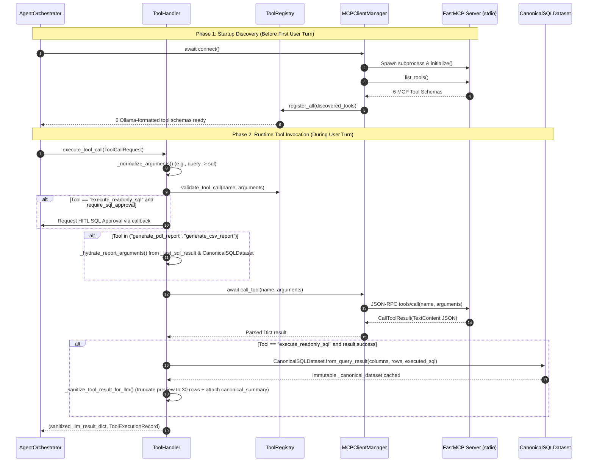

> *Optional modular references:* [`docs/solution/04-mcp-tool-discovery.md`](./solution/04-mcp-tool-discovery.md), [`docs/solution/appendices/mcp-tools-reference.md`](./solution/appendices/mcp-tools-reference.md)

---

## 11. Agent Orchestration, Task Planning, Step Dependencies, and State Transitions

### 11.1 `TaskPlanner` Intent Analysis & Plan Creation (`agent/task_planner.py`)

At the start of every user turn, `TaskPlanner.create_plan(user_query, has_cached_schema)` inspects the prompt using compiled regex patterns:
- **Report/PDF Intent (`_REPORT_KEYWORDS`):** `\b(pdf|report|executive\s+summary|document|briefing|presentation|generate\s+a\s+report|export.*pdf)\b`
- **CSV Intent (`_CSV_KEYWORDS`):** `\b(csv|spreadsheet|excel|export.*data|download.*table|raw\s+export)\b`
- **Chart/Visual Intent (`_CHART_KEYWORDS`):** `\b(chart|graph|plot|visuali[sz]e|visuali[sz]ation|trend|bar\s+chart|line\s+chart|pie\s+chart|histogram|breakdown)\b`

Depending on whether reporting/export artifacts are requested, `TaskPlanner` builds either a **5-step reporting plan** or a **3-step query plan**:

| Step ID | Title | Tool Hint | Included In |
| :--- | :--- | :--- | :--- |
| `step_1_schema` | Inspect & Verify Database Schema | `inspect_database_schema` (auto-completed if schema already cached) | 3-Step & 5-Step Plans |
| `step_2_prepare_sql` | Formulate & Validate SQL Query | `prepare_sql_query` | 3-Step & 5-Step Plans |
| `step_3_execute_sql` | Execute Approved Read-Only SQL | `execute_readonly_sql` | 3-Step & 5-Step Plans |
| `step_4_analyze` | Synthesize Insights & KPIs | *(Cognitive analysis step)* | 5-Step Plan Only |
| `step_5_report` | Generate Report Artifact (`PDF` / `CSV`) | `generate_pdf_report` or `generate_csv_report` | 5-Step Plan Only |

### 11.2 `AgentOrchestrator.process_message()` State Machine (`agent/orchestrator.py`)

The orchestrator drives each turn through a bounded loop (`max_agent_iterations = 10` by default):

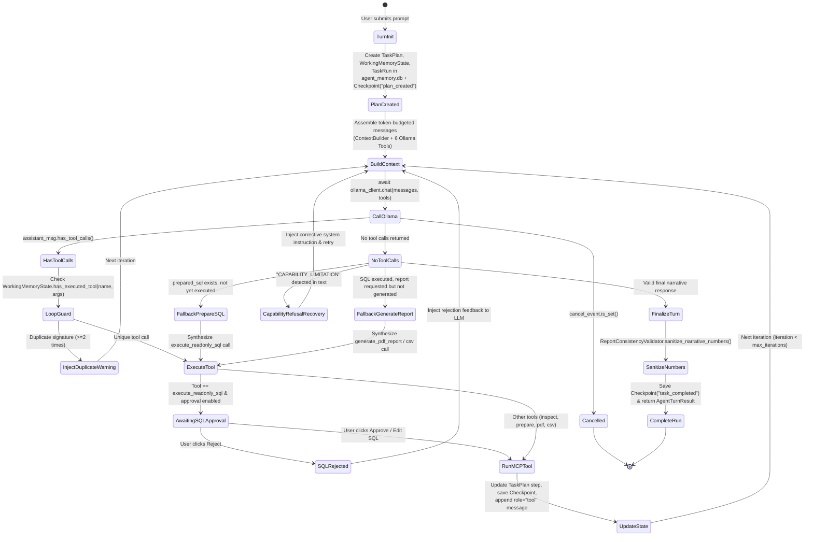

### 11.3 Built-In Resilience Mechanisms in the Orchestration Loop

Small 4B models (`qwen3.5:4b`) exhibit several predictable failure modes during multi-step tool use. `AgentOrchestrator` (`agent/orchestrator.py`) includes four deterministic guardrails to keep the pipeline reliable:

1. **Duplicate Tool Call Loop Prevention (`WorkingMemoryState.has_executed_tool`):** Every tool call signature (`tool_name::json_args`) is tracked in `WorkingMemoryState`. If the model requests the exact same tool call with identical arguments a second time, the orchestrator skips MCP re-execution, returns a synthetic guidance message instructing the model to advance to the next step in the plan, and increments `duplicate_tool_loop_count` (breaking out after 3 consecutive duplicates).
2. **Heuristic Auto-Transition from `prepare_sql_query` to `execute_readonly_sql` (`_build_fallback_execute_tool_call`):** If the LLM calls `prepare_sql_query` (receiving a valid `prepared_sql`), and on the next iteration outputs plain text instead of calling `execute_readonly_sql`, the orchestrator automatically synthesizes the `execute_readonly_sql` tool call (which still passes through the mandatory HITL user approval gate).
3. **Heuristic Auto-Generation of Requested Reports (`_build_fallback_report_tool_call`):** If the user explicitly asked for a PDF or CSV report, `execute_readonly_sql` has succeeded (`has_sql_data=True`), and the LLM writes its final summary text without invoking `generate_pdf_report` or `generate_csv_report`, the orchestrator extracts the narrative summary, key bullet points, KPI metrics, and recommended charts from `CanonicalSQLDataset` and invokes the report tool automatically.
4. **Capability Refusal Interception (`_contains_capability_refusal`):** If the model ever emits phrases like `"CAPABILITY_LIMITATION"` or `"I cannot generate PDF files"`, the orchestrator intercepts the response before it reaches the user, injects a corrective `USER` reminder listing the 6 active MCP tools in `ToolRegistry`, and forces another iteration.

> *Optional modular reference:* [`docs/solution/06-agent-orchestration-and-planning.md`](./solution/06-agent-orchestration-and-planning.md)

---

## 12. System Prompt, Dynamic Context Construction, Token Budgeting, and Context-Window Management

### 12.1 Dynamic System Prompt Architecture (`agent/system_prompt.py`)

`build_system_prompt()` constructs the foundational `SYSTEM` message by combining core behavioral rules (`DEFAULT_SYSTEM_PROMPT`, ~538 tokens) with live runtime context:

1. **Core Identity & Workflow Protocol (`DEFAULT_SYSTEM_PROMPT`):**
   - Explicitly declares that the agent is connected to a live MCP server with 6 tools (`inspect_database_schema`, `get_table_sample`, `prepare_sql_query`, `execute_readonly_sql`, `generate_pdf_report`, `generate_csv_report`) and 22+ chart types.
   - Forbids claiming `"CAPABILITY_LIMITATION"` for PDF, chart, or CSV requests.
   - Mandates the 5-step execution sequence: `inspect_database_schema` → `prepare_sql_query` → `execute_readonly_sql` → `generate_pdf_report` / `generate_csv_report` → Final Response.
   - Enforces the **Single Source of Truth (`CanonicalSQLDataset`) Rule**: never invent, round inconsistently, or extrapolate numbers in prose; cite exact figures from `canonical_summary`.
2. **Dynamic Context Sections Appended by `ContextBuilder` (`agent/context_builder.py`):**
   - `discovered_mcp_tools`: Generated by `build_discovered_tools_capability_section(discovered_tools)`, listing every live MCP tool's exact name, parameter types, and `[REQUIRED]` / `[optional]` flags.
   - `database_schema`: Generated by `generate_schema_prompt_summary()` from the cached `inspect_database_schema` output.
   - `canonical_dataset`: Generated by `CanonicalSQLDataset.build_llm_context_summary()` once SQL has executed in the current turn.
   - `active_plan`: Markdown checklist of current `TaskPlan` steps (`[x]`, `[>]`, `[ ]`).
   - `domain_skills`: Top matching domain knowledge from `SkillManager` (capped at `1,200` tokens).
   - `working_memory`: Compact summary of tools called and artifacts generated in the current turn (`WorkingMemoryState.to_context_summary()`).

### 12.2 Token Budgeting and Priority Eviction (`agent/context_builder.py`)

To prevent context window overflow and keep local `qwen3.5:4b` inference fast and accurate, `ContextBuilder` enforces `settings.context_token_budget` (default `6,000` tokens within an `8,192`-token `num_ctx` window) using the fast `estimate_tokens(text) = max(1, len(text) // 4)` heuristic:

| Priority Level (`SectionPriority`) | Numeric Weight | Sections Assigned | Eviction / Truncation Policy |
| :--- | :--- | :--- | :--- |
| **`CRITICAL`** | `4` | `system_instructions`, `user_request` | **Never dropped.** Always included in the prompt payload. |
| **`HIGH`** | `3` | `discovered_mcp_tools`, `database_schema`, `canonical_dataset`, `active_plan` | Included right after `CRITICAL`. If budget is tight, truncated cleanly on a newline boundary with `...[truncated for token budget]` if >= 80 tokens remain. |
| **`MEDIUM`** | `2` | `domain_skills`, `working_memory`, `conversation_history` | Included if budget remains after `CRITICAL` and `HIGH` sections; otherwise truncated or shed. |
| **`LOW`** | `1` | `episodic_memory` | First to be shed when total tokens approach `total_token_budget -reserved_response_tokens (1,024)`. |

Additionally, `ContextBuilder.build_messages()` appends `build_compact_tool_reminder()` to the active user turn when MCP tools are registered, reminding the model of the exact 6 tool names right before generation.

> *Optional modular reference:* [`docs/solution/07-context-management-and-prompts.md`](./solution/07-context-management-and-prompts.md)

---

## 13. SQL Validation, Preparation, Approval, and Read-Only Execution Pipeline

### 13.1 Five-Gate SQL Security & Execution Pipeline

Every SQL query formulated by the LLM passes through five sequential safety gates before touching `data/ecommerce.db`:

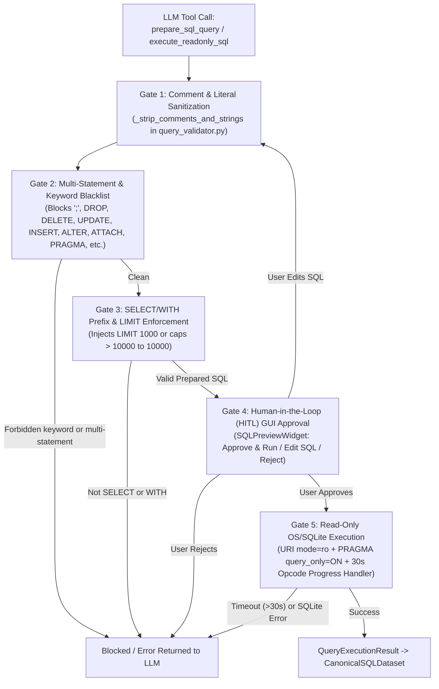

### 13.2 Detailed Rules in `validate_and_prepare_sql()` (`database/query_validator.py`)

1. **Non-Empty Check:** Rejects empty or whitespace-only queries.
2. **Comment & String Masking (`_strip_comments_and_strings`):** Replaces `--` line comments, `/* ... */` block comments, and `'...'` / `"..."` string literals with spaces so keyword scanning is immune to false positives inside string filters (e.g., `WHERE status = 'deleted'`) while preventing comment-smuggled payloads.
3. **Multi-Statement Prevention:** Trailing semicolons are stripped (`sql.rstrip("; \t\n\r")`). If any semicolon `;` remains in the stripped SQL, validation fails immediately with `"Multiple SQL statements are not allowed."`
4. **Word-Boundary Forbidden Keyword Check (`FORBIDDEN_KEYWORDS`):** Scans for 20 prohibited keywords/phrases using `\b<KEYWORD>\b`:
   - DDL/DML: `INSERT`, `UPDATE`, `DELETE`, `DROP`, `ALTER`, `CREATE`, `REPLACE`, `TRUNCATE`, `UPSERT`, `MERGE`
   - Database/Transaction Admin: `ATTACH`, `DETACH`, `VACUUM`, `REINDEX`, `PRAGMA`, `BEGIN`, `COMMIT`, `ROLLBACK`, `SAVEPOINT`, `RELEASE`
   - SQLite System Bypass Patterns (`FORBIDDEN_PATTERNS`): `load_extension(...)`, `sqlite_master` combined with write operations, and `INTO OUTFILE`.
5. **`SELECT` / `WITH` Structural Enforcement:** The first token must be `SELECT` or `WITH` (and a `WITH` CTE must contain a `SELECT` body).
6. **Automatic `LIMIT` Injection & Clamping (`_enforce_limit`):**
   - If the query has no top-level `LIMIT` clause, appends `LIMIT 1000` (`default_limit`).
   - If the query specifies `LIMIT N` where `N > 10000` (`hard_max_limit`), rewrites the clause to `LIMIT 10000` and attaches a warning.
7. **Heuristic Warning Generation:** Emits non-blocking warnings shown in `SQLPreviewWidget` when `SELECT *` is used or when `CROSS JOIN` appears without a `WHERE`/`ON` clause.

### 13.3 Read-Only Execution & Timeout Enforcement (`database/executor.py`)

When `execute_readonly_query()` runs:
1. Re-runs `validate_and_prepare_sql()` as a defense-in-depth guarantee (even if `prepare_sql_query` was called earlier).
2. Opens `get_readonly_connection()` (`database/connection.py`), which connects via `sqlite3.connect(f"file:{db_path.as_posix()}?mode=ro", uri=True)` and executes `PRAGMA query_only = ON;`.
3. Registers a wall-clock timeout callback via `conn.set_progress_handler(_progress_handler, 1000)`. Every 1,000 SQLite virtual machine instructions, `_progress_handler` checks `(time.perf_counter() - start_time) > timeout_seconds` (`30.0s` default) and returns `1` to abort runaway Cartesian joins with `sqlite3.OperationalError("interrupted")`.
4. Fetches `effective_max_rows + 1` rows via `cursor.fetchmany()` to detect whether results were truncated without loading unbounded result sets into memory.

> *Optional modular references:* [`docs/solution/08-sql-generation-and-database-access.md`](./solution/08-sql-generation-and-database-access.md), [`docs/solution/knowledge-graphs/05-sql-approval-and-execution.md`](./solution/knowledge-graphs/05-sql-approval-and-execution.md)

---

## 14. SQLite Database Architecture and Actual Schema Reference

### 14.1 Analytical Database Overview (`data/ecommerce.db`)

The analytical database `data/ecommerce.db` (`database/schema.sql`, seeded deterministically by `database/seed_data.py` with `SEED = 42`) models a multi-national outdoor and athletic e-commerce retailer across **7 normalized tables**, **499,385 total rows**, and **22 analytical indexes** (SHA-256: `c5a5965e000becdb75d0802897cb047dc2f827d1fdc7bacdf9d53ef7a46b6934`).

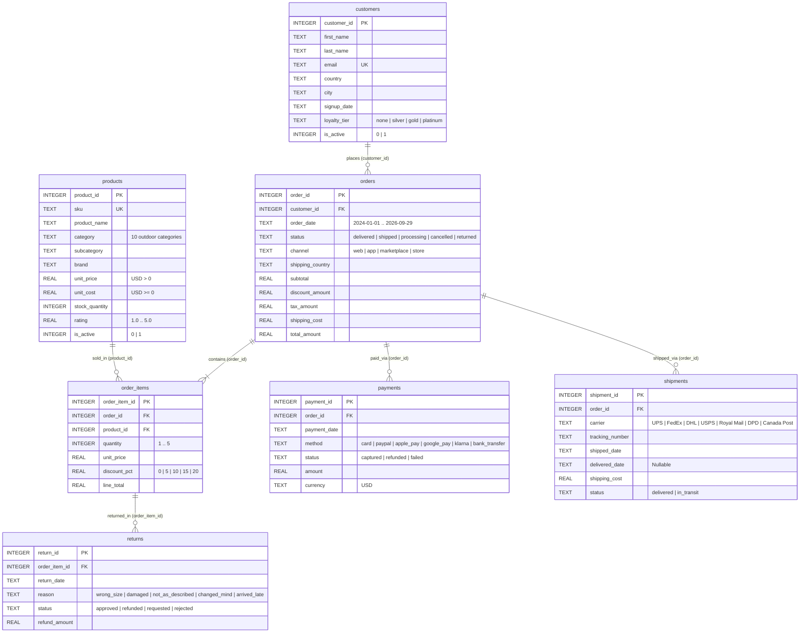

### 14.2 Complete Table, Row Count, Index, and Domain Value Reference

| Table Name | Exact Row Count | Primary Key | Foreign Keys | Indexes (`22` Total) | Exact Categorical Domain Values / Ranges |
| :--- | :---: | :--- | :--- | :--- | :--- |
| **`customers`** | `26,000` | `customer_id` | — | `idx_customers_country`, `idx_customers_loyalty_tier`, `idx_customers_signup_date` | `loyalty_tier`: `'gold'`, `'none'`, `'platinum'`, `'silver'`<br/>`country` (12): `'United States'`, `'United Kingdom'`, `'Germany'`, `'Canada'`, `'France'`, `'Australia'`, `'Netherlands'`, `'Sweden'`, `'Spain'`, `'Italy'`, `'Japan'`, `'Switzerland'` |
| **`products`** | `1,500` | `product_id` | — | `idx_products_category`, `idx_products_brand`, `idx_products_subcategory` | `category` (10): `'Accessories'`, `'Apparel'`, `'Backpacks'`, `'Climbing'`, `'Cooking'`, `'Footwear'`, `'Lighting'`, `'Navigation'`, `'Sleeping Bags'`, `'Tents'` |
| **`orders`** | `90,000` | `order_id` | `customer_id` → `customers(customer_id)` | `idx_orders_customer_id`, `idx_orders_order_date`, `idx_orders_status`, `idx_orders_channel`, `idx_orders_shipping_country` | `order_date`: `'2024-01-01 00:08:26'` to `'2026-09-29 23:22:24'`<br/>`status`: `'cancelled'`, `'delivered'`, `'processing'`, `'returned'`, `'shipped'`<br/>`channel`: `'app'`, `'marketplace'`, `'store'`, `'web'` |
| **`order_items`** | `200,000` | `order_item_id` | `order_id` → `orders(order_id)`,<br/>`product_id` → `products(product_id)` | `idx_order_items_order_id`, `idx_order_items_product_id` | `quantity`: `1..5`<br/>`discount_pct`: `0.0`, `5.0`, `10.0`, `15.0`, `20.0`<br/>`line_total = round(quantity * unit_price * (1 - discount_pct/100), 2)` |
| **`payments`** | `90,000` | `payment_id` | `order_id` → `orders(order_id)` | `idx_payments_order_id`, `idx_payments_method`, `idx_payments_status` | `method`: `'apple_pay'`, `'bank_transfer'`, `'card'`, `'google_pay'`, `'klarna'`, `'paypal'`<br/>`status`: `'captured'`, `'failed'`, `'refunded'`<br/>`currency`: `'USD'` |
| **`shipments`** | `83,885` | `shipment_id` | `order_id` → `orders(order_id)` | `idx_shipments_order_id`, `idx_shipments_carrier`, `idx_shipments_status` | `carrier`: `'Canada Post'`, `'DHL'`, `'DPD'`, `'FedEx'`, `'Royal Mail'`, `'UPS'`, `'USPS'`<br/>`status`: `'delivered'`, `'in_transit'` (no shipments for cancelled orders) |
| **`returns`** | `8,000` | `return_id` | `order_item_id` → `order_items(order_item_id)` | `idx_returns_order_item_id`, `idx_returns_reason`, `idx_returns_status` | `reason`: `'arrived_late'`, `'changed_mind'`, `'damaged'`, `'not_as_described'`, `'wrong_size'`<br/>`status`: `'approved'`, `'refunded'`, `'rejected'`, `'requested'` |

> *Optional modular reference:* [`docs/solution/appendices/database-schema-reference.md`](./solution/appendices/database-schema-reference.md)

---

## 15. Security Model and Safety Mechanisms

### 15.1 Five-Layer Defense-in-Depth Architecture

The Local Report SQL Agent enforces five concentric security boundaries to protect the host machine, the analytical database (`data/ecommerce.db`), and the integrity of generated reports:

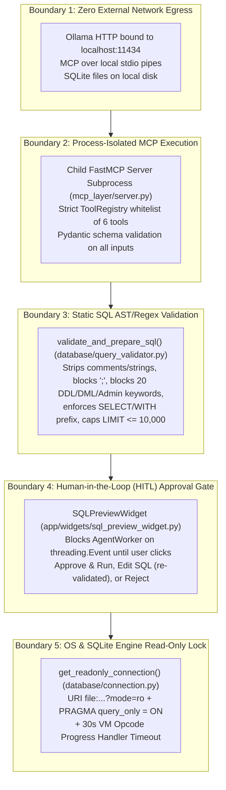

### 15.2 Threat Matrix and Concrete Code Mitigations

| Threat / Attack Vector | Mitigation Mechanism | Enforcing Code Location |
| :--- | :--- | :--- |
| **Destructive DDL/DML (`DROP`, `DELETE`, `UPDATE`, `INSERT`, `ALTER`)** | Blocked by word-boundary regex check after stripping comments/strings, AND rejected at the SQLite engine level by `mode=ro` + `PRAGMA query_only = ON`. | `database/query_validator.py` → `validate_and_prepare_sql()`, `database/connection.py` → `get_readonly_connection()` |
| **Stacked Query / Multi-Statement Injection (`SELECT 1; DROP TABLE orders`)** | Any semicolon `;` remaining after stripping trailing `;` and string literals causes immediate validation failure (`"Multiple SQL statements are not allowed."`). | `database/query_validator.py:L117-L124` |
| **Comment-Hidden Keyword Smuggling (`SEL/**/ECT` or `--` tricks)** | `_strip_comments_and_strings()` removes all `--` and `/* ... */` comments prior to structural and keyword analysis. | `database/query_validator.py` → `_strip_comments_and_strings()` |
| **SQLite File Exfiltration (`ATTACH DATABASE`, `load_extension`, `INTO OUTFILE`)** | `ATTACH`, `DETACH`, `PRAGMA`, `load_extension\s*\(`, and `INTO\s+OUTFILE` are explicitly blacklisted in `FORBIDDEN_KEYWORDS` and `FORBIDDEN_PATTERNS`. | `database/query_validator.py:L18-L39` |
| **Denial-of-Service via Unbounded Rows (`SELECT * FROM order_items`)** | `_enforce_limit()` automatically appends `LIMIT 1000` (`default_limit`) or clamps user-specified `LIMIT > 10000` down to `10000` (`hard_max_limit`). | `database/query_validator.py` → `_enforce_limit()` |
| **Denial-of-Service via Runaway Cartesian Join** | `conn.set_progress_handler(_progress_handler, 1000)` aborts any query exceeding `30.0` seconds wall-clock time. | `database/executor.py:L74-L82` |
| **Unauthorized Tool Invocation / Hallucinated Tool Names** | `ToolRegistry.validate_tool_call()` rejects any tool name not discovered in `EXPECTED_MCP_TOOLS`. | `mcp_layer/client.py` → `ToolRegistry.validate_tool_call()` |
| **User-Edited SQL Bypassing Validation** | If a user edits SQL in `SQLPreviewWidget`, `ToolHandler` re-invokes `prepare_sql_query` on the modified SQL before calling `execute_readonly_sql`. | `agent/tool_handler.py:L212-L234` |

> *Optional modular references:* [`docs/solution/09-security-and-approval-workflow.md`](./solution/09-security-and-approval-workflow.md), [`docs/solution/knowledge-graphs/07-security-boundaries.md`](./solution/knowledge-graphs/07-security-boundaries.md)

---

## 16. Skills and Domain Knowledge Loading

### 16.1 Markdown Skill Architecture (`skills/`, `agent/skill_manager.py`)

Domain-specific analytical rules, KPI formulas, SQLite date idioms, and chart selection heuristics are modularized into five Markdown skill files stored in `skills/`:

| Skill File (`skills/*.md`) | Skill ID | Version | Tags & Trigger Focus | Core Domain Knowledge Provided |
| :--- | :--- | :---: | :--- | :--- |
| `sql_analytics_skill.md` | `sql_analytics_core` | `1.1.0` | `sql`, `sqlite`, `joins`, `aggregation`, `date`, `revenue`, `margin` | SQLite `strftime` idioms, `NULLIF` safe division, net revenue (`status NOT IN ('cancelled', 'returned')`), gross profit margin, AOV, and CTE patterns. |
| `ecommerce_domain_skill.md` | `ecommerce_domain_knowledge` | `1.1.0` | `ecommerce`, `retail`, `orders`, `customers`, `returns`, `shipments`, `payments` | Table grain definitions, exact categorical status values (`delivered`, `captured`, `approved`/`refunded`), return rate formula, and carrier SLA metrics. |
| `executive_reporting_skill.md` | `executive_reporting_standards` | `1.1.0` | `report`, `pdf`, `executive`, `kpi`, `summary`, `recommendations` | Executive pyramid structure (Headline Answer → KPI Scorecard → Visual Evidence → Strategic Recommendations) and strict canonical data adherence. |
| `chart_selection_skill.md` | `chart_selection_guidelines` | `1.1.0` | `chart`, `visualization`, `bar`, `line`, `pie`, `pareto`, `waterfall`, `heatmap` | Mapping analytical question shapes (time-series, categorical ranking, part-to-whole, bivariate correlation, geographic) to the 25 `ChartRegistry` keys. |
| `recovery_and_validation_skill.md` | `recovery_and_validation_rules` | `1.0.0` | `validation`, `error`, `recovery`, `schema`, `consistency`, `self-correction` | Self-correction playbooks for `no such column`, empty result sets (`0 rows`), timeout mitigation, and numerical consistency verification. |

### 16.2 Skill Discovery, Relevance Scoring, and Database Sync (`SkillManager`)

1. **Parsing (`_parse_skill_file`):** Extracts YAML frontmatter (`id`, `name`, `description`, `version`, `tags`, `triggers`, `priority`) and Markdown body content, computing a SHA-256 content checksum.
2. **Persistence Sync (`sync_with_repository`):** Upserts each skill's metadata, checksum, and priority into the `skill_registry` table in `data/agent_memory.db` (`memory/repository.py`) and tracks `usage_count`.
3. **Query-Time Relevance Ranking (`select_relevant_skills`):** For each user prompt, `SkillManager` scores every enabled skill:
   - `+3.0` points per matching `trigger` substring in the prompt.
   - `+2.0` points per matching `tag` token.
   - `+1.0` point per matching word in the skill's `name` or `description`.
   - Multiplies raw score by `(1.0 + priority * 0.1)`.
   - Selects the top `max_skills = 3` skills and formats their bodies within `max_chars = 4800` (~`1,200` tokens) for injection into `ContextBuilder`'s `domain_skills` section (`SectionPriority.MEDIUM`).

> *Optional modular reference:* [`docs/solution/12-skills-and-domain-knowledge.md`](./solution/12-skills-and-domain-knowledge.md)

---

## 17. Working, Episodic, and Semantic Memory Architecture, Checkpoints, and Recovery Mechanisms

### 17.1 Three-Tier Memory Hierarchy

The agent maintains state across three complementary memory tiers:

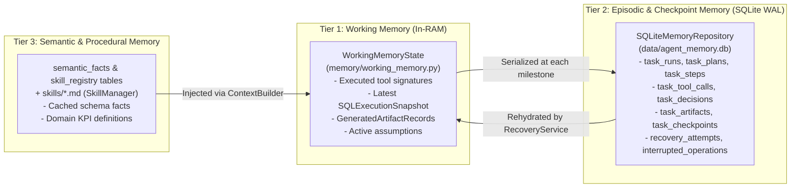

### 17.2 Complete Schema of `data/agent_memory.db` (11 Tables Across 3 Migrations)

`SQLiteMemoryRepository` (`memory/repository.py`) initializes `data/agent_memory.db` with `PRAGMA journal_mode = WAL;` and `PRAGMA synchronous = NORMAL;`, applying three deterministic SQL migrations located in `memory/migrations/`:

| Migration File | Table Name | Primary Key | Purpose & Key Columns |
| :--- | :--- | :--- | :--- |
| `001_initial_schema.sql` | `schema_migrations` | `version` | Tracks applied migration versions (`001`, `002`, `003`) and `applied_at` timestamps. |
| `001_initial_schema.sql` | `task_runs` | `task_id` | Master record per user request: `session_id`, `user_query`, `status` (`RUNNING`, `AWAITING_APPROVAL`, `COMPLETED`, `FAILED`, `CANCELLED`, `INTERRUPTED`), `current_step_id`, `final_answer`, `error_message`. |
| `001_initial_schema.sql` | `task_plans` | `plan_id` | Serialized `TaskPlan` JSON (`plan_json`), `requires_report`, `requires_csv`, `total_steps`. |
| `001_initial_schema.sql` | `task_steps` | `id` (Auto) | Individual plan steps (`task_id`, `step_id`, `step_Order`, `title`, `tool_hint`, `status`, `summary`). |
| `001_initial_schema.sql` | `task_decisions` | `id` (Auto) | Audit log of agent/user decisions (`decision_type`, `rationale`, `payload_json`), including HITL SQL approval/rejection. |
| `001_initial_schema.sql` | `task_tool_calls` | `call_id` | Full trace of every MCP tool invocation (`task_id`, `tool_name`, `arguments_json`, `result_summary_json`, `success`, `duration_ms`). |
| `001_initial_schema.sql` | `task_artifacts` | `artifact_id` | Generated PDF/CSV/Chart files (`task_id`, `artifact_type`, `file_path`, `file_name`, `metadata_json`). |
| `001_initial_schema.sql` | `semantic_facts` | `fact_key` | Key-value store for learned schema and domain facts (`category`, `fact_value`, `confidence`). |
| `001_initial_schema.sql` + `003` | `skill_registry` | `skill_id` | Indexed Markdown skills (`name`, `file_path`, `version`, `checksum`, `priority`, `tags_json`, `triggers_json`, `usage_count`). |
| `002_checkpoint_recovery.sql` | `task_checkpoints` | `checkpoint_id` | Step-level state snapshots (`task_id`, `checkpoint_stage`, `working_memory_json`, `canonical_dataset_json`, `plan_snapshot_json`, `is_terminal`). |
| `002_checkpoint_recovery.sql` | `recovery_attempts` | `attempt_id` | Audit log of crash recovery executions (`task_id`, `checkpoint_id`, `action`, `outcome`, `details`). |
| `002_checkpoint_recovery.sql` | `interrupted_operations` | `operation_id` | Tracks in-flight operations (`mcp_tool_call`, `sql_approval`, `pdf_generation`) that were interrupted mid-flight. |

### 17.3 Checkpoint Lifecycle & Crash Recovery (`CheckpointManager` & `RecoveryService`)

1. **Milestone Checkpointing (`memory/checkpoint_manager.py`):** During `AgentOrchestrator.process_message()`, `CheckpointManager.save_checkpoint()` persists a full snapshot at five stages:
   - `plan_created` (after `TaskPlanner` builds the plan)
   - `sql_prepared` (after `prepare_sql_query` succeeds)
   - `sql_executed` (after `execute_readonly_sql` succeeds, storing serialized `CanonicalSQLDataset`)
   - `report_generated` (after `generate_pdf_report` or `generate_csv_report` completes)
   - `task_completed` (terminal checkpoint when turn finishes)
2. **Startup Detection (`memory/recovery_service.py` → `scan_for_recoverable_tasks()`):** On startup, `RecoveryService` queries `task_runs` for tasks in `RUNNING`, `AWAITING_APPROVAL`, or `INTERRUPTED` status that have a valid non-terminal checkpoint in `task_checkpoints`.
3. **Interactive Resume or Discard:** `MainWindow` displays a recovery banner showing the interrupted prompt and last completed stage.
   - If the user clicks **Resume Task**, `AgentOrchestrator.resume_recoverable_task(task_id)` calls `RecoveryService.reconstruct_task_context(task_id)`, restores `WorkingMemoryState`, `TaskPlan`, and `CanonicalSQLDataset` (so already-executed SQL does not need to be re-run if it already succeeded), and continues execution to completion.
   - If the user clicks **Discard**, `RecoveryService.discard_recoverable_task(task_id)` marks the run as `CANCELLED` in `agent_memory.db`.

> *Optional modular references:* [`docs/solution/13-memory-checkpoints-and-recovery.md`](./solution/13-memory-checkpoints-and-recovery.md), [`docs/solution/knowledge-graphs/08-agent-memory-and-recovery.md`](./solution/knowledge-graphs/08-agent-memory-and-recovery.md)

---

## 18. Canonical Dataset Architecture and Single-Source-of-Truth Reporting Rules

### 18.1 The Split-Brain Reporting Problem & Canonical Solution

In naive LLM reporting pipelines, the LLM summarizes query results in prose while a separate script plots charts or formats tables—often resulting in conflicting totals, hallucinated percentages, or mismatched row counts.

The Local Report SQL Agent eliminates this class of bugs via `CanonicalSQLDataset` (`reporting/canonical_data.py`):

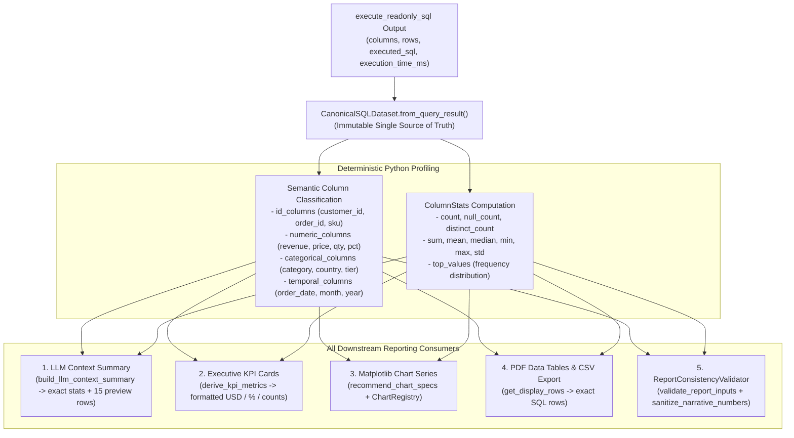

### 18.2 Semantic Column Classification Rules (`CanonicalSQLDataset._analyze_columns`)

When `CanonicalSQLDataset.from_query_result()` inspects the returned rows, it classifies each column deterministically:

1. **ID Columns (`id_columns`):** Column names matching `(^id$|_id$|^sku$|_code$|^uuid$|^pk$)` (e.g., `customer_id`, `order_id`, `product_id`). Crucially, ID columns are **excluded from `numeric_columns`** so the reporting engine never computes nonsensical metrics like `"Total customer_id = $338,013,000"` or plots `order_id` as a revenue bar chart.
2. **Temporal Columns (`temporal_columns`):** Column names matching `(date|time|month|year|quarter|week|day|period|created|updated)` or string values matching ISO date/month patterns (`^\d{4}-\d{2}`).
3. **Numeric Columns (`numeric_columns`):** Non-ID, non-temporal columns where `>= 80%` of non-null values parse as finite `int`/`float` numbers. For each numeric column, `ColumnStats` computes exact `total_sum`, `mean`, `median`, `min_val`, `max_val`, and sample `std_dev`.
4. **Categorical Columns (`categorical_columns`):** Remaining string/status/category columns, for which `ColumnStats` computes `distinct_count` and the top 10 most frequent `(value, count)` pairs (`top_values`).

### 18.3 `ReportConsistencyValidator` and Narrative Number Sanitization (`reporting/canonical_data.py`)

Before any PDF is generated (`generate_pdf_report_tool` in `mcp_layer/tools/reporting_tools.py`), `ReportConsistencyValidator` enforces three invariants:
1. **KPI Override (`derive_kpi_metrics`):** Recomputes or verifies `kpi_metrics` directly from `CanonicalSQLDataset.column_stats`, formatting currency columns (`revenue`, `sales`, `amount`, `price`, `cost`, `profit`, `refund`) with `$` and rate/margin columns (`pct`, `rate`, `margin`, `share`) with `%`.
2. **Chart Spec Verification (`validate_report_inputs`):** Verifies that every `x_column` and `y_column` in `chart_specs` actually exists in `dataset.columns`. Invalid specs are automatically replaced with `dataset.recommend_chart_specs()`.
3. **Narrative Number Sanitization (`sanitize_narrative_numbers`):** Extracts numeric tokens from the LLM's `executive_summary` and `key_findings` and cross-checks them against the set of valid numbers present in `CanonicalSQLDataset` (raw cell values, column sums, means, medians, min/max, row counts, and percentage shares within a `1.5%` rounding tolerance).

> *Optional modular references:* [`docs/solution/10-reporting-pipeline-and-canonical-data.md`](./solution/10-reporting-pipeline-and-canonical-data.md), [`docs/solution/knowledge-graphs/06-report-generation-data-flow.md`](./solution/knowledge-graphs/06-report-generation-data-flow.md)

---

## 19. Reporting Pipeline and Deterministic KPI Calculation

### 19.1 End-to-End Reporting Pipeline (`mcp_layer/tools/reporting_tools.py`)

When `AgentOrchestrator` invokes `generate_pdf_report` (or `generate_csv_report`), the request flows through a 7-stage deterministic pipeline:

1. **ToolHandler Argument Hydration (`agent/tool_handler.py` → `_hydrate_report_arguments`):**
   - Small local LLMs do not need to copy hundreds of SQL rows back into the `generate_pdf_report` JSON arguments. `ToolHandler` automatically injects `columns`, `rows`, and `executed_sql` from `self._last_sql_result` (`CanonicalSQLDataset`), plus auto-derived `kpi_metrics` and `chart_specs` if the LLM omitted them.
2. **Canonical Reconstruction (`generate_pdf_report_tool`):**
   - Re-instantiates `CanonicalSQLDataset.from_query_result(columns, rows, executed_sql)` inside the MCP server process.
3. **Consistency Validation & KPI Synthesis:**
   - Runs `ReportConsistencyValidator.validate_report_inputs()` to merge deterministic KPIs (Total Records, Sum/Average of primary monetary/quantity columns, Top Category Share) and sanitize narrative text.
4. **Batch Chart Rendering (`reporting/chart_generator.py` → `generate_charts_batch`):**
   - Renders up to 4 high-resolution (`200 DPI`) PNG charts into `charts/` using `ChartRegistry` and headless Matplotlib (`Agg`).
5. **PDF Composition (`compose_dynamic_pdf` or `generate_pdf_file`):**
   - By default (`use_dynamic_composer=True`), invokes `compose_dynamic_pdf()` (`reporting/dynamic_pdf_composer.py`), which adapts section depth to query complexity and falls back to `generate_pdf_file()` (`reporting/pdf_generator.py`) if needed.
6. **Report Index Registration (`reporting/report_manager.py`):**
   - Records a `ReportRecord` in `reports/report_index.json` with `report_id`, `title`, `report_type`, `file_path`, `file_size_bytes`, `row_count`, and `created_at`.
7. **Artifact Card Emission:**
   - Returns the file metadata to `AgentOrchestrator`, which records the artifact in `agent_memory.db` (`task_artifacts`), creates a `report_generated` checkpoint, and emits a clickable PDF/CSV card in the GUI chat stream and `ReportViewerWidget`.

### 19.2 Deterministic KPI Derivation Logic (`CanonicalSQLDataset.derive_kpi_metrics`)

`CanonicalSQLDataset.derive_kpi_metrics(max_kpis=6)` generates executive KPI cards without LLM math:
- **KPI 1 — Total Records Analyzed:** `f"{self.row_count:,}"` (or if a single-row aggregate query returned 1 row, displays the direct aggregate columns).
- **KPIs 2..N — Numeric Column Aggregations:** Iterates through `self.numeric_columns`:
  - For additive volume/monetary columns (`revenue`, `sales`, `total`, `amount`, `cost`, `profit`, `refund`, `quantity`, `count`, `orders`, `units`): computes exact `stats.total_sum` (formatted as `$X,XXX.XX` for currency or `X,XXX` for counts) and, when `row_count > 1`, also provides `Avg <Column>` (`stats.mean`).
  - For rate/ratio/score columns (`rate`, `pct`, `percent`, `margin`, `discount`, `rating`, `score`, `avg`): reports `Avg <Column>` (`stats.mean`, formatted with `%` for percentage columns or `2` decimals for scores) rather than summing percentages.
- **KPI Top Category Leader:** For the primary categorical column, identifies `stats.top_values[0]` (the highest-frequency or top-ranked category).

---

## 20. PDF Generation and CSV Export Architecture

### 20.1 Dual-Engine ReportLab PDF Architecture (`reporting/pdf_generator.py` & `reporting/dynamic_pdf_composer.py`)

Both PDF engines are built on **ReportLab Platypus** (`SimpleDocTemplate` + `_NumberedCanvas`) using an A4 portrait layout (`210mm × 297mm`, `18mm` left/right margins, `20mm` top/bottom margins):

1. **Two-Pass Page Numbering (`_NumberedCanvas` in `reporting/pdf_generator.py`):**
   - Caches canvas states during the first layout pass and renders a corporate header stripe and a bottom footer (`"Confidential — Local Report SQL Agent | Generated YYYY-MM-DD HH:MM | Page X of Y"`) on every page during `save()`.
2. **Standard Executive PDF Layout (`generate_pdf_file`):**
   - **Banner Header Block:** Dark navy title table (`#1E293B`), subtitle, generation timestamp, and metadata badges.
   - **Executive Summary & Key Findings:** Styled narrative paragraphs and bulleted insight list.
   - **KPI Scorecard Grid:** 3-column ReportLab `Table` of KPI cards with slate borders (`#CBD5E1`), muted uppercase labels, and bold navy metric values.
   - **Visualizations Section:** Proportional scaling of each `200 DPI` chart PNG (`max_width = 170mm`, `max_height = 95mm`) wrapped in `KeepTogether` with figure captions.
   - **Data Preview Table:** Up to `100` rows formatted with automatic column width allocation, text wrapping, numeric right-alignment, currency/float formatting, and alternating row shading (`#F8FAFC` / `#FFFFFF`).
   - **Strategic Recommendations & SQL Appendix:** Actionable recommendations followed by a monospace box showing the exact validated SQL query executed.
3. **Adaptive Dynamic Composer (`compose_dynamic_pdf` in `reporting/dynamic_pdf_composer.py`):**
   - Calls `analyze_query_complexity(executed_sql, dataset)` to score query sophistication (`JOIN` count, `GROUP BY` dimensions, CTEs, window functions, column diversity).
   - Dynamically adds **Automated Statistical Insights** (top/bottom performers, concentration share, dispersion/coefficient of variation `std / mean`) and **Column-by-Column Statistical Profile Tables** (`Min`, `Median`, `Mean`, `Max`, `Std Dev`, `Sum`) computed directly from `CanonicalSQLDataset.column_stats`.

### 20.2 UTF-8 CSV Export Engine (`reporting/csv_generator.py`)

`generate_csv_file()` exports the full query dataset (`rows` and `columns`) to `reports/<sanitized_title>_<timestamp>.csv`:
- Uses UTF-8 encoding (`encoding="utf-8"`, `newline=""`).
- When `include_metadata_header=True`, prepends `#`-prefixed metadata comment lines (`# Report Title`, `# Generated At`, `# User Query`, `# Row Count`, `# Executed SQL`).
- Serializes all rows via `csv.DictWriter` (`extrasaction="ignore"`) and registers the resulting `.csv` file in `ReportHistoryManager`.

---

## 21. Supported Charts, Visualizations, Tables, and Layout Mechanisms

### 21.1 Complete `ChartRegistry` Reference (`25` Registered Keys Across 6 Modules)

The visualization subsystem (`reporting/chart_registry.py`, `reporting/chart_generator.py`, and `reporting/charts/*`) provides **25 registered chart keys** (19 specialized chart builders in `reporting/charts/*` plus 6 core/general chart types in `reporting/chart_generator.py`), all rendered headlessly via Matplotlib's `Agg` backend at `200 DPI` using the corporate palette defined in `reporting/charts/theme.py`:

| # | Registry Key | Category | Implementation Module & Function | Primary Analytical Use Case |
| :-: | :--- | :--- | :--- | :--- |
| **1** | `kpi_card` | `Executive` | `reporting/charts/executive_charts.py` → `render_kpi_card_chart()` | Visual multi-tile executive KPI scorecard image with primary values and delta indicators. |
| **2** | `gauge` | `Executive` | `reporting/charts/executive_charts.py` → `render_gauge_chart()` | Semi-circular radial dial gauge comparing a rate/margin metric against target thresholds. |
| **3** | `bullet` | `Executive` | `reporting/charts/executive_charts.py` → `render_bullet_chart()` | Stephen Few horizontal bullet graph comparing actual performance against qualitative bands. |
| **4** | `waterfall` | `Advanced` | `reporting/charts/advanced_charts.py` → `render_waterfall_chart()` | Sequential positive/negative contribution bridge from starting value to net total. |
| **5** | `pareto` | `Advanced` | `reporting/charts/advanced_charts.py` → `render_pareto_chart()` | Dual-axis descending bar chart + cumulative percentage curve with `80%` cutoff line. |
| **6** | `box_plot` | `Advanced` | `reporting/charts/advanced_charts.py` → `render_box_plot_chart()` | Quartile distribution (`IQR`, median, whiskers, outliers) across categories. |
| **7** | `histogram` | `Advanced` | `reporting/charts/advanced_charts.py` → `render_histogram_chart()` | Continuous numeric frequency distribution with mean and median vertical markers. |
| **8** | `heatmap` | `Advanced` | `reporting/charts/advanced_charts.py` → `render_heatmap_chart()` | 2D color-encoded matrix for cross-tabulated dimensions or correlation matrices. |
| **9** | `treemap` | `Advanced` | `reporting/charts/advanced_charts.py` → `render_treemap_chart()` | Squarified area-proportional rectangles showing hierarchical or categorical share. |
| **10** | `Choropleth_bar` | `Geographic` | `reporting/charts/geo_charts.py` → `render_geo_choropleth_bar_chart()` | Color-graded geographic ranking chart by country/region with share annotations. |
| **11** | `geo_bubble` | `Geographic` | `reporting/charts/geo_charts.py` → `render_geo_bubble_chart()` | Lat/Lon or regional coordinate scatter plot with bubble area scaled to volume/revenue. |
| **12** | `region_comparison` | `Geographic` | `reporting/charts/geo_charts.py` → `render_region_comparison_chart()` | Multi-metric normalized side-by-side comparison across top geographic markets. |
| **13** | `conditional_table` | `Tables` | `reporting/charts/table_charts.py` → `render_conditional_table_chart()` | Heatmap-shaded data table figure highlighting high/low cell outliers. |
| **14** | `ranking_table` | `Tables` | `reporting/charts/table_charts.py` → `render_ranking_table_chart()` | Leaderboard table with rank badges and inline horizontal data bars. |
| **15** | `summary_stats_table` | `Tables` | `reporting/charts/table_charts.py` → `render_summary_stats_table_chart()` | Descriptive statistics matrix (`Count`, `Sum`, `Mean`, `Median`, `Min`, `Max`, `Std`). |
| **16** | `funnel` | `Specialized` | `reporting/charts/specialized_charts.py` → `render_funnel_chart()` | Centered stage-by-stage conversion funnel (e.g., order or payment status progression). |
| **17** | `radar` | `Specialized` | `reporting/charts/specialized_charts.py` → `render_radar_chart()` | Multi-axis spider/polar polygon comparing top entities across 3–8 normalized metrics. |
| **18** | `area_trend` | `Specialized` | `reporting/charts/specialized_charts.py` → `render_area_trend_chart()` | Shaded time-series trend line with moving-average overlay and peak/trough callouts. |
| **19** | `lollipop` | `Specialized` | `reporting/charts/specialized_charts.py` → `render_lollipop_chart()` | High data-ink ratio stem-and-dot ranking chart for categorical comparisons. |
| **20** | `bar` | `General` | `reporting/chart_generator.py` → `_render_bar_chart()` | Classic vertical column chart with automatic value labels and rotated X ticks. |
| **21** | `horizontal_bar` | `General` | `reporting/chart_generator.py` → `_render_horizontal_bar_chart()` | Ranked horizontal bar chart ideal for long product or category names. |
| **22** | `line` | `General` | `reporting/chart_generator.py` → `_render_line_chart()` | Multi-point temporal or sequential line plot with markers and gridlines. |
| **23** | `pie` | `General` | `reporting/chart_generator.py` → `_render_pie_chart()` | Donut/pie composition chart (automatically groups tail slices > 7 into `"Other"`). |
| **24** | `scatter` | `General` | `reporting/chart_generator.py` → `_render_scatter_chart()` | Bivariate `X` vs. `Y` correlation scatter plot with linear trendline overlay. |
| **25** | `stacked_bar` | `General` | `reporting/chart_generator.py` → `_render_stacked_bar_chart()` | Multi-series stacked column chart comparing sub-segment composition across categories. |

### 21.2 Smart Column Resolution & Automatic Chart Recommendation (`ChartRegistry`)

If the LLM requests a chart with missing or slightly mismatched column names, `ChartRegistry.resolve_columns(request, columns, rows)` automatically binds `x_column` to the first temporal or categorical column and `y_column` to the primary non-ID numeric column. Furthermore, `CanonicalSQLDataset.recommend_chart_specs()` inspects the shape of the result set:
- **Temporal + Numeric columns present:** Recommends an `area_trend` (or `line`) chart over time plus a `pareto` or `bar` breakdown if a categorical dimension is also present.
- **Geographic column (`country`, `shipping_country`, `city`) + Numeric column:** Recommends `choropleth_bar` and `pareto`.
- **Categorical (`<= 7` distinct values) + Numeric column:** Recommends `pie` and `bar`.
- **Categorical (`> 7` distinct values) + Numeric column:** Recommends `horizontal_bar` and `pareto`.
- **Two or more Numeric columns:** Adds a `scatter` correlation chart or `summary_stats_table`.

> *Optional modular reference:* [`docs/solution/11-pdf-generation-and-visualizations.md`](./solution/11-pdf-generation-and-visualizations.md)

---

## 22. Error Handling, Retries, Fallbacks, and Degraded Execution Paths

### 22.1 End-to-End Error Handling & Self-Correction Matrix

The system is designed so transient errors, SQL syntax mistakes by the local model, or invalid chart parameters trigger structured self-correction rather than crashing the GUI or background worker:

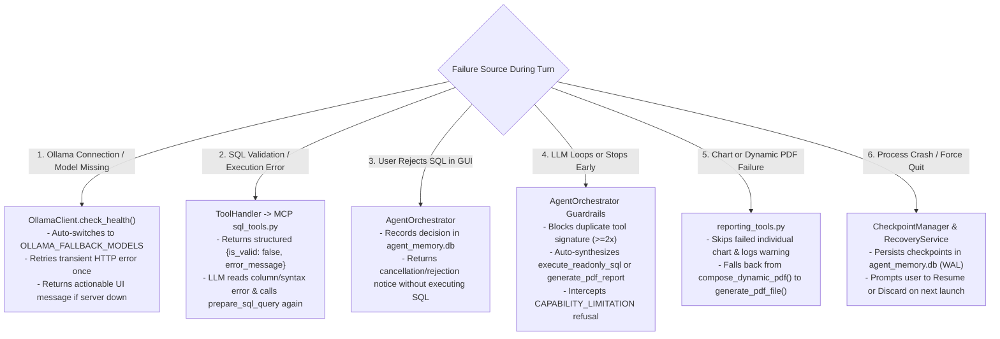

### 22.2 Detailed Failure Modes & Recovery Mechanisms

| Subsystem | Failure Condition | Automatic Recovery / Degraded Path | Code Anchor |
| :--- | :--- | :--- | :--- |
| **MCP Startup** | MCP subprocess fails to start or returns `< 6` tools | `discover_and_register_tools()` raises `RuntimeError` with exact missing tool list; GUI badge turns red (`MCP Error`) and alerts user immediately. | `mcp_layer/client.py:L215-L260` |
| **Ollama Model** | Configured `qwen3.5:4b` not installed locally | `OllamaClient.check_health()` scans `/api/tags` against `ollama_fallback_models` (`qwen2.5-coder:7b`, `qwen2.5:7b`, `llama3.1:8b`, `mistral:7b`) and binds to the first available model. | `agent/ollama_client.py:L90-L135` |
| **LLM Tool Formatting** | Model emits raw JSON in `content` instead of `tool_calls` | `_extract_fallback_tool_calls_from_text()` parses fenced or inline JSON objects matching registered MCP tool names into `ToolCallRequest` objects. | `agent/ollama_client.py:L240-L310` |
| **LLM Argument Naming** | Model passes `query` instead of `sql`, or `table` instead of `table_name` | `ToolHandler._normalize_arguments()` maps common parameter aliases (`query`/`statement` → `sql`, `table` → `table_name`, `charts` → `chart_specs`) before schema validation. | `agent/tool_handler.py:L115-L170` |
| **SQL Query Timeout** | Complex join exceeds `30.0s` (`query_timeout_seconds`) | SQLite progress handler aborts query after `30.0s`; `execute_readonly_query()` returns `"Query execution timed out after 30.0 seconds"` so the LLM can rewrite a simpler/indexed query. | `database/executor.py:L74-L115` |
| **PDF Composer Fault** | `compose_dynamic_pdf()` encounters an unexpected layout error | `generate_pdf_report_tool()` catches the exception, logs a warning, and automatically falls back to `generate_pdf_file()` so the user still receives a valid PDF report. | `mcp_layer/tools/reporting_tools.py:L165-L195` |

> *Optional modular references:* [`docs/solution/17-failure-modes-and-troubleshooting.md`](./solution/17-failure-modes-and-troubleshooting.md), [`docs/solution/knowledge-graphs/09-error-handling-and-recovery.md`](./solution/knowledge-graphs/09-error-handling-and-recovery.md)

---

## 23. Cross-Platform Packaging and Execution on macOS and Windows

### 23.1 PyInstaller Packaging Architecture (`ReportSQLAgent.spec` & `scripts/package_app.py`)

The project is engineered to package cleanly into a native desktop application on both **macOS** (`dist/ReportSQLAgent.app` + standalone `dist/ReportSQLAgent/ReportSQLAgent`) and **Windows** (`dist\ReportSQLAgent\ReportSQLAgent.exe`) using PyInstaller (`--onedir` collective bundle mode):

1. **Bundled Read-Only Assets (`datas` in `ReportSQLAgent.spec`):**
   - `data/ecommerce.db` and `database/schema.sql`
   - `memory/migrations/*.sql` (`001`–`003`)
   - `skills/*.md` (all 5 domain skills)
   - `app/styles.qss` (Qt6 dark theme stylesheet)
   - `.env.example`
2. **Hidden Imports (`hiddenimports` in `ReportSQLAgent.spec`):**
   - Explicitly bundles dynamic imports required by FastMCP (`mcp.server.fastmcp`, `mcp.client.stdio`, `anyio._backends._asyncio`), Pydantic (`pydantic_settings`), Matplotlib (`matplotlib.backends.backend_agg`), ReportLab (`reportlab.platypus`, `reportlab.graphics.barcode`), and all project subpackages (`config`, `database`, `mcp_layer`, `agent`, `memory`, `reporting`, `app`).

### 23.2 Frozen vs. Source Path Resolution (`config/paths.py` → `RuntimePaths`)

When running as a frozen PyInstaller bundle (`getattr(sys, "frozen", False) == True`), the bundle directory (`sys._MEIPASS`) is read-only (especially inside macOS `.app` bundles under Gatekeeper/App Translocation or Windows `Program Files`). `resolve_runtime_paths()` solves this cleanly:

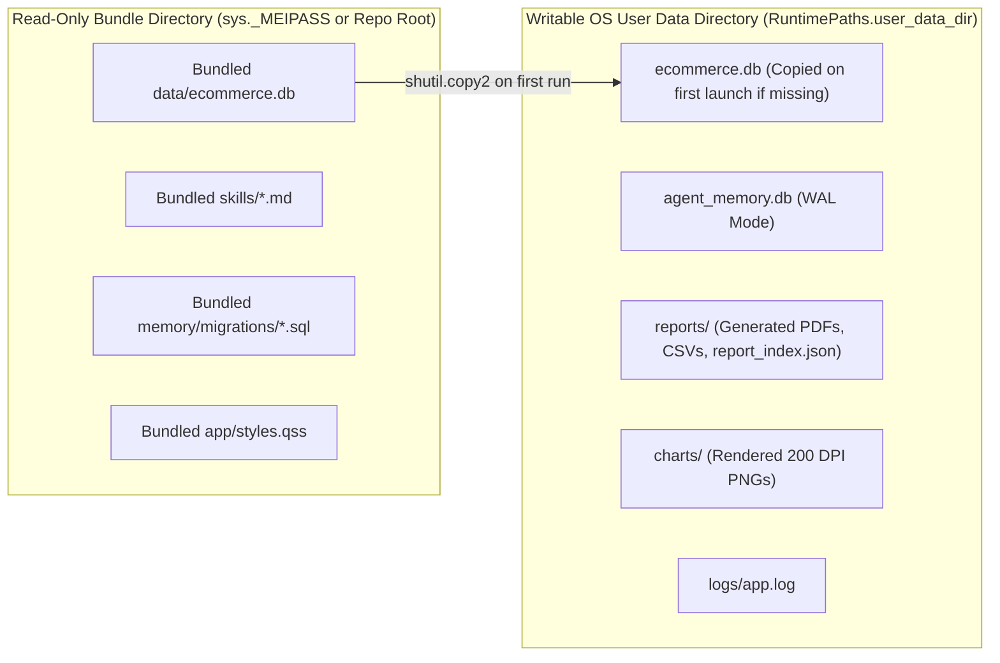

- **Source Mode (`sys.frozen == False`):** All paths resolve relative to the repository root (`data/ecommerce.db`, `data/agent_memory.db`, `reports/`, `charts/`, `logs/`).
- **Frozen Mode (`sys.frozen == True`):**
  - **macOS Writable Root:** `~/Library/Application Support/ReportSQLAgent/`
  - **Windows Writable Root:** `%LOCALAPPDATA%\ReportSQLAgent\` (fallback `~\AppData\Local\ReportSQLAgent\`)
  - **MCP Subprocess Spawning (`get_mcp_server_spawn_command()`):**
    - In source mode: `[sys.executable, "<repo>/run_app.py", "--mcp-server"]`
    - In frozen mode: `[sys.executable, "--mcp-server"]` (invokes the bundled executable itself in headless MCP stdio server mode without opening a second GUI window).

> *Optional modular references:* [`docs/solution/15-cross-platform-packaging.md`](./solution/15-cross-platform-packaging.md), [`docs/solution/knowledge-graphs/10-deployment-and-packaging.md`](./solution/knowledge-graphs/10-deployment-and-packaging.md)

---

## 24. Testing Strategy, Test Suites, and Validation Results

### 24.1 Multi-Tier Test Architecture (`tests/`)

The repository contains **35 pytest test modules** comprising **388 `test_*` functions** (`439` total collected pytest items including parameterized cases), organized into six verification tiers:

| Test Tier | Test Modules (`tests/test_*.py`) | Functions | Collected Items | Primary Verification Scope |
| :--- | :--- | :---: | :---: | :--- |
| **1. Database, Schema & SQL Security** | `test_database.py`, `test_sql_validator.py`, `test_sql_safety_comprehensive.py`, `test_database_readonly_enforcement.py`, `test_schema_integrity.py` | `64` | `111` | 7-table schema & FK integrity, 5-gate SQL validator, injection/comment/stacking prevention, `mode=ro` + `PRAGMA query_only=ON`, 30s query timeout. |
| **2. MCP Discovery & Tool Execution** | `test_mcp_tools.py`, `test_mcp_tool_discovery.py`, `test_mcp_discovery_and_execution.py`, `test_mcp_protocol_integration.py`, `test_mcp_stdio_integration.py` | `51` | `51` | Live stdio subprocess handshake, `list_tools()` 6-tool validation, `DiscoveredTool.to_ollama_tool()` schema adaptation, end-to-end tool calls. |
| **3. Agent Orchestration, Context & Ollama** | `test_orchestrator.py`, `test_agent_orchestrator_flows.py`, `test_ollama_client.py`, `test_ollama_tool_payload.py`, `test_context_builder.py`, `test_context_and_conversation.py`, `test_task_planner.py`, `test_tool_handler.py`, `test_End_to_end_agent_workflows.py` | `97` | `97` | Token budgeting, priority truncation, tool-call normalization, loop guards, fallback synthesis, HITL SQL approval, cancellation, capability awareness. |
| **4. Memory, Skills & Crash Recovery** | `test_memory_repository.py`, `test_working_memory.py`, `test_checkpoint_and_recovery.py`, `test_checkpoint_recovery_lifecycle.py`, `test_skill_manager.py`, `test_skills_and_memory_compression.py` | `56` | `56` | SQLite WAL migrations `001`–`003`, CRUD across 11 memory tables, checkpoint serialization, crash detection, task reconstruction, skill scoring. |
| **5. Canonical Data, Charts & PDF/CSV Reporting** | `test_canonical_data.py`, `test_canonical_consistency.py`, `test_chart_registry.py`, `test_all_chart_types.py`, `test_reporting.py`, `test_pdf_and_csv_generation.py`, `test_dynamic_pdf_composer.py` | `78` | `82` | `CanonicalSQLDataset` column classification, `ReportConsistencyValidator`, all 25 chart keys in `ChartRegistry`, `%PDF-1.4` header & file size validation, CSV metadata headers. |
| **6. GUI, Packaging & Live LLM E2E** | `test_gui_smoke.py`, `test_gui_widgets_and_worker.py`, `test_packaging_and_paths.py`, `test_live_qwen_capability.py` | `42` | `42` | Headless `offscreen` PySide6 widget & signal tests, `RuntimePaths` frozen/source resolution, and live `qwen3.5:4b` tool-calling E2E verification (`2` live tests). |
| **Total Across All 35 Modules** | **35 Test Files** | **388** | **439** | **437 Offline Deterministic Items + 2 Live `qwen3.5:4b` E2E Items** |

### 24.2 Running the Test Suite

```bash
# Run all 437 deterministic offline unit, integration, security, and GUI tests:
.venv/bin/pytest -q -m "not live_ollama"

# Run the live Ollama qwen3.5:4b capability and PDF reporting tests:
.venv/bin/pytest -v tests/test_live_qwen_capability.py
```

> *Optional modular references:* [`docs/solution/16-testing-and-validation.md`](./solution/16-testing-and-validation.md), [`docs/solution/appendices/test-coverage-reference.md`](./solution/appendices/test-coverage-reference.md)

---

## 25. Configuration Reference and Installation/Setup Guide

### 25.1 Complete `AppSettings` Configuration Reference (`config/settings.py` & `.env.example`)

All settings are loaded via `AppSettings` (`pydantic_settings.BaseSettings`) from `.env` or process environment variables:

| Environment Variable | `AppSettings` Field | Type | Default Value | Description |
| :--- | :--- | :--- | :--- | :--- |
| `APP_NAME` | `app_name` | `str` | `"Local Report SQL Agent"` | Application display title in GUI and PDF headers. |
| `APP_VERSION` | `app_version` | `str` | `"1.0.0"` | Semantic version string. |
| `LOG_LEVEL` | `log_level` | `str` | `"INFO"` | Logging verbosity (`DEBUG`, `INFO`, `WARNING`, `ERROR`). |
| `OLLAMA_BASE_URL` | `ollama_base_url` | `str` | `"http://localhost:11434"` | Local Ollama HTTP server base URL. |
| `OLLAMA_MODEL` | `ollama_model` | `str` | `"qwen3.5:4b"` | Primary local tool-calling LLM tag. |
| `OLLAMA_FALLBACK_MODELS` | `ollama_fallback_models` | `List[str]` | `["qwen2.5-coder:7b", "qwen2.5:7b", "llama3.1:8b", "mistral:7b"]` | Ordered fallback models if primary model is not pulled. |
| `OLLAMA_TIMEOUT_SECONDS` | `ollama_timeout_seconds` | `float` | `120.0` | Per-request HTTP timeout for `/api/chat` inference. |
| `OLLAMA_TEMPERATURE` | `ollama_temperature` | `float` | `0.1` | Low sampling temperature for deterministic SQL and tool calls. |
| `OLLAMA_NUM_CTX` | `ollama_num_ctx` | `int` | `8192` | Ollama context window token size passed in `options.num_ctx`. |
| `DATABASE_PATH` | `database_path` | `Path` | `data/ecommerce.db` | Path to the read-only analytical SQLite database. |
| `AGENT_MEMORY_DB_PATH` | `agent_memory_db_path` | `Path` | `data/agent_memory.db` | Path to the WAL-mode episodic memory SQLite database. |
| `MAX_QUERY_ROWS` | `max_query_rows` | `int` | `1000` | Default `LIMIT` automatically injected into `SELECT` queries. |
| `HARD_MAX_QUERY_ROWS` | `hard_max_query_rows` | `int` | `10000` | Absolute maximum `LIMIT` ceiling allowed for any query. |
| `QUERY_TIMEOUT_SECONDS` | `query_timeout_seconds` | `float` | `30.0` | Maximum SQLite query execution wall-clock timeout. |
| `REQUIRE_SQL_APPROVAL` | `require_sql_approval` | `bool` | `True` | When `True`, pauses before `execute_readonly_sql` for user approval in the GUI. |
| `MAX_AGENT_ITERATIONS` | `max_agent_iterations` | `int` | `10` | Maximum LLM ↔ MCP tool-calling iterations per user prompt. |
| `CONTEXT_TOKEN_BUDGET` | `context_token_budget` | `int` | `6000` | Target input token budget enforced by `ContextBuilder`. |
| `MAX_HISTORY_MESSAGES` | `max_history_messages` | `int` | `20` | Maximum recent conversation turns retained in `ConversationManager`. |
| `REPORTS_DIR` | `reports_dir` | `Path` | `reports/` | Output directory for generated PDF and CSV reports. |
| `CHARTS_DIR` | `charts_dir` | `Path` | `charts/` | Output directory for rendered 200-DPI Matplotlib PNG charts. |
| `SKILLS_DIR` | `skills_dir` | `Path` | `skills/` | Directory containing Markdown domain skill files (`*.md`). |
| `LOGS_DIR` | `logs_dir` | `Path` | `logs/` | Directory for rotating `app.log` files. |

### 25.2 Step-by-Step Installation and Setup Guide

1. **Prerequisites:**
   - Python `3.10` or newer (`3.11+` recommended) on macOS or Windows.
   - [Ollama](https://ollama.com) installed and running locally (`ollama serve`).
   - Pull the default model:
     ```bash
     ollama pull qwen3.5:4b
     ```
2. **Create Virtual Environment & Install Dependencies:**
   ```bash
   python3 -m venv .venv
   source .venv/bin/activate          # On Windows: .venv\Scripts\activate
   pip install --upgrade pip
   pip install -r requirements.txt
   ```
3. **Initialize / Verify the Analytical Database (Optional — Auto-runs on first launch):**
   ```bash
   .venv/bin/python scripts/init_db.py
   ```
4. **Launch the Desktop Application:**
   ```bash
   .venv/bin/python run_app.py
   ```
5. **Build a Standalone Desktop Executable (Optional):**
   ```bash
   .venv/bin/python scripts/package_app.py
   ```

> *Optional modular reference:* [`docs/solution/appendices/configuration-reference.md`](./solution/appendices/configuration-reference.md)

---

## 26. Known Limitations, Operational Assumptions, and Design Trade-Offs

### 26.1 Architectural Trade-Offs and Rationale

| Design Decision | Alternative Considered | Rationale for Chosen Architecture | Trade-Off / Limitation |
| :--- | :--- | :--- | :--- |
| **Local `qwen3.5:4b` via Ollama** | Cloud LLM APIs (GPT-4o / Claude 3.5 / Gemini) | Guarantees 100% offline privacy, zero API cost, and deterministic local evaluation. | 4B parameter models have smaller context windows (`8,192` default) and occasionally require orchestrator fallback synthesis when they stop early after `prepare_sql_query`. |
| **MCP over `stdio` Subprocess** | In-process Python function calls | Enforces strict process isolation between the GUI/LLM orchestrator and database/file I/O; validates standard MCP protocol interoperability. | Adds ~`2–5ms` JSON-RPC serialization overhead per tool call and requires passing `--mcp-server` dispatcher flags in PyInstaller builds. |
| **Mandatory `CanonicalSQLDataset` Single Source of Truth** | Letting the LLM write free-form Markdown tables and KPI numbers | Completely eliminates numerical hallucination in KPI cards, charts, and PDF tables. | Report visualizations and KPIs are strictly bounded to the columns returned by the most recent `execute_readonly_sql` call in that turn. |
| **Single-Query Canonical Snapshot per Report** | Combining multiple independent SQL queries into one PDF | Simplifies cross-section consistency verification (`ReportConsistencyValidator`) and guarantees every chart matches the PDF data table. | Multi-dimensional reports must use SQL `JOIN`s or `WITH` (CTEs) to assemble the required columns into a single analytical query result. |
| **Character-Based Token Heuristic (`len(text) // 4`)** | Bundling a model-specific BPE tokenizer (`tiktoken` / HuggingFace `AutoTokenizer`) | Zero external tokenizer model download required; executes in microseconds. | Approximate within ~`10–15%` of exact Qwen BPE token counts; mitigated by keeping `context_token_budget = 6000` safely below `ollama_num_ctx = 8192`. |

---

## 27. End-to-End Walkthrough of a Complete User Request from Prompt to Generated Report

To illustrate how all components collaborate during a live session, consider the following real user request:

> **User Prompt:** *"Generate an executive PDF report analyzing total net revenue, order count, and average order value by product category, including a Pareto chart and horizontal bar chart."*

### 27.1 Complete Request-to-Report Sequence Diagram

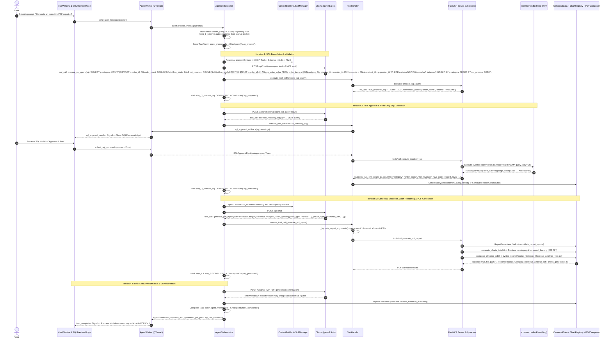

---

## 28. Conclusion and Architectural Rationale

The **Local Report SQL Agent** demonstrates that a compact, locally hosted language model (`qwen3.5:4b` via Ollama) can deliver enterprise-grade, numerically trustworthy SQL analytics and executive reporting when paired with deterministic software engineering guardrails:

1. **Authoritative MCP Capability Discovery (`mcp_layer/client.py`, `agent/orchestrator.py`):** By discovering all 6 MCP tools over JSON-RPC stdio before the first user request, adapting their JSON Schemas into Ollama's native `tools` parameter, and reinforcing them in the token-budgeted system prompt, the agent achieves reliable tool invocation without capability refusals.
2. **Five-Gate Read-Only SQL Security (`database/query_validator.py`, `database/connection.py`, `app/widgets/sql_preview_widget.py`):** Combining static lexical/structural query validation, mandatory human-in-the-loop approval, OS/SQLite URI read-only enforcement (`?mode=ro` + `PRAGMA query_only = ON`), and VM opcode timeouts guarantees that the analytical database (`data/ecommerce.db`) cannot be mutated or locked by any prompt.
3. **Single-Source-of-Truth Canonical Reporting (`reporting/canonical_data.py`, `reporting/chart_registry.py`, `reporting/pdf_generator.py`):** Decoupling linguistic reasoning (handled by the LLM) from mathematical aggregation and visualization (handled deterministically by `CanonicalSQLDataset`, `ReportConsistencyValidator`, ReportLab, and 25 Matplotlib chart renderers) ensures every KPI card, chart, data table, and narrative statistic in the exported PDF and CSV reports is 100% consistent and verifiable.
4. **Durable Episodic Memory & Crash Resumability (`memory/repository.py`, `memory/checkpoint_manager.py`, `memory/recovery_service.py`):** Persisting every task plan, tool call, decision, and milestone checkpoint in a WAL-mode SQLite repository (`data/agent_memory.db`) provides full auditability in the GUI Activity Inspector and seamless task recovery across application restarts.

---

### Complete Modular Documentation Index (`docs/solution/`)

For deep-dive modular chapters, knowledge graphs, and reference appendices, consult:
- **Index:** [`docs/solution/README.md`](./solution/README.md)
- **Chapters 01–18:** [`01-executive-overview.md`](./solution/01-executive-overview.md) through [`18-configuration-and-runtime-requirements.md`](./solution/18-configuration-and-runtime-requirements.md)
- **Knowledge Graphs 01–10:** [`knowledge-graphs/01-system-component-graph.md`](./solution/knowledge-graphs/01-system-component-graph.md) through [`knowledge-graphs/10-deployment-and-packaging.md`](./solution/knowledge-graphs/10-deployment-and-packaging.md)
- **Appendices:** [`glossary.md`](./solution/appendices/glossary.md), [`mcp-tools-reference.md`](./solution/appendices/mcp-tools-reference.md), [`database-schema-reference.md`](./solution/appendices/database-schema-reference.md), [`configuration-reference.md`](./solution/appendices/configuration-reference.md), [`source-code-map.md`](./solution/appendices/source-code-map.md), [`test-coverage-reference.md`](./solution/appendices/test-coverage-reference.md)
