# Terminology, Definitions & Error Taxonomy

**Project**: Local Report SQL Agent  
**Parent Document**: [COMPLETE_SYSTEM_REFERENCE.md](file:///Users/stefanapopa/Documents/8)%20DOCUMENTE%20BOGDAN/7_Projects/Applied-Computational-Intelligence-UBB/Year2_Semester1_DeclarativeProgrammingMachineLearning/FinalProject_SQLAgent/docs/COMPLETE_SYSTEM_REFERENCE.md)

---

## 1. Domain Glossary & Key Concepts

### Model Context Protocol (FastMCP)
An open standard protocol enabling AI applications to interact with external tools and data sources safely. In this application, FastMCP runs as an isolated subprocess communicating over standard input and output (`stdio`), guaranteeing that tool execution is cleanly decoupled from LLM inference.

### Effective Context Window
The resolved, validated maximum token budget used for a request. While an agent may be configured with a 128K context window (`131072` tokens), the *effective context window* is the verified token limit after checking the Ollama model's runtime metadata (`/api/show`). If the model does not support the requested context, execution is blocked rather than silently truncated.

### Context Budget Reservation Invariant
A mathematical guarantee enforced by [`ContextBuilder`](file:///Users/stefanapopa/Documents/8)%20DOCUMENTE%20BOGDAN/7_Projects/Applied-Computational-Intelligence-UBB/Year2_Semester1_DeclarativeProgrammingMachineLearning/FinalProject_SQLAgent/agent/context_builder.py):
$$\text{Input Tokens} \le \text{Effective Context} - \text{Reserved Output Tokens} - \text{Safety Margin}$$
Input context is never permitted to encroach upon the token space required for the model's response (`reserved_output_tokens`, default 1,024) or the safety buffer (`safety_margin`, default 256).

### SQLite C-Authorizer (`sqlite3_set_authorizer`)
A native C-level callback mechanism within the SQLite engine. Before compiling or executing any byte-code statement, SQLite invokes this callback. The agent permits only `SQLITE_SELECT`, `SQLITE_READ`, safe functions, and recursive CTEs; any attempt to write, alter, attach, or drop tables triggers an immediate `SQLITE_DENY`.

### Single Source of Truth (Canonical Dataset)
The architectural principle enforced by [`CanonicalSQLDataset`](file:///Users/stefanapopa/Documents/8)%20DOCUMENTE%20BOGDAN/7_Projects/Applied-Computational-Intelligence-UBB/Year2_Semester1_DeclarativeProgrammingMachineLearning/FinalProject_SQLAgent/reporting/canonical_data.py) where all report components (tables, summary KPI cards, vector charts, CSV exports) derive deterministically from the raw SQL execution result. The LLM is never allowed to hallucinate or invent numeric data for reports.

### Write-Ahead Logging (WAL Mode)
A SQLite journaling mode used by `data/agent_memory.db`. WAL mode allows concurrent readers to query memory while a single writer updates checkpoints or execution state, preventing database lock contention.

### Platypus (Page Layout and Typography Using Scripts)
A high-level document generation sub-framework inside ReportLab. It structures PDF documents into reusable "flowable" objects (paragraphs, tables, charts, spacers) that automatically paginate, break across pages, and manage vertical margins.

### Kahn's Algorithm
A topological sorting algorithm used by [`SkillManager`](file:///Users/stefanapopa/Documents/8)%20DOCUMENTE%20BOGDAN/7_Projects/Applied-Computational-Intelligence-UBB/Year2_Semester1_DeclarativeProgrammingMachineLearning/FinalProject_SQLAgent/agent/skill_manager.py) to resolve dependencies among domain skills. It detects circular dependency cycles (e.g., Skill A requires Skill B which requires Skill A) and raises a [`CircularSkillDependencyError`](file:///Users/stefanapopa/Documents/8)%20DOCUMENTE%20BOGDAN/7_Projects/Applied-Computational-Intelligence-UBB/Year2_Semester1_DeclarativeProgrammingMachineLearning/FinalProject_SQLAgent/agent/skill_manager.py) before skills can be loaded.

### Dual-Mode Tool Calling
A resilience mechanism implemented in [`OllamaClient`](file:///Users/stefanapopa/Documents/8)%20DOCUMENTE%20BOGDAN/7_Projects/Applied-Computational-Intelligence-UBB/Year2_Semester1_DeclarativeProgrammingMachineLearning/FinalProject_SQLAgent/agent/ollama_client.py). When calling smaller models like `qwen3.5:4b`, Ollama's native tool calling parser can fail with HTTP 500 XML grammar errors. When detected, the client automatically falls back to structured JSON extraction mode without crashing or aborting the task.

---

## 2. Enums & Data Contracts

### 2.1 `TaskStatus` & `StepStatus`
Defined in [`agent/task_models.py`](file:///Users/stefanapopa/Documents/8)%20DOCUMENTE%20BOGDAN/7_Projects/Applied-Computational-Intelligence-UBB/Year2_Semester1_DeclarativeProgrammingMachineLearning/FinalProject_SQLAgent/agent/task_models.py):

```python
class TaskStatus(str, Enum):
    PENDING = "pending"          # Task initialized, waiting to execute
    IN_PROGRESS = "in_progress"  # Currently executing steps
    COMPLETED = "completed"      # All steps finished successfully
    FAILED = "failed"            # Unrecoverable error occurred
    CANCELLED = "cancelled"      # Halted by user intervention

class StepStatus(str, Enum):
    PENDING = "pending"          # Waiting for previous step to finish
    RUNNING = "running"          # Currently executing tool call
    COMPLETED = "completed"      # Tool returned valid result
    FAILED = "failed"            # Tool failed or approval was denied
    SKIPPED = "skipped"          # Step bypassed by recovery planner
```

### 2.2 `CheckpointType` & `RecoveryPolicy`
Defined in [`agent/checkpoint_models.py`](file:///Users/stefanapopa/Documents/8)%20DOCUMENTE%20BOGDAN/7_Projects/Applied-Computational-Intelligence-UBB/Year2_Semester1_DeclarativeProgrammingMachineLearning/FinalProject_SQLAgent/agent/checkpoint_models.py):

```python
class CheckpointType(str, Enum):
    TASK_CREATED = "task_created"      # Initial task state
    PLAN_READY = "plan_ready"          # Plan generated and validated
    STEP_STARTED = "step_started"      # Step execution begun
    TOOL_EXECUTION = "tool_execution"  # Tool invocation snapshot
    STEP_COMPLETED = "step_completed"  # Step finished successfully
    TASK_COMPLETED = "task_completed"  # Final task completion
    ERROR_RECOVERY = "error_recovery"  # Snapshot taken before recovery

class RecoveryPolicy(str, Enum):
    SAFE_RESUME = "safe_resume"        # Resume execution from last clean step
    RETRY_STEP = "retry_step"          # Retry current step with corrected arguments
    REPLAN_REMAINDER = "replan"        # Discard remaining steps and plan anew
    FAIL_FAST = "fail_fast"            # Immediately fail task on error
```

### 2.3 `SectionPriority`
Defined in [`agent/context_models.py`](file:///Users/stefanapopa/Documents/8)%20DOCUMENTE%20BOGDAN/7_Projects/Applied-Computational-Intelligence-UBB/Year2_Semester1_DeclarativeProgrammingMachineLearning/FinalProject_SQLAgent/agent/context_models.py):

```python
class SectionPriority(int, Enum):
    MANDATORY = 100  # Must fit (System Prompt, User Request). Fails if budget exceeded.
    HIGH = 75        # Stage Domain Skills, Referenced Table Schemas.
    MEDIUM = 50      # Task State, Recent Tool Results, Active Chat Window.
    LOW = 25         # Semantic Facts, Historical Execution Traces, Older History.
```

### 2.4 `ModelCapabilityStatus`
Defined in [`agent/ollama_client.py`](file:///Users/stefanapopa/Documents/8)%20DOCUMENTE%20BOGDAN/7_Projects/Applied-Computational-Intelligence-UBB/Year2_Semester1_DeclarativeProgrammingMachineLearning/FinalProject_SQLAgent/agent/ollama_client.py):

```python
class ModelCapabilityStatus(str, Enum):
    COMPATIBLE = "compatible"      # Model supports >= configured context window
    INCOMPATIBLE = "incompatible"  # Model max context < configured context window
    UNKNOWN = "unknown"            # Model metadata missing context parameters
    REJECTED = "rejected"          # Ollama server returned OOM or rejected num_ctx
```

---

## 3. Comprehensive Exception Taxonomy

```mermaid
classDiagram
    class Exception
    class SkillError
    class MigrationError
    class QueryExecutionError
    class OllamaClientError
    class ContextError

    Exception <|-- SkillError
    Exception <|-- MigrationError
    Exception <|-- QueryExecutionError
    Exception <|-- OllamaClientError
    Exception <|-- ContextError

    SkillError <|-- SkillNotFoundError
    SkillError <|-- SkillValidationError
    SkillError <|-- MissingSkillDependencyError
    SkillError <|-- CircularSkillDependencyError
    SkillError <|-- ExcessiveSkillSizeError
    SkillError <|-- SkillSecurityError

    MigrationError <|-- UnsupportedSchemaVersionError

    QueryExecutionError <|-- QueryTimeoutError
    QueryExecutionError <|-- QueryCancelledError
    QueryExecutionError <|-- SQLValidationError

    OllamaClientError <|-- OllamaConnectionError
    OllamaClientError <|-- OllamaTimeoutError
    OllamaClientError <|-- OllamaModelNotFoundError
    OllamaClientError <|-- ModelContextIncompatibleError
    OllamaClientError <|-- OllamaContextSizeRejectedError

    ContextError <|-- ContextBudgetExceededError
```



### 3.1 Skill System Exceptions (`agent/skill_manager.py`)
* `SkillError`: Base class for all skill system exceptions.
* `SkillNotFoundError`: Raised when a referenced skill ID does not exist on disk.
* `SkillValidationError`: Raised when `metadata.yaml` or `SKILL.md` fails schema validation.
* `MissingSkillDependencyError`: Raised when a skill requires another skill that is disabled or missing.
* `CircularSkillDependencyError`: Raised when Kahn's algorithm detects a cyclic dependency chain.
* `ExcessiveSkillSizeError`: Raised when a skill file exceeds the maximum allowed size (500 KB limit).
* `SkillSecurityError`: Raised when path traversal (`../`) or symlink escapes are detected.

### 3.2 Database & Migration Exceptions (`memory/migrations/` & `database/`)
* `MigrationError`: Base class for database schema migration errors.
* `UnsupportedSchemaVersionError`: Raised when the SQLite memory database schema is newer than the application supports.
* `QueryExecutionError`: Base class for query failures.
* `QueryTimeoutError`: Raised when a SQL query exceeds its execution timeout (default 30.0s).
* `QueryCancelledError`: Raised when a query is cancelled cooperatively by the user or thread.
* `SQLValidationError`: Raised when a query contains forbidden mutating keywords or invalid syntax.

### 3.3 Ollama Inference Exceptions (`agent/ollama_client.py`)
* `OllamaClientError`: Base class for all Ollama interaction errors.
* `OllamaConnectionError`: Raised when the daemon is unreachable at `http://localhost:11434`.
* `OllamaTimeoutError`: Raised when inference request exceeds the client timeout.
* `OllamaModelNotFoundError`: Raised when the requested model (e.g., `qwen3.5:4b`) is not installed.
* `ModelContextIncompatibleError`: Raised when the installed model cannot support the configured context window.
* `OllamaContextSizeRejectedError`: Raised when Ollama fails with an out-of-memory or invalid size error.

### 3.4 Context Exceptions (`agent/context_builder.py`)
* `ContextBudgetExceededError`: Raised when `MANDATORY` sections (system prompt + user prompt) exceed the available input budget.

