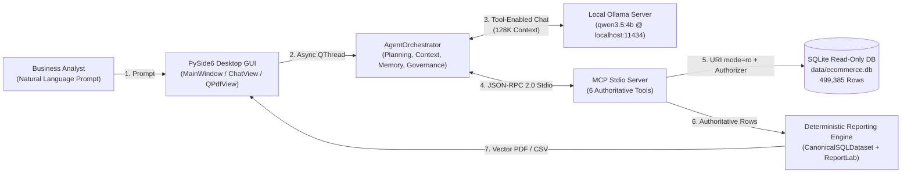

# Chapter 01 — Executive Overview

## 1. Purpose and Vision

The **Local Report SQL Agent** is a privacy-preserving, local-first desktop business intelligence and analytical reporting application built in Python 3.13 with PySide6, the official Model Context Protocol (MCP) SDK, local Ollama LLM inference (`qwen3.5:4b`), SQLite, and ReportLab.

It enables business analysts, operations managers, and technical evaluators to ask complex analytical questions in natural language—such as *"Generate a comprehensive executive sales report for last month with revenue by category and payment method"*—and receive publication-grade, multi-page PDF or UTF-8 CSV reports backed by verified, read-only SQL queries executed against a local relational database (`data/ecommerce.db`, containing **499,385 records** across **7 normalized tables**).

---

## 2. Core Problem Statement

Organizations and analysts frequently need ad-hoc analytical reports from relational databases, but face three systemic barriers:

1. **Data Privacy & Sovereignty Risks**: Cloud-hosted AI assistants require transmitting proprietary schemas, customer PII, and financial records to third-party APIs.
2. **LLM Hallucination in Financial Reporting**: When language models are allowed to compute totals, percentages, or KPIs directly in free text, they frequently hallucinate numbers, misalign chart series with table totals, or invent non-existent schema columns.
3. **Database Mutation & Operational Risk**: Granting an autonomous LLM direct database access without strict read-only boundaries, query timeouts, or human-in-the-loop governance creates severe data-corruption and denial-of-service risks.

---

## 3. Architectural Solution & Key Capabilities

The Local Report SQL Agent solves these challenges through a strict **separation of probabilistic reasoning and deterministic execution**:

The high-level flow diagram above demonstrates how the user interacts with the PySide6 desktop GUI while `AgentOrchestrator` coordinates local Ollama reasoning (`qwen3.5:4b`) with deterministic tool execution inside an isolated MCP server subprocess.

### Summary of Key Capabilities

| Capability Domain | Implementation Highlights | Authoritative Modules |
| :--- | :--- | :--- |
| **100% Local & Offline Execution** | Loopback-only HTTP policy (`localhost`, `127.0.0.1`, `::1`). Zero cloud telemetry or external API calls. | `config/settings.py`, `agent/ollama_client.py` |
| **Deterministic MCP Tool Discovery** | Persistent `stdio_client` subprocess handshake and `list_tools()` verification of all 6 tools before the first LLM turn. | `mcp_layer/client.py`, `mcp_layer/server.py`, `agent/tool_handler.py` |
| **Multi-Layer Read-Only SQL Defense** | AST/token validation (`prepare_sql_query`), SQLite `mode=ro` URI, `PRAGMA query_only=ON`, `set_authorizer` whitelist, and 5,000-op progress watchdog. | `mcp_layer/tools/sql_tools.py`, `database/connection.py`, `database/query_executor.py` |
| **Single Source of Truth Reporting** | `CanonicalSQLDataset` computes all KPIs, chart series, percentages, and consistency checks deterministically in Python from SQLite rows. | `reporting/canonical_data.py`, `reporting/pdf_generator.py`, `reporting/dynamic_pdf_composer.py` |
| **25-Renderer Vector Chart Engine** | `ChartRegistry` renders 22 canonical chart types (25 registered keys) across 6 analytical categories as native ReportLab vector graphics. | `reporting/chart_registry.py`, `reporting/report_spec.py` |
| **DAG Planning & Crash Recovery** | `TaskPlanner` + `TaskManager` (Kahn's topological sort) + `SQLiteMemoryRepository` (`data/agent_memory.db`) + SHA-256 `CheckpointManager` (Scenarios A–F). | `agent/task_planner.py`, `agent/task_manager.py`, `agent/checkpoint_manager.py`, `memory/repository.py` |
| **Responsive Desktop Workspace** | Split-pane dark-themed PySide6 GUI with native `QPdfView`, `CsvTableModel`, live `AgentActivityInspectorWidget`, and modal `SqlApprovalDialog`. | `app/main_window.py`, `app/views/chat_view.py`, `app/widgets/report_preview_widget.py` |

---

## 4. Target Audience & Use Cases

1. **University Evaluators & Academic Reviewers**: Inspecting neuro-symbolic AI engineering, MCP protocol integration, deterministic safety guardrails, and formal state machines.
2. **Software Architects & AI Engineers**: Reviewing production patterns for local small-language-model (`qwen3.5:4b`) tool calling, token-budgeted context assembly, and crash-resilient task checkpointing.
3. **Business & Data Analysts**: Generating multi-section PDF executive briefings and CSV data exports from local SQLite datasets without writing SQL manually.

