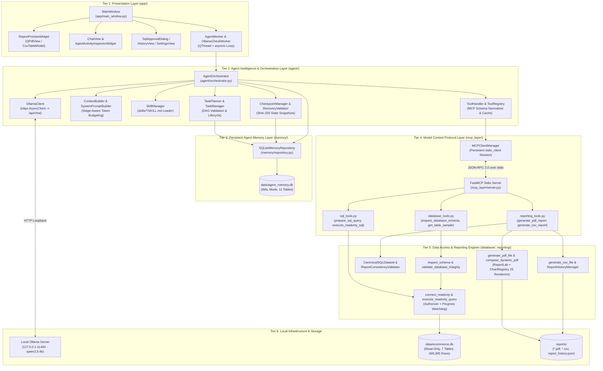

# Chapter 02 — System Architecture

## 1. Architectural Design Principles

The Local Report SQL Agent is structured around five foundational engineering invariants:

1. **Process-Isolated Tool Execution**: All database inspection, SQL validation, read-only SQL execution, and PDF/CSV generation run inside a dedicated child **MCP Server subprocess** communicating over `stdin`/`stdout` JSON-RPC 2.0 (`mcp_layer/server.py`, `mcp_layer/client.py`).
2. **Strict Read-Only Data Plane**: The primary analytical database (`data/ecommerce.db`) is never opened in read-write mode by any runtime component. Agent working/episodic/semantic state is isolated in a separate database (`data/agent_memory.db`), and `SQLiteMemoryRepository.__init__()` raises a `ValueError` if configured with `data/ecommerce.db`.
3. **Single Source of Truth (SSOT) Reporting**: The LLM never fabricates chart numbers or KPI totals. It supplies SQL queries and structural chart specifications (`ChartSpecification`), while Python (`CanonicalSQLDataset`) deterministically computes KPIs, aggregates chart series, and validates cross-component consistency.
4. **Non-Blocking Asynchronous GUI**: The PySide6 GUI thread (`MainWindow`) never performs network I/O, subprocess I/O, or SQLite queries directly. Background `QThread` workers (`AgentWorker`, `OllamaCheckWorker`) host their own `asyncio` event loops and communicate with the UI exclusively via Qt `Signal` objects and thread-safe `queue.Queue` bridges.
5. **Local-First Loopback Security**: Both `AppSettings.validate()` and `OllamaClient._validate_and_normalize_host()` enforce that the LLM endpoint resolves strictly to `localhost`, `127.0.0.1`, or `::1`.

---

## 2. Six-Tier Layered Architecture

The architecture diagram above maps the six horizontal tiers of the system and shows how control flows downward from the PySide6 UI through the `AgentOrchestrator` to local storage, local LLM inference, and the child MCP server process.

---

## 3. Process and Thread Topology

At runtime, the application spans **two operating system processes** inside the project boundary plus the **external local Ollama daemon**:

| OS Process / Thread | Entrypoint | Lifespan | Communication Channel | Primary Responsibility |
| :--- | :--- | :--- | :--- | :--- |
| **Process 1 (Main Thread)** | `run_app.py` → `app.main:main()` | Application lifetime | Qt Signals & `queue.Queue` | Renders `MainWindow`, `ReportPreviewWidget`, `ChatView`, and modal `SqlApprovalDialog`. |
| **Process 1 (`OllamaCheckWorker`)** | `OllamaCheckWorker.run()` | Transient (~100–500 ms on startup / settings save) | `OllamaCheckSignals.check_completed` | Queries `GET /api/version` and `GET /api/tags` on a dedicated `asyncio` event loop. |
| **Process 1 (`AgentWorker`)** | `AgentWorker.run()` | Per user request turn | `WorkerSignals` + `queue.Queue[bool]` | Runs `AgentOrchestrator.process_message()` on a dedicated `asyncio` event loop. |
| **Process 2 (MCP Server Subprocess)** | `python -m mcp_layer.server` (or `ReportSQLAgent --mcp-server` when frozen) | Persistent across workflow (reused by `MCPClientManager`) | `stdin` / `stdout` JSON-RPC 2.0 (`mcp.client.stdio`) | Hosts `FastMCP("local-report-sql-agent")` and executes the 6 authoritative MCP tools. |
| **External Local Daemon (Ollama)** | `ollama serve` | OS background service | HTTP `127.0.0.1:11434` (`/api/chat`, `/api/show`, `/api/tags`, `/api/version`) | Executes local LLM inference (`qwen3.5:4b`) with native tool definitions. |

---

## 4. Directory and Package Responsibilities

| Package / Directory | Key Modules | Architectural Responsibility |
| :--- | :--- | :--- |
| `config/` | `settings.py`, `paths.py`, `prompts.py`, `logging_setup.py` | 3-tier configuration management, frozen/source path resolution, system prompts, and rotating file logging. |
| `database/` | `connection.py`, `query_executor.py`, `schema_inspector.py`, `importer.py` | Read-only SQLite URI connections, authorizer sandboxing, schema reflection, and transactional dataset import. |
| `mcp_layer/` | `server.py`, `client.py`, `tools/database_tools.py`, `tools/sql_tools.py`, `tools/reporting_tools.py` | FastMCP server exposing 6 tools over stdio and `MCPClientManager` managing persistent client sessions and retries. |
| `agent/` | `orchestrator.py`, `ollama_client.py`, `tool_handler.py`, `context_builder.py`, `system_prompt.py`, `task_planner.py`, `task_manager.py`, `checkpoint_manager.py`, `skill_manager.py`, `conversation.py`, `events.py` | Autonomous reasoning loop, tool discovery & schema adaptation, DAG planning, token-budgeted context assembly, skill loading, and crash recovery. |
| `memory/` | `repository.py`, `models.py`, `migrations/001..003.sql` | Thread-safe SQLite persistence (`data/agent_memory.db`) for working memory, episodic task history, semantic facts, and SHA-256 checkpoints. |
| `reporting/` | `canonical_data.py`, `pdf_generator.py`, `dynamic_pdf_composer.py`, `chart_registry.py`, `chart_builder.py`, `csv_generator.py`, `report_spec.py`, `report_manager.py`, `date_utils.py` | Authoritative `CanonicalSQLDataset`, KPI synthesis, 25-renderer vector `ChartRegistry`, multi-page ReportLab PDF composer, CSV exporter, and `report_history.json`. |
| `app/` | `main.py`, `main_window.py`, `style.py`, `views/*`, `widgets/*`, `dialogs/*`, `workers/*`, `models/*` | PySide6 desktop interface, split workspace, native PDF viewer, CSV table viewer, SQL syntax highlighter, and activity timeline inspector. |
| `skills/` | `sql/SKILL.md`, `data_analysis/SKILL.md`, `data_validation/SKILL.md` | Structured domain knowledge markdown files with YAML frontmatter injected dynamically by execution stage. |
| `scripts/` | `verify_environment.py`, `import_dataset.py`, `build_macos.sh`, `build_windows.ps1` | Environment verification, CLI dataset builder, and cross-platform PyInstaller packaging scripts. |
| `tests/` | 35 `test_*.py` modules | Comprehensive unit, integration, security, GUI, MCP discovery, and live `qwen3.5:4b` E2E test suites. |

