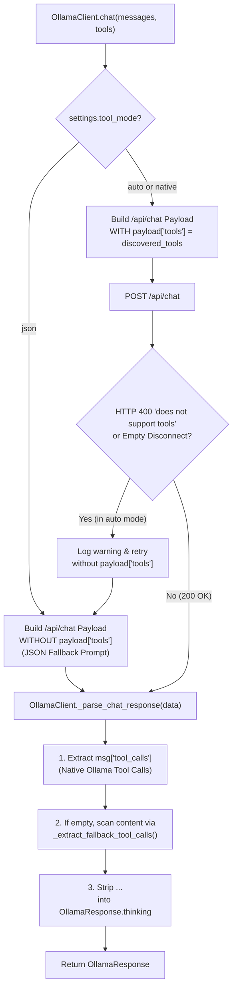

# Chapter 05 — Ollama Integration

## 1. Local LLM Client Architecture (`agent/ollama_client.py`)

`OllamaClient` is an asynchronous HTTP client built on `httpx.AsyncClient` that interfaces exclusively with the local Ollama server (`http://localhost:11434` by default) using the configured model (`qwen3.5:4b`).

### Loopback-Only Network Enforcement

To guarantee zero external data egress, `OllamaClient._validate_and_normalize_host(raw_host)` parses the configured URL with `urllib.parse.urlparse` and enforces:
1. Scheme must be `http` or `https`.
2. Hostname must be in `LOCAL_HOSTS = {"localhost", "127.0.0.1", "::1", "[::1]"}`.
3. Any non-local hostname raises `OllamaSecurityError("Security policy violation: Ollama host '...' is not a local loopback address...")`.
4. `httpx.AsyncClient` is instantiated with `trust_env=False` so system proxy environment variables (`HTTP_PROXY`, `HTTPS_PROXY`) can never redirect local LLM traffic to an external proxy.

---

## 2. Tool Mode Protocols (`auto`, `native`, `json`)

`OllamaSettings.tool_mode` supports three modes (`auto` by default):



The flowchart above details how `OllamaClient.chat()` handles native tool definitions, automatic fallback on HTTP 400 or runner disconnects, dual-mode tool call extraction, and `<think>` block separation.

### Request Payload Structure

When `tools` are provided and `tool_mode` is `"auto"` or `"native"`, `OllamaClient.chat()` sends the following JSON payload to `POST /api/chat`:

```json
{
  "model": "qwen3.5:4b",
  "messages": [
    {"role": "system", "content": "..."},
    {"role": "user", "content": "..."}
  ],
  "stream": false,
  "keep_alive": "10m",
  "options": {
    "temperature": 0.1,
    "top_p": 0.9,
    "num_ctx": 131072
  },
  "tools": [
    {
      "type": "function",
      "function": {
        "name": "inspect_database_schema",
        "description": "...",
        "parameters": {"type": "object", "properties": {...}, "required": []}
      }
    }
  ]
}
```

---

## 3. Reasoning (`<think>`) Extraction & Fallback Tool Parsing

Models in the Qwen 3 / 3.5 family emit chain-of-thought reasoning either in a dedicated `message.thinking` field or inline inside `<think>...</think>` XML tags. `OllamaClient._parse_chat_response()` performs three deterministic normalization steps:

1. **Thought Separation (`_THINK_TAG_RE` & `_UNCLOSED_THINK_RE`)**:
   - Extracts all `<think>...</think>` blocks (and any unclosed `<think>...` block if generation was cut off) from `message.content`.
   - Merges them into `OllamaResponse.thinking` (displayed in a collapsible *"💡 Show reasoning process"* box in `MessageWidget` and recorded in `AgentActivityInspectorWidget`) while stripping them completely from user-facing `OllamaResponse.content`.
2. **Native Tool Call Extraction (`_extract_native_tool_calls`)**:
   - Reads `message.tool_calls`, parsing `function.name` and `function.arguments` (handling both `dict` and JSON-encoded `str` arguments) into `ToolCall(call_id, name, arguments)`.
3. **Structured JSON Fallback Extraction (`_extract_fallback_tool_calls` & `_parse_tool_candidate`)**:
   - If the model emits a tool call as a fenced ` ```json ... ``` ` block or raw JSON object in `message.content` (or even inside `<think>` if `content` was empty), `_parse_tool_candidate()` recognizes:
     - `{"tool": "<name>", "arguments": {...}}`
     - `{"name": "<name>", "arguments": {...}}` / `{"name": "<name>", "parameters": {...}}`
     - `{"function": {"name": "<name>", "arguments": {...}}}`
     - `{"tool_calls": [...]}`

---

## 4. Context Window Validation (`resolve_effective_context_window`)

Before assembling prompts, `OllamaClient.resolve_effective_context_window(configured_window)` queries `POST /api/show` for the active model (`qwen3.5:4b`) and inspects `model_info` keys (`*.context_length`, `num_ctx`) to determine the model's maximum supported context window:

| Condition | Returned Status | Effective Context Window |
| :--- | :--- | :--- |
| Model metadata reports `max_ctx >= configured_window` (e.g. `262,144 >= 131,072`) | `"compatible"` | `configured_window` (`131,072`) |
| Model metadata reports `max_ctx < configured_window` | `"clamped"` (with warning) | `max_ctx` |
| `/api/show` does not expose `context_length` or is unreachable offline | `"unverified"` | `configured_window` (`131,072`) |

---

## 5. Connection Resilience & Retry Policy

`OllamaClient._post_chat_with_retry()` wraps `/api/chat` requests in an exponential backoff loop (`max_retries = 2`, delays `1.0s`, `2.0s`):
- **Transient Disconnects (`httpx.RemoteProtocolError`)**: Retries automatically; if all retries fail and native tools were attached in `"auto"` mode, downgrades to JSON tool mode for that turn.
- **Connection Refused (`httpx.ConnectError`)**: Raises `OllamaConnectionError` immediately with instructions to run `ollama serve`.
- **Missing Model (`HTTP 404`)**: Raises `OllamaModelNotFoundError` with instructions to run `ollama pull qwen3.5:4b`.
- **Request Timeout (`httpx.TimeoutException`)**: Raises `OllamaTimeoutError` after `request_timeout_s` (`600.0s` default).

