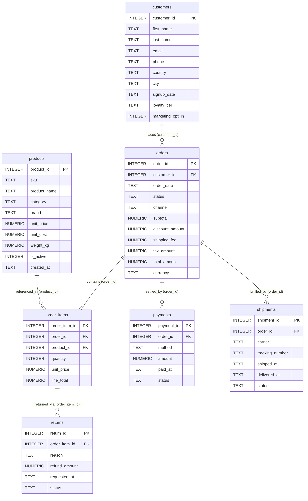

# Chapter 08 — SQL Generation and Database Access Layer

## 1. The Analytical Database (`data/ecommerce.db`)

The primary analytical target is `data/ecommerce.db`, a normalized 7-table e-commerce relational database containing **499,385 total rows** spanning orders from `2024-01-01` through `2026-09-29`. Its SHA-256 digest (`c5a5965e000becdb75d0802897cb047dc2f827d1fdc7bacdf9d53ef7a46b6934`) is verified by `scripts/verify_environment.py` and the automated test suite.

### Relational Entity-Relationship Diagram

The entity-relationship diagram above depicts all 7 tables, their primary/foreign keys, and their many-to-one relationships inside `data/ecommerce.db`.

### Table Row Counts & Analytical Indexes

| Table Name | Row Count | Primary Key | Foreign Keys | Analytical Indexes (`22` Total) |
| :--- | :--- | :--- | :--- | :--- |
| `customers` | `26,000` | `customer_id` | — | `idx_customers_country`, `idx_customers_signup_date`, `idx_customers_loyalty_tier` |
| `products` | `1,500` | `product_id` | — | `idx_products_category`, `idx_products_brand`, `idx_products_created_at` |
| `orders` | `90,000` | `order_id` | `customer_id -> customers.customer_id` | `idx_orders_customer_id`, `idx_orders_order_date`, `idx_orders_status`, `idx_orders_channel` |
| `order_items` | `200,000` | `order_item_id` | `order_id -> orders.order_id`, `product_id -> products.product_id` | `idx_order_items_order_id`, `idx_order_items_product_id` |
| `payments` | `90,000` | `payment_id` | `order_id -> orders.order_id` | `idx_payments_order_id`, `idx_payments_method`, `idx_payments_paid_at`, `idx_payments_status` |
| `shipments` | `83,885` | `shipment_id` | `order_id -> orders.order_id` | `idx_shipments_order_id`, `idx_shipments_carrier`, `idx_shipments_shipped_at`, `idx_shipments_delivered_at`, `idx_shipments_status` |
| `returns` | `8,000` | `return_id` | `order_item_id -> order_items.order_item_id` | `idx_returns_order_item_id`, `idx_returns_reason`, `idx_returns_requested_at`, `idx_returns_status` |
| **Total** | **499,385** | **7 PKs** | **6 FKs** | **22 Indexes** |

---

## 2. Dynamic Schema Discovery (`database/schema_inspector.py`)

`database/schema_inspector.py` makes zero hardcoded assumptions about table or column names. Everything is discovered at runtime:
- `inspect_schema(db, table_name=None, include_counts=True)` queries `sqlite_master`, `PRAGMA table_info`, `PRAGMA foreign_key_list`, `PRAGMA index_list`, and `PRAGMA index_info` to return a `DatabaseSchema` dataclass containing `TableSchema`, `ColumnInfo` (with canonical SQLite affinity per SQLite docs §3.1), `ForeignKeyInfo`, `IndexInfo`, and derived `RelationshipInfo`.
- `DatabaseSchema.format_for_prompt()` renders a compact, token-efficient summary injected into `ContextBuilder` and cached into `SQLiteMemoryRepository.seed_schema_facts()`.
- `get_table_sample(db, table_name, limit=10, max_limit=100)` retrieves sample records and column metadata using identifier quoting (`quote_identifier`).
- `validate_database_integrity(db)` runs `PRAGMA integrity_check` and `PRAGMA foreign_key_check`.
- `compare_databases(target_db, reference_db)` verifies structural and row-count parity against `data/raw/ecommerce.sqlite`.

---

## 3. Read-Only Connection & Query Execution (`database/connection.py` & `database/query_executor.py`)

All analytical database access passes through `connect_readonly()` and `execute_readonly_query()`:

1. **Read-Only SQLite URI (`connect_readonly`)**:
   - Constructs a percent-encoded SQLite URI via `build_readonly_uri(db_path, immutable=...)`:
     `file:/.../data/ecommerce.db?mode=ro` (plus `&immutable=1` when `immutable=True`).
   - Immediately executes `PRAGMA foreign_keys = ON`, `PRAGMA query_only = ON`, `PRAGMA temp_store = MEMORY`, and `PRAGMA busy_timeout = 5000`.
2. **Pre-Execution AST/Token Validation (`validate_readonly_sql`)**:
   - Strips comments (`--` and `/* ... */`) and string/identifier literals (`'...'`, `"..."`, `` `...` ``, `[...]`) via `_strip_comments_and_literals()`.
   - Rejects empty statements, multiple semicolon-separated statements, statements not starting with `SELECT` or `WITH`, any of the 23 `_FORBIDDEN_KEYWORDS` (`INSERT`, `UPDATE`, `DELETE`, `DROP`, `ALTER`, `CREATE`, `REPLACE`, `TRUNCATE`, `ATTACH`, `DETACH`, `PRAGMA`, `VACUUM`, `REINDEX`, `ANALYZE`, `BEGIN`, `COMMIT`, `ROLLBACK`, `SAVEPOINT`, `RELEASE`, `GRANT`, `REVOKE`, `MERGE`, `UPSERT`), and internal `sqlite_*` catalog references.
3. **SQLite Authorizer Callback (`_readonly_authorizer`)**:
   - Installed via `con.set_authorizer(_readonly_authorizer)` before `con.execute()` or `EXPLAIN QUERY PLAN`.
   - Permits only `SQLITE_SELECT` (21), `SQLITE_READ` (20, denying `sqlite_*` except `sqlite_master`/`sqlite_schema`), `SQLITE_FUNCTION` (31, denying `load_extension` and `fts3_tokenizer`), and `SQLITE_RECURSIVE` (33). All write/DDL/pragma opcodes return ` sqlite3.SQLITE_DENY`.
4. **Progress Handler Watchdog (`_progress_watchdog`)**:
   - Installed via `con.set_progress_handler(_progress_watchdog, 5_000)` (invoked every 5,000 SQLite VM opcodes).
   - Aborts execution if `time.perf_counter() > deadline` (raising `QueryTimeoutError`) or if `cancel_event.is_set()` (raising `QueryCancelledError`).
5. **Bounded Row Fetching**:
   - Fetches `cursor.fetchmany(effective_max_rows + 1)` (`max_result_rows = 1000` default for direct queries; up to `max_report_rows = 100,000` when feeding report generation) and sets `QueryExecutionResult.truncated = len(fetched) > effective_max_rows`.

---

## 4. Streaming Dataset Importer (`database/importer.py`)

For rebuilding `data/ecommerce.db` from raw CSVs, ZIP archives, or reference SQLite files (`scripts/import_dataset.py`), `database/importer.py` provides a streaming, transactional pipeline:
- Infers column types (`INTEGER`, `NUMERIC`, `TEXT`), `NOT NULL` constraints, primary keys (`<table>_id`), foreign keys, topological load order (`customers`, `products` → `orders` → `order_items`, `payments`, `shipments` → `returns`), and analytical indexes dynamically.
- Streams inserts in configurable batches (`batch_size = 5,000`) inside explicit transactions and verifies `PRAGMA integrity_check` and `PRAGMA foreign_key_check` before committing.

