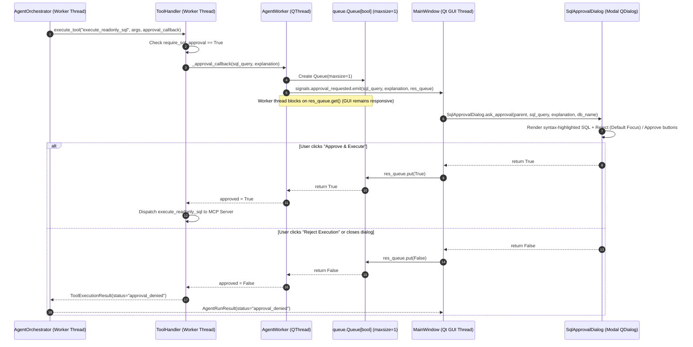

# Chapter 09 — Security Model and SQL Approval Workflow

## 1. Defense-in-Depth Security Architecture

The Local Report SQL Agent implements a **seven-layer defense-in-depth security model** spanning network isolation, prompt/skill sanitization, SQL validation, SQLite engine sandboxing, human-in-the-loop approval, filesystem containment, and credential masking.

```mermaid
flowchart TB
    subgraph L1["Layer 1: Network & Host Isolation"]
        Loopback["LOCAL_HOSTS Whitelist<br/>(localhost, 127.0.0.1, ::1)<br/>trust_env=False (No Proxy Hijack)"]
    end

    subgraph L2["Layer 2: Prompt & Skill Sanitization"]
        CtxSan["ContextBuilder.sanitize_text()<br/>Strips control chars & injection tokens"]
        SkillSec["SkillManager._scan_security()<br/>Blocks script tags, eval/exec, SQL DDL"]
    end

    subgraph L3["Layer 3: Process & Memory Isolation"]
        Subproc["MCP Server Subprocess<br/>(Separate OS process via stdio)"]
        MemGuard["SQLiteMemoryRepository Guard<br/>Blocks pointing memory DB to ecommerce.db"]
    end

    subgraph L4["Layer 4: Human-in-the-Loop SQL Governance"]
        Approval["SqlApprovalDialog<br/>(When require_sql_approval=True)<br/>Default focus on 'Reject Execution'"]
    end

    subgraph L5["Layer 5: Static & Planner SQL Validation"]
        StaticVal["validate_readonly_sql()<br/>Single SELECT/WITH only, 23 forbidden keywords"]
        ExplainVal["prepare_sql_query()<br/>EXPLAIN QUERY PLAN under Authorizer"]
    end

    subgraph L6["Layer 6: SQLite Engine Sandbox"]
        URIRo["URI mode=ro + PRAGMA query_only=ON"]
        Auth["con.set_authorizer(_readonly_authorizer)<br/>Only SELECT, READ, FUNCTION, RECURSIVE"]
        Watchdog["con.set_progress_handler(5000)<br/>Timeout (120s) + Cancel Event + Row Cap"]
    end

    subgraph L7["Layer 7: Output & UI Sanitization"]
        PathSafe["resolve_safe_report_path()<br/>Blocks NUL bytes, '..', Windows reserved names,<br/>enforces candidate.is_relative_to(base_dir)"]
        UISan["MessageWidget HTML Sanitizer &<br/>mask_sensitive_data() Credential Redaction"]
    end

    L1 --> L2 --> L3 --> L4 --> L5 --> L6 --> L7
```

The diagram above illustrates the seven concentric security layers protecting the user's machine, database, and UI from untrusted LLM outputs or malformed inputs.

---

## 2. Five-Stage Read-Only SQL Enforcement

Every SQL query proposed by the LLM must pass five sequential gates before returning rows:

| Gate | Component | Mechanism | Threat Mitigated |
| :--- | :--- | :--- | :--- |
| **Gate 1: Lexical & Structural Validation** | `database/query_executor.py` → `validate_readonly_sql()` | Strips comments/literals; enforces single statement starting with `SELECT` or `WITH`; blocks 23 write/DDL/transaction/pragma keywords and `sqlite_*` tables. | Multi-statement Piggybacking (`SELECT 1; DROP TABLE orders`), DDL/DML mutations, `ATTACH DATABASE`, `PRAGMA writable_schema`. |
| **Gate 2: Query Plan Verification** | `mcp_layer/tools/sql_tools.py` → `prepare_sql_query()` | Runs `EXPLAIN QUERY PLAN <sql>` under `_readonly_authorizer` without executing data scans. | Hallucinated table/column names, syntax errors, and disguised write operations before user approval. |
| **Gate 3: Human-in-the-Loop Approval** | `app/dialogs/sql_approval_dialog.py` → `SqlApprovalDialog.ask_approval()` | Modal dialog on the GUI thread when `require_sql_approval=True` (rejects empty SQL immediately; sets keyboard default focus on **Reject Execution**). | Unauthorized or unintended analytical queries when manual governance is enabled. |
| **Gate 4: OS & SQLite Connection Lock** | `database/connection.py` → `connect_readonly()` | Opens SQLite file with `file:...?mode=ro` URI and sets `PRAGMA query_only = ON`. | Operating-system and engine-level file modification. |
| **Gate 5: VM Authorizer & Watchdog** | `database/query_executor.py` → `_readonly_authorizer` & `_progress_watchdog` | Whitelists `SQLITE_SELECT`, `SQLITE_READ`, `SQLITE_FUNCTION` (blocking `load_extension` / `fts3_tokenizer`), `SQLITE_RECURSIVE`; checks timeout/cancel every 5,000 VM opcodes. | Malicious C-extension loading (`load_extension`), FTS3 pointer corruption (`fts3_tokenizer`), and runaway Cartesian join DoS. |

---

## 3. Human-in-the-Loop SQL Approval Workflow (`require_sql_approval`)

The application supports two SQL governance modes controlled by `AgentSettings.require_sql_approval` (or `REPORT_AGENT_REQUIRE_SQL_APPROVAL` / the **Mandatory SQL Approval** checkbox in `SettingsView`):

1. **Automated Read-Only Mode (`require_sql_approval = False`, Default)**:
   - Validated read-only `SELECT`/`WITH` queries execute automatically after passing `validate_readonly_sql()`, `_readonly_authorizer`, and `_progress_watchdog`.
   - Emits an `ActivityEvent` with `category="Approval Result"`, `title="SQL Execution Auto-Approved"`, and `status="auto_approved"`.
2. **Interactive Approval Mode (`require_sql_approval = True`)**:
   - Whenever the LLM calls `execute_readonly_sql`, `AgentOrchestrator` pauses the worker thread and requests explicit confirmation from the user on the main Qt GUI thread.

The sequence diagram above shows how `AgentWorker` bridges the asynchronous `asyncio` worker thread and the main Qt GUI thread using `signals.approval_requested` and a bounded `queue.Queue(maxsize=1)`.

---

## 4. Filesystem Path Traversal Protection (`reporting/report_manager.py`)

All generated PDF and CSV files are strictly confined to the configured `reports/` directory via `sanitize_filename_stem()` and `resolve_safe_report_path()`:
- Rejects any `title` or `output_dir` containing NUL bytes (`\x00`) with `ReportSecurityError`.
- Replaces `/`, `\`, `..`, and all characters outside `[A-Za-z0-9._-]` with `_`.
- Prefixes Windows reserved device names (`CON`, `PRN`, `AUX`, `NUL`, `COM1`–`COM9`, `LPT1`–`LPT9`) with `report_`.
- Appends a timestamp and 6-character UUID suffix (`<stem>_YYYYMMDD_HHMMSS_<hex6>.<ext>`).
- Verifies `candidate.resolve().is_relative_to(base_dir.resolve())` before returning the path, raising `ReportSecurityError` on any escape attempt.
- Writes to a `.tmp` file first (`.pdf.tmp` or `.csv.tmp`) and atomically renames via `tmp_path.replace(output_path)`.

