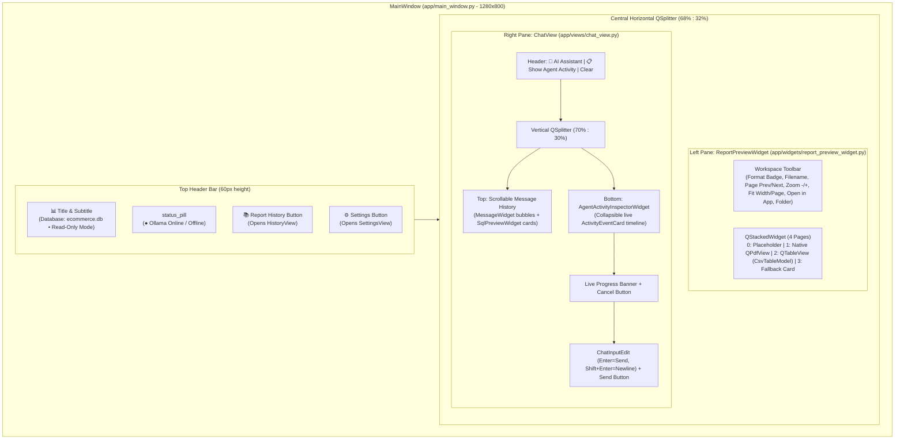

# Chapter 14 — Desktop GUI Architecture and Concurrency Model

## 1. PySide6 Split-Workspace Desktop Architecture (`app/`)

The graphical user interface is built natively with **PySide6 (Qt 6)** and styled via a custom modern dark stylesheet (`app/style.py`). `MainWindow` (`app/main_window.py`) organizes the interface into a top header bar and a non-collapsible horizontal `QSplitter` (`68%` left Report Workspace, `32%` right Conversational Assistant):



The component layout diagram above illustrates the visual hierarchy of `MainWindow`, `ReportPreviewWidget`, `ChatView`, and `AgentActivityInspectorWidget`.

---

## 2. Central Report Workspace (`ReportPreviewWidget`)

`app/widgets/report_preview_widget.py` provides immediate in-app inspection of generated PDF and CSV reports without requiring an external viewer:
- **Native PDF Viewer (`QPdfDocument` + `QPdfView`)**:
  - When `PySide6.QtPdf` and `PySide6.QtPdfWidgets` are available (`HAS_QT_PDF == True`), renders multi-page vector PDFs directly inside page index `1` of `self.stack`.
  - Supports single-page / multi-page navigation (`_prev_page`, `_next_page`, `pageNavigator()`), zoom in/out (`zoomFactor() * 1.25` / `0.8`, clamped to `[0.25, 4.0]`), `FitToWidth`, and `FitInView`.
- **High-Performance CSV Table Viewer (`QTableView` + `CsvTableModel`)**:
  - Loads UTF-8 (with Latin-1 fallback) CSV files into `CsvTableModel` (`app/models/csv_table_model.py`), capping in-memory preview rows at `DEFAULT_MAX_PREVIEW_ROWS = 5,000` while tracking `_total_file_rows` and `_is_truncated`.
  - Right-aligns numeric cells automatically and displays column/value tooltips.
- **External OS Integration**:
  - Provides **Open in App** and **📁 Folder** buttons using `QDesktopServices.openUrl(QUrl.fromLocalFile(...))`.

---

## 3. Lateral Chat View & Live Activity Inspector (`ChatView` & `AgentActivityInspectorWidget`)

1. **`MessageWidget` (`app/widgets/message_widget.py`)**:
   - Renders `user`, `assistant`, and `system` turns with role badges and timestamps.
   - If an assistant message includes chain-of-thought reasoning (`thinking`), renders a collapsible **💡 Show reasoning process** toggle while stripping `<think>...</think>` tags from the main body.
   - Sanitizes HTML strictly: user messages are 100% `html.escape()`d; assistant messages allow only safe formatting tags (`b`, `strong`, `i`, `em`, `code`, `br`, `span`, `p`, `ul`, `ol`, `li`, `pre`) and block any `javascript:` or `on*` event attributes.
2. **`SqlPreviewWidget` & `SqlSyntaxHighlighter` (`app/widgets/sql_preview_widget.py`, `sql_highlighter.py`)**:
   - Displays proposed SQL statements inline in chat with a one-click **Copy SQL** button and regex syntax highlighting (`#60a5fa` bold keywords, `#fbbf24` functions, `#c084fc` numbers, `#34d399` strings, `#94a3b8` italic comments).
3. **`AgentActivityInspectorWidget` (`app/widgets/activity_inspector_widget.py`)**:
   - Displays a live chronological stream of `ActivityEventCard` widgets across 17 `ActivityCategory` types (`User Request`, `Planning`, `Tool Call`, `SQL Validation`, `Approval Required`, `SQL Execution`, `Report Generation`, etc.).
   - Expandable cards show syntax-highlighted SQL, credential-masked tool arguments (`mask_sensitive_data`), result summaries, duration badges (`ms`), and `ContextBuildReport` token breakdowns (`Configured Window`, `Effective Window`, `Model Capability`, `Estimated Input`, `Included/Excluded Categories`).

---

## 4. Threading & Concurrency Model (`AgentWorker` & `WorkerSignals`)

To guarantee that the Qt GUI thread never freezes during multi-minute LLM inference or SQL queries:

```mermaid
sequenceDiagram
    autonumber
    participant UI as Qt Main Thread (MainWindow / ChatView)
    participant Signals as WorkerSignals (QObject)
    participant Worker as AgentWorker (QThread)
    participant Loop as Dedicated asyncio Event Loop
    participant Orch as AgentOrchestrator

    UI->>Worker: active_worker = AgentWorker(orchestrator, message)
    UI->>Worker: active_worker.start()
    Worker->>Loop: asyncio.new_event_loop() & run_until_complete(_execute())
    Worker->>Signals: started.emit()
    Signals-->>UI: Update status banner ("Analyzing request with Ollama...")

    Loop->>Orch: await process_message(user_message, _approval_callback, _progress_callback, _cancel_event)
    loop Every Agent / Tool Event
        Orch->>Worker: _progress_callback(AgentEvent)
        Worker->>Signals: progress_event.emit(event) & activity_event.emit(act)
        Signals-->>UI: Append ActivityEventCard / SqlPreviewWidget
    end

    opt User Clicks "Cancel" Button
        UI->>Worker: active_worker.cancel()
        Worker->>Loop: loop.call_soon_threadsafe(_cancel_event.set)
        Loop-->>Orch: cancel_event.is_set() == True -> Abort cleanly
    end

    Orch-->>Loop: return AgentRunResult
    Worker->>Signals: finished.emit(result)
    Signals-->>UI: Render assistant reply & load PDF/CSV in ReportPreviewWidget
    Worker->>Loop: Cancel pending tasks & loop.close()
```

The sequence diagram above shows the lifecycle of `AgentWorker` (`app/workers/agent_worker.py`), its dedicated `asyncio` event loop (using `WindowsProactorEventLoopPolicy` on `win32` so stdio subprocesses work inside `QThread`), Qt signal emissions, and thread-safe cooperative cancellation (`loop.call_soon_threadsafe(self._cancel_event.set)`).

