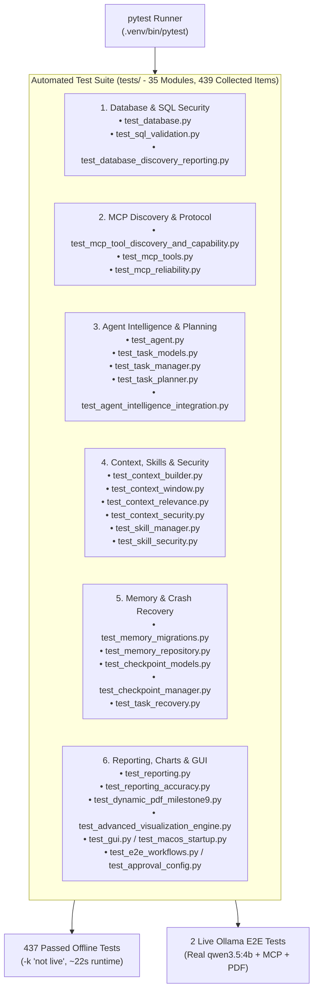

# Chapter 16 — Testing Strategy and Validation Suite

## 1. Multi-Tier Verification Architecture

The repository includes an extensive automated test suite under `tests/` comprising **35 test modules**, **388 test functions**, and **439 collected pytest items** (`437` deterministic offline tests + `2` live local Ollama E2E tests).



The diagram above groups the 35 test modules into six verification domains covering every architectural layer of the application.

---

## 2. Key Test Suites and Invariants Verified

### A. MCP Tool Discovery & Capability Awareness (`tests/test_mcp_tool_discovery_and_capability.py`)
Validates the complete 12-stage MCP lifecycle across 12 deterministic tests + 1 live `qwen3.5:4b` E2E test:
- `test_01_mcp_server_subprocess_startup_and_handshake`: Verifies `MCPClientManager.connect()` and stdio handshake.
- `test_02_mcp_list_tools_discovers_all_six_tools_with_valid_schemas`: Verifies all 6 tools (`inspect_database_schema`, `get_table_sample`, `prepare_sql_query`, `execute_readonly_sql`, `generate_pdf_report`, `generate_csv_report`) and their JSON schemas.
- `test_03_tool_registry_and_ollama_schema_conversion`: Verifies `ToolRegistry.to_ollama_tools()` function schemas.
- `test_04_missing_tool_in_discovery_fails_validation`: Proves incomplete tool discovery raises `MCPConnectionError`.
- `test_05_system_prompt_and_context_builder_reflect_discovered_tools`: Verifies `discovered_mcp_tools` injection and absence of false refusal triggers.
- `test_06_ollama_client_receives_and_sends_tools_in_api_payload`: Captures actual `/api/chat` HTTP payload and confirms all 6 tool definitions are sent in `payload["tools"]`.
- `test_07` through `test_12`: Verify MCP execution of `inspect_database_schema`, `get_table_sample`, `prepare_sql_query`, `execute_readonly_sql`, `generate_pdf_report`, `generate_csv_report`, and full multi-turn orchestrator workflows.
- `test_13_live_ollama_qwen_reporting_workflow`: Executes a live multi-turn reporting workflow against local `qwen3.5:4b`, verifying zero `CAPABILITY_LIMITATION` refusals and real PDF generation on disk.

### B. Database Integrity & Read-Only SQL Sandboxing (`tests/test_database.py`, `tests/test_sql_validation.py`)
- Verifies that `data/ecommerce.db` has 7 tables, 499,385 rows, 0 foreign-key violations, `PRAGMA integrity_check == "ok"`, and matches `data/raw/ecommerce.sqlite`.
- Tests 23+ destructive SQL attack vectors (`DROP`, `DELETE`, `UPDATE`, `INSERT`, `ALTER`, `ATTACH`, `PRAGMA`, `WITH ... DELETE`, multi-statement piggybacking, `sqlite_master` tampering) and confirms every single one is blocked before execution.
- Verifies query timeout (`QueryTimeoutError`) and cooperative cancellation (`QueryCancelledError`) via the 5,000-opcode SQLite progress watchdog.

### C. Reporting Accuracy & 25-Renderer Chart Engine (`tests/test_reporting_accuracy.py`, `tests/test_advanced_visualization_engine.py`)
- Verifies `CanonicalSQLDataset.compute_deterministic_kpis()` and `extract_and_transform_chart()`.
- Confirms `ReportConsistencyValidator` detects mismatched chart/table totals and reconciles drifted LLM KPI values.
- Renders all 25 registered chart keys in `ChartRegistry` into multi-page ReportLab PDFs and verifies valid `%PDF-` headers and non-zero file sizes.

### D. Headless PySide6 GUI & Concurrency (`tests/test_gui.py`, `tests/test_macos_startup.py`, `tests/test_approval_config.py`)
- Runs under `QT_QPA_PLATFORM=offscreen` to test `MainWindow`, `ChatView`, `ReportPreviewWidget`, `HistoryView`, `SettingsView`, `AgentActivityInspectorWidget`, and `SqlApprovalDialog` without requiring a physical display server.
- Verifies both `require_sql_approval=False` (automated read-only execution without modal prompts) and `require_sql_approval=True` (modal `SqlApprovalDialog` approval and rejection flows).

---

## 3. Running the Validation Suite

```bash
# 1. Verify runtime environment, packages, MCP SDK, and ecommerce.db SHA-256
.venv/bin/python scripts/verify_environment.py

# 2. Run the complete offline automated test suite (437 tests)
QT_QPA_PLATFORM=offscreen .venv/bin/pytest -k "not live" -q

# 3. Run the live local Ollama (qwen3.5:4b) end-to-end tests
QT_QPA_PLATFORM=offscreen .venv/bin/pytest -k "live" -v
```

