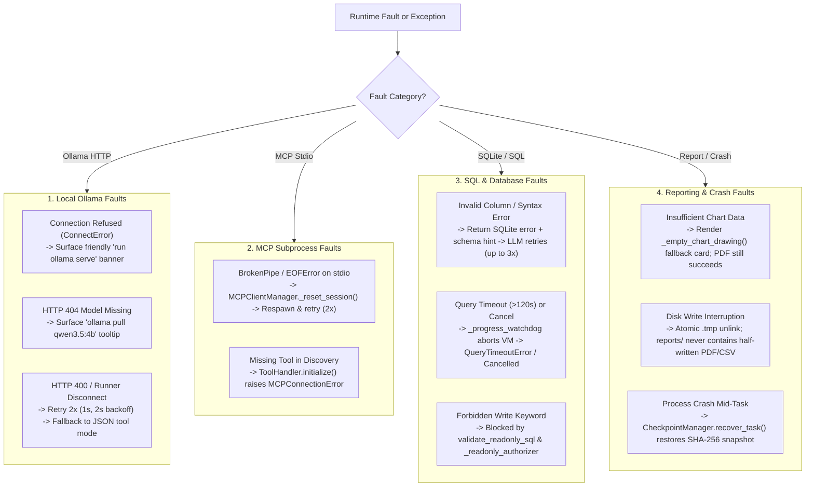

# Chapter 17 — Failure Modes, Resilience, and Troubleshooting

## 1. Failure Modes and Automated Recovery Matrix

The Local Report SQL Agent is engineered to handle infrastructure, model, SQL, and rendering failures deterministically without crashing the GUI or leaving corrupted files on disk.



The fault-tree diagram above maps each runtime failure domain to its automated containment and recovery mechanism.

---

## 2. Diagnostic & Troubleshooting Guide

### Symptom 1: Header Status Pill Shows `● Ollama Offline`
- **Root Cause**: The local Ollama daemon is not running or is listening on a different port.
- **Verification**:
  ```bash
  curl http://localhost:11434/api/version
  ```
- **Resolution**: Start Ollama locally (`ollama serve` or launch the Ollama desktop app), then click **⚙️ Settings → Test Connection**.

### Symptom 2: Header Status Pill Shows `● Ollama Online (Model missing)`
- **Root Cause**: Ollama is running, but the configured model (`qwen3.5:4b`) has not been pulled locally.
- **Verification**:
  ```bash
  ollama list
  ```
- **Resolution**: Pull the model in a terminal:
  ```bash
  ollama pull qwen3.5:4b
  ```
  Or open **⚙️ Settings** in the GUI and select an already-installed model from the **Model Name** dropdown.

### Symptom 3: `Ollama disconnected abruptly without sending a response`
- **Root Cause**: The local Ollama model runner ran out of unified/system RAM when allocating the KV cache for a large context window (`256K` or `128K`).
- **Resolution**:
  1. Open **⚙️ Settings → Local Ollama Configuration → Agent Context Window** and reduce the context window from `128K` / `256K` to **`64K (65,536 tokens)`** or **`32K (32,768 tokens)`**.
  2. If the model runner struggles with native tool schemas under low memory, switch **Tool Mode Protocol** from `auto` to `json`.

### Symptom 4: `Database not found at data/ecommerce.db` or Checksum Mismatch
- **Root Cause**: `data/ecommerce.db` was deleted or not yet built from `data/raw/`.
- **Resolution**: Rebuild and verify the database from the read-only raw source archive:
  ```bash
  .venv/bin/python scripts/import_dataset.py --overwrite --run-validation-queries
  .venv/bin/python scripts/verify_environment.py
  ```

### Symptom 5: Inspecting Detailed Execution & Crash Logs
- **GUI & Orchestrator Log**: `logs/report_agent_app.log` (or `~/Library/Application Support/ReportSQLAgent/logs/report_agent_app.log` when running the packaged macOS `.app`).
- **MCP Server Subprocess Log**: `logs/report_agent_mcp_server.log` (logged strictly to file and `stderr` so `stdout` JSON-RPC frames remain uncorrupted).
- **Early Bootstrap Crash Log**: `logs/startup_crash.log` (written by `run_app.py:_fallback_log_fatal()` if an import error occurs before `setup_logging()`).

