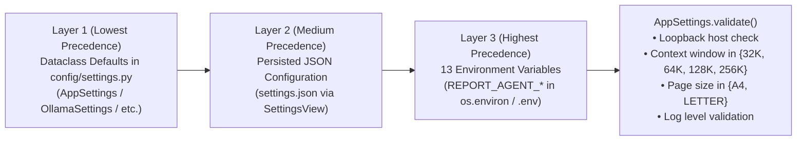

# Chapter 18 — Configuration and Runtime Requirements

## 1. Three-Layer Configuration Precedence (`config/settings.py`)

Application configuration is managed through strongly typed dataclasses in `config/settings.py` (`AppSettings`, `OllamaSettings`, `DatabaseSettings`, `AgentSettings`, `ReportSettings`, `LoggingSettings`).

`load_settings(settings_file=None)` merges settings in strict **lowest-to-highest precedence order**:

The diagram above illustrates the 3-layer configuration cascade and final `AppSettings.validate()` invariant check.

---

## 2. Complete Configuration Parameter Reference

| Section | Field (`settings.json`) | Environment Variable Override (`ENV_OVERRIDES`) | Type | Default Value | Validation / Constraints |
| :--- | :--- | :--- | :--- | :--- | :--- |
| **`ollama`** | `ollama.host` | `REPORT_AGENT_OLLAMA_HOST` | `str` | `"http://localhost:11434"` | Must resolve to `localhost`, `127.0.0.1`, or `::1` (`LOCAL_HOSTS`). |
| **`ollama`** | `ollama.model` | `REPORT_AGENT_OLLAMA_MODEL` | `str` | `"qwen3.5:4b"` | Non-empty local Ollama model tag. |
| **`ollama`** | `ollama.temperature` | `REPORT_AGENT_OLLAMA_TEMPERATURE` | `float` | `0.1` | Sampling temperature (`0.0`–`2.0`). |
| **`ollama`** | `ollama.top_p` | *(JSON only)* | `float` | `0.9` | Nucleus sampling threshold. |
| **`ollama`** | `ollama.num_ctx` | *(Synced with `agent_context_window`)* | `int` | `131072` | Must be in `{32768, 65536, 131072, 262144}`. |
| **`ollama`** | `ollama.request_timeout_s` | `REPORT_AGENT_OLLAMA_TIMEOUT_S` | `float` | `600.0` | Must be `> 0`. |
| **`ollama`** | `ollama.keep_alive` | *(JSON only)* | `str` | `"10m"` | Ollama model memory retention duration. |
| **`ollama`** | `ollama.tool_mode` | *(JSON only)* | `str` | `"auto"` | `"auto"`, `"native"`, or `"json"`. |
| **`database`** | `database.path` | `REPORT_AGENT_DB_PATH` | `str` | `"data/ecommerce.db"` | Resolved via `config.paths.resolve_path()`. |
| **`database`** | `database.max_result_rows` | `REPORT_AGENT_MAX_ROWS` | `int` | `1000` | Must be `>= 1` (`10`–`50,000` in GUI). |
| **`database`** | `database.llm_preview_rows` | *(JSON only)* | `int` | `50` | Rows included in `role="tool"` LLM preview. |
| **`database`** | `database.query_timeout_s` | `REPORT_AGENT_QUERY_TIMEOUT_S` | `float` | `120.0` | Must be `> 0` (`1`–`120` in GUI). |
| **`agent`** | `agent.max_iterations` | `REPORT_AGENT_MAX_ITERATIONS` | `int` | `20` | Must be `>= 1` (`2`–`100` in GUI). |
| **`agent`** | `agent.max_tool_calls` | *(JSON only)* | `int` | `40` | Maximum total MCP tool calls per turn. |
| **`agent`** | `agent.max_sql_retries` | *(JSON only)* | `int` | `3` | Maximum self-correction retries on SQL error. |
| **`agent`** | `agent.max_history_messages` | *(JSON only)* | `int` | `30` | Rolling conversation message cap. |
| **`agent`** | `agent.require_sql_approval` | `REPORT_AGENT_REQUIRE_SQL_APPROVAL` | `bool` | `False` | `True` enables modal `SqlApprovalDialog` before SQL execution. |
| **`agent`** | `agent.agent_context_window` | `REPORT_AGENT_CONTEXT_WINDOW` | `int` | `131072` | Must be in `{32768, 65536, 131072, 262144}` (also accepts `32k`, `64k`, `128k`, `256k`). |
| **`reports`** | `reports.output_dir` | `REPORT_AGENT_OUTPUT_DIR` | `str` | `"reports"` | Directory where PDF/CSV reports and `report_history.json` are stored. |
| **`reports`** | `reports.page_size` | `REPORT_AGENT_PAGE_SIZE` | `str` | `"A4"` | Must be `"A4"` or `"LETTER"`. |
| **`reports`** | `reports.max_pdf_rows` | `REPORT_AGENT_MAX_PDF_ROWS` | `int` | `5000` | Maximum tabular rows rendered inside a PDF. |
| **`reports`** | `reports.max_report_rows` | `REPORT_AGENT_MAX_CSV_ROWS` | `int` | `100000` | Maximum rows fetched for CSV/report datasets. |
| **`reports`** | `reports.include_sql_in_pdf` | `REPORT_AGENT_INCLUDE_SQL_IN_PDF` | `bool` | `False` | When `True`, appends an SQL Query Appendix to generated PDFs. |
| **`logging`** | `logging.level` | `REPORT_AGENT_LOG_LEVEL` | `str` | `"INFO"` | `"DEBUG"`, `"INFO"`, `"WARNING"`, `"ERROR"`, or `"CRITICAL"`. |
| **`logging`** | `logging.directory` | *(JSON only)* | `str` | `"logs"` | Directory for rotating log files. |
| **`logging`** | `logging.file_name` | *(JSON only)* | `str` | `"report_agent.log"` | Base stem for `report_agent_app.log` and `report_agent_mcp_server.log`. |

---

## 3. Software and Hardware Runtime Requirements

### Software Dependencies (`requirements.txt`)
- **Python**: `3.13.x` (verified on Python `3.13.9`)
- **GUI Framework**: `PySide6>=6.8,<7.0` (including `QtPdf` and `QtPdfWidgets`)
- **MCP Protocol SDK**: `mcp>=1.2.0` (`FastMCP`, `ClientSession`, `stdio_client`)
- **HTTP Client & Data Validation**: `httpx>=0.27.0`, `pydantic>=2.9.0`, `python-dotenv>=1.0.1`
- **PDF & Vector Graphics Engine**: `reportlab>=4.2.0`
- **Testing & Packaging**: `pytest>=8.3.0`, `pytest-asyncio>=0.24.0`, `pytest-qt>=4.4.0`, `pyinstaller>=6.10.0`
- **External Local LLM Runtime**: [Ollama](https://ollama.com) (`>=0.5.0` recommended) with `qwen3.5:4b` installed (`ollama pull qwen3.5:4b`).

### Operating System & Hardware Requirements
- **macOS**: macOS 12.0 (Monterey) or newer (Apple Silicon M1/M2/M3/M4 or Intel x86_64).
- **Windows**: Windows 10 (64-bit) or Windows 11 (64-bit).
- **Memory (RAM)**: Minimum `8 GB` RAM (`16 GB` unified memory/RAM recommended when using the `128K` or `256K` context window with `qwen3.5:4b`).
- **Disk Space**: ~`500 MB` for the repository, `.venv`, and `data/ecommerce.db` (`~58 MB`), plus ~`3.0 GB` for the local `qwen3.5:4b` Ollama model weights.

