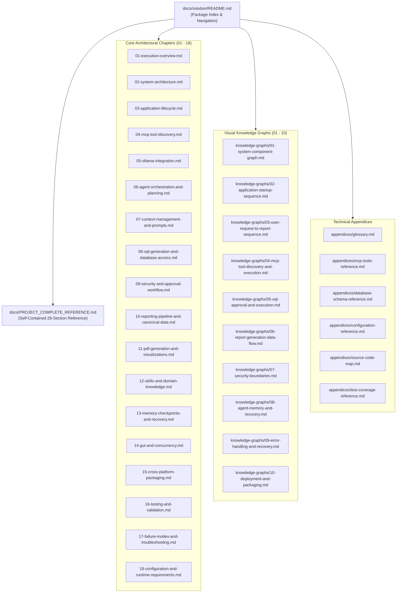

# Local Report SQL Agent — Solution Documentation Package

Welcome to the authoritative, source-accurate technical documentation package for the **Local Report SQL Agent** desktop application.

> **Standalone External Reference**: For a single, self-contained document suitable for external academic evaluation, architectural review, or onboarding without repository access, see [`../PROJECT_COMPLETE_REFERENCE.md`](../PROJECT_COMPLETE_REFERENCE.md).

---

## 1. Documentation Package Architecture

The diagram above illustrates how the documentation package is organized into three modular tiers—Core Architectural Chapters, Visual Knowledge Graphs, and Technical Appendices—paired with the standalone `PROJECT_COMPLETE_REFERENCE.md` master specification.

---

## 2. Core Architectural Chapters

| Chapter | Document | Primary Focus & Verified Source Modules |
| :--- | :--- | :--- |
| **01** | [`01-executive-overview.md`](./01-executive-overview.md) | Problem statement, local-first privacy posture, key capabilities, architectural highlights, and user value proposition. |
| **02** | [`02-system-architecture.md`](./02-system-architecture.md) | Six-tier layered architecture, OS process boundaries (GUI vs. stdio MCP server vs. local Ollama daemon), and inter-layer contracts. |
| **03** | [`03-application-lifecycle.md`](./03-application-lifecycle.md) | Entrypoint (`run_app.py`), startup initialization (`app/main.py`, `InitWorker`), MCP connection, and deterministic shutdown (`MainWindow.closeEvent`). |
| **04** | [`04-mcp-tool-discovery.md`](./04-mcp-tool-discovery.md) | Official MCP SDK (`FastMCP` + `stdio_client`), persistent session lifecycle, `ToolRegistry`, 6-tool completeness gate, and schema normalization. |
| **05** | [`05-ollama-integration.md`](./05-ollama-integration.md) | Loopback-only HTTP client (`agent/ollama_client.py`), `/api/chat` payload structure, native vs. JSON fallback tool calling, model fallback resolution, and retries. |
| **06** | [`06-agent-orchestration-and-planning.md`](./06-agent-orchestration-and-planning.md) | `AgentOrchestrator`, `TaskPlanner`, step state transitions, loop prevention, fallback tool synthesis, and multi-turn execution loop. |
| **07** | [`07-context-management-and-prompts.md`](./07-context-management-and-prompts.md) | `ContextBuilder`, `SectionPriority` levels (`CRITICAL`, `HIGH`, `MEDIUM`, `LOW`), token budget allocation (`6,000` default), `system_prompt.py`, and `ConversationManager`. |
| **08** | [`08-sql-generation-and-database-access.md`](./08-sql-generation-and-database-access.md) | `data/ecommerce.db` (7 tables, 499,385 rows), `database/schema_inspector.py`, `database/connection.py`, `database/query_validator.py`, and `database/executor.py`. |
| **09** | [`09-security-and-approval-workflow.md`](./09-security-and-approval-workflow.md) | Defense-in-depth read-only SQL enforcement, lexical/structural validation, SQLite URI `mode=ro` + `PRAGMA query_only=ON`, 30s opcode watchdog, and `SQLPreviewWidget` approval gate. |
| **10** | [`10-reporting-pipeline-and-canonical-data.md`](./10-reporting-pipeline-and-canonical-data.md) | Single Source of Truth (`CanonicalSQLDataset`), deterministic KPI calculation, and `ReportConsistencyValidator`. |
| **11** | [`11-pdf-generation-and-visualizations.md`](./11-pdf-generation-and-visualizations.md) | ReportLab multi-page PDF engine (`pdf_generator.py`, `dynamic_pdf_composer.py`), `ChartRegistry` (25 registered keys across 6 categories), and UTF-8 CSV export. |
| **12** | [`12-skills-and-domain-knowledge.md`](./12-skills-and-domain-knowledge.md) | `SkillManager` discovery (`skills/*.md`), YAML frontmatter parsing, `skill_registry` synchronization, and query-time relevance scoring. |
| **13** | [`13-memory-checkpoints-and-recovery.md`](./13-memory-checkpoints-and-recovery.md) | `SQLiteMemoryRepository` (`data/agent_memory.db`), working/episodic/semantic memory, `CheckpointManager` snapshots, and `RecoveryService` crash recovery. |
| **14** | [`14-gui-and-concurrency.md`](./14-gui-and-concurrency.md) | PySide6 `MainWindow`, `MessageWidget`, `SQLPreviewWidget`, `ActivityInspectorWidget`, `ReportViewerWidget`, `AgentWorker` (`QThread` + `asyncio`), and `threading.Event` approval bridge. |
| **15** | [`15-cross-platform-packaging.md`](./15-cross-platform-packaging.md) | `ReportSQLAgent.spec`, `--mcp-server` dual-mode binary dispatch, `config/paths.py` frozen vs. user-data path resolution, and `scripts/package_app.py`. |
| **16** | [`16-testing-and-validation.md`](./16-testing-and-validation.md) | 35 test modules (`437` offline tests + `2` live `qwen3.5:4b` end-to-end tests), headless `QT_QPA_PLATFORM=offscreen` GUI testing, and SHA-256 DB verification. |
| **17** | [`17-failure-modes-and-troubleshooting.md`](./17-failure-modes-and-troubleshooting.md) | Diagnostic guide for Ollama disconnects, MCP handshake errors, SQLite timeouts, missing models, and automated recovery procedures. |
| **18** | [`18-configuration-and-runtime-requirements.md`](./18-configuration-and-runtime-requirements.md) | `AppSettings` (`config/settings.py`), `.env` environment variables, `RuntimePaths`, hardware/OS requirements, and rotating logging setup. |

---

## 3. Visual Knowledge Graphs

Each file in [`knowledge-graphs/`](./knowledge-graphs/) pairs high-precision Mermaid architecture, sequence, state, class, and entity-relationship diagrams with deep technical walkthroughs:

1. [`01-system-component-graph.md`](./knowledge-graphs/01-system-component-graph.md) — Complete module, class, and process topology across all six architectural layers.
2. [`02-application-startup-sequence.md`](./knowledge-graphs/02-application-startup-sequence.md) — Step-by-step initialization sequence from `run_app.py` to `MainWindow` and `InitWorker`.
3. [`03-user-request-to-report-sequence.md`](./knowledge-graphs/03-user-request-to-report-sequence.md) — Full end-to-end execution trace from user prompt submission to PDF/CSV report presentation.
4. [`04-mcp-tool-discovery-and-execution.md`](./knowledge-graphs/04-mcp-tool-discovery-and-execution.md) — JSON-RPC 2.0 stdio transport, `list_tools()` discovery, `ToolRegistry` validation, and `call_tool()` dispatch.
5. [`05-sql-approval-and-execution.md`](./knowledge-graphs/05-sql-approval-and-execution.md) — Multi-layer SQL validation, cross-thread approval synchronization, and read-only SQLite execution.
6. [`06-report-generation-data-flow.md`](./knowledge-graphs/06-report-generation-data-flow.md) — Data pipeline from SQLite rows to `CanonicalSQLDataset`, KPI synthesis, `ChartRegistry`, and PDF/CSV creation.
7. [`07-security-boundaries.md`](./knowledge-graphs/07-security-boundaries.md) — Trust boundaries across user input, LLM output, MCP IPC, SQLite read-only mode, filesystem containment, and loopback networking.
8. [`08-agent-memory-and-recovery.md`](./knowledge-graphs/08-agent-memory-and-recovery.md) — `data/agent_memory.db` ER diagram, task/step state machines, checkpoint persistence, and crash recovery flows.
9. [`09-error-handling-and-recovery.md`](./knowledge-graphs/09-error-handling-and-recovery.md) — SQL self-correction loop, HTTP/MCP retry state machines, native-to-JSON tool fallback, and graceful chart degradation.
10. [`10-deployment-and-packaging.md`](./knowledge-graphs/10-deployment-and-packaging.md) — PyInstaller packaging pipeline, macOS `.app` bundle layout, Windows standalone layout, and runtime path routing.

---

## 4. Technical Appendices

- [`appendices/glossary.md`](./appendices/glossary.md) — Definitions of domain, protocol, and architectural terms used across the project.
- [`appendices/mcp-tools-reference.md`](./appendices/mcp-tools-reference.md) — Authoritative specification of all 6 MCP tools, input JSON schemas, validation rules, and return payloads.
- [`appendices/database-schema-reference.md`](./appendices/database-schema-reference.md) — Complete relational schema reference for `data/ecommerce.db` (7 tables, 499,385 rows, columns, PKs, FKs, indexes, and domain values) and `data/agent_memory.db` (11 tables across 3 migrations).
- [`appendices/configuration-reference.md`](./appendices/configuration-reference.md) — Exhaustive reference for `AppSettings`, `.env` configuration variables, and `RuntimePaths`.
- [`appendices/source-code-map.md`](./appendices/source-code-map.md) — File-by-file and class-by-class directory map of the entire repository.
- [`appendices/test-coverage-reference.md`](./appendices/test-coverage-reference.md) — Complete inventory of all 35 test modules (`388` test functions / `439` collected test items) and verification commands.

---

## 5. Additional Reference Documents in `docs/`

In addition to this modular solution package and [`../PROJECT_COMPLETE_REFERENCE.md`](../PROJECT_COMPLETE_REFERENCE.md), the parent `docs/` directory includes:

- [`../ARCHITECTURE.md`](../ARCHITECTURE.md) — Architectural overview.
- [`../AGENT_INTELLIGENCE_LAYER.md`](../AGENT_INTELLIGENCE_LAYER.md) & [`../AGENT_WORKFLOW.md`](../AGENT_WORKFLOW.md) — Cognitive agent workflow and memory layer documentation.
- [`../DATABASE.md`](../DATABASE.md) & [`../SECURITY.md`](../SECURITY.md) — Database design and SQL safety notes.
- [`../TOOLS_AND_MCP_SPECIFICATION.md`](../TOOLS_AND_MCP_SPECIFICATION.md) & [`../MCP_TOOL_DISCOVERY_FIX_REPORT.md`](../MCP_TOOL_DISCOVERY_FIX_REPORT.md) — MCP specification and root-cause fix report for deterministic MCP tool discovery and `qwen3.5:4b` capability awareness.
- [`../MACOS_STARTUP_FIX_REPORT.md`](../MACOS_STARTUP_FIX_REPORT.md) — macOS startup and concurrency engineering report.
- [`../TESTING.md`](../TESTING.md) & [`../DEMO_GUIDE.md`](../DEMO_GUIDE.md) — Testing and interactive demonstration guides.
