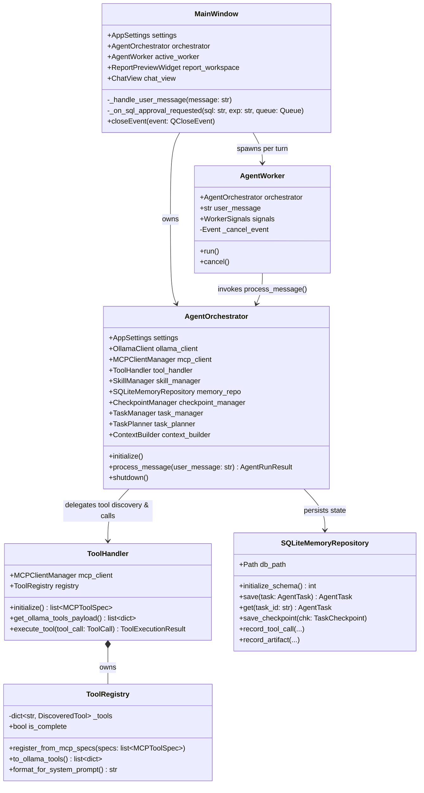

# Knowledge Graph 01 — System Component and Class Topology

## 1. Complete Module & Component Dependency Graph

```mermaid
flowchart TB
    subgraph Entry["Entrypoint & Configuration (config/)"]
        RunApp["run_app.py"]
        AppMain["app/main.py"]
        Settings["config/settings.py<br/>(AppSettings)"]
        Paths["config/paths.py<br/>(resource_root / user_data_root)"]
        Prompts["config/prompts.py"]
        LogSetup["config/logging_setup.py"]
    end

    subgraph GUI["PySide6 GUI Layer (app/)"]
        MW["MainWindow<br/>(app/main_window.py)"]
        RPW["ReportPreviewWidget<br/>(app/widgets/report_preview_widget.py)"]
        CSVMod["CsvTableModel<br/>(app/models/csv_table_model.py)"]
        CV["ChatView<br/>(app/views/chat_view.py)"]
        MsgW["MessageWidget & SqlPreviewWidget"]
        ActW["AgentActivityInspectorWidget<br/>(app/widgets/activity_inspector_widget.py)"]
        HistV["HistoryView<br/>(app/views/history_view.py)"]
        SetV["SettingsView<br/>(app/views/settings_view.py)"]
        ApprD["SqlApprovalDialog<br/>(app/dialogs/sql_approval_dialog.py)"]
        AW["AgentWorker & OllamaCheckWorker<br/>(app/workers/agent_worker.py)"]
    end

    subgraph Agent["Agent Intelligence Layer (agent/)"]
        Orch["AgentOrchestrator<br/>(agent/orchestrator.py)"]
        TP["TaskPlanner<br/>(agent/task_planner.py)"]
        TM["TaskManager<br/>(agent/task_manager.py)"]
        CM["CheckpointManager & RecoveryValidator<br/>(agent/checkpoint_manager.py)"]
        CB["ContextBuilder<br/>(agent/context_builder.py)"]
        SPB["SystemPromptBuilder<br/>(agent/system_prompt.py)"]
        SM["SkillManager<br/>(agent/skill_manager.py)"]
        Conv["ConversationMemory<br/>(agent/conversation.py)"]
        TH["ToolHandler & ToolRegistry<br/>(agent/tool_handler.py)"]
        OC["OllamaClient<br/>(agent/ollama_client.py)"]
    end

    subgraph Memory["Persistent Memory Layer (memory/)"]
        Repo["SQLiteMemoryRepository<br/>(memory/repository.py)"]
        Migs["memory/migrations/<br/>001..003.sql"]
    end

    subgraph MCPLayer["MCP Client/Server Layer (mcp_layer/)"]
        MCPC["MCPClientManager<br/>(mcp_layer/client.py)"]
        MCPS["FastMCP Stdio Server<br/>(mcp_layer/server.py)"]
        T_DB["database_tools.py"]
        T_SQL["sql_tools.py"]
        T_REP["reporting_tools.py"]
    end

    subgraph DataAndReporting["Database & Reporting Engines (database/, reporting/)"]
        DBConn["connection.py & query_executor.py"]
        DBInsp["schema_inspector.py & importer.py"]
        CanData["CanonicalSQLDataset & ReportConsistencyValidator<br/>(reporting/canonical_data.py)"]
        PDFG["pdf_generator.py & dynamic_pdf_composer.py"]
        ChartR["ChartRegistry (25 Renderers)<br/>(reporting/chart_registry.py)"]
        CSVG["csv_generator.py & report_manager.py"]
    end

    RunApp --> AppMain
    AppMain --> Settings
    AppMain --> LogSetup
    AppMain --> MW
    MW --> RPW --> CSVMod
    MW --> CV --> MsgW
    CV --> ActW
    MW --> HistV
    MW --> SetV
    MW --> ApprD
    MW --> AW
    AW --> Orch
    Orch --> TP --> TM
    Orch --> CM
    Orch --> CB --> SPB --> Prompts
    Orch --> SM
    Orch --> Conv
    Orch --> TH --> MCPC
    Orch --> OC
    TM --> Repo
    CM --> Repo
    Orch --> Repo --> Migs
    MCPC <-->|"JSON-RPC 2.0 Stdio"| MCPS
    MCPS --> T_DB --> DBInsp --> DBConn
    MCPS --> T_SQL --> DBConn
    MCPS --> T_REP --> CanData
    T_REP --> PDFG --> ChartR
    T_REP --> CSVG
    Settings --> Paths
```

The component graph above maps all 7 packages (`config`, `app`, `agent`, `memory`, `mcp_layer`, `database`, `reporting`) and their structural dependencies.

---

## 2. Core Class Relationships (`classDiagram`)

The class diagram above highlights the ownership and method contracts between the UI host (`MainWindow`), background thread runner (`AgentWorker`), central brain (`AgentOrchestrator`), MCP tool adapter (`ToolHandler` + `ToolRegistry`), and persistent SQLite repository (`SQLiteMemoryRepository`).

