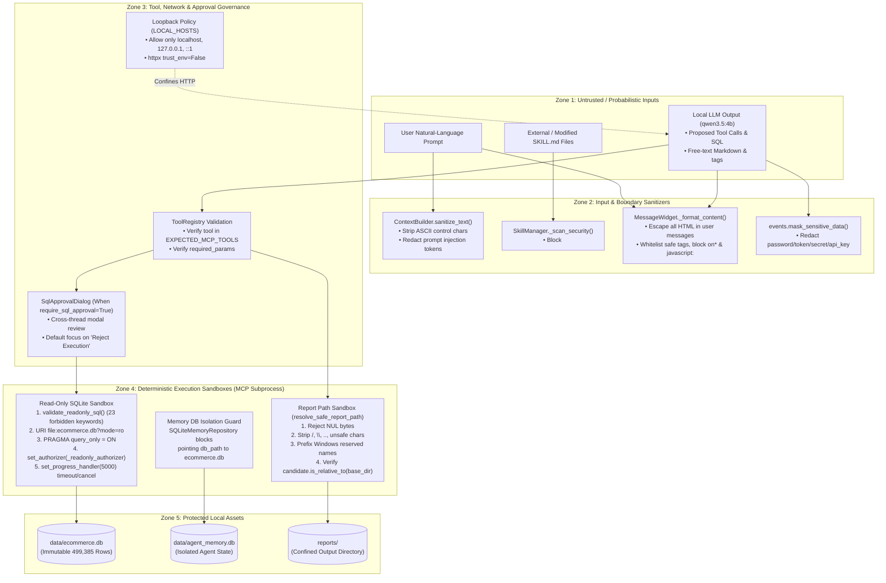

# Knowledge Graph 07 — Security Boundaries and Trust Zones

## 1. System Trust Zones and Security Enforcement Graph

The trust-zone diagram above maps all five security zones—from untrusted/probabilistic inputs (Zone 1) through input sanitizers (Zone 2), governance gates (Zone 3), and execution sandboxes (Zone 4) to protected local storage assets (Zone 5).

---

## 2. Security Boundary Summary Table

| Boundary | Source Module | Enforced Invariant | Exception Raised on Violation |
| :--- | :--- | :--- | :--- |
| **Network Loopback Boundary** | `config/settings.py`, `agent/ollama_client.py` | `hostname in {"localhost", "127.0.0.1", "::1", "[::1]"}` and `trust_env=False` | `ValueError` / `OllamaSecurityError` |
| **Database Separation Boundary** | `memory/repository.py` | `agent_memory.db` path must never equal `data/ecommerce.db` | `ValueError("Critical security violation...")` |
| **SQL Lexical & Keyword Boundary** | `database/query_executor.py` | Single `SELECT`/`WITH` statement; zero `_FORBIDDEN_KEYWORDS`; zero `sqlite_*` tables | `UnsafeQueryError` / `InvalidQueryError` |
| **SQLite Engine Authorizer Boundary** | `database/query_executor.py` | `_readonly_authorizer` allows only action codes `21`, `20`, `31` (safe functions), `33` | `UnsafeQueryError("Statement blocked by read-only authorizer...")` |
| **Query Resource Boundary** | `database/query_executor.py` | `_progress_watchdog` every 5,000 opcodes (`120s` timeout) + `fetchmany(max_rows + 1)` | `QueryTimeoutError` / `QueryCancelledError` |
| **Report Filesystem Boundary** | `reporting/report_manager.py` | `candidate.resolve().is_relative_to(base_dir.resolve())`; no NUL bytes or `..` | `ReportSecurityError` |
| **Skill Injection Boundary** | `agent/skill_manager.py` | No `<script>`, `eval(`, `os.system`, destructive SQL, or prompt injection phrases | `SkillSecurityError` |

