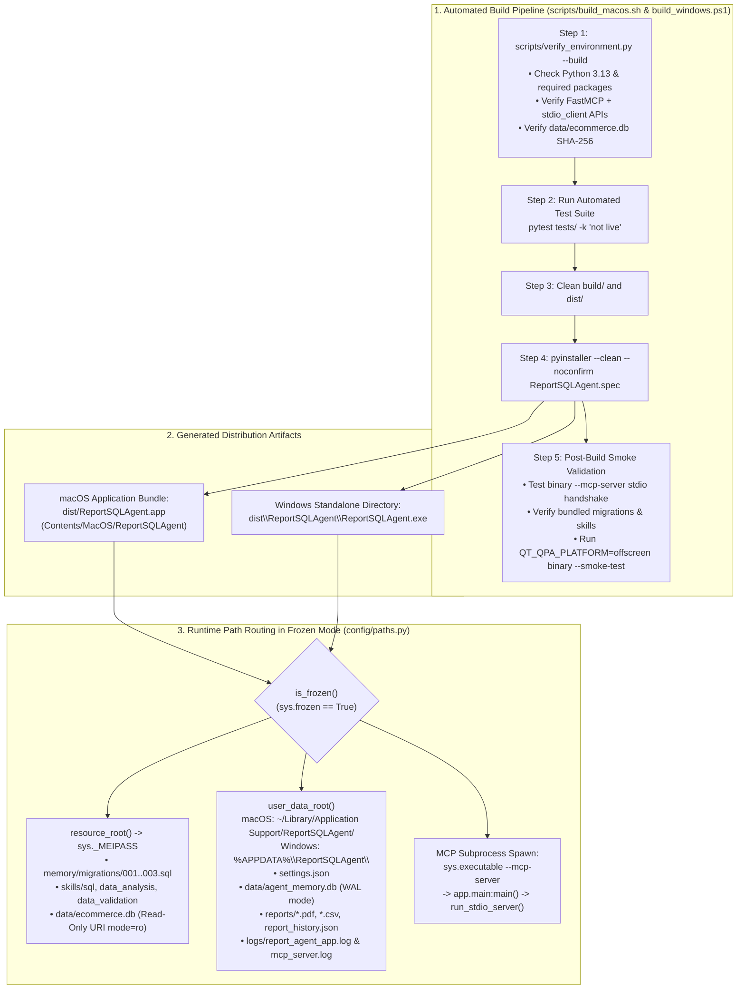

# Knowledge Graph 10 — Cross-Platform Deployment and Packaging

## 1. Build, Packaging, and Runtime Path Resolution Graph

The deployment graph above connects the 5-step build scripts (`build_macos.sh`, `build_windows.ps1`), the generated platform bundles (`ReportSQLAgent.app`, `ReportSQLAgent.exe`), and the runtime path routing in `config/paths.py`.

---

## 2. macOS `.app` Bundle vs. Windows Standalone Directory Structure

| Component | macOS (`dist/ReportSQLAgent.app`) | Windows (`dist\ReportSQLAgent\`) |
| :--- | :--- | :--- |
| **Primary Executable** | `Contents/MacOS/ReportSQLAgent` | `ReportSQLAgent.exe` |
| **MCP Child Server Command** | `Contents/MacOS/ReportSQLAgent --mcp-server` | `ReportSQLAgent.exe --mcp-server` |
| **Bundled Read-Only Assets (`sys._MEIPASS`)** | `Contents/Resources/` & `Contents/Frameworks/` (`memory/migrations/*.sql`, `skills/*`, `data/ecommerce.db`) | `_internal\` (`memory\migrations\*.sql`, `skills\*`, `data\ecommerce.db`) |
| **Writable User Data Root** | `~/Library/Application Support/ReportSQLAgent/` | `%APPDATA%\ReportSQLAgent\` |

