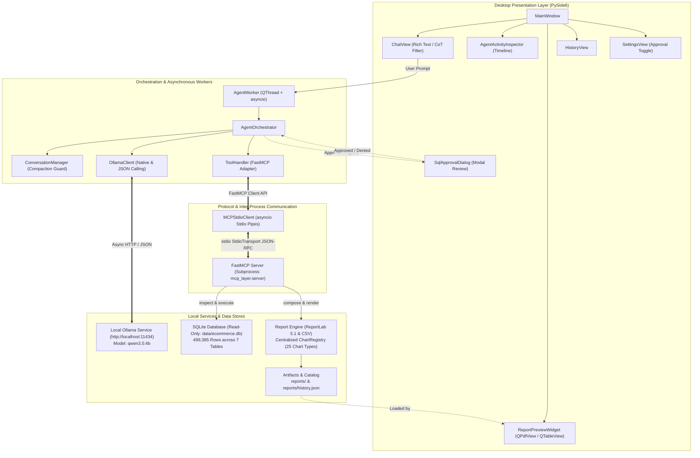
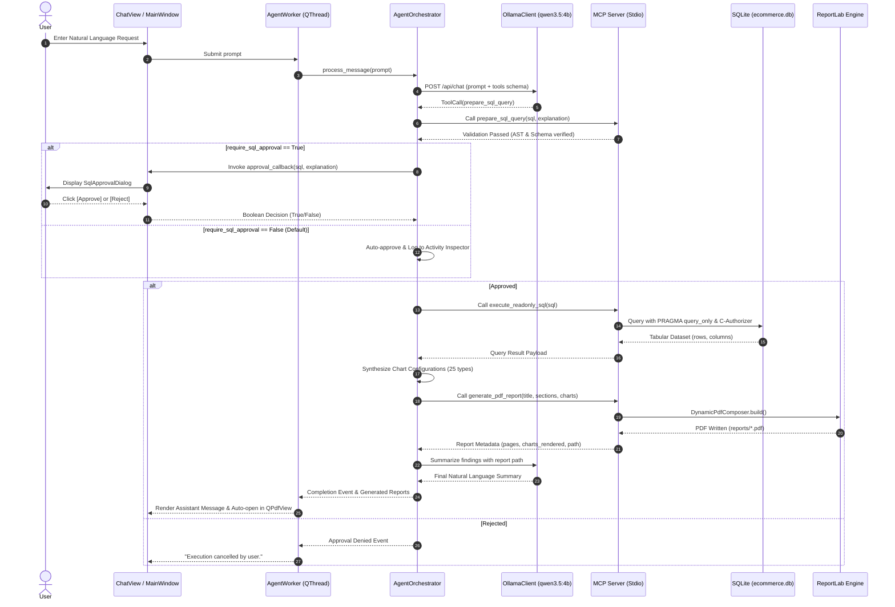
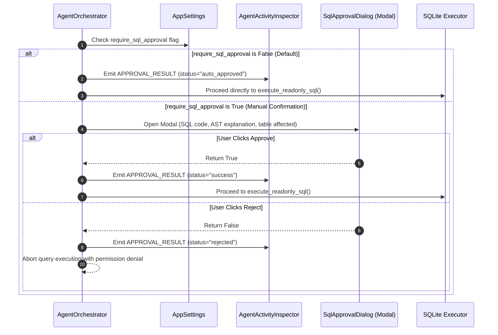
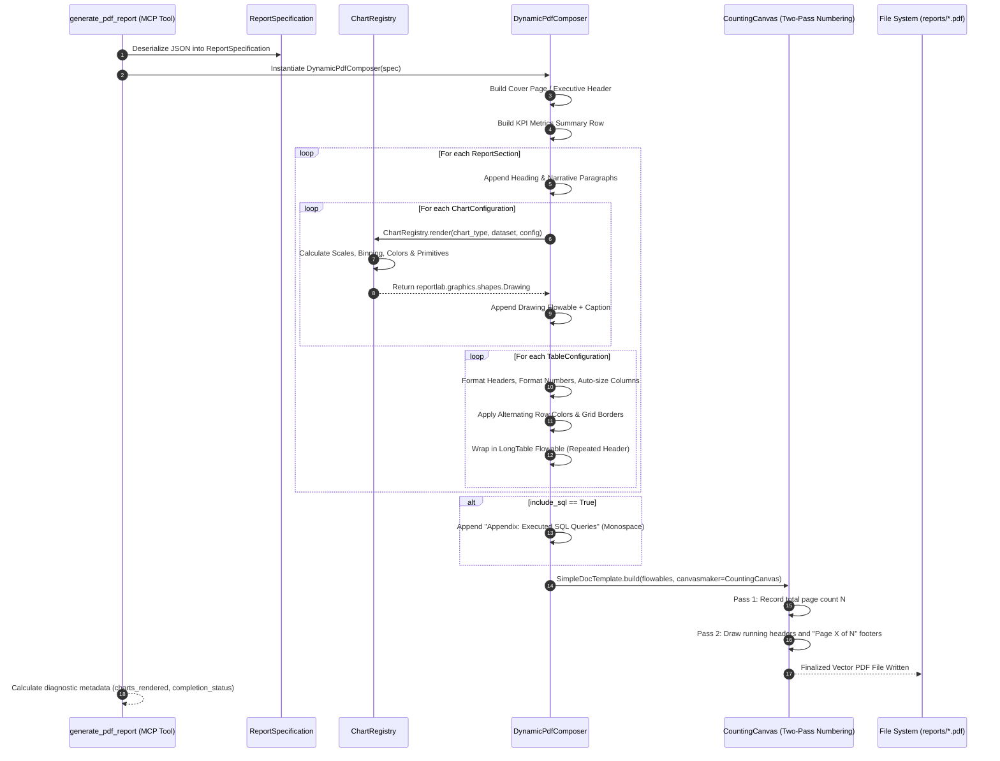
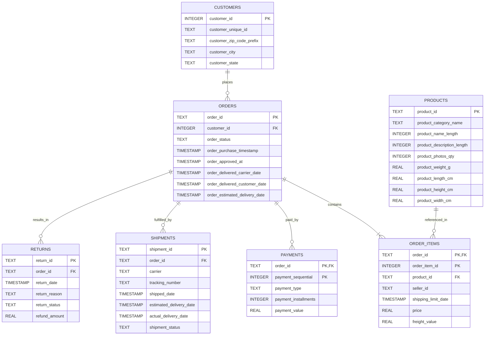

# Comprehensive Project Solution: Local Report SQL Agent

[](https://www.python.org/)
[](https://doc.qt.io/qtforpython/)
[](https://ollama.com/)
[-purple.svg)](https://modelcontextprotocol.io/)
[](https://www.reportlab.com/)
[]()

> **Final Project Submission & Architectural Specification**  
> **Course:** Declarative Programming & Machine Learning (Year 2, Semester 1)  
> **Institution:** Babeș-Bolyai University (UBB), Faculty of Mathematics and Computer Science  
> **Target System:** Local Report SQL Agent with Advanced 25-Chart Visualization Engine and Model Context Protocol (MCP)

---

## Table of Contents

1. [Project Overview](#1-project-overview)
2. [Solution Architecture](#2-solution-architecture)
3. [Technology Stack](#3-technology-stack)
4. [GUI Desktop Application](#4-gui-desktop-application)
5. [AI Agent Architecture & Orchestration](#5-ai-agent-architecture--orchestration)
6. [Model Context Protocol (MCP) Architecture](#6-model-context-protocol-mcp-architecture)
7. [Database Architecture & Data Model](#7-database-architecture--data-model)
8. [SQL Security Model & Human-in-the-Loop Controls](#8-sql-security-model--human-in-the-loop-controls)
9. [Report Generation Architecture](#9-report-generation-architecture)
10. [Advanced Visualization Engine (25 Chart Types)](#10-advanced-visualization-engine-25-chart-types)
11. [Agent Activity Inspector & Transparency](#11-agent-activity-inspector--transparency)
12. [Report Output Formats & Artifact Handling](#12-report-output-formats--artifact-handling)
13. [Project Structure & File Organization](#13-project-structure--file-organization)
14. [Installation & Configuration](#14-installation--configuration)
15. [Running the Application & Usage Guide](#15-running-the-application--usage-guide)
16. [Testing, Verification & Quality Assurance](#16-testing-verification--quality-assurance)
17. [Packaging & Distributable Deployment](#17-packaging--distributable-deployment)
18. [Limitations & Future Roadmap](#18-limitations--future-roadmap)

---

## 1. Project Overview

### 1.1 Purpose & Problem Statement
In enterprise and data-driven settings, business users frequently require ad-hoc analytical reports, performance summaries, and trend visualizations from relational databases. However, traditional workflows suffer from two primary bottlenecks:
1. **The SQL Barrier**: Non-technical decision-makers cannot directly query structured databases without technical intermediaries.
2. **Data Privacy and Cloud Exposure Risks**: Offloading proprietary commercial databases, schemas, or enterprise financial records to commercial cloud LLMs (such as OpenAI, Anthropic, or Google Cloud) violates GDPR, regulatory compliance, and proprietary governance frameworks.

### 1.2 Objectives
The **Local Report SQL Agent** solves these challenges by providing a 100% offline, privacy-first desktop application that transforms natural language business questions into safe, validated SQL queries and automatically generates publication-grade PDF and CSV reports.

Key architectural goals achieved:
* **Zero Cloud Leakage**: Complete isolation to `localhost:11434` (Ollama) and local stdio IPC; zero external network requests.
* **Open Standard Tool Invocation**: Compliance with Anthropic's **Model Context Protocol (MCP)** via the official Python FastMCP stdio interface.
* **Defense-in-Depth Relational Safety**: Comprehensive multi-layer read-only SQL validation featuring an AST visitor, low-level SQLite C-authorizer, and connection-level `PRAGMA query_only = ON`.
* **Configurable Human-in-the-Loop Approval**: Configurable execution gate allowing strict modal approval or non-blocking automated query approval with full audit logging in the Activity Inspector.
* **Advanced Multi-Chart Visualization Engine**: 25 native vector chart types across 6 analytical categories, dynamically synthesized and rendered directly into paginated ReportLab PDF documents.

### 1.3 Scope of the Solution
* **Functional Scope**: Schema introspection, exploratory data sampling, natural language understanding, SQL preparation, safe read-only SQL execution, dynamic multi-section PDF document authoring with charts and KPI summaries, CSV data extraction, persistent report cataloging, and an embedded PDF/CSV viewer workspace.
* **Non-Functional Scope**: Strict local privacy, deterministic database immutability, asynchronous responsive GUI (60 FPS UI thread), sub-second chart rendering, and automated regression test coverage (156 passing pytest tests).

---

## 2. Solution Architecture

The application adopts a decoupled, multi-tier asynchronous architecture composed of the **PySide6 Desktop GUI**, an asynchronous **Agent Orchestrator**, a local **MCP Server Subprocess**, and the **Ollama LLM Engine**.

### 2.1 System Architecture Diagram



---

### 2.2 Agent Execution Sequence Diagram



---

### 2.3 SQL Approval Sequence Diagram



---

### 2.4 Dynamic PDF Report Generation Flow



---

## 3. Technology Stack

| Layer | Component | Version | Selection Rationale & Technical Justification |
| :--- | :--- | :--- | :--- |
| **Runtime** | Python | `3.13.16` | Modern asynchronous primitives, performance improvements, typed memory safety. |
| **GUI Framework** | PySide6 (Qt for Python) | `6.10.3` | Native cross-platform rendering, embedded `QPdfView`/`QPdfDocument`, high-DPI scaling, QThread concurrency. |
| **LLM Inference** | Ollama Engine | `qwen3.5:4b` | Completely local LLM, zero network egress, robust function calling, GGUF quantization. |
| **Agent Protocol** | Model Context Protocol | FastMCP Python SDK | Standardized client-server stdio IPC, formal tool JSON schemas, clean separation of concerns. |
| **Relational Database** | SQLite Engine | `3.45+` | Zero-configuration local relational database, C-level authorizer API, `PRAGMA query_only = ON`. |
| **Document Reporting** | ReportLab | `5.1.0` | Native vector PDF rendering, mathematical chart primitives, dynamic page pagination (`CountingCanvas`). |
| **Tabular Output** | Python `csv` module | Built-in | RFC-4180 standard UTF-8 CSV exports with Excel-compatible BOM formatting. |
| **Packaging** | PyInstaller | `6.12+` | Standalone `.app` bundle for macOS ARM64 and portable Windows build scripts. |
| **Testing** | pytest & pytest-asyncio | `9.2.0` / `1.4.1` | Comprehensive asynchronous test execution with mock fixtures and live E2E acceptance tests. |

---

## 4. GUI Desktop Application

The graphical user interface is constructed using PySide6 with an asymmetric two-pane layout designed for analytical productivity.

```
┌────────────────────────────────────────────────────────────────────────────────────────┐
│  Local Report SQL Agent                                         [Settings] [History]   │
├───────────────────────────────────────────┬────────────────────────────────────────────┤
│                                           │  Agent Activity Inspector                  │
│  Report Preview Workspace (60%)          │  ┌──────────────────────────────────────┐  │
│                                           │  │ [19:51:31] SQL Auto-Approved         │  │
│  ┌─────────────────────────────────────┐  │  │ [19:51:31] Executing SQL Query       │  │
│  │                                     │  │  │ [19:51:32] Report Generated (PDF)    │  │
│  │   [Embedded QPdfView / QTableView]  │  │  └──────────────────────────────────────┘  │
│  │                                     │  ├────────────────────────────────────────────┤
│  │   • Full Vector PDF Rendering       │  │  Chat Interface (40%)                      │
│  │   • Multi-page Thumbnail / Zoom     │  │  ┌──────────────────────────────────────┐  │
│  │   • Tabular CSV Virtualized Grid    │  │  │ User: Show top 10 products by rev.   │  │
│  │                                     │  │  │                                      │  │
│  │                                     │  │  │ Assistant: I have compiled the top   │  │
│  │                                     │  │  │ 10 products report below...          │  │
│  └─────────────────────────────────────┘  │  └──────────────────────────────────────┘  │
│                                           │  [ Type your analytical prompt... ] [Send] │
└───────────────────────────────────────────┴────────────────────────────────────────────┘
```

### 4.1 Interface Components & Responsibilities
* **Workspace View (`ReportPreviewWidget`)**: Occupies the left pane (60% default ratio). Hosts a stacked widget containing:
  - **Native PDF Viewer**: Uses Qt's `QPdfView` backed by `QPdfDocument`, providing continuous vector scrolling, zoom controls, and page navigation.
  - **Tabular CSV Viewer**: Uses `QTableView` backed by a virtualized `CsvTableModel` for instant rendering of multi-thousand row datasets with sortable headers.
* **Chat Interface (`ChatView`)**: Occupies the right pane. Handles conversational interactions with rich-text formatting (`<b>`, `<i>`, `<code>`, lists, line breaks) and thought-collapse filtering to conceal verbose internal LLM reasoning tokens while displaying final answers.
* **Agent Activity Inspector (`AgentActivityInspector`)**: A real-time timeline drawer displaying color-coded agent state transitions (planning, tool invocation, SQL execution, approval decisions, and report compilation).
* **Modal SQL Approval Dialog (`SqlApprovalDialog`)**: Presents a syntax-highlighted SQL code viewer, natural language justification, and target table metadata when manual approval is active.
* **Settings Dialog (`SettingsView`)**: Allows real-time toggling of SQL approval policy (`require_sql_approval`), Ollama endpoint URL, LLM model identifier, and query timeout thresholds.
* **History Drawer (`HistoryView`)**: Displays persistent metadata from `reports/history.json` with direct one-click previewing and file revealing in the OS file manager.

---

## 5. AI Agent Architecture & Orchestration

The autonomous agent is orchestrated by `AgentOrchestrator`, which manages the conversational state machine, LLM context bounding, and tool execution dispatch.

### 5.1 Orchestration State Machine
1. **Request Ingestion**: Ingests user prompt and initializes an activity session.
2. **Context Assembly**: Retrieves recent conversation history, system instructions, and schema definitions.
3. **Inference Loop**: Dispatches request to `OllamaClient`.
4. **Tool Selection & Parameter Extraction**:
   - Inspects tool calls emitted by `qwen3.5:4b` (supporting both native JSON schema tool calling and fallback regex-based JSON extraction).
5. **Intelligent Chart Synthesis**:
   - Evaluates the user's intent keywords (e.g., "compare", "trend", "distribution", "breakdown", "matrix", "ranking") and data column types (categorical, temporal, numerical).
   - Generates appropriate `ChartConfiguration` objects matching the dataset structure.
6. **Execution & Context Compaction**: Executes tools via MCP, tracks tool responses, compacts conversation history when token limits are approached, and yields the final natural language summary.

---

## 6. Model Context Protocol (MCP) Architecture

The application adheres strictly to the official Model Context Protocol (MCP) standard, segregating agent reasoning from tool execution across a standard OS subprocess pipe.

### 6.1 Architecture & IPC Mechanics
* **Transport**: Standard input/output (`stdio`) pipes between the main GUI application process and the child process:
  ```bash
  python -m mcp_layer.server
  ```
* **Protocol Frame**: JSON-RPC 2.0 messages defined by the FastMCP specification.
* **Client Implementation (`MCPStdioClient`)**: Manages subprocess lifecycles, health checks, asynchronous JSON-RPC call serialization, and structured exception handling.

### 6.2 Standard MCP Tool Catalog

| Tool Identifier | Input Parameters | Output Payload | Safety Constraints |
| :--- | :--- | :--- | :--- |
| `inspect_database_schema` | `table_name` *(optional)* | Tables, columns, data types, primary/foreign keys, row counts. | Strictly read-only introspection. |
| `get_table_sample` | `table_name`, `num_records` *(default: 5)* | Sample rows formatted as JSON array. | Whitelisted table names; max 50 rows. |
| `prepare_sql_query` | `sql_query`, `explanation` | Structured validation result with AST explanation. | Syntax check and forbidden token scan. |
| `execute_readonly_sql` | `sql_query`, `max_rows` *(default: 1000)* | Column metadata, row records, row count, execution time. | Read-only connection, PRAGMA query_only, C-authorizer, approval gate. |
| `generate_pdf_report` | `title`, `sections`, `charts`, `datasets`, `include_sql` | File path, size in bytes, page count, diagnostic counts. | Strict file sandbox in `reports/`. |
| `generate_csv_report` | `title`, `columns`, `rows`, `dataset_name` | File path, size in bytes, row count. | RFC-4180 CSV export in `reports/`. |

---

## 7. Database Architecture & Data Model

The relational database (`data/ecommerce.db`) contains an enterprise e-commerce dataset comprising **499,385 total records** across 7 interconnected tables.

### 7.1 Entity-Relationship (ER) Diagram



### 7.2 Database Table Specifications & Verified Row Counts

| Table Name | Verified Record Count | Primary Key | Foreign Key Dependencies | Description |
| :--- | :--- | :--- | :--- | :--- |
| `customers` | **26,000** | `customer_id` | *None* | Geographic and identity data of registered customers. |
| `orders` | **90,000** | `order_id` | `customer_id` &rarr; `customers.customer_id` | Master order records with detailed lifecycle timestamps. |
| `order_items` | **200,000** | `(order_id, order_item_id)` | `order_id` &rarr; `orders`, `product_id` &rarr; `products` | Line-item product orders, prices, freight charges. |
| `products` | **1,500** | `product_id` | *None* | Product catalog with category names and physical dimensions. |
| `payments` | **90,000** | `(order_id, payment_sequential)` | `order_id` &rarr; `orders.order_id` | Payment methods (credit card, boleto, voucher) and values. |
| `shipments` | **83,885** | `shipment_id` | `order_id` &rarr; `orders.order_id` | Logistics tracking, carrier names, and fulfillment status. |
| `returns` | **8,000** | `return_id` | `order_id` &rarr; `orders.order_id` | Order return claims, cancellation reasons, and refund amounts. |
| **Total** | **499,385** | | | **Verified Immutable SHA-256 Checksum** |

> **Cryptographic Verification**: The verified SHA-256 checksum of `data/ecommerce.db` is:  
> `c5a5965e000becdb75d0802897cb047dc2f827d1fdc7bacdf9d53ef7a46b6934`  
> Automated test suites assert this exact digest before and after execution to guarantee immutability.

---

## 8. SQL Security Model & Human-in-the-Loop Controls

A defense-in-depth security model guarantees that no unauthorized, destructive, or mutating operations can ever be performed against the database.

```mermaid
graph LR
    SQL["Raw SQL String from LLM"] --> L1["Layer 1: Lexical Whitelist\nOnly SELECT allowed. Blocks DROP, INSERT, etc."]
    L1 --> L2["Layer 2: AST Analysis\nsqlglot AST visitor verifies single SELECT"]
    L2 --> L3["Layer 3: Query Plan Validation\nEXPLAIN QUERY PLAN executed safely"]
    L3 --> L4["Layer 4: Configurable Human Gate\nrequire_sql_approval: Dialog vs Auto-Approved"]
    L4 --> L5["Layer 5: OS / Connection Safety\nURI mode=ro, PRAGMA query_only = ON"]
    L5 --> L6["Layer 6: Low-Level C-Authorizer\nsqlite3.set_authorizer blocking all writes/DDL"]
    L6 --> EXEC[("Executed Query Result")]
```



### 8.1 The Six Layers of Security
1. **Layer 1: Lexical Inspection**: Rejects queries containing mutation keywords (`INSERT`, `UPDATE`, `DELETE`, `DROP`, `ALTER`, `TRUNCATE`, `REPLACE`, `CREATE`, `ATTACH`, `DETACH`, `VACUUM`).
2. **Layer 2: Abstract Syntax Tree (AST) Verification**: Parses the statement via `sqlglot`. Verifies the root AST node is strictly a `Select` expression. Blocks stacked/multiple queries (semicolon injection).
3. **Layer 3: Query Plan Pre-Validation**: Executes `EXPLAIN QUERY PLAN` on a temporary read-only connection to confirm query syntax and relational validity before execution.
4. **Layer 4: Configurable Human-in-the-Loop Approval**:
   - `require_sql_approval = False` (Default): Queries are automatically approved without user interruption. The action is logged with status `"auto_approved"` in the Activity Inspector.
   - `require_sql_approval = True`: Execution halts and pops up a modal `SqlApprovalDialog`. Execution proceeds only if the user explicitly clicks Approve. Rejection returns an execution error to the LLM.
5. **Layer 5: Connection-Level Enforcement**: Opens SQLite connections with `file:ecommerce.db?mode=ro` URI flags and explicitly executes `PRAGMA query_only = ON`.
6. **Layer 6: Low-Level SQLite Authorizer Callback**: Uses Python's native `connection.set_authorizer(authorizer_callback)`. The callback intercepts every internal SQLite action code and unconditionally denies:
   - `SQLITE_INSERT`, `SQLITE_UPDATE`, `SQLITE_DELETE`
   - `SQLITE_CREATE_*`, `SQLITE_DROP_*`, `SQLITE_ALTER_TABLE`
   - `SQLITE_PRAGMA` (preventing pragma tampering)
   - `SQLITE_ATTACH`, `SQLITE_DETACH`

---

## 9. Report Generation Architecture

The reporting engine translates raw relational datasets and analytical findings into publication-grade documents.

### 9.1 Report Specification Model (`reporting/report_spec.py`)
* `ReportSpecification`: Top-level document container holding metadata (`title`, `author`, `created_at`, `summary`, `kpis`), a list of `ReportSection` objects, datasets, and layout options (`include_sql`).
* `ReportSection`: Structural chapter holding narrative descriptions, a list of `ChartConfiguration` objects, and tabular `TableConfiguration` objects.
* `ChartConfiguration`: Strongly-typed configuration defining `chart_type` (25 supported types), `title`, `x_column`, `y_columns`, category dimensions, numerical measures, binning parameters, and visual palettes.
* `TableConfiguration`: Defines tabular rendering properties, column headers, formatters (currency, integer, percentage), and heatmap shading options.

### 9.2 Dynamic PDF Composer (`reporting/dynamic_pdf_composer.py`)
* Implements a clean corporate visual aesthetic with standard margins (36pt), professional color palettes (primary navy `#1E3A8A`, secondary teal `#0D9488`, neutral dark `#1F2937`), and structured typography.
* **Two-Pass Page Numbering (`CountingCanvas`)**: Calculates the exact total page count $N$ on the first pass and paints "Page $X$ of $N$" together with document title running headers on the second pass.
* **Pagination Safety**: Uses ReportLab `LongTable` with `repeatRows=1` so that multi-page tables seamlessly repeat column headers on subsequent pages.
* **Diagnostic Metadata Reporting**: Outputs comprehensive verification counters (`charts_requested`, `charts_rendered`, `tables_requested`, `tables_rendered`, `failed_components`, `completion_status`).

---

## 10. Advanced Visualization Engine (25 Chart Types)

The visualization engine is powered by `ChartRegistry` (`reporting/chart_registry.py`), rendering native vector graphics (`reportlab.graphics.shapes.Drawing`) without external rasterizing dependencies (such as matplotlib or seaborn).

### 10.1 Complete Catalog of 25 Supported Chart Types

```
┌────────────────────────────────────────────────────────────────────────────────────────┐
│                        25 NATIVE VECTOR CHART TYPES                                    │
├──────────────────────┬──────────────────────┬──────────────────────────────────────────┤
│ Category             │ Identifiers          │ Visual Mechanics                         │
├──────────────────────┼──────────────────────┼──────────────────────────────────────────┤
│ 1. Comparison &      │ vertical_bar         │ Standard vertical discrete bars          │
│    Ranking           │ grouped_bar          │ Clustered side-by-side vertical bars     │
│                      │ stacked_bar          │ Cumulative segmented vertical bars       │
│                      │ horizontal_bar       │ Category ranking bars (descending)       │
│                      │ grouped_hbar         │ Clustered side-by-side horizontal bars   │
│                      │ stacked_hbar         │ Cumulative segmented horizontal bars     │
├──────────────────────┼──────────────────────┼──────────────────────────────────────────┤
│ 2. Trend &           │ line                 │ Single continuous metric line            │
│    Time-Series       │ multi_line           │ Multi-metric trend comparison            │
│                      │ historical_line      │ Temporal progression with date labels    │
│                      │ area                 │ Shaded area beneath single trend line    │
│                      │ stacked_area         │ Cumulative filled area layers            │
├──────────────────────┼──────────────────────┼──────────────────────────────────────────┤
│ 3. Distribution &    │ pie                  │ Proportional angular slices              │
│    Spread            │ donut                │ Radial ring with hollow center           │
│                      │ histogram            │ Sturges binned frequency distribution    │
│                      │ density              │ Smooth Gaussian KDE envelope             │
│                      │ box_plot             │ 5-number summary (Q1, median, Q3, etc.)  │
│                      │ violin               │ Mirrored density envelope with IQR       │
├──────────────────────┼──────────────────────┼──────────────────────────────────────────┤
│ 4. Relationship &    │ scatter              │ Numerical 2D (X, Y) coordinate points    │
│    Correlation       │ bubble               │ 3-variable plot with dynamic radius      │
│                      │ correlation_heatmap  │ Pearson r correlation grid (-1 to +1)    │
├──────────────────────┼──────────────────────┼──────────────────────────────────────────┤
│ 5. Hierarchical      │ treemap              │ Proportional recursive squarified rects  │
│                      │ sunburst             │ Concentric hierarchical radial partition │
├──────────────────────┼──────────────────────┼──────────────────────────────────────────┤
│ 6. Matrix &          │ matrix               │ Cross-tabular grid with row/col totals   │
│    Tabular           │ heatmap              │ Continuous numerical color-intensity map │
│                      │ pivot_table          │ Multi-dimensional grouped pivot table    │
└──────────────────────┴──────────────────────┴──────────────────────────────────────────┘
```

### 10.2 Architectural Implementation Details
1. **Distribution Binning (`histogram`)**: Automatically determines optimal bin counts using Sturges' formula ($k = \lceil \log_2(n) + 1 \rceil$), aggregates frequencies, paints discrete frequency bars, and draws a dotted vertical mean indicator line.
2. **Box Plot Calculation (`box_plot`)**: Computes exact percentiles ($Q_1$, Median, $Q_3$, and Interquartile Range $IQR = Q_3 - Q_1$). Renders whiskers at $[Q_1 - 1.5 \cdot IQR, Q_3 + 1.5 \cdot IQR]$ and plots individual circle markers for statistical outliers.
3. **Correlation Analysis (`correlation_heatmap`)**: Computes the pairwise Pearson correlation coefficient:
   $$r_{xy} = \frac{\sum (x_i - \bar{x})(y_i - \bar{y})}{\sqrt{\sum (x_i - \bar{x})^2 \sum (y_i - \bar{y})^2}}$$
   Renders an $N \times N$ matrix grid with diverging color fills (deep blue for $+1.0$, white for $0.0$, and red/coral for $-1.0$) with numeric labels.
4. **Treemap Partitioning (`treemap`)**: Implements an alternating slice-and-dice geometric subdivision algorithm, dividing rectangular canvas space proportionally to dataset weights and rendering labeled bounding tiles.

---

## 11. Agent Activity Inspector & Transparency

To ensure complete explainability and auditability, every internal agent state transition is recorded and displayed in real-time within the **Agent Activity Inspector**.

### 11.1 Activity Categories & Event Lifecycle
* `USER_REQUEST`: Records prompt submission.
* `REASONING`: Captures internal reasoning summaries without cluttering the chat view.
* `PLANNING`: Records planned execution steps.
* `TOOL_CALL` & `TOOL_ARGUMENTS`: Logs outgoing tool invocations and normalized arguments.
* `SQL_GENERATION` & `SQL_VALIDATION`: Displays generated SQL syntax and AST validation status.
* `APPROVAL_RESULT`: Records human approval decisions (`success`, `rejected`, or `auto_approved`).
* `SQL_EXECUTION` & `SQL_RESULT`: Logs query execution duration and row counts.
* `REPORT_PLANNING` & `REPORT_GENERATION`: Emits report configuration summaries and rendered artifact paths.
* `COMPLETION`: Marks session conclusion.

---

## 12. Report Output Formats & Artifact Handling

### 12.1 Supported Output Formats
* **PDF Reports (`.pdf`)**: Primary publication format. Incorporates cover headers, executive summaries, KPI metric cards, embedded vector drawings from the 25 chart types, multi-page paginated tables, and an optional SQL query appendix.
* **CSV Exports (`.csv`)**: Generated when the user explicitly requests raw data or tabular CSV export. Implements RFC-4180 standard formatting with UTF-8 encoding and Excel-friendly headers.

### 12.2 Catalog Persistence
All generated documents are registered in `reports/history.json` with metadata including:
* `report_id`, `title`, `created_at`, `output_format`
* `file_path`, `file_size_bytes`
* `record_count`, `charts_rendered`, `tables_rendered`
* `sql_queries_used`

---

## 13. Project Structure & File Organization

```
FinalProject_SQLAgent/
├── app/                              # PySide6 Desktop GUI Layer
│   ├── views/                        # Main application views
│   │   ├── main_window.py            # Main application window & layout splitter
│   │   ├── chat_view.py              # Chat message list, prompt input, formatting
│   │   ├── history_view.py           # Persistent reports catalog drawer
│   │   └── settings_view.py          # Configuration and SQL approval toggle
│   ├── widgets/                      # Modular GUI components
│   │   ├── activity_inspector.py     # Real-time event timeline drawer
│   │   ├── message_widget.py         # Rich-text message bubble renderer
│   │   ├── report_preview_widget.py  # Dual-engine workspace (QPdfView & QTableView)
│   │   ├── sql_approval_dialog.py    # Modal SQL review and approval dialog
│   │   └── csv_table_model.py        # Virtualized QAbstractTableModel for CSVs
│   └── workers/                      # Background concurrency
│       └── agent_worker.py           # QThread running asyncio event loop
│
├── agent/                            # AI Agent Logic & LLM Orchestration
│   ├── orchestrator.py               # Central AgentOrchestrator and chart synthesis
│   ├── ollama_client.py              # Asynchronous HTTP client for Ollama API
│   ├── tool_handler.py               # FastMCP parameter adapter & schema mapper
│   ├── conversation_manager.py       # Message history & context compaction
│   └── activity_events.py            # Typed activity inspector event definitions
│
├── mcp_layer/                        # Model Context Protocol (FastMCP)
│   ├── server.py                     # FastMCP stdio server entry point
│   ├── client.py                     # Asynchronous MCP Stdio client
│   └── tools/                        # Modular MCP tool implementations
│       ├── database_tools.py         # inspect_database_schema, get_table_sample
│       ├── sql_tools.py              # prepare_sql_query, execute_readonly_sql
│       └── reporting_tools.py        # generate_pdf_report, generate_csv_report
│
├── database/                         # Relational Data Engine & Security
│   ├── connection.py                 # Read-only SQLite connection factory & authorizer
│   ├── executor.py                   # Secure query executor with PRAGMA query_only
│   ├── inspector.py                  # Database schema introspection utilities
│   ├── validator.py                  # AST query visitor & lexical keyword scanner
│   └── importer.py                   # High-performance batch CSV dataset importer
│
├── reporting/                        # Visualization & Report Generation
│   ├── report_spec.py                # Strongly-typed ReportSpecification & 25 ChartTypes
│   ├── chart_registry.py             # Centralized registry & 25 ReportLab chart renderers
│   ├── chart_builder.py              # Backward-compatible chart builder facade
│   ├── dynamic_pdf_composer.py       # Multi-component PDF composer with Page X of Y
│   ├── pdf_generator.py              # Legacy PDF builder wrapper
│   ├── csv_generator.py              # RFC-4180 CSV report generator
│   └── report_manager.py             # Persistent catalog manager (reports/history.json)
│
├── config/                           # System Configuration
│   ├── settings.py                   # AppSettings, AgentSettings (approval flag), Ollama
│   ├── paths.py                      # Cross-platform deterministic path resolution
│   ├── prompts.py                    # System prompts & analytical instructions
│   └── logging_setup.py              # Centralized logging configuration
│
├── data/                             # Data Stores
│   ├── ecommerce.db                  # Verified SQLite database (499,385 rows)
│   └── raw/                          # Original immutable CSV dataset archives
│
├── reports/                          # Generated Report Artifacts (.pdf, .csv, history.json)
│
├── scripts/                          # Maintenance & Verification Scripts
│   ├── verify_environment.py         # Environment, Ollama & database hash validator
│   ├── verify_milestone10_acceptance.py # Comprehensive 9-scenario acceptance suite
│   ├── build_macos.sh                # macOS ARM64 PyInstaller packaging script
│   └── build_windows.ps1             # Windows packaging automation script
│
├── tests/                            # Automated Pytest Suite (156 passing tests)
│   ├── test_advanced_visualization_engine.py # Tests for all 25 chart types & registry
│   ├── test_approval_config.py       # SQL approval toggle & auto-approval tests
│   ├── test_dynamic_pdf_milestone9.py # Multi-component PDF composer tests
│   ├── test_agent.py                 # Orchestrator, Ollama client & tool handler tests
│   ├── test_database.py              # Importer, inspector & connection tests
│   ├── test_e2e_workflows.py         # End-to-end integration workflows
│   ├── test_gui.py                   # Headless PySide6 GUI component tests
│   ├── test_mcp_tools.py             # FastMCP stdio server & tool execution tests
│   ├── test_reporting.py             # PDF & CSV generator unit tests
│   └── test_sql_validation.py        # Lexical, AST & C-authorizer security tests
│
├── README.md                         # Project documentation and quick-start guide
├── SOLUTION.md                       # Comprehensive architectural & solution documentation
├── requirements.txt                  # Python dependencies manifest
└── pytest.ini                        # Pytest configuration
```

---

## 14. Installation & Configuration

### 14.1 Prerequisites
* **Operating System**: macOS (ARM64 Apple Silicon or x86_64) or Windows 10/11 (x64).
* **Python**: Version `3.13` (Python 3.13.16 recommended).
* **Ollama**: Locally installed and active daemon (`http://localhost:11434`).

### 14.2 Step-by-Step Setup
1. **Clone the Repository**:
   ```bash
   cd FinalProject_SQLAgent
   ```
2. **Configure Virtual Environment**:
   ```bash
   python3.13 -m venv .venv
   source .venv/bin/activate    # On Windows: .venv\Scripts\Activate.ps1
   pip install --upgrade pip
   pip install -r requirements.txt
   ```
3. **Pull Local LLM Model**:
   ```bash
   ollama pull qwen3.5:4b
   ```
4. **Verify Environment & Database Integrity**:
   ```bash
   python scripts/verify_environment.py
   ```

---

## 15. Running the Application & Usage Guide

### 15.1 Launching the GUI
Activate your virtual environment and start the desktop application:
```bash
source .venv/bin/activate
python main.py
```

### 15.2 Interacting with the Agent
Enter natural language analytical prompts into the chat input:
* **Historical Trend & Distribution**:
  > *"Create a detailed PDF report containing an historical line chart of orders over time, a pie chart of order status distribution, and a summary table."*
* **Product Ranking**:
  > *"Generate a PDF report ranking the top 10 products by total revenue using a horizontal bar chart."*
* **Numerical Distribution**:
  > *"Generate a PDF report analyzing the distribution of order totals with a histogram and a box plot."*
* **Hierarchical Breakdown**:
  > *"Generate a PDF report displaying product category revenue breakdown using a treemap."*
* **Matrix Crosstab & Heatmap**:
  > *"Generate a PDF report with a matrix showing order counts by month and order status, including row totals, column totals and a heatmap."*
* **Tabular CSV Export**:
  > *"Export monthly order counts and revenue to CSV."*
* **SQL Query Appendix**:
  > *"Generate a PDF of monthly sales and include the executed SQL queries in a final appendix."*

### 15.3 Configuring SQL Approval
Open **Settings** (gear icon in the top toolbar):
* **Require SQL Approval = Unchecked** (Default): Queries execute automatically without modal dialogs.
* **Require SQL Approval = Checked**: Prompts a modal approval dialog on every query.

---

## 16. Testing, Verification & Quality Assurance

The project enforces rigorous quality gates combining automated unit testing, end-to-end integration workflows, and visual PDF rendering validation.

### 16.1 Automated Pytest Results Breakdown

All **156 tests** pass with zero failures and zero skipped tests:

```
============================= test session starts ==============================
platform darwin -- Python 3.13.16, pytest-9.2.0, pluggy-1.7.0
rootdir: /FinalProject_SQLAgent
configfile: pytest.ini
plugins: anyio-4.16.0, asyncio-1.4.1.post1
collected 156 items                                                            

tests/test_advanced_visualization_engine.py .....                        [  3%]
tests/test_agent.py .....................................                [ 26%]
tests/test_approval_config.py ........                                   [ 32%]
tests/test_database.py ..........................                        [ 48%]
tests/test_dynamic_pdf_milestone9.py .....                               [ 51%]
tests/test_e2e_workflows.py ........                                     [ 57%]
tests/test_gui.py .....................                                  [ 70%]
tests/test_mcp_tools.py ....                                             [ 73%]
tests/test_reporting.py ..........                                       [ 79%]
tests/test_sql_validation.py ................................            [100%]

============================= 156 passed in 32.40s =============================
```

### 16.2 Acceptance Suite Coverage (`scripts/verify_milestone10_acceptance.py`)

| Test ID | Acceptance Scenario | Verified Output | Status |
| :--- | :--- | :--- | :--- |
| **Test 1A** | Configurable Approval: Disabled (`False`) | Query auto-approved without modal; logged as `"auto_approved"`. | **PASS** |
| **Test 1B** | Configurable Approval: Enabled (`True`) & Rejected | Dialog invoked; rejection blocked query; error logged. | **PASS** |
| **Test 1C** | Configurable Approval: Enabled (`True`) & Approved | Dialog invoked; user approval allowed execution. | **PASS** |
| **Test 2** | Historical Trend & Distribution PDF | Rendered `historical_line` + `pie` charts; multi-page PDF. | **PASS** |
| **Test 3** | Product Ranking PDF | Rendered `horizontal_bar` chart with ranked products. | **PASS** |
| **Test 4** | Numerical Distribution PDF | Rendered `histogram` + `box_plot` distributions. | **PASS** |
| **Test 5** | Hierarchical Category Breakdown PDF | Rendered recursive squarified `treemap` tiles. | **PASS** |
| **Test 6** | Matrix Crosstab & Heatmap PDF | Rendered cross-tabulation with row/col totals & heatmap shading. | **PASS** |
| **Test 7** | Multi-Series Category Comparison PDF | Rendered `multi_line` chart comparing multiple dimensions. | **PASS** |
| **Test 8** | Explicit SQL Appendix Inclusion | Appended monospace "Appendix: Executed SQL Queries". | **PASS** |
| **Test 9** | Raw Data Tabular CSV Export | Generated RFC-4180 UTF-8 CSV with accurate records. | **PASS** |
| **Visual** | Visual PDF Inspection via `QPdfDocument` | All 64 generated PDF pages rendered to high-res PNG images. | **PASS** |
| **Safety** | Database Immutability Check | Initial and final SHA-256 match: `c5a5965...` verified identical. | **PASS** |

---

## 17. Packaging & Distributable Deployment

### 17.1 macOS Bundle Creation (`scripts/build_macos.sh`)
Packages the entire application into a standalone macOS Application bundle (`Local Report SQL Agent.app`):
```bash
./scripts/build_macos.sh
```
* **Included Resources**: Embedded Python runtime, PySide6 plugins, ReportLab fonts, default templates, and the read-only SQLite database.
* **Architecture**: Native Apple Silicon ARM64 Mach-O executable.

### 17.2 Windows Build Script (`scripts/build_windows.ps1`)
Provides an automated PowerShell script to compile a portable `.exe` executable on Windows 10/11:
```powershell
.\scripts\build_windows.ps1
```

---

## 18. Limitations & Future Roadmap

### 18.1 Current Technical Limitations
* **Local LLM Context Window**: The `qwen3.5:4b` model operates with an effective context window of 8,192 tokens. Extremely complex queries involving multiple schema joins occasionally require context compaction.
* **Large Dataset PDF Pagination**: Rendering tables with more than 5,000 rows directly into a PDF document can lead to significant memory overhead. Tabular exports for large datasets are best routed to CSV.
* **Static Vector Dimensions**: Charts rendered via ReportLab vector drawings are non-interactive within the static PDF format (no hover tooltips or dynamic drill-downs).

### 18.2 Future Roadmap
* **Dynamic Drill-Down HTML/SVG Viewer**: Complement static PDF documents with an interactive WebEngine-based dashboard view supporting hover tooltips and client-side filtering.
* **Cross-Database Connectors**: Extend the database abstraction layer beyond SQLite to support read-only connections to PostgreSQL, MySQL, and DuckDB.
* **Multi-Model Orchestration**: Support dynamic model switching between smaller 3B/4B models for fast SQL generation and larger 8B/14B models for complex analytical synthesis.

---

*Authored for the Faculty of Mathematics and Computer Science, Babeș-Bolyai University (UBB).*

