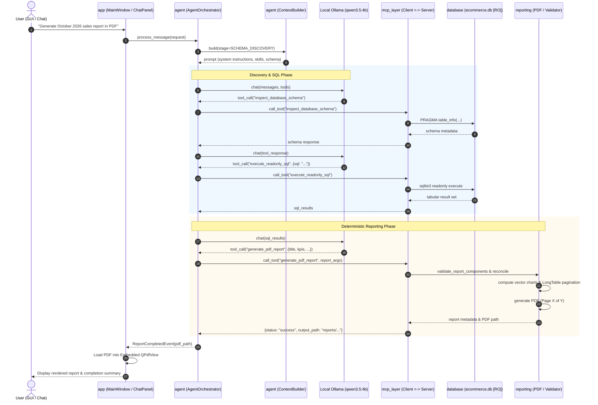

# Repository Structure: Local Report SQL Agent

This document details the code organization, architectural boundaries, module responsibilities, and directory layout of the **Local Report SQL Agent** project.

---

## 1. Top-Level Directory Tree

```text
FinalProject_SQLAgent/
├── DEPLOY.md                          # Comprehensive macOS & Windows deployment guide
├── FEATURE.md                         # Detailed technical specification of all system features
├── PRESENTATION.md                    # 10-minute university presentation script and defense Q&A
├── README.md                          # Project overview, quick start, and architectural entry point
├── ReportSQLAgent.spec                # Unified cross-platform PyInstaller packaging specification
├── STRUCTURE.md                       # Repository layout and module responsibilities (this file)
├── pytest.ini                         # Pytest configuration and async test mode definitions
├── requirements.txt                   # Production and build Python package dependencies
├── run_app.py                         # Single application entry point (GUI and --mcp-server modes)
│
├── agent/                             # Autonomous Agent Intelligence Layer
│   ├── checkpoint_manager.py          # State snapshot creation, verification, and crash recovery
│   ├── checkpoint_models.py           # Pydantic models for checkpoints, state diffs, and recovery
│   ├── context_builder.py             # Stage-specific dynamic context construction and token budgeting
│   ├── context_models.py              # ContextItem, Priority, and ExecutionStage definitions
│   ├── conversation.py                # Turn tracking, message windowing, and session serialization
│   ├── ollama_client.py               # Asynchronous HTTP client for local Ollama REST API
│   ├── orchestrator.py                # Main orchestration loop, tool dispatch, and error remediation
│   ├── skill_manager.py               # Domain skill discovery, parsing, and intent-based selection
│   ├── skill_models.py                # Skill metadata models and invocation parameter schemas
│   ├── system_prompt.py               # Dynamic system prompt generation with runtime schema injection
│   ├── task_manager.py                # Task lifecycle, DAG dependency tracking, and step state transitions
│   ├── task_models.py                 # Task, Step, Plan, and TaskStatus data models
│   ├── task_planner.py                # Natural-language plan formulation and JSON response parsing
│   └── tool_handler.py                # Discovered MCP tool registry and invocation bridge
│
├── app/                               # PySide6 Desktop GUI Layer
│   ├── __init__.py
│   ├── activity_inspector.py          # Live DAG execution tree, tool execution log, and token gauge
│   ├── chat_panel.py                  # Conversational chat panel with token streaming and activity pills
│   ├── main.py                        # GUI application initialization and CLI routing
│   ├── main_window.py                 # Main split-pane window coordinating chat, preview, and inspector
│   ├── preview_panel.py               # Embedded QtPdf document viewer with zoom and page controls
│   ├── report_history_panel.py        # Searchable cards for previously generated PDF/CSV reports
│   ├── settings_dialog.py             # Configuration editor (Ollama host, context window, approval toggle)
│   ├── sql_approval_dialog.py         # Human-in-the-loop modal dialog for reviewing prepared SQL queries
│   └── theme.py                       # Modern dark/light theme definitions and Qt stylesheets
│
├── config/                            # Application Configuration and Paths
│   ├── logging_setup.py               # Rotating file and console logging configuration
│   ├── paths.py                       # Cross-platform development and frozen path resolution
│   ├── prompts.py                     # Baseline system instructions and fallback templates
│   └── settings.py                    # Pydantic-based hierarchical application settings
│
├── data/                              # Databases and Datasets
│   ├── agent_memory.db                # SQLite database for persistent agent memory (WAL mode)
│   ├── ecommerce.db                   # Primary SQLite database (7 tables, 499,385 records; immutable)
│   └── raw/                           # Pristine raw CSV files for reproducible ETL
│
├── database/                          # Database Access and Security Layer
│   ├── engine.py                      # Thread-safe SQLite connection factory with read-only enforcement
│   ├── schema_introspector.py         # Table names, column types, foreign keys, and sample rows
│   └── sql_guardrails.py              # SQL AST validation, disallowed keyword blocking, and authorizers
│
├── dist/                              # Packaged Application Binaries
│   ├── ReportSQLAgent/                # Standalone directory distribution
│   └── ReportSQLAgent.app/            # Native macOS Application Bundle
│
├── docs/                              # Supplementary Documentation
│   └── solution/                      # Modular architecture package, appendices, and knowledge graphs
│
├── logs/                              # Runtime Logs
│   ├── report_agent_app.log           # GUI and orchestrator execution log
│   ├── report_agent_import.log        # Raw data import log
│   └── report_agent_mcp_server.log    # Child MCP stdio server log
│
├── mcp_layer/                         # Model Context Protocol (MCP) Subprocess Layer
│   ├── client.py                      # MCP stdio client communicating over standard input/output
│   ├── server.py                      # FastMCP stdio server exposing database and reporting tools
│   └── tools/                         # Modular MCP tool implementations
│       ├── database_tools.py          # inspect_database_schema, get_table_sample
│       ├── reporting_tools.py         # generate_pdf_report, generate_csv_report
│       └── sql_tools.py               # prepare_sql_query, execute_readonly_sql
│
├── memory/                            # Persistent Memory Subsystem
│   ├── migrations/                    # Versioned SQLite schema migrations
│   │   ├── 001_initial_schema.sql     # Tasks, steps, tool calls, facts, and artifacts schema
│   │   ├── 002_checkpoint_recovery.sql# Checkpoint snapshots and recovery attempt logs
│   │   └── 003_skill_registry_enhancements.sql # Registered skills metadata and activation tracking
│   ├── migrations.py                  # Forward migration runner and schema version tracker
│   └── repository.py                  # SQLiteMemoryRepository implementing thread-safe CRUD methods
│
├── reporting/                         # Deterministic Reporting Engine
│   ├── advanced_visualizations.py     # 22 vector chart renderers built on ReportLab graphics
│   ├── canonical_data.py              # CanonicalSQLDataset, metric reconciliation, and KPI normalizers
│   ├── csv_generator.py               # RFC 4180-compliant CSV report synthesis and formula sanitization
│   ├── pdf_generator.py               # ReportLab Platypus document synthesis with NumberedCanvas
│   ├── report_manager.py              # Report metadata tracking, history persistence, and file management
│   ├── report_spec.py                 # Structured ReportSpecification model (sections, charts, tables)
│   └── report_validator.py            # Four-stage report validation, AOV checks, and chart eligibility
│
├── reports/                           # Output Artifacts Directory
│   ├── .gitkeep
│   ├── *.pdf                          # Generated PDF reports
│   ├── *.csv                          # Generated CSV exports
│   └── report_history.json            # Persistent catalog of all generated report metadata
│
├── scripts/                           # Maintenance and Packaging Scripts
│   ├── build_macos.sh                 # 5-stage macOS packaging script (PyInstaller, smoke test)
│   ├── build_windows.ps1              # 5-stage Windows packaging script (PowerShell)
│   ├── import_dataset.py              # CLI utility for importing raw CSVs into SQLite
│   ├── verify_environment.py          # Diagnostic environment and database SHA-256 validator
│   ├── verify_milestone8_acceptance.py # Milestone 8 validation harness
│   ├── verify_milestone9_acceptance.py # Milestone 9 validation harness
│   └── verify_milestone10_acceptance.py# Milestone 10 acceptance verification harness
│
├── skills/                            # Specialized Domain Knowledge Skills
│   ├── analytics/                     # Statistical and financial analysis skill
│   ├── ecommerce/                     # E-commerce business logic and KPI definitions
│   ├── reporting/                     # Report layout, chart selection, and executive presentation
│   └── sql/                           # SQLite dialect optimization, schema maps, and join rules
│
└── tests/                             # Automated Test Suite (463 tests across 36 modules)
    ├── test_advanced_visualization_engine.py
    ├── test_agent.py
    ├── test_agent_intelligence_integration.py
    ├── test_approval_config.py
    ├── test_checkpoint_manager.py
    ├── test_checkpoint_models.py
    ├── test_checkpoint_repository.py
    ├── test_context_builder.py
    ├── test_context_models.py
    ├── test_context_relevance.py
    ├── test_context_security.py
    ├── test_context_window.py
    ├── test_database.py
    ├── test_database_discovery_reporting.py
    ├── test_dynamic_pdf_milestone9.py
    ├── test_e2e_workflows.py
    ├── test_gui.py
    ├── test_macos_startup.py
    ├── test_mcp_reliability.py
    ├── test_mcp_tool_discovery_and_capability.py
    ├── test_mcp_tools.py
    ├── test_memory_migrations.py
    ├── test_memory_repository.py
    ├── test_reporting.py
    ├── test_reporting_accuracy.py
    ├── test_reporting_pipeline_fixes.py
    ├── test_skill_manager.py
    ├── test_skill_models.py
    ├── test_skill_security.py
    ├── test_skill_selection.py
    ├── test_sql_validation.py
    ├── test_task_manager.py
    ├── test_task_manager_sqlite.py
    ├── test_task_models.py
    ├── test_task_planner.py
    └── test_task_recovery.py
```

---

## 2. Core Packages and Responsibilities

### 2.1 `app/` — Desktop GUI Layer (PySide6)
- **Role**: Native presentation layer using Qt6 / PySide6.
- **Key Modules**:
  - `main.py`: Entry point that interprets CLI arguments (`--mcp-server`, `--smoke-test`, `--help`).
  - `main_window.py`: Orchestrates the primary split-screen UI (Chat on left, Report Preview on right, collapsible Activity Inspector at bottom).
  - `chat_panel.py`: Handles message history, auto-scrolling, streaming LLM tokens, and execution status badges.
  - `preview_panel.py`: Embeds `QPdfView` for real-time, in-app vector PDF previewing with multi-page navigation and zoom.
  - `activity_inspector.py`: Renders the live DAG execution plan, tool calls, checkpoint timelines, and a token gauge.
  - `sql_approval_dialog.py`: Renders a human-in-the-loop modal dialog presenting the generated SQL query and safety metadata before execution.

### 2.2 `agent/` — Autonomous Agent Intelligence Layer
- **Role**: Coordinates plan formulation, tool calling, context budgeting, and state recovery.
- **Key Modules**:
  - `orchestrator.py`: Implements `AgentOrchestrator`, driving the multi-turn execution loop between Ollama and the MCP client.
  - `context_builder.py`: Dynamically constructs the model prompt per execution stage (`SCHEMA_DISCOVERY`, `SQL_GENERATION`, `DATA_ANALYSIS`, `REPORT_SYNTHESIS`) constrained by the configured token budget.
  - `task_planner.py`: Translates high-level natural language requests into structured execution plans and DAG steps.
  - `task_manager.py`: Manages the lifecycle of tasks and steps (Pending, In Progress, Blocked, Completed, Failed).
  - `checkpoint_manager.py`: Captures SHA-256 verified state checkpoints, allowing task resumption after crashes.
  - `skill_manager.py`: Indexes markdown-based domain knowledge from `skills/` and injects relevant snippets based on task intent.
  - `ollama_client.py`: Async HTTP client interfacing with Ollama REST API (`/api/chat`, `/api/show`, `/api/tags`).

### 2.3 `mcp_layer/` — Model Context Protocol (FastMCP)
- **Role**: Decouples database tools and report generators into an isolated subprocess communicating via standard input/output (stdio).
- **Key Modules**:
  - `server.py`: Instantiates `FastMCP("local-report-sql-agent-mcp")` and registers the six MCP tools.
  - `client.py`: Implements `MCPStdioClient` which launches the server subprocess (`python -m mcp_layer.server` or `executable --mcp-server`), manages JSON-RPC protocol handshakes, and provides async tool execution.
  - `tools/database_tools.py`: Exposes `inspect_database_schema` and `get_table_sample`.
  - `tools/sql_tools.py`: Exposes `prepare_sql_query` and `execute_readonly_sql`.
  - `tools/reporting_tools.py`: Exposes `generate_pdf_report` and `generate_csv_report`.

### 2.4 `database/` — Data Access & Security
- **Role**: Provides thread-safe, strictly read-only connections to SQLite with layered security guardrails.
- **Key Modules**:
  - `engine.py`: Manages SQLite connections opened with URI flag `mode=ro`.
  - `schema_introspector.py`: Queries table schemas, column data types, foreign keys, and row counts.
  - `sql_guardrails.py`: Validates queries against syntax rules, blocks data manipulation keywords (`INSERT`, `UPDATE`, `DELETE`, `DROP`, `ALTER`, `ATTACH`), and installs a SQLite C-authorizer callback.

### 2.5 `reporting/` — Deterministic Reporting Engine
- **Role**: Validates, normalizes, and synthesizes multi-page executive PDF and CSV reports.
- **Key Modules**:
  - `pdf_generator.py`: ReportLab Platypus document synthesis, flowable layout, and two-pass `NumberedCanvas` ("Page X of Y").
  - `canonical_data.py`: Normalizes KPI inputs (`normalize_kpi_entry`, `normalize_kpi_collection`), enforces gross sales vs net revenue separation, and calculates vertical AOV.
  - `report_validator.py`: Executes four-stage component validation, period availability checks, and chart eligibility rules.
  - `advanced_visualizations.py`: 22 vector chart renderers (bar, grouped bar, stacked bar, line, area, pie, donut, matrix heatmap, scatter, radar).
  - `csv_generator.py`: RFC 4180-compliant CSV report synthesis with formula injection defenses.
  - `report_spec.py`: Pydantic models for structured report specifications.
  - `report_manager.py`: Catalogues generated reports in `reports/report_history.json`.

### 2.6 `memory/` — Persistent Agent Memory
- **Role**: Long-term SQLite storage for task plans, step outputs, tool executions, semantic facts, and recovery checkpoints.
- **Key Modules**:
  - `repository.py`: `SQLiteMemoryRepository` managing `data/agent_memory.db` in WAL mode.
  - `migrations.py`: Applies versioned SQL migrations from `memory/migrations/`.

---

## 3. Component Interaction Flow

The following diagram illustrates how the major packages interact during a reporting request:



---

## 4. Test Suite Organization

The project contains **463 automated tests across 36 modules**, partitioned into clean functional layers:

| Layer | Primary Test Modules | Test Count | Focus |
|:---|:---|:---:|:---|
| **MCP Subprocess & Discovery** | `test_mcp_tools.py`, `test_mcp_reliability.py`, `test_mcp_tool_discovery_and_capability.py` | 22 | FastMCP stdio protocol, tool registration, subprocess reconnection, and live Ollama discovery. |
| **Agent Intelligence & Orchestration** | `test_agent.py`, `test_task_manager.py`, `test_task_planner.py`, `test_agent_intelligence_integration.py` | 95 | Plan generation, DAG execution, tool calling, JSON parsing, retry logic, and fallback modes. |
| **Context Window & Prompt Budgeting** | `test_context_builder.py`, `test_context_models.py`, `test_context_window.py`, `test_context_relevance.py`, `test_context_security.py` | 68 | 32K–256K context scaling, priority budgeting (`HIGH`, `MEDIUM`, `LOW`), PII masking, injection defense. |
| **Memory, Checkpoints & Recovery** | `test_checkpoint_manager.py`, `test_checkpoint_models.py`, `test_checkpoint_repository.py`, `test_memory_migrations.py`, `test_memory_repository.py`, `test_task_recovery.py` | 57 | SQLite WAL persistence, SHA-256 state serialization, checkpoint rollbacks, and schema migrations. |
| **Domain Skills System** | `test_skill_manager.py`, `test_skill_models.py`, `test_skill_security.py`, `test_skill_selection.py` | 42 | Markdown skill indexing, YAML frontmatter validation, intent ranking, and sandbox path isolation. |
| **Database & SQL Security** | `test_database.py`, `test_database_discovery_reporting.py`, `test_sql_validation.py`, `test_approval_config.py` | 74 | Read-only enforcement, SQLite authorizer, AST statement validation, DDL/DML blocking, human approval. |
| **Reporting Engine & Visualizations** | `test_reporting.py`, `test_reporting_accuracy.py`, `test_reporting_pipeline_fixes.py`, `test_advanced_visualization_engine.py`, `test_dynamic_pdf_milestone9.py` | 72 | 22 vector chart renderers, canonical dataset reconciliation, KPI normalization, LongTable pagination, AOV logic. |
| **GUI & Packaging Verification** | `test_gui.py`, `test_macos_startup.py`, `test_e2e_workflows.py` | 36 | Headless PySide6 widgets, thread safety, path resolution in frozen mode, and full analytical workflows. |
| **Total Test Suite** | **36 Specialized Test Modules** | **463** | **461 deterministic + 2 live Ollama workflows** |

