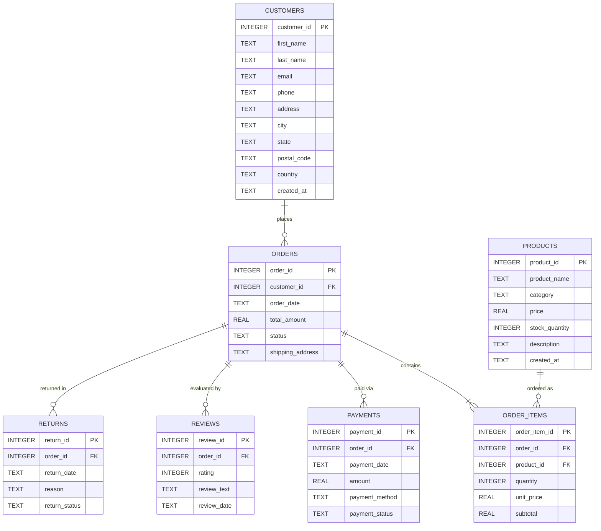

# Database Architecture & Relational Schema

This document details the relational data model, table structures, referential constraints, read-only guarantees, and validation mechanisms implemented in the **Local Report SQL Agent**.

---

## 1. Dataset Overview

The database is built from the Kaggle **Synthetic E-commerce Database** dataset, modeling a full e-commerce lifecycle spanning customers, catalog products, purchase orders, line items, transaction payments, customer reviews, and order returns.

* **Primary Application Database:** `data/ecommerce.db`
* **Raw Reference Data:** `data/raw/` (treated strictly as read-only)
* **Total Tables:** 7 relational tables
* **Total Relational Records:** **499,385 rows**
* **Verified Database Checksum (SHA-256):**  
  `c5a5965e000becdb75d0802897cb047dc2f827d1fdc7bacdf9d53ef7a46b6934`

---

## 2. Entity-Relationship Diagram



---

## 3. Relational Table Specifications

### 1. `customers` (50,000 rows)
Stores individual customer demographics and registration timestamps.

| Column | Type Affinity | Nullable | Constraint | Description |
| :--- | :--- | :---: | :--- | :--- |
| `customer_id` | `INTEGER` | No | `PRIMARY KEY` | Unique customer identifier |
| `first_name` | `TEXT` | No | — | Customer given name |
| `last_name` | `TEXT` | No | — | Customer family name |
| `email` | `TEXT` | No | `UNIQUE` | Email contact address |
| `phone` | `TEXT` | Yes | — | Telephone contact number |
| `address` | `TEXT` | Yes | — | Street address |
| `city` | `TEXT` | Yes | — | City name |
| `state` | `TEXT` | Yes | — | Province / state code |
| `postal_code` | `TEXT` | Yes | — | Postal zip code |
| `country` | `TEXT` | No | — | Country of residence (e.g., USA, UK, Germany) |
| `created_at` | `TEXT` | No | — | Account creation timestamp (ISO 8601) |

### 2. `products` (1,000 rows)
Product catalog detailing item categories, pricing, and current stock.

| Column | Type Affinity | Nullable | Constraint | Description |
| :--- | :--- | :---: | :--- | :--- |
| `product_id` | `INTEGER` | No | `PRIMARY KEY` | Unique product identifier |
| `product_name` | `TEXT` | No | — | Commercial product title |
| `category` | `TEXT` | No | — | Product classification (e.g., Apparel, Backpacks) |
| `price` | `REAL` | No | `CHECK (price >= 0)` | Unit sales price |
| `stock_quantity` | `INTEGER` | No | `CHECK (stock >= 0)` | Current warehouse inventory count |
| `description` | `TEXT` | Yes | — | Detailed product specification |
| `created_at` | `TEXT` | No | — | Catalog creation timestamp |

### 3. `orders` (100,000 rows)
Purchases placed by customers with transaction status and total amount.

| Column | Type Affinity | Nullable | Constraint | Description |
| :--- | :--- | :---: | :--- | :--- |
| `order_id` | `INTEGER` | No | `PRIMARY KEY` | Unique order identifier |
| `customer_id` | `INTEGER` | No | `FOREIGN KEY -> customers(customer_id)` | Customer placing the order |
| `order_date` | `TEXT` | No | — | Date and time order was placed |
| `total_amount` | `REAL` | No | `CHECK (total_amount >= 0)` | Aggregate gross order amount |
| `status` | `TEXT` | No | — | Order fulfillment status (`Completed`, `Pending`, etc.) |
| `shipping_address` | `TEXT` | Yes | — | Physical destination address |

### 4. `order_items` (237,508 rows)
Individual line items within each order linking to specific catalog products.

| Column | Type Affinity | Nullable | Constraint | Description |
| :--- | :--- | :---: | :--- | :--- |
| `order_item_id` | `INTEGER` | No | `PRIMARY KEY` | Unique line item identifier |
| `order_id` | `INTEGER` | No | `FOREIGN KEY -> orders(order_id)` | Parent order reference |
| `product_id` | `INTEGER` | No | `FOREIGN KEY -> products(product_id)` | Catalog item ordered |
| `quantity` | `INTEGER` | No | `CHECK (quantity > 0)` | Units purchased |
| `unit_price` | `REAL` | No | `CHECK (unit_price >= 0)` | Price per unit at purchase |
| `subtotal` | `REAL` | No | `CHECK (subtotal >= 0)` | Calculated `quantity * unit_price` |

### 5. `payments` (100,000 rows)
Financial payment records for orders.

| Column | Type Affinity | Nullable | Constraint | Description |
| :--- | :--- | :---: | :--- | :--- |
| `payment_id` | `INTEGER` | No | `PRIMARY KEY` | Unique payment record ID |
| `order_id` | `INTEGER` | No | `FOREIGN KEY -> orders(order_id)` | Order associated with payment |
| `payment_date` | `TEXT` | No | — | Payment settlement timestamp |
| `amount` | `REAL` | No | `CHECK (amount >= 0)` | Settled transaction amount |
| `payment_method` | `TEXT` | No | — | Payment channel (`credit_card`, `paypal`, etc.) |
| `payment_status` | `TEXT` | No | — | Status (`Captured`, `Refunded`, `Failed`) |

### 6. `reviews` (10,000 rows)
Customer feedback and rating scores for completed orders.

| Column | Type Affinity | Nullable | Constraint | Description |
| :--- | :--- | :---: | :--- | :--- |
| `review_id` | `INTEGER` | No | `PRIMARY KEY` | Unique review ID |
| `order_id` | `INTEGER` | No | `FOREIGN KEY -> orders(order_id)` | Evaluated order |
| `rating` | `INTEGER` | No | `CHECK (rating BETWEEN 1 AND 5)` | Star rating score (1 to 5) |
| `review_text` | `TEXT` | Yes | — | Natural language customer review |
| `review_date` | `TEXT` | No | — | Review submission date |

### 7. `returns` (877 rows)
Returned merchandise and refund processing details.

| Column | Type Affinity | Nullable | Constraint | Description |
| :--- | :--- | :---: | :--- | :--- |
| `return_id` | `INTEGER` | No | `PRIMARY KEY` | Unique return record ID |
| `order_id` | `INTEGER` | No | `FOREIGN KEY -> orders(order_id)` | Associated order |
| `return_date` | `TEXT` | No | — | Return request timestamp |
| `reason` | `TEXT` | Yes | — | Reason code (e.g., Damaged, Wrong Item) |
| `return_status` | `TEXT` | No | — | Processing status (`Approved`, `Rejected`, `Pending`) |

---

## 4. Multi-Layer Read-Only Strategy

To strictly guarantee database integrity during LLM execution, SQLite is protected through four independent defense layers:

```
[ Natural Language Query from User ]
                 │
                 ▼
     Layer 1: Lexical & AST Validation (database/sql_validator.py)
     • Rejects non-SELECT / non-WITH statements
     • Scans for forbidden tokens (DROP, INSERT, UPDATE, PRAGMA, ATTACH)
                 │
                 ▼
     Layer 2: Pre-Execution Schema Validation
     • Runs EXPLAIN QUERY PLAN without executing query
     • Rejects unknown tables/columns or syntax errors
                 │
                 ▼
     Layer 3: SQLite Read-Only Connection (database/connection.py)
     • Opened via URI: file:ecommerce.db?mode=ro
     • Enforces PRAGMA query_only = ON
                 │
                 ▼
     Layer 4: Low-Level SQLite C Authorizer Hook
     • sqlite3_set_authorizer callback intercepts low-level action codes
     • Systematically blocks SQLITE_INSERT, SQLITE_UPDATE, SQLITE_DELETE, etc.
                 │
                 ▼
[ SQLite Engine: Read-Only Query Execution with Timeout & Row Cap ]
```

### Detailed Security Layers

1. **URI Mode (`mode=ro`)**:
   Connections are opened strictly using SQLite URI filenames:
   ```python
   sqlite3.connect(f"file:{db_path}?mode=ro", uri=True)
   ```
   Any direct attempt to write to the database is rejected by the SQLite engine with:
   `sqlite3.OperationalError: attempt to write a readonly database`.

2. **Query Only Pragma**:
   Immediately upon opening the connection, `PRAGMA query_only = ON` is executed. This internal SQLite pragma prevents database mutation even if the file permissions are altered.

3. **SQLite C-Level Authorizer Hook**:
   Python's `sqlite3` driver registers an authorizer callback via `connection.set_authorizer(...)`. The callback intercepts every action code during query compilation:
   - **Allowed**: `SQLITE_SELECT`, `SQLITE_READ`, `SQLITE_FUNCTION`.
   - **Forbidden & Denied**: `SQLITE_INSERT`, `SQLITE_UPDATE`, `SQLITE_DELETE`, `SQLITE_CREATE_TABLE`, `SQLITE_DROP_TABLE`, `SQLITE_ALTER_TABLE`, `SQLITE_PRAGMA`, `SQLITE_ATTACH`, `SQLITE_DETACH`.

4. **Resource Caps & Execution Timeouts**:
   - **Row Limit (Default: 1,000, Max: 100,000)**: Query fetching uses cursor slicing (`cursor.fetchmany(max_rows + 1)`). If the result exceeds the threshold, the result set is truncated safely with a metadata warning flag `truncated: True`.
   - **Timeout (Default: 120.0s)**: Query execution runs on a monitored timer. If a runaway query exceeds the configured timeout, `connection.interrupt()` is called immediately to abort execution and free thread resources.

---

## 5. Schema Inspection API (`database/inspector.py`)

The MCP tool `inspect_database_schema` queries SQLite metadata dynamically without hardcoding table names or column definitions:
* **`sqlite_master`**: Discovers available tables and indexes.
* **`PRAGMA table_info(<table>)`**: Extracts column names, type affinities, nullability, and primary key positions.
* **`PRAGMA foreign_key_list(<table>)`**: Discovers foreign key targets and mapped column relationships.
* **Parity Verification**: The schema inspector exposes a `compare_databases(db1, db2)` utility used during testing to verify that `data/ecommerce.db` matches the reference `data/raw/ecommerce.sqlite` with 100% relational parity.

