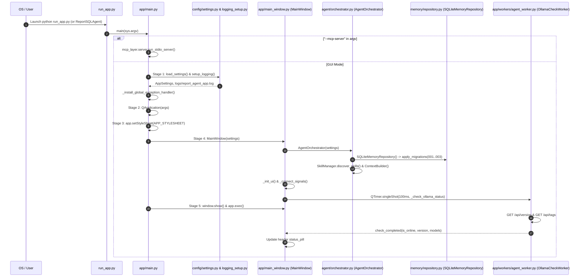

# Chapter 03 — Application Lifecycle

## 1. Entrypoints and Execution Modes

The application starts at `run_app.py`, which invokes `app.main:main()`. To support both source checkouts and standalone PyInstaller bundles (`ReportSQLAgent.app` on macOS and `ReportSQLAgent.exe` on Windows), `app.main:main(argv)` inspects command-line flags before initializing any GUI components:

1. **Child MCP Server Mode (`--mcp-server`)**:
   - Triggered when `MCPClientManager` spawns the packaged executable with `--mcp-server`.
   - Calls `mcp_layer.server:run_stdio_server()` immediately without importing or starting `QApplication`, ensuring zero stdout pollution on the JSON-RPC stdio stream.
2. **Headless Smoke-Test Mode (`--smoke-test`)**:
   - Used by `scripts/build_macos.sh` and CI pipelines (`QT_QPA_PLATFORM=offscreen ReportSQLAgent --smoke-test`).
   - Runs Stages 1 through 4 (loads settings, configures logging, initializes `QApplication`, applies `APP_STYLESHEET`, constructs `MainWindow` and `AgentOrchestrator`, runs SQLite memory migrations), closes the window cleanly, and exits with code `0`.
3. **Interactive Desktop GUI Mode (Default)**:
   - Runs all 5 startup stages, shows `MainWindow`, triggers `OllamaCheckWorker`, and enters the Qt event loop (`app.exec()`).

---

## 2. Five-Stage Startup Lifecycle

The sequence diagram above details the exact 5-stage startup progression executed by `app/main.py` and the sub-components constructed during `MainWindow` initialization.

### Detailed Breakdown of Startup Stages

| Stage | Function / Method | Operations Performed | Failure Handling |
| :--- | :--- | :--- | :--- |
| **Stage 0 (Bootstrap)** | `run_app.py` | Wraps `from app.main import main` in a `try...except BaseException` block. | Writes full traceback to `user_data_root() / "logs" / "startup_crash.log"` via `_fallback_log_fatal(exc)` and exits with code `1`. |
| **Stage 1 (Settings & Logging)** | `load_settings()`, `setup_logging()`, `_install_global_exception_handler()` | Merges dataclass defaults, `settings.json`, and `REPORT_AGENT_*` env vars; validates settings; configures `RotatingFileHandler` (`2 MB × 3 backups`); installs `sys.excepthook`. | Displays modal `QMessageBox.Critical` (`_show_fatal_error_dialog`) with log path and expandable traceback (unless `QT_QPA_PLATFORM=offscreen`). |
| **Stage 2 (Qt Application)** | `QApplication(args)` | Creates or reuses the singleton `QApplication`, sets application name (`Report SQL Agent`), version (`1.0.0`), and organization (`UBB Advanced Agentic AI`). | Caught by top-level `except Exception` in `main()`. |
| **Stage 3 (Theme Styling)** | `app.setStyleSheet(APP_STYLESHEET)` | Applies the dark-mode QSS theme defined in `app/style.py`. | Caught by top-level exception handler. |
| **Stage 4 (MainWindow & Orchestrator)** | `MainWindow(settings)` → `AgentOrchestrator(settings)` | Initializes `OllamaClient`, `MCPClientManager`, `ToolHandler`, `SkillManager` (discovers `skills/*/SKILL.md` and syncs to `skill_registry`), `SQLiteMemoryRepository` (applies migrations `001`–`003` on `data/agent_memory.db` in WAL mode), `CheckpointManager`, `TaskManager`, `TaskPlanner`, and `ContextBuilder`. | Database or migration errors raise immediately and surface via `_show_fatal_error_dialog`. |
| **Stage 5 (Event Loop & Async Health Check)** | `window.show()`, `QTimer.singleShot(100, self._check_ollama_status)`, `app.exec()` | Renders the split workspace (`ReportPreviewWidget` + `ChatView`) and launches `OllamaCheckWorker` on a background `QThread` after 100 ms. | If Ollama is offline or `qwen3.5:4b` is missing, the header status pill turns red/amber (`● Ollama Offline` or `● Ollama Online (Model missing)`) with actionable tooltip instructions without crashing the GUI. |

---

## 3. Lazy vs. Eager Initialization Strategy

A key architectural decision in `AgentOrchestrator` (`agent/orchestrator.py`) is separating **fast synchronous GUI construction** from **asynchronous I/O initialization**:

- **Eager at Startup (`AgentOrchestrator.__init__`)**:
  - Constructing `SQLiteMemoryRepository` (`data/agent_memory.db`) and running SQL migrations (`001_initial_schema.sql`, `002_checkpoint_recovery.sql`, `003_skill_registry_enhancements.sql`).
  - Discovering local Markdown skills (`SkillManager.discover_skills()`) and syncing metadata into `skill_registry`.
  - Detecting any interrupted tasks from prior sessions (`CheckpointManager.detect_interrupted_tasks()`).
- **Asynchronous Before First User Request (`AgentOrchestrator.initialize()`)**:
  - Called automatically at the start of `AgentOrchestrator.process_message()` on the background `AgentWorker` thread (if `not self._initialized`).
  - Starts the persistent MCP stdio subprocess (`MCPClientManager.connect()`), completes the JSON-RPC 2.0 `initialize` handshake, calls `list_tools()`, validates that all **6 required MCP tools** are registered in `ToolRegistry`, and caches the database schema (`inspect_database_schema`) for prompt injection and semantic memory seeding.

---

## 4. Deterministic Shutdown Lifecycle

When the user closes the desktop window, `MainWindow.closeEvent(event: QCloseEvent)` (`app/main_window.py`) executes a deterministic teardown sequence to prevent orphaned threads or zombie MCP subprocesses:

1. **Active AgentWorker Cancellation**: If `self.active_worker` is running, calls `self.active_worker.cancel()` (which sets `self._cancel_event` thread-safely via `self._loop.call_soon_threadsafe(self._cancel_event.set)`) and waits up to `2000 ms` (`self.active_worker.wait(2000)`).
2. **Health-Check Worker Teardown**: If `self._check_worker` is running, waits up to `1000 ms` (`self._check_worker.wait(1000)`).
3. **Event Loop Task Cleanup**: Inside `AgentWorker.run()`, the `finally` block cancels all pending `asyncio` tasks on the worker loop, awaits `asyncio.gather(*pending, return_exceptions=True)`, and closes the loop.
4. **MCP Subprocess Termination**: `AgentOrchestrator.shutdown()` invokes `ToolHandler.shutdown()` → `MCPClientManager.disconnect()`, which exits the `AsyncExitStack` managing `ClientSession` and `stdio_client`, cleanly closing the child MCP server's `stdin`/`stdout` pipes.
