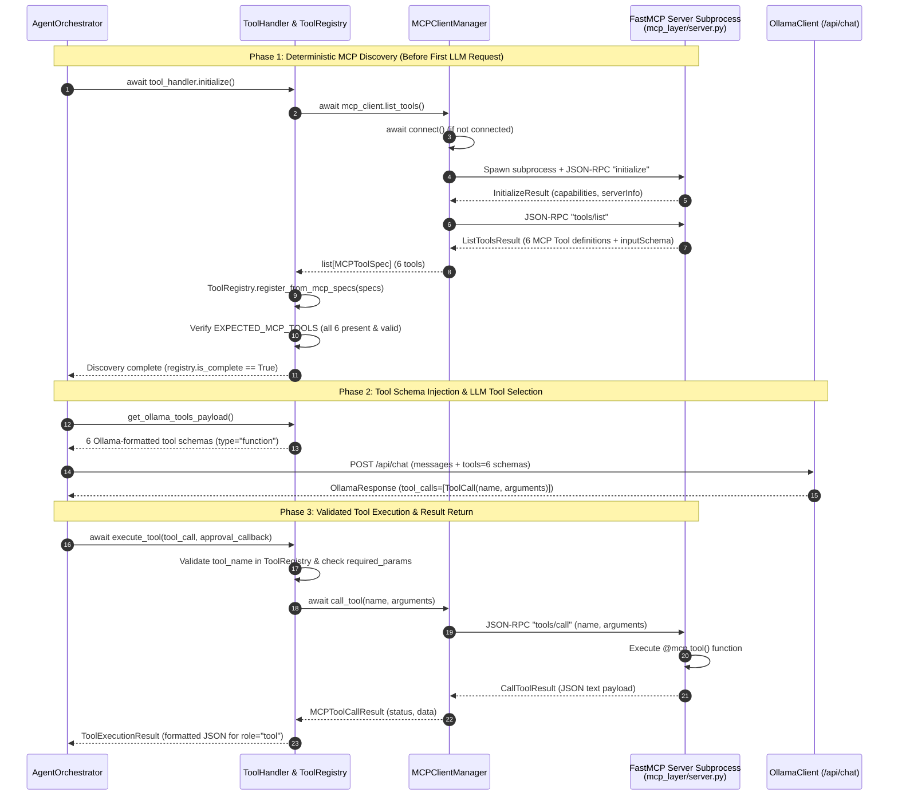

# Chapter 04 — MCP Tool Discovery and Execution Pipeline

## 1. Role of the Model Context Protocol (MCP)

The **Model Context Protocol (MCP)** serves as the strict, process-isolated boundary between the LLM reasoning layer (`agent/`) and the deterministic execution layer (`database/`, `reporting/`).

Using the official Python MCP SDK (`mcp>=1.2.0`), the project implements:
- **Authoritative MCP Server (`mcp_layer/server.py`)**: A `FastMCP("local-report-sql-agent")` server running in a dedicated child subprocess over `stdio`.
- **Persistent MCP Client (`mcp_layer/client.py`)**: `MCPClientManager`, which spawns the server subprocess, maintains a persistent `ClientSession` via `contextlib.AsyncExitStack`, discovers tool schemas dynamically via `list_tools()`, and dispatches `call_tool()` requests with automatic transient error recovery.
- **Runtime Tool Registry & Adapter (`agent/tool_handler.py`)**: `ToolRegistry`, `DiscoveredTool`, and `ToolHandler`, which validate tool completeness, convert MCP JSON Schemas into Ollama's native `/api/chat` `tools` format, and route tool invocations.

---

## 2. Complete MCP Discovery & Execution Sequence



The sequence diagram above illustrates the three-phase lifecycle of MCP tool discovery, native schema injection into Ollama, and JSON-RPC 2.0 tool execution over `stdio`.

---

## 3. Subprocess Launch & Stdio Transport (`mcp_layer/client.py`)

`MCPClientManager._build_server_params()` constructs `StdioServerParameters` with environment isolation and dual-mode binary support:

1. **Source Execution (`is_frozen() == False`)**:
   - `command = sys.executable` (e.g. `.venv/bin/python`)
   - `args = ["-m", "mcp_layer.server"]`
2. **Packaged Bundle Execution (`is_frozen() == True`)**:
   - `command = sys.executable` (e.g. `ReportSQLAgent.app/Contents/MacOS/ReportSQLAgent` or `ReportSQLAgent.exe`)
   - `args = ["--mcp-server"]`
3. **Environment Propagation**:
   - Sets `PYTHONUNBUFFERED="1"` and `PYTHONIOENCODING="utf-8"`.
   - Propagates active `AppSettings` explicitly via `REPORT_AGENT_DB_PATH`, `REPORT_AGENT_MAX_ROWS`, `REPORT_AGENT_QUERY_TIMEOUT_S`, `REPORT_AGENT_OUTPUT_DIR`, `REPORT_AGENT_PAGE_SIZE`, `REPORT_AGENT_MAX_PDF_ROWS`, `REPORT_AGENT_MAX_CSV_ROWS`, `REPORT_AGENT_INCLUDE_SQL_IN_PDF`, and `REPORT_AGENT_LOG_LEVEL` so runtime settings changes in the GUI immediately apply to the child MCP server.

### Persistent Session & Automatic Reconnection

`MCPClientManager` maintains a persistent `ClientSession` inside `self._exit_stack` Protected by an `asyncio.Lock` (`self._lock`). If a transient `OSError`, `BrokenPipeError`, or `EOFError` occurs during `list_tools()` or `call_tool()`, `MCPClientManager` calls `await self._reset_session()`, respawns the subprocess, re-runs the MCP handshake, and retries (`max_retries = 2`).

---

## 4. Authoritative Six MCP Tools (`EXPECTED_MCP_TOOLS`)

`agent/tool_handler.py` defines the exact set of six expected tools in `EXPECTED_MCP_TOOLS`:

| # | Tool Name | Server Module | Purpose | Required Input Parameters |
| :--- | :--- | :--- | :--- | :--- |
| **1** | `inspect_database_schema` | `mcp_layer/tools/database_tools.py` | Dynamically inspect tables, columns, SQLite type affinities, PKs, FKs, indexes, and row counts. | None (`table_name: str \| None = None`, `include_row_counts: bool = True` optional) |
| **2** | `get_table_sample` | `mcp_layer/tools/database_tools.py` | Retrieve up to `limit` (default `10`, capped at `100`) sample rows and column metadata from a table. | `table_name: str` (`limit: int = 10` optional) |
| **3** | `prepare_sql_query` | `mcp_layer/tools/sql_tools.py` | Validate a candidate SQL statement for read-only safety and syntax (`EXPLAIN QUERY PLAN`) without executing it. | `sql_query: str` (`explanation: str = ""` optional) |
| **4** | `execute_readonly_sql` | `mcp_layer/tools/sql_tools.py` | Validate and execute a read-only `SELECT`/`WITH` query against `data/ecommerce.db` with timeout and row limits. | `sql_query: str` (`max_rows: int \| None = None` optional) |
| **5** | `generate_pdf_report` | `mcp_layer/tools/reporting_tools.py` | Generate a styled, multi-page PDF report with KPI cards, 25-type vector charts, findings, and tables. | `title: str` (plus `columns`/`rows` or cached SQL dataset, `charts`, `kpis`, `findings`, `sections`, `datasets`) |
| **6** | `generate_csv_report` | `mcp_layer/tools/reporting_tools.py` | Export structured query results (single or multi-dataset) to a UTF-8 CSV file inside `reports/`. | `title: str`, `columns: list[str]`, `rows: list[list \| dict]` |

---

## 5. Runtime `ToolRegistry` and Schema Normalization (`agent/tool_handler.py`)

When `ToolHandler.initialize()` runs:
1. It calls `await self.mcp_client.list_tools()` to retrieve raw `MCPToolSpec` objects from the MCP server.
2. `ToolRegistry.register_from_mcp_specs(specs)` normalizes each tool's JSON Schema via `_normalize_input_schema()` into a `DiscoveredTool` dataclass containing:
   - `name: str`
   - `description: str`
   - `input_schema: dict[str, Any]` (`type: "object"`, `properties`, `required`)
   - `required_params: tuple[str, ...]`
   - `parameter_names: tuple[str, ...]`
3. **Completeness Gate**: `ToolHandler.initialize()` checks `self._registry.missing_expected_tools`. If any of the 6 tools in `EXPECTED_MCP_TOOLS` is missing, or if `registry.is_complete` is `False`, it raises a `MCPConnectionError` immediately—preventing the agent from ever running with partial or missing reporting capabilities.
4. **Ollama Function Schema Conversion**: `DiscoveredTool.to_ollama_tool()` formats each discovered tool into the exact structure required by Ollama's `/api/chat` endpoint:
   ```json
   {
     "type": "function",
     "function": {
       "name": "generate_pdf_report",
       "description": "...",
       "parameters": {
         "type": "object",
         "properties": { ... },
         "required": ["title"]
       }
     }
   }
   ```
5. **Argument Aliasing & Sanitization**: Before dispatching `generate_pdf_report` or `generate_csv_report` over MCP, `ToolHandler._prepare_report_tool_arguments()` normalizes model-supplied argument aliases (e.g., mapping `report_title`/`name` → `title`, `executive_summary` → `summary`, `query`/`sql` → `sql_query`, `key_findings`/`insights` → `findings`, and auto-injecting cached full query rows from `self._latest_sql_result` when the LLM omits or truncates `rows`).
