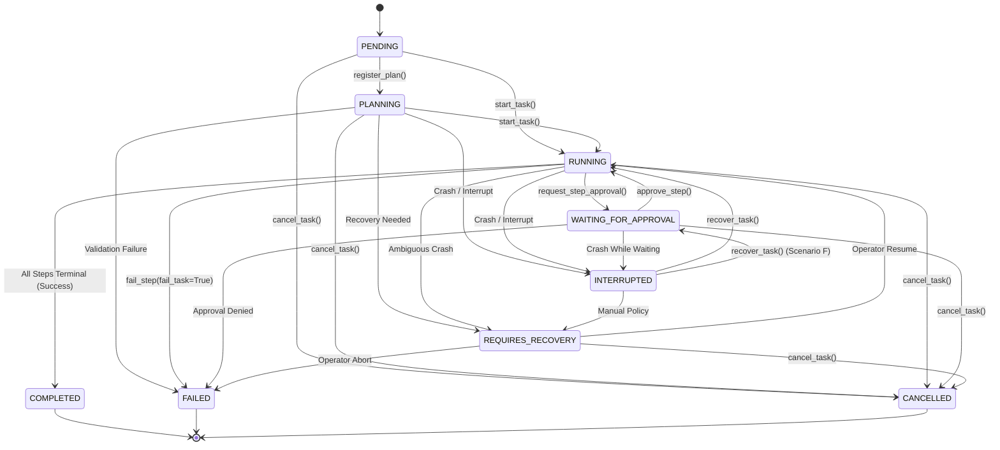
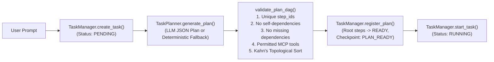

# Chapter 06 — Agent Orchestration and Task Planning

## 1. Overview of the Agent Intelligence Layer

The agent intelligence layer coordinates structured multi-step planning, deterministic DAG validation, iterative tool execution, and self-correction across five core modules:

- `agent/orchestrator.py` (`AgentOrchestrator`, `AgentRunResult`, `AgentEvent`, `AgentEventType`)
- `agent/task_planner.py` (`TaskPlanner`)
- `agent/task_manager.py` (`TaskManager`, `validate_plan_dag`)
- `agent/task_models.py` (`AgentTask`, `TaskPlan`, `TaskStep`, `TaskStatus`, `StepStatus`)
- `agent/events.py` (`ActivityEvent`, `ActivityCategory`, `mask_sensitive_data`)

---

## 2. Task & Step Lifecycle State Machines (`agent/task_models.py`)

Both `AgentTask` and `TaskStep` enforce strict state-transition graphs via `VALID_TASK_TRANSITIONS` and `VALID_STEP_TRANSITIONS`. Any illegal transition raises `InvalidStateTransitionError`.

The state diagram above illustrates the `TaskStatus` lifecycle enforced by `AgentTask.transition_to()`. Terminal states (`COMPLETED`, `FAILED`, `CANCELLED`) have empty outgoing transition sets (`set()`), guaranteeing that completed or cancelled tasks cannot be accidentally mutated.

---

## 3. Structured Task Planning & Kahn's Algorithm DAG Validation

Before entering the iterative tool-execution loop, `AgentOrchestrator.process_message()` creates a persistent `AgentTask` and invokes `TaskPlanner.generate_plan()`.

The flowchart above traces how a natural-language user request is transformed into a topologically sorted, cycle-free `TaskPlan` before step execution begins.

### Fallback Deterministic Plan (`TaskPlanner._build_fallback_plan`)

If the local LLM returns non-JSON text during the planning prompt or if an analytical report request omits a report-generation step (`generate_pdf_report` / `generate_csv_report`), `TaskPlanner` automatically normalizes or synthesizes a canonical 4-step DAG:

| Step ID | Step Name | `required_skill` | `required_tools` | `dependencies` |
| :--- | :--- | :--- | :--- | :--- |
| `step_1_schema` | Inspect Database Schema | `sql` | `["inspect_database_schema"]` | `[]` |
| `step_2_sql_prep` | Prepare and Validate SQL Query | `sql` | `["prepare_sql_query"]` | `["step_1_schema"]` |
| `step_3_sql_exec` | Execute Read-Only SQL Query | `data_analysis` | `["execute_readonly_sql"]` | `["step_2_sql_prep"]` |
| `step_4_report` | Generate Final Report | `data_validation` | `["generate_pdf_report"]` (or `["generate_csv_report"]`) | `["step_3_sql_exec"]` |

---

## 4. Multi-Turn Orchestration Loop (`AgentOrchestrator.process_message`)

Once the task is in `RUNNING` state, `AgentOrchestrator.process_message()` executes an iterative reasoning and tool-invocation loop bounded by `max_iterations` (`20` default) and `max_tool_calls` (`40` default):

1. **Stage Determination (`_determine_execution_stage`)**:
   - Inspects the active DAG step and tool history to select the appropriate `ExecutionStage` (`SCHEMA_DISCOVERY`, `SQL_GENERATION`, `SQL_VALIDATION`, `DATA_ANALYSIS`, `REPORT_GENERATION`, or `FINAL_RESPONSE`).
2. **Dynamic Context Assembly (`ContextBuilder.build_context`)**:
   - Builds the stage-specific system prompt, discovered MCP tool summary, active task/checkpoint progress, relevant skill slices (`sql`, `data_analysis`, `data_validation`), database schema summary, working/episodic/semantic memory, and recent conversation turns within the `131,072`-token window.
3. **LLM Inference (`OllamaClient.chat`)**:
   - Sends `messages`, `tools` (the 6 discovered MCP tool schemas from `ToolHandler.get_ollama_tools_payload()`), and `num_ctx=effective_ctx` to local Ollama.
   - Checks `cancel_event.is_set()` both before and immediately after `await self.ollama_client.chat(**chat_kwargs)`.
4. **Tool Call Dispatch (`ToolHandler.execute_tool`)**:
   - If `response.has_tool_calls` is `True`, iterates over each `ToolCall`:
     - Emits `AgentEventType.TOOL_CALL_PROPOSED` and `SQL_PROPOSED` (if executing SQL).
     - Enforces human-in-the-loop approval if `settings.agent.require_sql_approval` is `True`.
     - Executes the tool via `MCPClientManager.call_tool()`.
     - Audits the tool call in `SQLiteMemoryRepository.record_tool_call()` and records any generated PDF/CSV in `record_artifact()`.
     - Appends the tool result as a `role="tool"` message in `ConversationMemory`.
5. **SQL Self-Correction & Retry Guard (`max_sql_retries = 3`)**:
   - If `prepare_sql_query` or `execute_readonly_sql` fails validation or execution, increments `sql_retries`, feeds the exact SQLite error and schema hints back to the model, and allows up to `max_sql_retries` (`3`) self-correction attempts.
6. **Direct SQL Recovery & Report Synthesis Guards**:
   - If the model outputs a raw `SELECT` block in plain text instead of a tool call (`_extract_raw_sql_from_text`), nudges the model to invoke `execute_readonly_sql` (up to 2 nudges).
   - If the user requested a report and SQL rows have already been retrieved (`tool_handler.latest_sql_result`), but the model stops without calling `generate_pdf_report` / `generate_csv_report`, nudges the model once and—if still omitted—invokes `_synthesize_fallback_report()` so valid reporting requests never fail silently.
