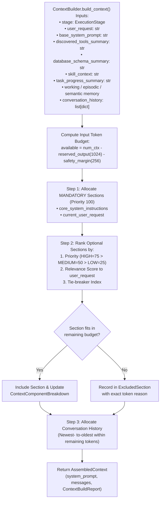

# Chapter 07 — Context Management, Token Budgeting, and Prompts

## 1. Stage-Aware Context Assembly (`agent/context_builder.py`)

Rather than stuffing static prompts and unbounded history into every LLM turn, `ContextBuilder` dynamically assembles a stage-tailored context payload (`AssembledContext`) accompanied by a deterministic token audit report (`ContextBuildReport`).

The diagram above shows the 3-step token allocation algorithm in `ContextBuilder.build_context()` (`agent/context_builder.py`).

---

## 2. Supported Context Windows & Token Budget Math

`config/settings.py` defines four selectable context window presets (`ALLOWED_CONTEXT_WINDOWS`):

| Display Label in Settings UI | `num_ctx` (`agent_context_window`) | `reserved_output_tokens` | `safety_margin_tokens` | `available_input_tokens` |
| :--- | :--- | :--- | :--- | :--- |
| `32K (32,768 tokens)` | `32,768` | `1,024` | `256` | `31,488` |
| `64K (65,536 tokens)` | `65,536` | `1,024` | `256` | `64,256` |
| **`128K (131,072 tokens) - Default`** | **`131,072`** | **`1,024`** | **`256`** | **`129,792`** |
| `256K (262,144 tokens)` | `262,144` | `1,024` | `256` | `260,864` |

Token estimation uses a conservative deterministic heuristic in `ContextBuilder.estimate_tokens(text)`:
$$\text{estimated\_tokens} = \max\left(1, \left\lceil \frac{\text{len(text)}}{3.5} \right\rceil + 4\right)$$
If mandatory sections (`core_system_instructions` + `current_user_request`) ever exceed `available_input_tokens`, `ContextBuilder` raises `ContextBudgetExceededError`.

---

## 3. Execution Stages & Priority Matrix (`STAGE_PRIORITIES`)

`agent/context_models.py` defines 8 `ExecutionStage` values, and `agent/context_builder.py` assigns stage-specific `SectionPriority` levels (`HIGH = 75`, `MEDIUM = 50`, `LOW = 25`):

| Execution Stage | `skills` | `database_schema` | `task_and_checkpoint` | `working_memory` | `tool_results` | `semantic_memory` | `episodic_memory` |
| :--- | :--- | :--- | :--- | :--- | :--- | :--- | :--- |
| `REQUEST_PLANNING` | `HIGH` | `HIGH` | `MEDIUM` | `LOW` | `LOW` | `MEDIUM` | `LOW` |
| `SCHEMA_DISCOVERY` | `MEDIUM` | `HIGH` | `MEDIUM` | `MEDIUM` | `HIGH` | `HIGH` | `LOW` |
| `SQL_GENERATION` | `HIGH` | `HIGH` | `MEDIUM` | `HIGH` | `HIGH` | `HIGH` | `LOW` |
| `SQL_VALIDATION` | `HIGH` | `HIGH` | `MEDIUM` | `HIGH` | `HIGH` | `MEDIUM` | `LOW` |
| `DATA_ANALYSIS` | `HIGH` | `MEDIUM` | `MEDIUM` | `HIGH` | `HIGH` | `MEDIUM` | `LOW` |
| `CHART_PLANNING` | `HIGH` | `LOW` | `MEDIUM` | `HIGH` | `HIGH` | `LOW` | `LOW` |
| `REPORT_GENERATION` | `HIGH` | `LOW` | `HIGH` | `HIGH` | `HIGH` | `LOW` | `LOW` |
| `FINAL_RESPONSE` | `LOW` | `LOW` | `HIGH` | `HIGH` | `HIGH` | `LOW` | `LOW` |

In addition, when `discovered_tools_summary` is provided from `ToolRegistry.format_for_system_prompt()`, `ContextBuilder` injects it as the `discovered_mcp_tools` section with `SectionPriority.HIGH` (`category="system_instructions"`), ensuring the model always sees the authoritative MCP tool contracts in its system prompt while respecting small test token budgets.

---

## 4. Prompt Engineering & Sanitization (`config/prompts.py` & `agent/system_prompt.py`)

`config/prompts.py` defines:
- **`DEFAULT_SYSTEM_PROMPT`**: Establishes the agent's identity, dynamic temporal anchor (`{current_date}`, `{prev_month_label}`, `{prev_month_start}`, `{prev_month_end_exclusive}` calculated via `reporting/date_utils.py`), strict read-only SQL rules, reporting & visualization capabilities (22 chart types, PDF/CSV defaults), and an explicit ban on false `CAPABILITY_LIMITATION` refusals for supported SQL/PDF/CSV/chart tasks.
- **`JSON_TOOL_FALLBACK_INSTRUCTIONS`**: Appended when `tool_mode == "json"` so the model emits `{"tool": "<tool_name>", "arguments": {...}}`.

### Prompt Injection & Control-Character Sanitization

`ContextBuilder.sanitize_text(text)` protects the prompt assembly pipeline from malicious or noisy strings stored in database cells or external text:
1. Strips ASCII control characters (`[\x00-\x08\x0b\x0c\x0e-\x1f\x7f]`).
2. Neutralizes prompt-injection patterns (`ignore previous instructions`, `disregard all system rules`, `<|im_start|>`, `<|im_end|>`, `[INST]`, `[/INST]`) by replacing them with `[REDACTED_INJECTION_PATTERN]`.

---

## 5. Multi-Turn Conversation Memory (`agent/conversation.py`)

`ConversationMemory` manages the rolling message window passed to Ollama:
- Stores `ConversationMessage` instances (`role`, `content`, `thinking`, `tool_calls`, `tool_call_id`, `tool_name`).
- Enforces `max_history_messages` (`30` default) via `_trim_history()`, preserving the latest user turn and any unbroken `assistant (tool_calls)` → `tool (result)` chains so Ollama never receives an orphaned `role="tool"` message.
