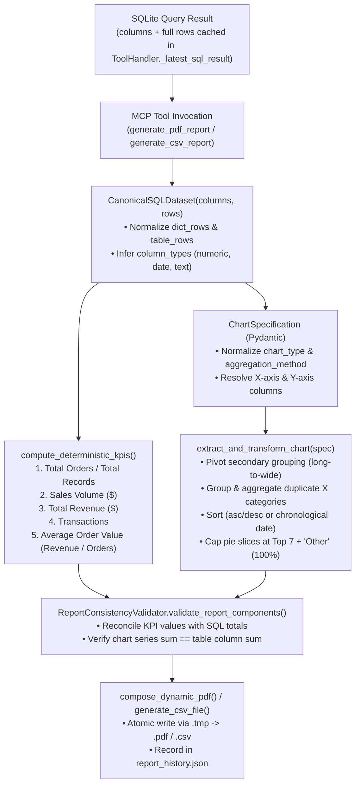

# Chapter 10 — Reporting Pipeline and Canonical Data Architecture

## 1. Single Source of Truth Architecture (`reporting/canonical_data.py`)

A core architectural innovation of the Local Report SQL Agent is its **Single Source of Truth (SSOT)** reporting pipeline (`reporting/canonical_data.py`).

In naïve LLM reporting systems, the language model is asked to write KPI values, calculate percentages, and supply chart arrays in JSON—leading to arithmetic hallucinations and discrepancies between tables and charts. In this architecture:

1. **Authoritative Dataset (`CanonicalSQLDataset`)**: The exact `columns` and `rows` returned by SQLite (`execute_readonly_sql`) form the sole authoritative dataset for the report.
2. **Deterministic Python Calculations**: `CanonicalSQLDataset` infers column types (`numeric`, `date`, `text`, `unknown`), computes verified KPI summary cards (`compute_deterministic_kpis()`), aggregates and sorts chart series (`extract_and_transform_chart()`), and calculates exact slice percentages for pie/donut charts.
3. **Cross-Component Consistency Validation (`ReportConsistencyValidator`)**: Before ReportLab renders a single page, `ReportConsistencyValidator.validate_report_components()` verifies that chart series totals align with table column sums, pie percentages sum to ~100%, and any LLM-supplied KPI strings that drift from the SQL dataset calculation are automatically overridden with the deterministic Python values.

---

## 2. End-to-End Reporting Data Flow

The data-flow diagram above traces how raw SQLite rows are normalized into a `CanonicalSQLDataset` and transformed deterministically into KPIs, validated chart series, and multi-page PDF/CSV artifacts.

---

## 3. Full-Dataset Caching vs. LLM Context Preview (`llm_preview_rows`)

To prevent large SQL result sets from exhausting the LLM context window while ensuring PDF and CSV reports contain 100% of the queried data, `mcp_layer/tools/sql_tools.py` and `agent/tool_handler.py` implement a dual-tier row pipeline:

| Parameter | Default Value | Purpose |
| :--- | :--- | :--- |
| `DatabaseSettings.max_result_rows` | `1,000` (up to `100,000` for reports) | Maximum rows fetched from SQLite into `execute_readonly_sql` (`full_rows` in the MCP response). |
| `DatabaseSettings.llm_preview_rows` | `50` | Maximum rows shown to the LLM in the `role="tool"` JSON message (`records` / `rows` preview) when `row_count > 50`. |
| `ToolHandler._latest_sql_result` & `_sql_datasets` | Up to `8` named datasets per turn | Caches the **complete, untruncated** `full_rows` in `ToolHandler` memory. When the LLM calls `generate_pdf_report` or `generate_csv_report`, `ToolHandler._prepare_report_tool_arguments()` automatically injects the full cached dataset rows (`datasets` and `rows`) so no records are ever lost to LLM preview truncation. |

---

## 4. Deterministic KPI Calculation Rules (`compute_deterministic_kpis`)

`CanonicalSQLDataset.compute_deterministic_kpis()` inspects column names case-insensitively and computes up to five verified executive KPI cards directly from `self._dict_rows`:

1. **Total Orders / Total Records**:
   - Sums columns matching `order_count`, `total_orders`, `orders_count`, `num_orders`, or `orders`; otherwise counts distinct `order_id`; otherwise reports `Total Records` (`row_count`).
2. **Sales Volume**:
   - Sums columns matching `sales_volume`, `gross_sales`, `subtotal`, `gross_amount`, or `gross_item_sales` formatted as `$X,XXX.XX`.
3. **Total Revenue**:
   - Sums columns matching `total_revenue`, `net_revenue`, `revenue`, `total_amount`, `net_amount`, or `captured_revenue` formatted as `$X,XXX.XX`.
4. **Transactions**:
   - Sums `transaction_count`, `total_transactions`, `transactions_count`, or counts distinct `payment_id` / `transaction_id`.
5. **Average Order Value (AOV)**:
   - Automatically computed when both a Revenue/Sales KPI and an Orders KPI are present:
     $$\text{AOV} = \frac{\text{Total Revenue (or Sales Volume)}}{\text{Total Orders}}$$

---

## 5. Dynamic Calendar Period Utilities (`reporting/date_utils.py`)

To ensure natural-language date requests like *"last month"* or *"previous calendar month"* never use hardcoded dates, `reporting/date_utils.py` provides `calculate_previous_calendar_month(reference_date=None)` returning a `ReportingPeriod` dataclass:
- `start_date_str`: First day of the previous calendar month (`YYYY-MM-01`, inclusive).
- `end_date_str`: First day of the current calendar month (`YYYY-MM-01`, exclusive).
- `period_label`: Human-readable month and year (e.g., `"October 2026"`).
- `sql_filter_clause`: `">= 'YYYY-MM-01' AND < 'YYYY-MM-01'"`.

These values are injected into `SystemPromptBuilder` on every turn so the LLM writes exact half-open interval filters (`order_date >= '...' AND order_date < '...'`) that properly include timestamps on the final day of the month.
