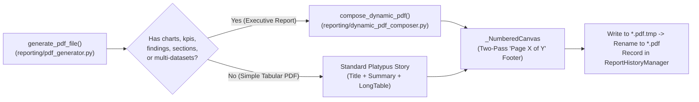

# Chapter 11 — PDF Generation, Vector Visualizations, and CSV Export

## 1. Multi-Page PDF Composition Engine

The PDF generation subsystem is implemented across four cohesive modules in `reporting/`:
- `reporting/pdf_generator.py` (`generate_pdf_file`, `_make_numbered_canvas`, `_compute_column_widths`, `_ensure_fonts_registered`)
- `reporting/dynamic_pdf_composer.py` (`compose_dynamic_pdf`, `_build_table_flowable`)
- `reporting/report_spec.py` (`ReportSpecification`, `ReportSection`, `ReportComponent`, `ChartConfiguration`, `TableConfiguration`, `ChartType`)
- `reporting/chart_registry.py` (`ChartRegistry` and all 25 registered vector chart renderers)

The diagram above shows how `generate_pdf_file()` routes executive reports with charts, KPIs, findings, or multi-section specifications to `compose_dynamic_pdf()`, while simple single-table exports use the streamlined `LongTable` builder. Both paths share the two-pass `_NumberedCanvas` and atomic `.pdf.tmp` → `.pdf` persistence.

---

## 2. Typography, Page Layout, and Two-Pass Pagination

1. **Cross-Platform TrueType Font Registration (`_ensure_fonts_registered`)**:
   - Inspects ReportLab's bundled `fonts/` directory and registers the Bitstream Vera TrueType font family (`Vera.ttf`, `VeraBd.ttf`, `VeraIt.ttf`, `VeraBI.ttf`) for full Unicode glyph coverage across macOS and Windows, falling back to `Helvetica` if unavailable.
2. **Automatic Portrait vs. Landscape Orientation**:
   - Supports both `A4` (default) and `LETTER` page sizes (`ReportSettings.page_size`).
   - Automatically switches from `portrait` to `landscape` orientation whenever any table or dataset contains **more than 6 columns** (`max_cols > 6`), preventing cramped or overlapping columns.
3. **Proportional Column Width Allocation (`_compute_column_widths`)**:
   - Samples up to 200 rows per column, measures character lengths (capped at 46 chars per cell), enforces a minimum column width, and scales widths proportionally to fill `available_width` (`pagesize[0] - 28mm`).
4. **Repeating Headers, Zebra Striping, and Alignment**:
   - Uses ReportLab `LongTable(..., repeatRows=1)` so table headers repeat automatically at the top of every page break.
   - Numeric columns (`_is_numeric_column`) are right-aligned (`TA_RIGHT`) and formatted to 2 decimal places with thousands separators (`1,234.56`), `None` values render as em-dashes (`—`), and odd/even rows alternate between white and `#F8FAFC`.
   - When `TableConfiguration.show_totals=True` (or when the user requests a matrix/totals table), `_build_table_flowable()` appends a bold **TOTAL** summary row at the bottom of the table.
5. **Two-Pass `"Page X of Y"` Footer (`_make_numbered_canvas`)**:
   - `_NumberedCanvas` overrides `showPage()` to buffer page state dictionaries in `self._saved_page_states` without flushing to disk, then in `save()` computes `total_pages = len(self._saved_page_states)` and draws the footer rule and `"Local Report SQL Agent | <Title> | Generated <Timestamp> ... Page X of Y"` on every page.

---

## 3. The 25-Renderer Vector `ChartRegistry` (`reporting/chart_registry.py`)

All charts are rendered as resolution-independent **ReportLab vector `Drawing` objects** (never rasterized PNGs) using a WCAG AA accessible 12-color corporate palette (`PALETTE`). `ChartRegistry` registers **25 chart type keys** (covering all **22 canonical `SupportedChartType` identifiers** plus aliases) across 6 analytical categories:

| Category | Registered `chart_type` Keys | Renderer Function in `reporting/chart_registry.py` | Visual & Analytical Characteristics |
| :--- | :--- | :--- | :--- |
| **1. Comparison** (8 keys) | `bar`, `vertical_bar`, `grouped_bar`, `grouped_vertical_bar`, `stacked_bar`, `stacked_vertical_bar`, `horizontal_bar`, `grouped_horizontal_bar`, `stacked_horizontal_bar` | `render_vertical_bar()`, `render_horizontal_bar()` | Single-series, multi-series grouped, or stacked bars (`categoryAxis.style = "stacked"`), auto-rotated X labels, optional value labels, and series legend. |
| **2. Trend & Time-Series** (6 keys) | `line`, `multi_line`, `historical`, `historical_line`, `area`, `stacked_area` | `render_line()`, `render_area()` | Chronologically sorted time-series lines with circular markers, dashed trend reference lines (`is_historical=True`), or translucent polygon area fills. |
| **3. Distribution** (7 keys) | `pie`, `donut`, `histogram`, `density`, `box_plot`, `boxplot`, `violin` | `render_pie_or_donut()`, `render_histogram()`, `render_density()`, `render_box_plot()`, `render_violin()` | Top 7 slices + `"Other"` with exact percentages summing to 100%, inner radius cutout (`0.52`) for donuts, Sturges-rule histograms, Gaussian kernel density curves, IQR/median/whisker box plots, and mirrored KDE violins. |
| **4. Relationship** (3 keys) | `scatter`, `bubble`, `correlation_heatmap` | `render_scatter_or_bubble()`, `render_correlation_heatmap()` | 2D coordinate scatter plots with OLS linear regression trend line, 3-variable proportional radius bubble charts, and Pearson $r \in [-1, 1]$ correlation matrices. |
| **5. Hierarchical** (2 keys) | `treemap`, `sunburst` | `render_treemap()`, `render_sunburst()` | Recursive slice-and-dice area-proportional rectangles (`layout_treemap`) and concentric ring breakdowns. |
| **6. Matrix & Tabular** (3 keys) | `matrix`, `heatmap`, `pivot_table` | `render_matrix_or_heatmap()` | 2D crosstab grids with cell value formatting and continuous blue intensity color gradients (`is_heatmap=True`). |

If a dataset has insufficient numeric values for a requested chart, the renderer never crashes the PDF build; instead, `_empty_chart_drawing()` renders a clean vector card explaining why the chart could not be plotted.

---

## 4. UTF-8 CSV Export Engine (`reporting/csv_generator.py`)

`generate_csv_file()` exports tabular results to `reports/<stem>_<timestamp>_<id>.csv`:
- Supports both **single-dataset exports** (`columns` + `rows`) and **multi-dataset exports** (`datasets: dict[str, dict]`, writing `# Dataset: <name>` section headers so no secondary query result is ever discarded).
- Uses UTF-8 encoding (`encoding="utf-8", newline=""`), `csv.QUOTE_MINIMAL`, `\n` line terminators, and converts SQL `NULL` (`None`) to empty string `""`.
- Enforces `max_rows` (`ReportSettings.max_report_rows = 100,000` default) and records a `ReportMetadata` entry in `reports/report_history.json` via `ReportHistoryManager`.
