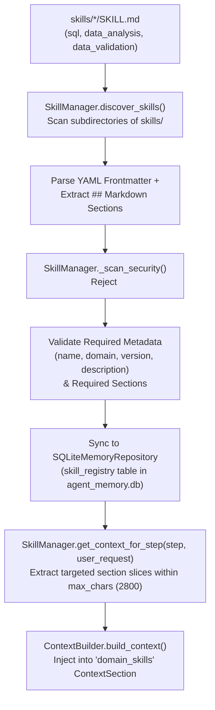

# Chapter 12 — Skills and Domain Knowledge Subsystem

## 1. Purpose of the Skill Subsystem (`agent/skill_manager.py` & `agent/skill_models.py`)

Rather than embedding thousands of lines of SQL syntax rules, analytical formulas, and chart validation heuristics into a monolithic static system prompt, the Local Report SQL Agent modularizes domain expertise into **versioned Markdown skill packages** under `skills/<domain>/SKILL.md`.

`SkillManager` (`agent/skill_manager.py`) discovers, parses, validates, security-scans, and selectively slices these skills so `ContextBuilder` injects only the domain knowledge relevant to the current `ExecutionStage` and `TaskStep`.

---

## 2. Skill Discovery, Validation, and Slice Injection Pipeline

The diagram above traces how `SkillManager` loads `SKILL.md` files from disk, validates their structure and security, synchronizes metadata to `data/agent_memory.db`, and extracts compact context slices per step.

---

## 3. Bundled Domain Skills (`skills/*/SKILL.md`)

The repository bundles three authoritative domain skills:

| Skill ID / Domain | File Path | Version | Applicable Stages | Required Markdown Sections & Key Guidance |
| :--- | :--- | :--- | :--- | :--- |
| **`sql`** (`sql_generation_and_validation`) | `skills/sql/SKILL.md` | `1.0.0` | `SCHEMA_DISCOVERY`, `SQL_GENERATION`, `SQL_VALIDATION` | `## Purpose`, `## Rules`, `## Instructions`, `## Examples`, `## Constraints`: Enforces SQLite dialect (`STRFTIME`, `JULIANDAY`, `COALESCE`), grain-safe joins (`orders` header vs. `order_items` line grain), half-open date intervals (`>= start AND < end`), and read-only `SELECT`/`WITH` rules. |
| **`data_analysis`** (`analytical_aggregation_and_kpis`) | `skills/data_analysis/SKILL.md` | `1.0.0` | `DATA_ANALYSIS`, `CHART_PLANNING` | `## Purpose`, `## Rules`, `## Instructions`, `## Metrics & KPIs`: Defines Gross Sales (`SUM(oi.line_total)`), Order Header Revenue (`SUM(o.total_amount)`), Captured Payment Revenue (`SUM(p.amount) WHERE p.status = 'captured'`), Average Order Value (`AOV`), Item Return Rate, and Average Transit Days. |
| **`data_validation`** (`data_and_chart_validation`) | `skills/data_validation/SKILL.md` | `1.0.0` | `CHART_PLANNING`, `REPORT_GENERATION`, `FINAL_RESPONSE` | `## Purpose`, `## Rules`, `## Instructions`, `## Validation Checks`: Enforces `CanonicalSQLDataset` Single Source of Truth, chart-type selection rules across all 22 supported chart types, non-negative pie/donut validation, and zero-row graceful reporting. |

---

## 4. Security Scanning (`_DANGEROUS_PATTERNS` & `_FORBIDDEN_SQL_PATTERNS`)

Because skill files are injected into the LLM system prompt, `SkillManager._scan_security(content)` enforces strict content guardrails before any skill is marked `SkillValidationStatus.VALID`:
1. **Prompt Injection & Script Blocking (`_DANGEROUS_PATTERNS`)**: Rejects `<script`, `javascript:`, `eval(`, `exec(`, `__import__`, `os.system`, `subprocess.Popen`, `ignore previous instructions`, and `disregard all system rules`.
2. **Destructive SQL Blocking (`_FORBIDDEN_SQL_PATTERNS`)**: Rejects any skill containing `DROP TABLE`, `DELETE FROM`, `TRUNCATE TABLE`, `ALTER TABLE`, `INSERT INTO`, `UPDATE ... SET`, or `ATTACH DATABASE`.
3. **Malformed YAML / Missing Sections**: Raises `MalformedSkillError` (when `strict=True`) or marks the skill `INVALID` in `SkillDiscoveryReport` so corrupted skills are never injected into `ContextBuilder`.
