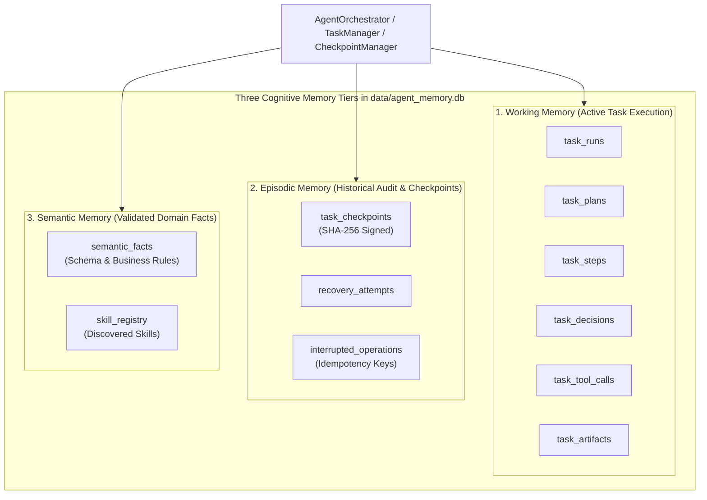

# Chapter 13 — Memory Architecture, Checkpoints, and Task Recovery

## 1. Three-Tier Persistent Memory Architecture (`memory/`)

The Local Report SQL Agent implements a persistent, ACID-compliant memory subsystem in `memory/repository.py` (`SQLiteMemoryRepository`) and `memory/models.py`, backed by a dedicated SQLite database at `data/agent_memory.db` running in **Write-Ahead Logging (`PRAGMA journal_mode = WAL`)** mode.

> **Critical Security Invariant**: `SQLiteMemoryRepository.__init__()` explicitly verifies `self.db_path.resolve() != resolve_path("data/ecommerce.db").resolve()`, raising a `ValueError` if any caller attempts to point agent memory at the immutable analytical database.



The diagram above shows how the 11 tables in `data/agent_memory.db` (created across migrations `001_initial_schema.sql`, `002_checkpoint_recovery.sql`, and `003_skill_registry_enhancements.sql`) map to Working Memory, Episodic Memory, and Semantic Memory.

---

## 2. Database Schema of `data/agent_memory.db`

| Migration | Table Name | Primary Key | Foreign Key / Cascade | Purpose |
| :--- | :--- | :--- | :--- | :--- |
| `001` | `schema_migrations` | `version` (`INTEGER`) | — | Tracks applied migration scripts (`1`, `2`, `3`). |
| `001` | `task_runs` | `task_id` (`TEXT`) | — | Root record for every `AgentTask` (`user_request`, `status`, `current_step`, `error`, `metadata`). |
| `001` | `task_plans` | `plan_id` (`TEXT`) | `task_id -> task_runs(task_id) ON DELETE CASCADE` | Stores `TaskPlan` rationale and metadata (`UNIQUE(task_id)`). |
| `001` | `task_steps` | `step_id` (`TEXT`) | `task_id -> task_runs(task_id) ON DELETE CASCADE` | Stores DAG `TaskStep` records (`step_order`, `required_skill`, `required_tools`, `dependencies`, `status`, `output_reference`). |
| `001` | `task_decisions` | `decision_id` (`TEXT`) | `task_id -> task_runs(task_id) ON DELETE CASCADE` | Stores `TaskDecision` reasoning choices (`decision_type`, `summary`, `rationale`). |
| `001` | `task_tool_calls` | `call_id` (`TEXT`) | `task_id -> task_runs(task_id) ON DELETE CASCADE` | Audit trail of MCP tool calls (`tool_name`, sanitized `arguments`, `result_summary`, `duration_ms`, `status`). |
| `001` | `task_artifacts` | `artifact_id` (`TEXT`) | `task_id -> task_runs(task_id) ON DELETE CASCADE` | Pointers to generated PDF/CSV files (`artifact_type`, `file_path`, `file_size_bytes`, SHA-256 `checksum`). |
| `001` | `semantic_facts` | `fact_id` (`TEXT`) | — | Validated schema/domain truths (`category`, `subject`, `fact`, `provenance`, `is_validated`). |
| `001` & `003` | `skill_registry` | `skill_id` (`TEXT`) | — | Metadata and activation state (`is_enabled`, `last_discovered_at`) for discovered `SKILL.md` packages. |
| `002` | `task_checkpoints` | `checkpoint_id` (`TEXT`) | `task_id -> task_runs(task_id) ON DELETE CASCADE` | Immutable snapshots with strictly incrementing `sequence_number` and deterministic SHA-256 `checksum`. |
| `002` | `recovery_attempts` | `attempt_id` (`TEXT`) | `task_id -> task_runs`, `checkpoint_id -> task_checkpoints` | Audit log of every `recover_task()` execution (`policy`, `status`, `failure_reason`, `details`). |
| `002` | `interrupted_operations` | `operation_id` (`TEXT`) | `task_id -> task_runs(task_id) ON DELETE CASCADE` | Idempotency tracking (`UNIQUE(task_id, operation_key)`) for in-flight SQL and report operations. |

---

## 3. Cryptographic Checkpointing (`agent/checkpoint_models.py` & `agent/checkpoint_manager.py`)

`CheckpointManager.create_checkpoint()` records a `TaskCheckpoint` at 11 lifecycle boundaries (`CheckpointType`: `TASK_CREATED`, `PLAN_READY`, `STEP_STARTED`, `STEP_COMPLETED`, `STEP_FAILED`, `APPROVAL_REQUESTED`, `APPROVAL_RESOLVED`, `ARTIFACT_GENERATED`, `TASK_COMPLETED`, `RECOVERY_STARTED`, `RECOVERY_COMPLETED`).

Each `TaskCheckpoint` computes a deterministic SHA-256 digest over its canonical JSON payload (sorted keys, excluding the `checksum` field itself):
```python
data = self.model_dump(mode="json", exclude={"checksum"})
serialized = json.dumps(data, sort_keys=True, separators=(",", ":"), ensure_ascii=False)
checksum = hashlib.sha256(serialized.encode("utf-8")).hexdigest()
```

Before restoring any checkpoint, `RecoveryValidator.validate_checkpoint()` verifies:
1. **Cryptographic Integrity**: `checkpoint.verify_checksum() == True` (rejects tampered or truncated payloads with `CorruptedCheckpointError`).
2. **Schema Version Compatibility**: `checkpoint.schema_version <= CURRENT_CHECKPOINT_SCHEMA_VERSION` (`1`).
3. **DAG Consistency**: Every step in `completed_step_ids` exists in the task and all of its mandatory `dependencies` are also in `completed_step_ids`.
4. **Filesystem Artifact Integrity**: Every artifact referenced in `checkpoint.artifact_ids` exists on disk, is non-empty, and matches its recorded SHA-256 file checksum.

---

## 4. Deterministic Crash Recovery Engine (Scenarios A through F)

`CheckpointManager.recover_task(task_id, policy)` handles six failure scenarios across three `RecoveryPolicy` modes (`AUTOMATIC_SAFE`, `REQUIRE_CONFIRMATION` [Default], and `MANUAL_ONLY`):

| Scenario | Interrupted State | Recovery Action in `CheckpointManager.recover_task()` |
| :--- | :--- | :--- |
| **Scenario A: Closed Between Tasks** | `task.status == PENDING` and no steps executed | Restores task cleanly to `PENDING` ready for fresh execution. |
| **Scenario B: Crashed During Planning** | `task.status == PLANNING` | Reuses persisted `task.plan` if complete; otherwise resets task status to `PENDING` to re-run planning cleanly. |
| **Scenario C: Crashed Between Steps** | Valid `STEP_COMPLETED` / `STEP_STARTED` checkpoint | Skips any corrupted tail checkpoints, restores last verified ancestor checkpoint, resets any in-flight `RUNNING` step to `READY`, and advances the next dependency-satisfied step to `READY`. |
| **Scenario D: Interrupted SQL Execution** | `interrupted_operations` has `sql_execution` in `STARTED` state | Marks operation `INTERRUPTED` and schedules safe re-execution (since all SQL against `ecommerce.db` is strictly read-only and idempotent). |
| **Scenario E: Interrupted Report Generation** | `interrupted_operations` has `report_generation` in `STARTED` state | Checks if the target PDF/CSV artifact already exists on disk and passes validation; if valid, reuses the artifact without regenerating (`reusable_artifacts`), otherwise schedules safe regeneration. |
| **Scenario F: Interrupted During Approval** | `task_status == WAITING_FOR_APPROVAL` or `pending_approval != None` | Restores `WAITING_FOR_APPROVAL` state on both task and step, sets `requires_user_action=True`, and never auto-executes an unapproved query. |
