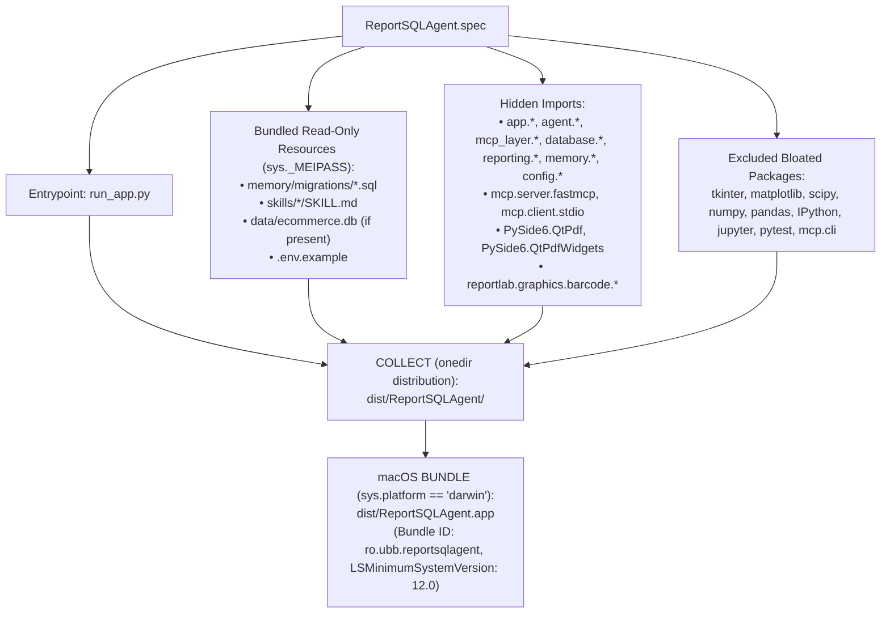

# Chapter 15 — Cross-Platform Packaging (macOS & Windows)

## 1. PyInstaller Packaging Architecture (`ReportSQLAgent.spec`)

The project packages into a standalone desktop application for both **macOS (`ReportSQLAgent.app` + standalone folder)** and **Windows (`dist\ReportSQLAgent\ReportSQLAgent.exe`)** using a unified PyInstaller specification (`ReportSQLAgent.spec`) and automated build scripts (`scripts/build_macos.sh` and `scripts/build_windows.ps1`).

The diagram above illustrates how `ReportSQLAgent.spec` assembles the Python 3.13 runtime, PySide6/QtPdf libraries, MCP server modules, ReportLab fonts, SQL migrations, domain skills, and `ecommerce.db` into an isolated `onedir` distribution and macOS `.app` bundle.

---

## 2. Dual-Mode Binary Dispatch (`--mcp-server`)

When packaged by PyInstaller, there is no external `python` interpreter on the target user's machine. To allow `MCPClientManager` to spawn the child MCP server subprocess inside a frozen bundle:
1. `MCPClientManager._build_server_params()` (`mcp_layer/client.py`) checks `is_frozen()` (`getattr(sys, "frozen", False)`).
2. When `is_frozen()` is `True`, it launches `sys.executable` with `args = ["--mcp-server"]`.
3. `app.main:main()` (`app/main.py`) checks `if "--mcp-server" in args:` at line 93 before initializing Qt or `QApplication`, and immediately delegates to `mcp_layer.server:run_stdio_server()`.

---

## 3. Frozen vs. Source Path Resolution (`config/paths.py`)

Operating systems prohibit writing mutable files (`settings.json`, `agent_memory.db`, generated PDFs/CSVs, or rotating logs) inside signed application bundles (`/Applications/ReportSQLAgent.app` on macOS or `C:\Program Files\ReportSQLAgent` on Windows). `config/paths.py` enforces a clean separation between **read-only bundled resources** and **mutable user data**:

| Path Helper in `config/paths.py` | Source Checkout (`is_frozen() == False`) | Packaged App on macOS (`is_frozen() == True`) | Packaged App on Windows (`is_frozen() == True`) |
| :--- | :--- | :--- | :--- |
| `resource_root()` (Read-only assets: `memory/migrations/*.sql`, `skills/*/SKILL.md`, bundled template `ecommerce.db`) | `<repo_root>/` | `sys._MEIPASS` (`ReportSQLAgent.app/Contents/Resources` or `Frameworks`) | `sys._MEIPASS` (`dist\ReportSQLAgent\_internal`) |
| `user_data_root()` (Mutable runtime files) | `<repo_root>/` | `~/Library/Application Support/ReportSQLAgent/` | `%APPDATA%\ReportSQLAgent\` |
| `get_settings_path()` | `<repo_root>/settings.json` | `~/Library/Application Support/ReportSQLAgent/settings.json` | `%APPDATA%\ReportSQLAgent\settings.json` |
| `get_memory_database_path()` | `<repo_root>/data/agent_memory.db` | `~/Library/Application Support/ReportSQLAgent/data/agent_memory.db` | `%APPDATA%\ReportSQLAgent\data\agent_memory.db` |
| `resolve_path("data/ecommerce.db")` | `<repo_root>/data/ecommerce.db` | Resolves to bundled `sys._MEIPASS/data/ecommerce.db` (since read-only file exists in bundle) | Resolves to bundled `sys._MEIPASS\data\ecommerce.db` |
| `resolve_path("reports")` & `resolve_path("logs")` | `<repo_root>/reports/`, `<repo_root>/logs/` | `~/Library/Application Support/ReportSQLAgent/reports/` & `logs/` | `%APPDATA%\ReportSQLAgent\reports\` & `logs\` |

---

## 4. Automated Build & Verification Scripts

### macOS Build Pipeline (`scripts/build_macos.sh`)
Executes a 5-stage build and post-packaging validation pipeline:
1. Runs `.venv/bin/python scripts/verify_environment.py --build` (verifies Python 3.13, packages, MCP SDK, and `data/ecommerce.db` SHA-256 checksum).
2. Runs the offline `pytest` suite.
3. Cleans `build/` and `dist/`.
4. Invokes `.venv/bin/pyinstaller --clean --noconfirm ReportSQLAgent.spec`.
5. Validates the built `dist/ReportSQLAgent.app`:
   - Tests `--mcp-server` stdio JSON-RPC handshake directly against `ReportSQLAgent.app/Contents/MacOS/ReportSQLAgent --mcp-server`.
   - Verifies that `memory/migrations/001_initial_schema.sql` and `skills/sql/SKILL.md` are bundled inside `Contents/Resources` or `Contents/Frameworks`.
   - Runs `QT_QPA_PLATFORM=offscreen ReportSQLAgent.app/Contents/MacOS/ReportSQLAgent --smoke-test` to verify full GUI and SQLite migration startup.

### Windows Build Pipeline (`scripts/build_windows.ps1`)
Executes the equivalent 5-stage PowerShell workflow on Windows:
1. Verifies `.venv\Scripts\python.exe` and `PyInstaller>=6.10`.
2. Runs `scripts\verify_environment.py --build`.
3. Runs the automated `pytest` suite.
4. Cleans `build\` and `dist\` and runs `PyInstaller --clean --noconfirm ReportSQLAgent.spec`.
5. Verifies `dist\ReportSQLAgent\ReportSQLAgent.exe`.
