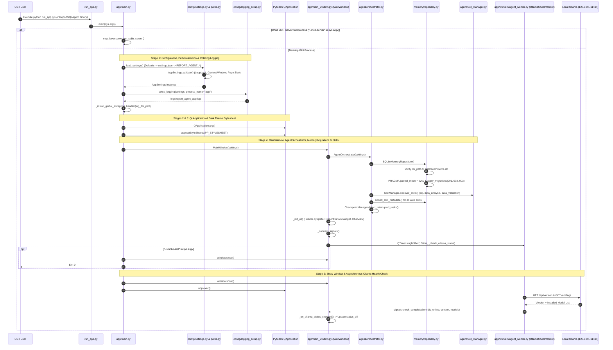

# Knowledge Graph 02 — Application Startup Sequence

## 1. End-to-End Application Initialization Sequence

The sequence diagram above captures every startup interaction from process launch (`run_app.py`) through `AppSettings.validate()`, `SQLiteMemoryRepository` schema migrations, `SkillManager` discovery, and the non-blocking `OllamaCheckWorker` health check.

---

## 2. Startup Invariants and Guarantees

1. **Zero UI Blocking on Startup**: `MainWindow.__init__()` schedules `_check_ollama_status()` via `QTimer.singleShot(100, ...)` on `OllamaCheckWorker` (`QThread`), and defers MCP subprocess spawn (`AgentOrchestrator.initialize()`) until the first `process_message()` call on `AgentWorker`. As a result, the desktop window appears in `< 300 ms` even if Ollama is offline.
2. **Early Crash Persistence**: If an unhandled exception occurs before `setup_logging()` finishes, `run_app.py:_fallback_log_fatal(exc)` writes the traceback to `user_data_root() / "logs" / "startup_crash.log"`.
3. **Database Separation Check at Boot**: `SQLiteMemoryRepository.__init__()` immediately verifies that the writable `agent_memory.db` path does not point to `data/ecommerce.db` before opening any SQLite connection.
