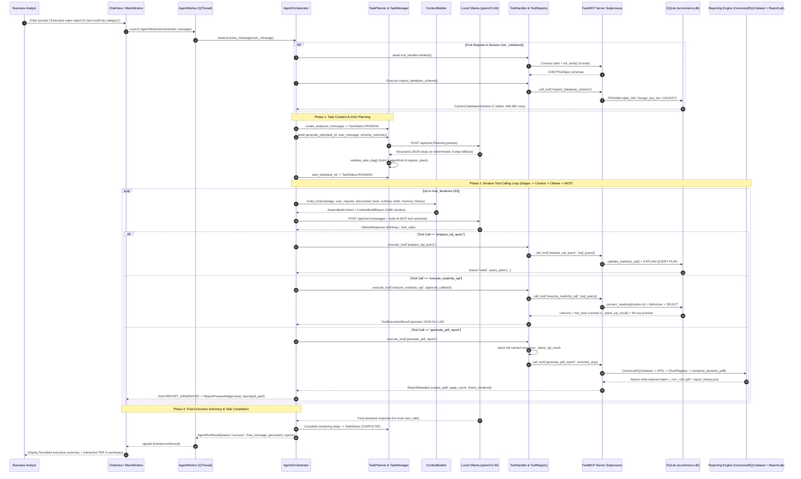

# Knowledge Graph 03 — End-to-End User Request to Report Sequence

## 1. Complete Multi-Turn Request-to-Report Execution Trace

The sequence diagram above traces the complete lifecycle of a user reporting prompt across all 11 runtime participants.

---

## 2. Data Handoff Checkpoints Along the Pipeline

1. **Schema Handoff**: `inspect_database_schema` caches `self._cached_schema_text` on `AgentOrchestrator` and seeds `semantic_facts` in `data/agent_memory.db` so subsequent turns do not need redundant schema queries.
2. **Full-Row Dataset Handoff**: `execute_readonly_sql` returns both `records` (capped at `llm_preview_rows = 50` for the LLM context window) and `full_rows` (up to `100,000` rows), which `ToolHandler` stores in `self._latest_sql_result` and `self._sql_datasets` and automatically forwards into `generate_pdf_report` / `generate_csv_report`.
3. **Artifact Handoff**: As soon as `generate_pdf_report` or `generate_csv_report` completes, `AgentOrchestrator` emits `AgentEventType.REPORT_GENERATED`, allowing `MainWindow._on_report_generated()` to load the PDF into `ReportPreviewWidget` immediately while the LLM writes its final narrative response.
