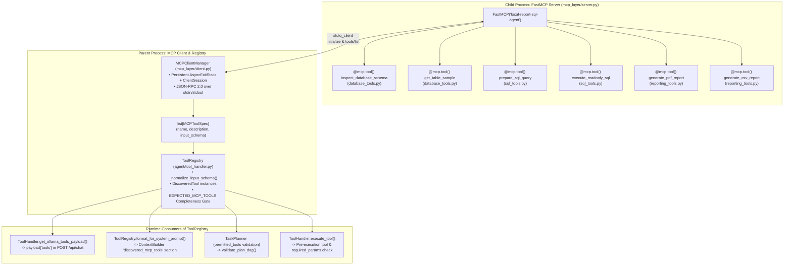
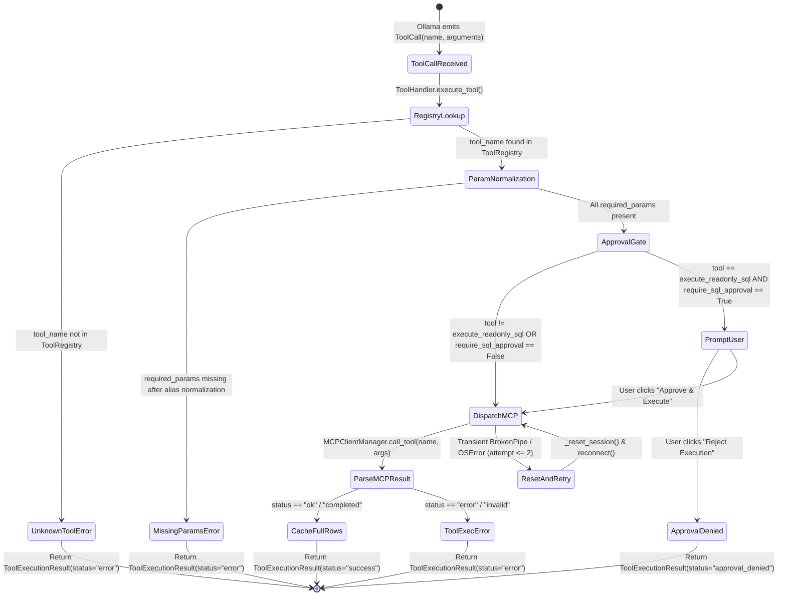

# Knowledge Graph 04 — MCP Tool Discovery and Execution Flow

## 1. MCP Discovery, Registration, and Schema Propagation Graph

The graph above illustrates how the 6 `@mcp.tool()` definitions in the child `FastMCP` server subprocess are discovered once via `MCPClientManager.list_tools()`, validated in `ToolRegistry`, and distributed to four consumers: `OllamaClient` (`payload["tools"]`), `ContextBuilder` (`discovered_mcp_tools` prompt section), `TaskPlanner` (`permitted_tools`), and `ToolHandler.execute_tool()`.

---

## 2. MCP Tool Invocation State Machine

The state machine diagram above traces every validation gate, retry path, and return status inside `ToolHandler.execute_tool()` and `MCPClientManager.call_tool()`.
