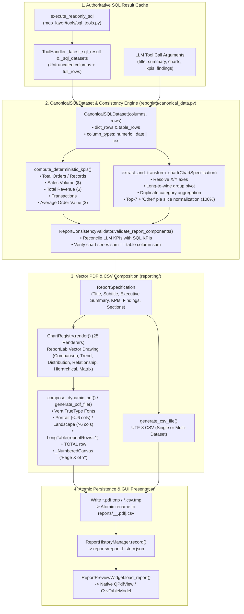
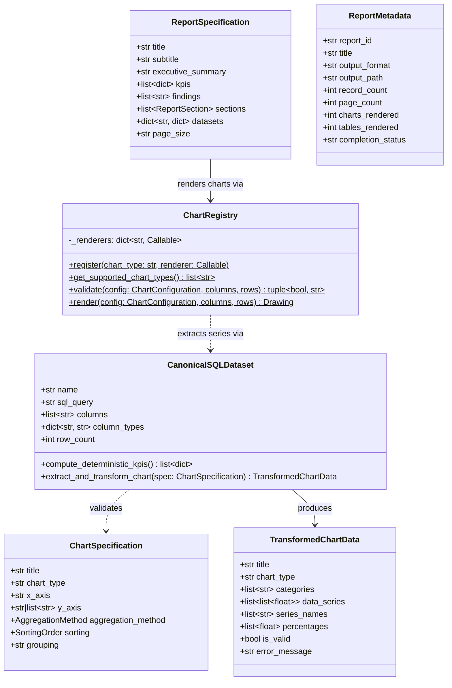

# Knowledge Graph 06 — Report Generation and Canonical Data Flow

## 1. Authoritative Data Transformation & Rendering Pipeline

The data-flow graph above illustrates how `ToolHandler`, `CanonicalSQLDataset`, `ReportConsistencyValidator`, `ChartRegistry`, and `compose_dynamic_pdf()` collaborate to guarantee zero numerical hallucination between SQLite rows and the rendered PDF/CSV report.

---

## 2. Class Hierarchy of the Reporting Engine (`classDiagram`)

The class diagram above shows the structural contracts connecting `CanonicalSQLDataset`, `ChartSpecification`, `TransformedChartData`, `ReportSpecification`, `ChartRegistry`, and `ReportMetadata`.
