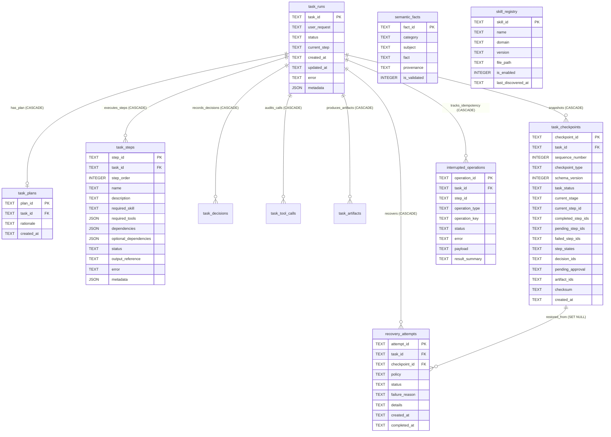
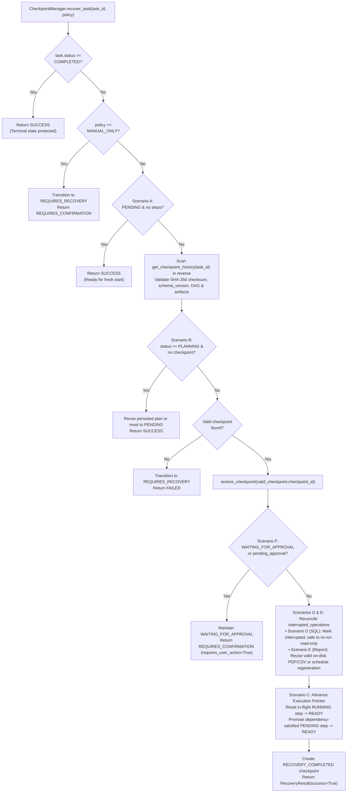

# Knowledge Graph 08 — Agent Memory Schema and Crash Recovery

## 1. Persistent Memory Entity-Relationship Diagram (`data/agent_memory.db`)

The entity-relationship diagram above shows the relational schema of `data/agent_memory.db` across migrations `001`, `002`, and `003`.

---

## 2. Deterministic Task Recovery Flow (Scenarios A through F)

The recovery decision flowchart above traces how `CheckpointManager.recover_task()` (`agent/checkpoint_manager.py`) handles Scenarios A through F while verifying SHA-256 checkpoint integrity and protecting human approval gates.
