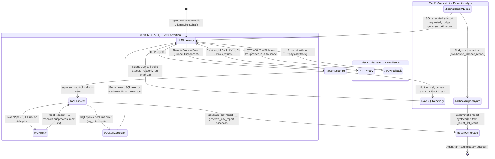

# Knowledge Graph 09 — Error Handling, Self-Correction, and Retries

## 1. Multi-Tier Error Recovery and Self-Correction State Machine

The state machine diagram above illustrates the three concentric resilience tiers:
1. **Tier 1 (Ollama HTTP Resilience)**: Retries transient `RemoteProtocolError` socket drops with exponential backoff and automatically downgrades from native `tools` to JSON fallback mode if a model returns HTTP 400.
2. **Tier 2 (Orchestrator Prompt Nudges & Deterministic Synthesis)**: Recovers when a small model outputs raw SQL instead of a tool call (`_extract_raw_sql_from_text`) or forgets to invoke `generate_pdf_report` after fetching SQL rows (`_synthesize_fallback_report`).
3. **Tier 3 (MCP Reconnection & SQL Self-Correction)**: Automatically respawns broken MCP stdio sessions (`_reset_session`) and feeds SQLite syntax/column errors back to the model for up to `max_sql_retries = 3` self-correction turns.

---

## 2. Error Classification and Containment Table

| Error Class | Raised By | Contained By | User-Visible Outcome |
| :--- | :--- | :--- | :--- |
| `OllamaConnectionError` | `OllamaClient._post_chat_with_retry()` | `AgentOrchestrator.process_message()` → `MainWindow._on_agent_error()` | Friendly chat system message: *"Cannot connect to Ollama. Please ensure Ollama is running (`ollama serve`)."* |
| `OllamaModelNotFoundError` | `OllamaClient._post_chat_with_retry()` | `AgentOrchestrator.process_message()` | Actionable prompt to run `ollama pull qwen3.5:4b`. |
| `MCPConnectionError` / `MCPToolExecutionError` | `MCPClientManager` / `ToolHandler` | `_reset_session()` retry (2x); if fatal, surfaces in `AgentRunResult(status="error")` | Clear error message in chat + red `Error` card in `AgentActivityInspectorWidget`. |
| `UnsafeQueryError` / `InvalidQueryError` | `validate_readonly_sql()` / `execute_readonly_query()` | Caught in `mcp_layer/tools/sql_tools.py`, returned as `{"status": "error", "error": ...}` | LLM self-corrects SQL query on next iteration (up to `3` retries). |
| `QueryTimeoutError` | `_progress_watchdog()` in `database/query_executor.py` | Returned as structured tool error | Prevents runaway joins from hanging the app; LLM simplifies query. |
| `QueryCancelledError` / `asyncio.CancelledError` | `cancel_event.is_set()` in `AgentWorker` / `AgentOrchestrator` | Transitions task to `TaskStatus.CANCELLED` | Chat displays `"⏹️ Workflow was cancelled by user."` |
