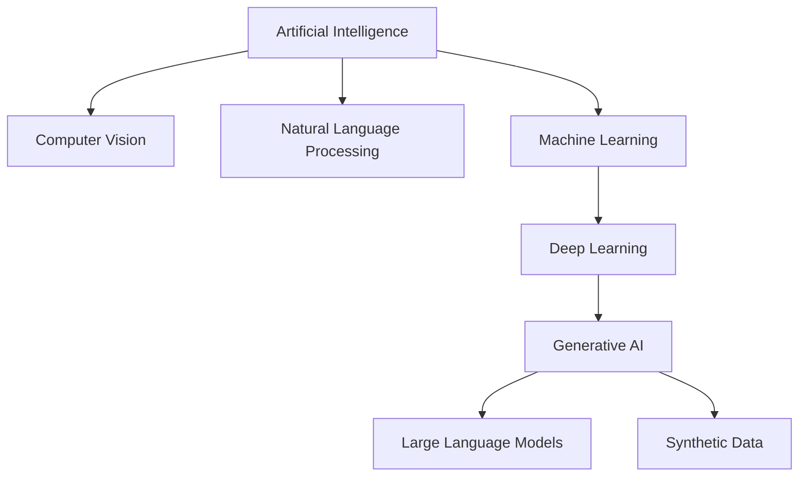
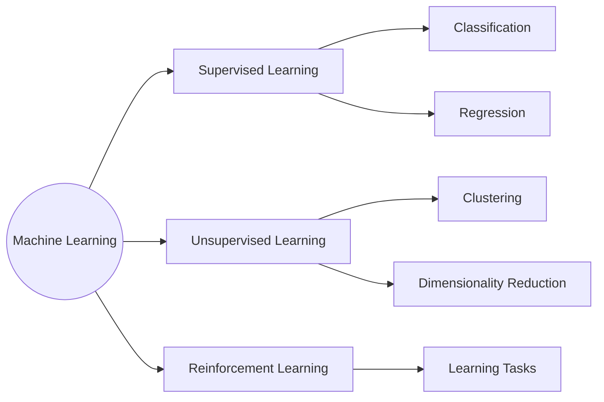
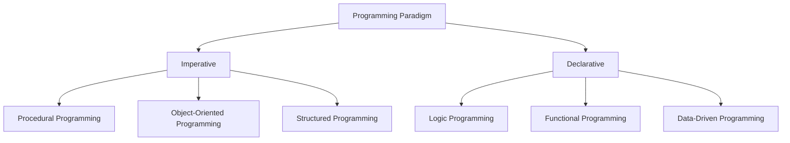
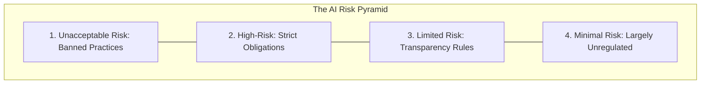
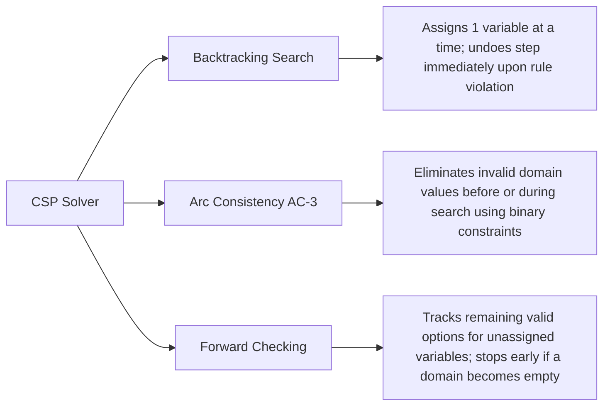
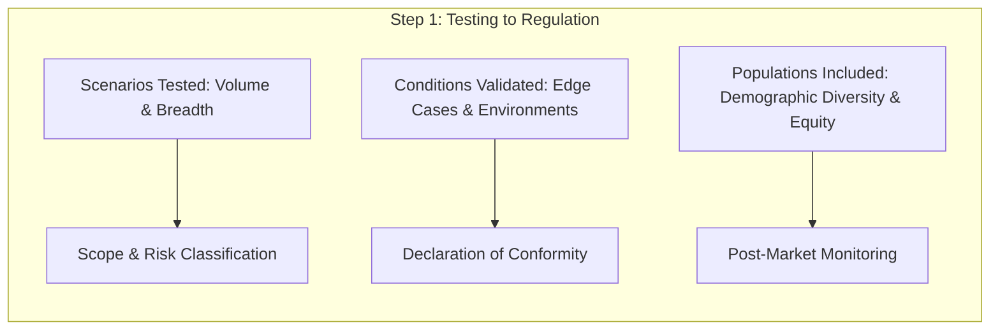
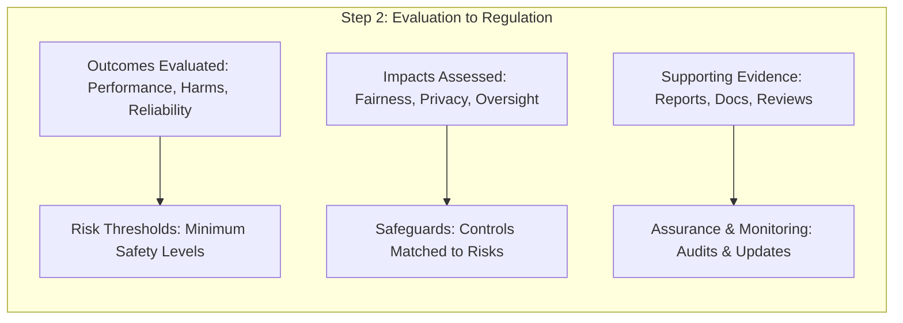

# DPML Course 1: Study Guide

## 1.1 Artificial Intelligence (AI) & Machine Learning (ML) Overview

### Core Concepts & Definitions
* **Artificial Intelligence (AI):** A broad field of computer science dedicated to creating systems capable of performing tasks that typically require human intelligence.
* **Machine Learning (ML):** A subset of AI that enables systems to learn and improve from experience (data) automatically without being explicitly programmed.
* **Deep Learning (DL):** A subset of ML that uses artificial neural networks with multiple layers to model and solve complex problems.
* **Generative AI (GenAI) / Generative Models:** A subset of DL consisting of models designed to generate new, previously unseen data (e.g., text, images, **Synthetic Data**) that is similar to their training data. Includes **Large Language Models (LLMs)**.
* **Computer Vision (CV):** Enables machines to interpret and understand the visual world (images and video) just like humans do.
* **Natural Language Processing (NLP):** Deals with the interaction between computers and humans using natural human language.
* **Predictive Maintenance:** Utilizes data and ML algorithms to predict when equipment or machinery is likely to fail so maintenance can be performed proactively.
* **Edge AI:** The deployment of AI algorithms and models directly on local devices at the edge of a network, such as Internet of Things (IoT) devices, rather than in a centralized cloud.



---

### Machine Learning Paradigms

ML is divided into three main learning paradigms based on how a model learns from data:



| Paradigm | Sub-Category | Core Purpose | Key Applications |
| :--- | :--- | :--- | :--- |
| **Supervised Learning** *(Learns from labeled data)* | **Classification** | Assigns data into specific categories. | Image Classification, Fraud Detection, Customer Retention, Diagnostics. |
| | **Regression** | Predicts continuous numerical values. | Forecasting, Predictions, Process Optimization, Generating New Insights. |
| **Unsupervised Learning** *(Finds hidden patterns in unlabeled data)* | **Clustering** | Groups similar data points together. | Recommender Systems, Targeted Marketing, Customer Segmentation. |
| | **Dimensionality Reduction** | Reduces the number of variables while keeping important data. | Meaningful Compression, Big Data Visualization, Feature Elicitation, Structure Discovery. |
| **Reinforcement Learning** *(Agent learns via trial, error, and rewards)* | **Decision & Control Tasks** | An agent interacts with an environment and receives rewards or punishments for actions. | Real-Time Decisions, Game AI, Robot Navigation, Skill Acquisition. |

---

## 1.2 Programming Paradigms in AI & ML

A **Programming Paradigm** is a fundamental style or approach to building and structuring computer programs.



* **Imperative Programming:** Focuses on *how* a program operates by giving the computer a step-by-step sequence of instructions to change its state.
* **Declarative Programming:** Focuses on *what* the program should accomplish without specifying the exact step-by-step control flow.
  * **Examples in AI:** Logic & Rule-Based AI (e.g., Prolog, CLisp), Constraint Satisfaction Problems (CSPs), and Prompt Engineering.

### Integration of Logic Programming in AI/ML
**Logic Programming** uses formal logic (facts and rules) to represent knowledge and solve problems through reasoning.
* **Symbolic Reasoning:** Using high-level symbols (words, concepts) to represent and solve problems logically.
* **Prolog Language:** A declarative logic programming language designed specifically for symbolic reasoning tasks.
* **Knowledge Representation:** The structured way information, facts, and rules are stored and organized so a computer can use them to reason.
* **Expert Systems:** Computer systems that emulate the decision-making ability of a human expert by applying inference rules to a knowledge base.
* **Natural Language Understanding (NLU):** A branch of NLP focused on enabling a computer to comprehend the meaning and grammar of human language.
* **Hybrid AI Systems:** Systems that combine different AI approaches (e.g., combining symbolic logic programming with neural networks) for better performance and interpretability.

### Functional Programming in AI/ML
**Functional Programming** builds programs by applying and composing pure mathematical functions, avoiding shared state and mutable data.

| Feature | Definition & Benefit in AI/ML |
| :--- | :--- |
| **Map-Reduce Operations** | High-level functions that process large datasets by mapping an operation across items and reducing the results into a summary. Enables concise expression of data operations. |
| **Parallelism Support** | Executing multiple computations at the same time. Facilitates efficient use of GPU clusters for training large models. |
| **Functional APIs** | Application Programming Interfaces built around functions. Provides clean and concise model creation (e.g., in deep learning frameworks). |
| **Modularity** | Breaking down complex tasks into smaller, independent, manageable parts that are easy to test and reuse. |
| **Immutability** | A rule where data cannot be modified after it is created. Ensures original data remains unchanged, preventing accidental side effects during data processing. |

---

## 1.3 Constraint Satisfaction Problems (CSPs)

A **Constraint Satisfaction Problem (CSP)** is a mathematical problem defined as a set of objects whose state must satisfy a number of rules or limitations. CSPs are a core application of declarative programming (e.g., solving the **Zebra Puzzle / Einstein's Riddle** in Prolog).

### Formal Components of a CSP
Every CSP consists of three core elements:
1. **Variables ($V$):** The unknown items, positions, or entities that need to be determined (e.g., $V = \{X_1, X_2, \dots, X_n\}$ such as House 1, House 2, or Person 1).
2. **Domains ($D$):** The set of possible values that each variable is allowed to take (e.g., Colors: Red, Green, Blue; or Pets: Dog, Fox, Zebra).
3. **Constraints ($C$):** The rules that restrict which values can be assigned to which variables at the same time.

### Types of Constraints
* **Unary Constraint:** Restricts the value of a single variable.
  * *Formula/Example:* $X_1 \neq 3$
* **Binary Constraint:** Relates two variables to each other.
  * *Formula/Example:* $X_1 > X_2$
* **Global (N-ary) Constraint:** Relates three or more (multiple) variables at once.
  * *Formula/Example:* $\text{alldifferent}(X_1, X_2, X_3)$ (meaning $X_1, X_2,$ and $X_3$ must all take different values).

### Real-World Examples of CSPs

### Real-World Examples of CSPs

| Application Domain | Variables (V) | Domain (D) | Constraints (C) |
|---|---|---|---|
| **Sudoku** | Grid cells (9 × 9) | Digits 1–9 | No repeated numbers in any row, column, or 3 × 3 box. |
| **Scheduling** | Tasks / Classes | Time slots, rooms, teachers | No double-booking of rooms or instructors; course prerequisites must be met. |
| **Map Coloring** | Map regions | Set of colors (e.g., Red, Green, Blue) | Neighboring regions sharing a border cannot share the same color. |
| **N-Queens Problem** | Board locations of N queens | Chessboard coordinates | No two queens can share the same row, column, or diagonal. |

### CSP Solving Techniques
Instead of checking every possible combination (brute-force search), CSP solvers combine systematic search with **constraint propagation** (using constraints to rule out invalid options early):

1. **Backtracking Search:** A depth-first search algorithm that assigns values to one variable at a time. As soon as an assignment violates a constraint, it undoes the last step ("backtracks") and tries a different value.
2. **Arc Consistency (AC-3):** A preprocessing or in-search algorithm that reduces the search space by removing values from variable domains that cannot possibly satisfy binary constraints with neighboring variables.
3. **Forward Checking:** A look-ahead technique used during search that tracks the remaining valid values for unassigned variables. If any unassigned variable runs out of valid domain options, the search backtracks immediately.

---

## 1.4 Trustworthy AI & The EU AI Act

**Trustworthy AI** refers to designing and deploying AI systems that are lawful, ethical, safe, and transparent.

### The EU Artificial Intelligence Act
The **EU AI Act** is the world's first comprehensive legal framework regulating artificial intelligence. It establishes harmonized rules across the European Union by classifying AI systems according to their **risk level**, where legal obligations increase based on the potential for harm to human rights and safety.



| Risk Level | Regulatory Stance | Description & Examples |
| :--- | :--- | :--- |
| **1. Unacceptable Risk** | **Banned Practices** | Systems considered a clear threat to people's safety, livelihoods, and fundamental rights are strictly prohibited. <br>*Examples:* Social scoring, cognitive behavioral manipulation, real-time remote biometric (facial) recognition in public spaces. |
| **2. High-Risk** | **Strict Obligations** | AI systems that can negatively affect safety or fundamental rights must undergo strict conformity assessments, risk management, and human oversight before deployment. <br>*Examples:* AI used in law enforcement, critical infrastructure, recruitment, medical devices, or education. |
| **3. Limited Risk** | **Transparency Rules** | Systems must adhere to specific transparency obligations so users know they are interacting with AI or viewing AI-generated content. <br>*Examples:* Generative AI, chatbots, and deepfakes. |
| **4. Minimal Risk** | **Largely Unregulated** | The vast majority of AI systems that pose little to no risk to citizens' rights or safety remain free from new legal obligations. <br>*Examples:* AI-enabled video games, spam filters. |

### Phased Rollout: Key Compliance Dates
* **February 2025 (Ban on Prohibited AI):** Rules banning AI systems that pose *Unacceptable Risks* begin to apply.
* **August 2025 (General-Purpose AI Rules):** Obligations and transparency requirements for *General-Purpose AI (GPAI)* models take effect.
* **August 2026 – 2027 (High-Risk System Rules):** Most remaining provisions, including strict rules for *High-Risk AI systems*, become fully applicable.

---

# DPML Course 2: Declarative Programming & CSPs Study Guide

## 2.1 Constraint Satisfaction Problems (CSP) Fundamentals

A **Constraint Satisfaction Problem (CSP)** is a mathematical problem where the goal is to find values for a set of objects that satisfy a specific set of rules or limitations.

### Core Components
1. **Variables ($V$):** The unknown items, positions, or entities that need to be determined (e.g., House 1, House 2, or Person 1, Person 2).
2. **Domains ($D$):** The set of possible values that each variable is allowed to take (e.g., Colors: Red, Green, Blue, Yellow, Ivory; Pets: Dog, Snails, Fox, Horse, Zebra).
3. **Constraints ($C$):** The rules that restrict which values can be assigned to which variables at the same time.

### Common Types of Constraints
* **Unary Constraint:** Relates to a single variable.
  * *Formula:* $X_1 \neq 3$
* **Binary Constraint:** Relates two variables to each other.
  * *Formula:* $X_1 > X_2$
* **Global / N-ary Constraint:** Relates three or more variables at once.
  * *Formula:* $\text{alldifferent}(X_1, X_2, X_3)$ (states that all listed variables must have unique values).

---

## 2.2 Common CSP Solving Techniques

Instead of using brute-force search (checking every possible combination blindly), algorithms solve CSPs efficiently by combining systematic search with **constraint propagation** (using rules to eliminate invalid choices early):



* **Backtracking Search:** A form of depth-first search (exploring one branch as deeply as possible before turning back) that assigns values one variable at a time and steps back ("backtracks") as soon as a constraint is violated.
* **Arc Consistency (AC-3):** An algorithm that shrinks the search space before or during the search by removing domain values that cannot possibly satisfy binary constraints.
* **Forward Checking:** A look-ahead method that tracks the remaining valid values for unassigned variables and stops early if any variable runs out of valid domain options.

---

## 3. Case Study 1: The Zebra Puzzle (Einstein Riddle)

The **Zebra Puzzle** is a classic logic puzzle modeled as a CSP where different attributes must be matched to specific positions (houses/people) based on positional and relational clues.

### Simplified 3-House Einstein Riddle
**Problem Setup & Clues:**
0. There are 3 houses, 3 nationalities (`eng`, `spa`, `rus`), 3 animals (`dog`, `wol`, `hor`), and 3 cigarette brands (`lm`, `ken`, `ls`).
1. The Englishman (`eng`) lives in the first house on the left (`p1`).
2. In the house immediately to the right of the wolf (`wol`), they smoke Lucky Strike (`ls`).
3. The Spaniard (`spa`) smokes Kent (`ken`).
4. The Russian (`rus`) has a horse (`hor`).
* **Goals:** Who smokes LM? Who has the dog?

**Valid Solutions:**

| Solution | House 1 (`p1`) | House 2 (`p2`) | House 3 (`p3`) |
| :--- | :--- | :--- | :--- |
| **Solution I** | Englishman, **Dog**, **LM** | Spaniard, Wolf, Kent | Russian, Horse, Lucky Strike |
| **Solution II** | Englishman, Wolf, **LM** | Russian, Horse, Lucky Strike | Spaniard, **Dog**, Kent |

### Prolog Implementation (Generate-and-Test Backtracking)
In **Prolog** (a declarative logic programming language where rules and facts are stated), the basic backtracking approach generates full candidate permutations first and then tests if they satisfy the constraints.

```prolog
% Main entry point: generates a candidate assignment, verifies constraints, and outputs a newline.
solve(N, A, C) :-
    candidate(N, A, C),
    constraints(N, A, C),
    nl.

% Generates candidate permutations for Nationalities (N), Animals (A), and Cigarettes (C).
candidate(N, A, C) :-
    perm([eng, spa, rus], N),
    perm([dog, wol, hor], A),
    perm([lm, ken, ls], C).

% Enforces all puzzle clues as positional constraints across lists N, A, and C.
constraints(N, A, C) :-
    pos(N, A, C, eng, _, _, p1),      % Clue 1: Englishman lives in house p1.
    pos(N, A, C, _, wol, _, H1),      % Clue 2a: Wolf is in house H1.
    posleft(H1, H2),                  % Clue 2b: House H1 is immediately to the left of H2.
    pos(N, A, C, _, _, ls, H2),       % Clue 2c: Lucky Strike is smoked in house H2.
    pos(N, A, C, spa, _, ken, _),     % Clue 3: Spaniard smokes Kent.
    pos(N, A, C, rus, hor, _, _).     % Clue 4: Russian has a horse.

% Base case for permutation: an empty list permutes to an empty list.
perm([], []).

% Recursive case for permutation: selects element A, deletes it to form Y1, and permutes the rest.
perm(Y, [A | X]) :-
    delete(A, Y, Y1),
    perm(Y1, X).

% Base case for element deletion: removes matching head element A from the list.
delete(A, [A | X], X).

% Recursive case for element deletion: keeps head element B and deletes A from the tail X.
delete(A, [B | X], [B | Y]) :-
    delete(A, X, Y).

% Maps the 1st elements of the three attribute lists to position p1.
pos([N1, _, _], [A1, _, _], [C1, _, _], N1, A1, C1, p1).

% Maps the 2nd elements of the three attribute lists to position p2.
pos([_, N2, _], [_, A2, _], [_, C2, _], N2, A2, C2, p2).

% Maps the 3rd elements of the three attribute lists to position p3.
pos([_, _, N3], [_, _, A3], [_, _, C3], N3, A3, C3, p3).

% Defines adjacency: p1 is immediately to the left of p2, and p2 is immediately to the left of p3.
posleft(p1, p2).
posleft(p2, p3).
```

### Extended Example: Inspiring Women Puzzle
A 5-entity variation of the Zebra Puzzle where five girls sit side-by-side.
* **Variables ($V$):** The 5 positions (`1` to `5`) and their associated attributes.
* **Domains ($D$):** 5 distinct values per category:
  * *Shirt Colors:* Green, Red, Blue, Yellow, etc.
  * *Names:* Jessie, Sabrina, Amy, Lindy, etc.
  * *Role Models (Inspirations):* Grandmother, Mother, Cousin, Aunt, Sister.
  * *Ages:* 8, 9, 10, 11, etc.
  * *Juices:* Grapefruit, Lemon, Pineapple, Orange, Cranberry.
  * *Future Professions:* Nurse, Writer, Teacher, Journalist, etc.
* **Constraints ($C$):**
  * **Unary Constraints:** Direct assignment to a single position (e.g., *"At the second position is the girl inspired by her Grandmother"*, *"At the fifth position is the girl who wants to become a Writer"*, *"At the third position is the girl who wants to be a Journalist"*, *"At one of the ends is the girl that likes Cranberry juice"*).
  * **Binary Constraints:** Direct links between two attributes or adjacent positions (e.g., *"Sabrina is 10 years old"*, *"Lindy is 11 years old"*, *"Jessie is exactly to the left of the girl that wants to become a Nurse"*, *"Amy is next to the girl inspired by her Grandmother"*, *"The girl that likes Pineapple juice is somewhere to the right of the girl wearing the Red shirt"*).
  * **Global / N-ary Constraints:** All attributes within each category are mutually exclusive ($\text{alldifferent}$), plus ordered three-variable positional clues (e.g., *"The girl wearing the Red shirt is somewhere between the girl who likes Lemon juice and Amy, in that order"*).

---

## 2.4 Case Study 2: The N-Queens Problem

The **N-Queens Problem** requires placing $N$ chess queens on an $N \times N$ chessboard so that no two queens can attack each other.

### CSP Formal Definition (for $N = 8$)
* **Variables ($V$):** The row positions of the 8 queens, where each queen $Q_i$ is assigned to column $i$:
  $$V = \{Q_1, Q_2, \dots, Q_8\}$$
* **Domains ($D$):** Possible row numbers for each queen $Q_i$ ($i \in \{1, \dots, 8\}$):
  $$D_i = \{1, 2, \dots, 8\}$$
* **Constraints ($C$):** For any two distinct queens $Q_i$ and $Q_j$ (where $i \neq j$):
  * **Row Constraint:** No two queens can share the same row:
    $$Q_i \neq Q_j$$
  * **Diagonal Constraint:** The vertical distance between two queens cannot equal their horizontal distance:
    $$|Q_i - Q_j| \neq |i - j|$$
    *(Note: In Prolog, this is tracked using upward diagonals $C = X - Y$ and downward diagonals $D = X + Y$, where $X$ is the column and $Y$ is the row).*

### Prolog Implementations: Version 1 vs. Version 2

| Feature | Version 1: Naive Backtracking (`queens_1`) | Version 2: Interleaved Search / AC (`queens_2`) |
| :--- | :--- | :--- |
| **Strategy** | **Generate-and-Test:** Generates a complete permutation of all $N$ queens first, then runs `test` to check diagonal constraints. | **Constraint Propagation during Search:** Tests diagonal constraints immediately as each queen row $Y$ is selected (`perm_test`). |
| **Efficiency** | Slow for large $N$; wastes time generating invalid full boards before checking diagonals. | Much faster; prunes invalid branches immediately when a single queen placement violates a diagonal rule. |

```prolog
% =====================================================================
% SHARED HELPER PREDICATES (Used by both Version 1 and Version 2)
% =====================================================================

% Base case: generates a single-element list when lower bound A equals upper bound A.
range(A, A, [A]).

% Recursive case: generates a list of integers from A to B inclusive.
range(A, B, [A | L]) :-
    A < B,
    A1 is A + 1,
    range(A1, B, L).

% Base case: deletes matching element X from the head of the list.
delete(X, [X | Xs], Xs).

% Recursive case: retains head Y and deletes element X from the tail Ys.
delete(X, [Y | Ys], [Y | Zs]) :-
    delete(X, Ys, Zs).

% Base case: succeeds if element E is the head of the list.
member(E, [E | _]).

% Recursive case: succeeds if element E is found in the tail L of the list.
member(E, [_ | L]) :-
    member(E, L).

% =====================================================================
% VERSION 1: Standard Backtracking (Generate-and-Test)
% =====================================================================

% Solves N-Queens by generating a full row permutation Qs first, then testing diagonals.
queens_1(N, Qs) :-
    range(1, N, Rs),
    perm(Rs, Qs),
    test(Qs).

% Base case: an empty list permutes to an empty list.
perm([], []).

% Recursive case: constructs permutation by deleting Y from available rows Qs and permuting Rs.
perm(Qs, [Y | Ys]) :-
    delete(Y, Qs, Rs),
    perm(Rs, Ys).

% Wrapper predicate: initializes diagonal testing starting at column 1 with empty diagonal lists.
test(Qs) :-
    test(Qs, 1, [], []).

% Base case: succeeds when all queens in the list have been verified without conflict.
test([], _, _, _).

% Recursive case: checks that diagonals C (X-Y) and D (X+Y) for column X and row Y are unused.
test([Y | Ys], X, Cs, Ds) :-
    C is X - Y,
    not(member(C, Cs)),
    D is X + Y,
    not(member(D, Ds)),
    X1 is X + 1,
    test(Ys, X1, [C | Cs], [D | Ds]).

% =====================================================================
% VERSION 2: Optimized Search with Early Constraint Checking
% =====================================================================

% Solves N-Queens by interleaving row selection and diagonal verification in perm_test.
queens_2(N, Qs) :-
    range(1, N, Rs),
    perm_test(Rs, Qs, 1, [], []).

% Base case: succeeds when no unassigned rows remain.
perm_test([], [], _, _, _).

% Recursive case: selects row Y for column X and immediately verifies diagonal constraints C and D.
perm_test(Qs, [Y | Ys], X, Cs, Ds) :-
    delete(Y, Qs, Rs),
    C is X - Y,
    not(member(C, Cs)),
    D is X + Y,
    not(member(D, Ds)),
    X1 is X + 1,
    perm_test(Rs, Ys, X1, [C | Cs], [D | Ds]).
```

---

## 2.5 Case Study 3: Sudoku

**Sudoku** is a logic-based number placement puzzle on a $9 \times 9$ grid divided into nine $3 \times 3$ sub-grids (blocks).

### CSP Formal Definition
* **Variables ($V$):** $9 \times 9 = 81$ grid cell variables:
  $$X = \{V_{1,1}, V_{1,2}, \dots, V_{i,j}, \dots, V_{9,9}\}$$
* **Domains ($D$):**
  * **Empty cell:** $D_{i,j} = \{1, 2, 3, 4, 5, 6, 7, 8, 9\}$
  * **Pre-filled cell (given clue):** $D_{i,j} = \{k\}$, where $k$ is the fixed starting digit.
* **Constraints ($C$):** For any two distinct variables $V_{a,b}$ and $V_{c,d}$ that share the same row, the same column, or the same $3 \times 3$ block:
  $$V_{a,b} \neq V_{c,d}$$

### Prolog Implementation (Using `clpfd` - Constraint Logic Programming over Finite Domains)
Instead of writing manual permutation loops, modern Prolog uses built-in finite domain constraint solvers (`ins`, `all_distinct`, `transpose`) to automatically apply arc consistency and constraint propagation.

```prolog
:- use_module(library(clpfd)).

% Defines the main Sudoku solver over a 9x9 list of lists (Rows).
sudoku(Rows) :-
    % Ensures Rows has 9 elements and every inner row also has length 9 (9x9 grid).
    length(Rows, 9), maplist(same_length(Rows), Rows),
    
    % Flattens the 9x9 grid into a single list Vs and restricts all variable domains to 1..9.
    append(Rows, Vs), Vs ins 1..9,
    
    % Applies the global constraint that every row must contain all distinct numbers.
    maplist(all_distinct, Rows),
    
    % Transposes rows into columns and requires every column to contain all distinct numbers.
    transpose(Rows, Columns),
    maplist(all_distinct, Columns),
    
    % Binds the 9 rows to variables As through Is and enforces 3x3 block constraints in groups of 3 rows.
    Rows = [As, Bs, Cs, Ds, Es, Fs, Gs, Hs, Is],
    blocks(As, Bs, Cs),
    blocks(Ds, Es, Fs),
    blocks(Gs, Hs, Is).

% Base case: succeeds when all columns of the three rows have been processed into 3x3 blocks.
blocks([], [], []).

% Recursive case: extracts the first 3 elements from each of the 3 rows to form a 3x3 block,
% enforces that all 9 elements are distinct, and recursively processes the remaining tails.
blocks([N1, N2, N3 | Ns1], [N4, N5, N6 | Ns2], [N7, N8, N9 | Ns3]) :-
    all_distinct([N1, N2, N3, N4, N5, N6, N7, N8, N9]),
    blocks(Ns1, Ns2, Ns3).

% Defines a sample puzzle instance where '_' represents an empty cell and integers represent fixed clues.
problem(1, [
    [_, _, _, _, _, _, _, _, _],
    [_, _, _, _, _, 3, _, 8, 5],
    [_, _, 1, _, 2, _, _, _, _],
    [_, _, _, 5, _, 7, _, _, _],
    [_, _, 4, _, _, _, 1, _, _],
    [_, 9, _, _, _, _, _, _, _],
    [5, _, _, _, _, _, _, 7, 3],
    [_, _, 2, _, 1, _, _, _, _],
    [_, _, _, _, 4, _, _, _, 9]
]).

% Query to load problem 1, solve the Sudoku grid, and print each completed row:
% ?- problem(1, Rows), sudoku(Rows), maplist(portray_clause, Rows).
```

---

# DPML Course 3: Building Trustworthy & Ethical AI Study Guide

## 3.1 Ethical AI Principles & The EU AI Act

### Common Ground: Core Ethical AI Principles
Across global laws, policies, and recommendations (such as the EU AI Act, European Commission Ethics Guidelines, and UNESCO Recommendations), six core principles form the foundation of **Trustworthy AI**:
1. **Fairness and Bias Mitigation:** Preventing discriminatory outcomes across demographic groups.
2. **Transparency and "Explainability" (or Interpretability):** Being open about how a system operates and ensuring its decisions can be understood.
3. **Privacy and Data Sovereignty:** Protecting user data and respecting ownership/control over personal information.
4. **Accountability and Human Oversight:** Ensuring humans remain in control and that clear responsibility exists for system outcomes.
5. **Safety and Reliability:** Ensuring systems perform consistently as intended without causing unintended harm.
6. **Social and Environmental Well-being:** Designing systems that benefit society and remain environmentally sustainable.

### Key Concepts in the EU AI Act
* **Core Legal Definitions to Know:**
  * **AI System:** Software/machine-based system that infers from inputs how to generate outputs (predictions, content, recommendations, decisions).
  * **Risk:** The combination of the probability of an occurrence of harm and the severity of that harm.
  * **Reasonably Foreseeable Misuse:** The use of an AI system in a way not intended by the provider, but which may result from reasonably foreseeable human behavior or interaction with other systems.
  * **Serious Incident:** Any incident or malfunctioning of an AI system that directly or indirectly leads to death, serious harm to health, disruption of critical infrastructure, or breach of fundamental rights.
  * **Deep Fake:** AI-generated or manipulated image, audio, or video content that resembles existing persons, objects, places, or events and would falsely appear authentic or truthful to a person.
  * **Systemic Risk:** A risk specific to the high-impact capabilities of general-purpose AI models having a significant impact on the Union market due to their reach or negative effects on public health, safety, public security, and fundamental rights.
* **Key Articles:**
  * **Article 5 (Prohibited AI Practices):** Bans AI systems posing *Unacceptable Risk* (e.g., subliminal manipulation, social scoring).
  * **Article 50 (Transparency Obligations):** Requires clear disclosures for systems interacting with humans (e.g., chatbots) or generating synthetic media (e.g., deepfakes).

---

## 3.2 Ethical Frameworks, Traditions & Core Glossary

### Philosophical & Cultural Ethical Frameworks
* **Ethics:** The systematic study of what matters, what is right, and how choices are justified—not a fixed rulebook.
* **Normative Ethics:** The branch of ethics that asks, *"What should we do?"* and generates principles for action.
* **Applied Ethics:** Translating ethical principles into real decisions in specific domains such as medicine, law, journalism, and AI.
* **Ethical Pluralism:** The condition in which the same facts yield several defensible ethical verdicts because different traditions optimize different values.

| Ethical Framework / Tradition | Core Principle & Application to AI |
| :--- | :--- |
| **Utilitarianism** | Judges actions by their **outcomes**. Favors deploying an AI system if the net welfare (overall benefit minus harm) is positive. |
| **Deontology** | Judges actions by **duties and rights** regardless of outcomes. Holds that certain protections (dignity, due process, non-discrimination) are non-negotiable. |
| **Virtue Ethics** | Asks what a person or institution of **good character** would do—focusing on what kind of organization is built through design choices. |
| **Ubuntu** | African relational ethical concept (*"a person is a person through other persons"*). Shifts the focus from individual consent to **communal impact**. |
| **Communitarian Ethics** | Treats the **community**, rather than the individual, as the primary unit of moral concern. |
| **Confucian Role Ethics** | Holds that moral character is formed through **practice and relationship**, implying that no design culture is morally neutral. |
| **Buddhist Ethics** | Centers **non-harm and interdependence**—viewing an AI model within a connected network of data labelers, users, and downstream consequences rather than as an isolated object. |
| **Indian Dharmic Traditions** | Treats duty as **context-sensitive**—what is right depends on role, situation, and time, sometimes requiring responsible choice among imperfect options. |

### Diagnostic Lens: The Five-Question Framework
A diagnostic lens applied to evaluate the ethical impact of any AI system:
1. **Who benefits?**
2. **Who is harmed?**
3. **Who decides?**
4. **Who can challenge?**
5. **At what scale?**

### Technical & Governance Glossary
* **Hallucination:** When an AI system produces confident misinformation without reliable awareness of its own errors.
* **Parasocial Dependency:** An emotional attachment a user forms toward a non-human system that does not meaningfully reciprocate.
* **Algorithmic Bias:** When a model learns historical inequities from training data and replicates them as discriminatory outputs at scale.
* **Transparency vs. Explainability vs. Accountability:**
  * **Transparency:** Openness about how a system works, what data it uses, and where it fails (a precondition for accountability, but not identical to it).
  * **Explainability:** The property of a system whose decisions can be understood or traced (useful, but not a substitute for accountability).
  * **Accountability:** The ability to identify and challenge those responsible for a system's decisions.
* **Lifecycle Design Approaches:**
  * **Ethics by Design:** Embedding values into a system *before* it is built or deployed—across purpose, data, model architecture, and governance gates.
  * **Ethics in Use:** Monitoring, correcting, and remaining accountable *once* a system is deployed, feeding what is learned back into the next design cycle.
  * **Humanization (over Automation):** A design principle centering empathy, accountability, and cultural diversity so systems support whole persons rather than replacing human judgment and connection.

---

## 3.3 Harm, Risk, and Stakeholder Analysis

### The "Uncomfortable Truth" of AI Failures
* **Safety vs. Security:** *Safety* protects against unintended system failures and environmental hazards causing harm, whereas *Security* protects against intentional, malicious external attacks.
* **Invisible Failures:** Unlike traditional software that crashes visibly when it fails, AI failures are often silent and invisible. Silent algorithmic biases can negatively affect thousands of decisions over months or years before anyone notices, impacting both users and non-users.

### Case Study: Autonomous Driving (Uber Incident)

#### Promise vs. Reality of Autonomous Vehicles
* **The Promise:** Eliminate 94% of crashes caused by human error (~1.35M lives saved annually); provide mobility to elderly and disabled populations; reduce congestion through optimized routing; make transportation deaths rare exceptions.
* **The Reality:** Algorithmic life-or-death decisions; unpredictable failures; mixed-traffic danger; cybersecurity vulnerabilities; software update risks; sensor limitations; no fail-safe.

#### Stakeholder Impact & Agency Analysis

| Stakeholder | Impact | Level of Choice / Agency |
| :--- | :--- | :--- |
| **The Victim** | Fatal injury | **No choice** — involuntary participant |
| **Other Pedestrians & Drivers** | Exposed to deployment risks | **No choice** — involuntary participants |
| **Passengers** | Safety risks, but also service benefits | **Limited choice** — imperfect information |
| **Safety Driver** | Faced criminal charges, trauma | **Employment choice**, but subject to complex workplace pressures |
| **Uber (Deployer)** | Regulatory scrutiny | **Full decision-making power** |

#### Deployment Strategies & Risk Allocation
* **Core Ethical Question:** *What level of risk to non-consenting pedestrians and other drivers is acceptable during the learning phase?*

| Launch Approach | Core Trade-Off | Risk Allocation |
| :--- | :--- | :--- |
| **A: Aggressive Deployment** | Speed to market vs. safety validation | Risk shifted to drivers and the public (with legal disclaimers) |
| **B: Extended Testing** | Market delay vs. comprehensive safety | Risk retained by the company during long validation |
| **C: Geofenced Rollout** | Limited market vs. controlled environment | Phased risk — lower public exposure, but slower expansion |

#### Five Key Lessons Learned
1. **Rigorous Pre-Deployment Testing:** The question is not *"Has it been tested?"* but *"Has it been tested adequately for specific risks?"*
2. **Design Choices Encode Values:** Tuning an algorithm to reduce false positives (e.g., avoiding unnecessary braking) prioritizes *passenger comfort over pedestrian safety*—making it an ethical decision, not just a technical one.
3. **Post-Incident Transparency:** How a company responds to failures shapes public trust, regulation, and industry-wide learning.
4. **Regulatory Frameworks Matter:** An absence of regulatory standards does not equal freedom to innovate; it creates ambiguity around responsibility that serves neither companies nor the public.
5. **Multi-Stakeholder Governance:** Engineers, regulators, affected communities, and civil society all need seats at the design and governance table.

---

## 3.4 Testing, Evaluation, and Benchmarking

### Why AI Needs a Dedicated Testing Framework
1. **AI is Not Like Other Software:** AI systems learn from data, and their outputs shift across different contexts. Standard software Quality Assurance (QA) is insufficient.
2. **Harm Happens at Scale:** AI systems can reach millions of users simultaneously, meaning a single flaw affects everyone in scope at once.
3. **Accountability Has No Hook:** When AI causes harm, responsibility is often diffused across developers, deployers, and regulators. Formal testing establishes clear standards of accountability.

### Distinguishing Testing, Evaluation, and Benchmarking

| Term | Definition / What It Means | Main Question Answered |
| :--- | :--- | :--- |
| **Testing** | Checking how the system behaves under specific conditions, including edge cases and failures. | *Does it work safely and reliably in this scenario?* |
| **Evaluation** | Assessing overall performance, risks, and fitness for purpose using technical and non-technical criteria. | *Is this system good enough and appropriate to deploy or use?* |
| **Benchmarking** | Comparing a system against standardized datasets, tasks, or other peer models. | *How does it compare to a baseline or peer system?* |

### From Technical Assessment to Regulation





---

## 3.5 Practical Governance Tools: Datasheets & Model Cards

### Tool #1: Datasheets for Datasets

A **Datasheet for Datasets** is a standardized document accompanying a dataset that details its creation, characteristics, and limitations as part of an organization's Safety and Security stack.

#### The 5 Core Questions a Datasheet Answers

1. **Motivation:** Why was this dataset created? Who funded it?
2. **Composition:** What do the instances represent (e.g., images, text, people)?
3. **Collection:** How was the data acquired? Was it scraped from the web, or was there explicit consent?
4. **Preprocessing:** Was the data cleaned, normalized, or anonymized before release?
5. **Distribution:** Are there any copyrights, licenses, or usage restrictions?

#### Industry Implementations of Datasheets

* **Microsoft:** Transparency Notes
* **Hugging Face:** Dataset Cards
* **Google:** Data Cards Playbook
* **IBM:** AI FactSheets
* **Common Crawl:** Data Governance Docs

---

### Tool #2: Model Cards

A **Model Card** is a standardized, brief document that provides a structured overview of a machine learning model's purpose, design, and performance across different conditions.

#### Why Model Cards Are Critical for Safety & Security

* **Risk Management:** Identifies known limitations and failure modes before deployment.
* **Accountability:** Establishes clear ownership and intended boundaries of use.
* **Security Posture:** Highlights vulnerabilities and safety test results.
* **Regulatory Compliance:** Provides standardized documentation required by laws like the EU AI Act.

#### Standard Content of a Model Card

* **Model Details:** Model name, version, architecture (e.g., Transformer), and developer contact information.
* **Intended Use:** Primary tasks the model is designed for (e.g., sentiment analysis) and explicit **"out-of-scope" uses** (e.g., *"not for clinical diagnosis"*).
* **Factors & Demographics:** Subgroups on which the model was tested (e.g., race, gender, age) to highlight potential performance gaps or biases.
* **Metrics & Thresholds:** Performance measures such as Accuracy, F1-score, or False Positive rates, including the specific decision thresholds used.
* **Quantitative Analysis:** Disaggregated error analysis (such as a **confusion matrix**) to identify specific types of errors across categories.
* **Training & Evaluation Data:** References and links to the *Datasheets* for the datasets used to train and validate the model.
* **Safety Disclosures:** Results from red-teaming, safety testing, vulnerability assessments, and mitigation steps taken.

#### Industry Implementations of Model Cards

* **Google:** Gemma Model Card
* **OpenAI:** System Cards (e.g., GPT-4o)
* **Salesforce:** AI Transparency Notes
* **NVIDIA:** Model Card++
* **Hugging Face:** Standard Model Cards

---
