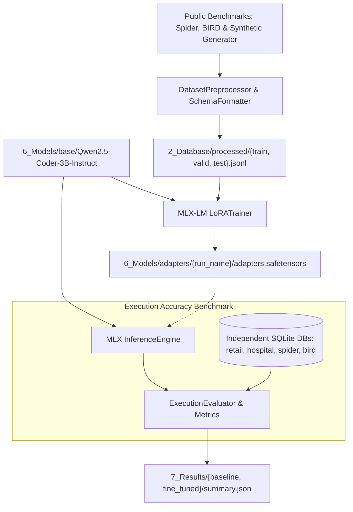

# Architecture Specification

## 1. System Philosophy

`SQLReportAgentFineTune` is designed as a self-contained, offline-first Text-to-SQL supervised fine-tuning laboratory. It executes natively on Apple Silicon (M-series) unified memory through Apple's MLX and MLX-LM frameworks, completely free of NVIDIA CUDA dependencies.

## 2. Component Separation of Responsibilities

### 2.1 Core Modules (`1_Source/app/core/`)
- `config.py`: Strongly typed configuration schemas via Pydantic v2.
- `logging.py`: Unified dual-output logging (human-readable console streams and timestamped files in `8_Logs/`).

### 2.2 Model Layer (`1_Source/app/models/`)
- `registry.py`: Model catalog tracking parameter counts, architecture family, quantization formats, and context windows. Certified sub-4B target: `Qwen2.5-Coder-3B-Instruct`.
- `downloader.py`: Hugging Face Hub snapshot downloader storing pristine base weights under `6_Models/base/`.

### 2.3 Database Sandbox (`1_Source/app/database/`)
- `sqlite_executor.py`: Isolated SQLite runtime with C-authorizer callbacks denying any mutation (`INSERT`, `UPDATE`, `DELETE`, `DROP`). Includes time-budgeted progress handler interrupts.
- `schema_manager.py`: Automated DDL inspection, table column types, and foreign-key link discovery.

### 2.4 Dataset Processing (`1_Source/app/datasets/`)
- `synthetic.py`: Domain-specific relational databases and complex query generators focusing on multi-table joins (2-way, 3-way, 4-way), aggregations, date functions, and NULL edge-cases.
- `spider.py` & `bird.py`: Public benchmark ingestors with local SQLite sandboxes.
- `preprocessor.py`: ChatML prompt assembler formatting training pairs into `messages` arrays.

### 2.5 Training Pipeline (`1_Source/app/training/`)
- `trainer.py`: MLX-LM LoRA training manager with gradient checkpointing, prompt masking, and automated checkpoint tracking.
- `lora_manager.py`: Adapter directory management and weight fusion (`mlx_lm.fuse`) for downstream GGUF or unified model exports.

### 2.6 Evaluation Engine (`1_Source/app/evaluation/`)
- `metrics.py`: Computes Execution Accuracy (EX), Exact Match (EM), and Valid SQL Rate (VSR).
- `execution_eval.py`: Compares predicted query result sets against golden outputs inside independent SQLite instances.
- `comparator.py`: Side-by-side performance delta analysis between baseline and fine-tuned checkpoints.
